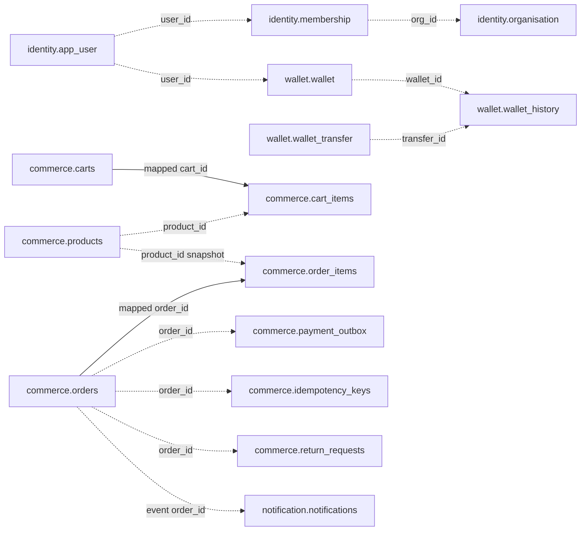

# Implemented database model

Assessed 2026-11-07 from JPA entities/repositories and application properties. **This is a mapping inventory, not a dump of the running MySQL schema.** No personal database or production schema was inspected.

## Ownership and lifecycle

| Service | JDBC schema | Mapped tables |
|---|---|---|
| Identity | identity | app_user, organisation, membership, refresh_token, password_reset_token, email_verification_token, org_invite_token, audit_log |
| Wallet | wallet | wallet, wallet_history, wallet_transfer |
| Commerce | commerce | categories, products, carts, cart_items, orders, order_items, coupons, idempotency_keys, payment_outbox, return_requests |
| Notification | notification | notifications |
| Gateway | None | No JPA persistence |

Local JDBC uses MySQL on 127.0.0.1:3307, createDatabaseIfNotExist=true, shared root credentials; Compose wallet overrides host to mysql:3306. Four business services use ddl-auto=update and open-in-view=false. Tests use separate H2 in-memory schemas in MySQL mode with create-drop. There is no Flyway/Liquibase dependency, SQL migration directory, schema.sql/data.sql baseline, or migration history in the inspected source. Actual database drift is unknown.

wallet-service/scripts/reset-local-db.sql is a destructive local utility that deletes all three wallet tables' rows and resets auto-increment counters with FK checks disabled. It is not a schema migration and was not executed.

All entity primary keys use generated IDENTITY Long values except commerce idempotency_keys, whose string key is the assigned primary key. Enums persist as strings. Most IDs below are scalar Long references, **not ORM associations or declared foreign keys**.

## Identity tables

| Table / entity | Primary key | Principal fields and constraints |
|---|---|---|
| app_user / User | user_id | email VARCHAR255 NOT NULL, unique uk_app_user_email; password_hash VARCHAR100; status VARCHAR20; email_verified; created_at |
| organisation / Org | org_id | name VARCHAR120 NOT NULL; created_at |
| membership / Membership | membership_id | user_id, org_id, role VARCHAR40, status VARCHAR20, created_at; unique (user_id,org_id), uk_membership_user_org |
| refresh_token / RefreshToken | token_id | user_id, token_hash VARCHAR64 unique, expires_at, revoked, created_at |
| password_reset_token / PasswordResetToken | reset_id | user_id, token_hash VARCHAR64 unique, expires_at, used, created_at |
| email_verification_token / EmailVerificationToken | token_id | user_id, token_hash VARCHAR64 unique, expires_at, used, created_at |
| org_invite_token / OrgInviteToken | invite_id | org_id, email VARCHAR255, role VARCHAR40, token_hash VARCHAR64 unique, expires_at, used, created_at |
| audit_log / AuditLog | audit_id | nullable actor_user_id/org_id; action/resource_type VARCHAR64 required; nullable resource_id VARCHAR64/details VARCHAR512; created_at |

User status ACTIVE/DISABLED; membership ACTIVE/INVITED/REMOVED; roles ORG_ADMIN, FINANCE_OPERATOR, MEMBER. Raw action/session tokens are UUID values hashed SHA-256 to 64 hex characters before persistence. BCrypt password hashes are separate from opaque-token hashes.

Relationships user -> memberships -> org, user -> session/action tokens, invite -> org/email, audit -> actor/org are logical scalar references. There are no JPA user/org joins or @Version fields in these entities. Repository methods derive user/email/membership lookups; token cleanup uses explicit JPQL bulk delete, and password reset/change bulk-revokes refresh sessions. Audit listing is orgId/newest first, without pagination.

## Wallet tables

| Table / entity | Primary key | Principal fields and constraints |
|---|---|---|
| wallet / Wallet | wallet_id | user_id unique uk_wallet_user_id; balance DECIMAL(19,2); currency VARCHAR3; status VARCHAR20; version NOT NULL (@Version); created_at |
| wallet_history / WalletHistory | history_id | wallet_id; type VARCHAR20; amount/balance_after DECIMAL(19,2); nullable from_wallet_id/to_wallet_id/transfer_id; nullable idempotency_key VARCHAR100 unique uk_wallet_history_idempotency_key; created_at |
| wallet_transfer / WalletTransfer | transfer_id | idempotency_key VARCHAR100 NOT NULL unique uk_wallet_transfer_idempotency_key; from_wallet_id/to_wallet_id; amount/from_balance_after/to_balance_after DECIMAL(19,2); created_at |

One wallet per **user**, not per org/currency. No organisation column exists. History is a movement statement: DEPOSIT/WITHDRAW rows have idempotency key, no transfer fields; SENT/RECEIVED rows have both wallet IDs/transfer ID and null idempotency key. A transfer creates one business record and two history legs in the same local transaction.

Wallet status ACTIVE/BLOCKED/CLOSED; entity enforces active movement, sufficient balance and zero balance to close. Balance is materialized and updated with history, not computed by SUM. This is not a debit/credit account chart or full double-entry ledger. All wallet/user/transfer references here are scalar IDs with no declared ORM FK. Unique nullable history keys allow multiple transfer legs without keys. Sequential idempotency is tested; replay scope and race limitations are in R2/R11 of PROJECT_STATUS.

## Commerce tables

| Table / entity | Primary key | Principal fields and constraints |
|---|---|---|
| categories / Category | category_id | organisation_id, name VARCHAR120, slug VARCHAR140; unique (organisation_id,slug), uk_category_org_slug |
| products / Product | product_id | organisation_id, nullable category_id; name VARCHAR200; unit_price DECIMAL(19,4); available_quantity; status VARCHAR20; version (@Version) |
| carts / Cart | cart_id | customer_user_id, organisation_id, updated_at, version (@Version); unique (customer_user_id,organisation_id), uk_cart_user_org |
| cart_items / CartItem | cart_item_id | cart_id NOT NULL @ManyToOne LAZY; product_id scalar; quantity; unique (cart_id,product_id), uk_cart_item_product |
| orders / CommerceOrder | order_id | organisation_id, customer_user_id; order_number VARCHAR40 unique; status VARCHAR30; total_amount/discount_amount DECIMAL(19,4); currency_code VARCHAR3; nullable coupon_code VARCHAR40/payment_wallet_id/payment_transaction_id; embedded shipping fields; created_at |
| order_items / OrderItem | order_item_id | order_id NOT NULL @ManyToOne LAZY; product_id scalar; product_name_snapshot VARCHAR200; unit_price_snapshot DECIMAL(19,4); quantity |
| coupons / Coupon | coupon_id | organisation_id, code VARCHAR40; percent_off DECIMAL(5,2); active; nullable expires_at; unique (organisation_id,code), uk_coupon_org_code |
| idempotency_keys / IdempotencyRecord | idempotency_key VARCHAR100 | organisation_id, order_id; key is globally unique PK, no request fingerprint/customer column |
| payment_outbox / PaymentOutbox | id (default column name) | order_id unique; status VARCHAR20; attempts; nullable last_error VARCHAR500/sandbox_hint VARCHAR20; created_at, updated_at |
| return_requests / ReturnRequest | return_id | order_id, customer_user_id; reason VARCHAR500; status VARCHAR30; created_at; no one-return-per-order unique constraint |

Embedded address columns in orders: ship_line1/ship_line2 VARCHAR200, ship_city/ship_state VARCHAR100, ship_postal_code VARCHAR20, ship_country VARCHAR2; no separate address table. Fields nullable in mapping, direct order address optional; checkout DTO requires it.

Product status ACTIVE/INACTIVE; no exposed status-change endpoint. Stock hold is represented by decrementing available_quantity and order status/items; there is no separate reservation table. Quantity release increments stock. Absolute stock update is exposed by product PATCH.

Order states: CREATED, PENDING_PAYMENT, CONFIRMED, PAYMENT_FAILED, ACTION_REQUIRED, CANCELLED, EXPIRED, FULFILMENT_PENDING, FULFILLED. CommerceOrder.transitionTo does not validate a state graph; service methods apply selected guards. No order @Version exists. Order number uses ORD- plus eight UUID characters; DB unique constraint is the collision backstop, not an allocation/retry scheme.

Payment work states: PENDING/PROCESSING/DONE/FAILED. Written atomically with placement, updated by synchronous settlement; not a domain-event outbox. Return states REQUESTED/APPROVED/COMPLETED/REJECTED; entity methods guard sequential transitions, but there is no version, return-item model or order-level completion state.

Cart.items and CommerceOrder.items have @OneToMany(mappedBy), cascade ALL, orphanRemoval=true. CartItem.cart and OrderItem.order are the **only mapped entity relationships** found. Product.categoryId, line product IDs, return/order, payment-work/order and idempotency/order are scalar references; do not infer FK constraints from their names.

## Notification table

| Table / entity | Primary key | Principal fields and constraints |
|---|---|---|
| notifications / NotificationRecord | notification_id | customer_user_id, order_id; nullable order_number VARCHAR40; event_type VARCHAR40; subject VARCHAR200; body VARCHAR1000; status VARCHAR20; created_at; unique (event_type,order_id), uk_notification_event_order |

NotificationRecord initializes SENT before log-channel invocation. SKIPPED_DUPLICATE exists in enum but duplicate processing returns null without persisting a duplicate row. organisationId is present on consumed event but not persisted in this entity. Inbox ownership is user ID. No FK to commerce/identity, delivery attempts, provider receipt, read flag or retry schedule is stored.

## Relationship map

Solid edges denote JPA associations; dotted edges denote logical references only. Cross-service IDs are exchanged via JWT/HTTP/events; no distributed SQL transaction exists.

## Integrity, queries and unresolved choices

- Explicit mapping uniqueness is documented above; no explicit nonunique @Index declarations were found. Actual DB-generated indexes/constraints and MySQL collation are unverified.
- Product search uses JpaSpecificationExecutor with org/name/category predicates and Pageable. Other lists (wallet history, org members/audit, orders, notifications) and expiry/cart maintenance fetch full result lists.
- Wallet/product/cart optimistic versions exist; order/return/payment-work/membership/token rows have no corresponding concurrency guards.
- Service validation supplies many invariants; this document does not assert DB CHECK constraints or physical FKs not declared by mappings.
- Commerce scale 4 versus wallet scale 2 and HTTP amount cap need one approved money contract. Currency conversion is absent; commerce creates INR orders.
- Migration baseline, collation/case uniqueness, retention/indexes, key-scope uniqueness, refund/recovery fields and deletion policy need discussion before schema changes. Do not generate a production migration from this document without inspecting existing data/schema.
