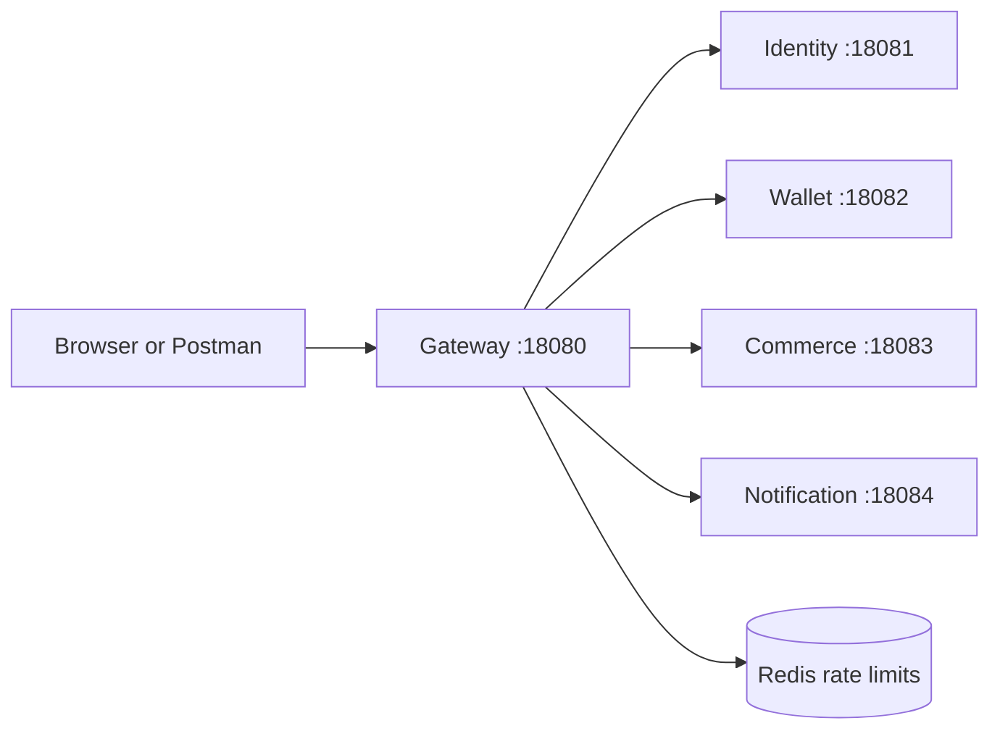
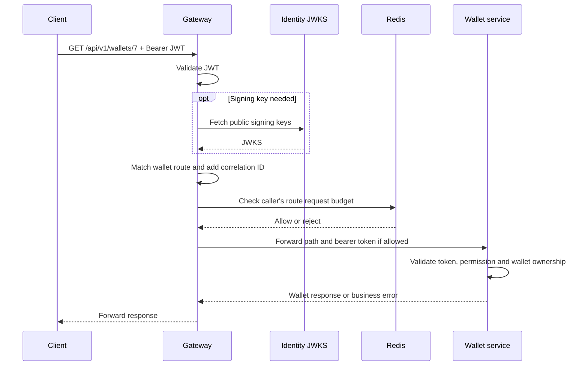

# FinFlow API Gateway: how it works

This guide explains the existing gateway in simple English. Pending production-readiness improvements are marked as proposals; shared retry configuration, Java readability changes and the unused-binding cleanup below are implemented.

Current assessment: useful for local development and learning, **not ready for public production deployment**. Read the [detailed review](../docs/GATEWAY_REVIEW.md) for file-by-file findings and dated verification. This README reuses that review; writing it did not rerun the application or tests.

## A short explanation for interviews

> "FinFlow's API gateway is the entry point for four backend services. It uses Spring Cloud Gateway with WebFlux. Spring Security validates access JWTs using identity-service's public JWKS. Path-based routes forward requests to the right service. Shared filters apply request-size checks and Redis rate limits; each service has a circuit breaker and GET-only retries. The business services still enforce permissions, ownership and transactions."

Use a wallet example to explain the flow:

```text
GET /api/v1/wallets/7 + Bearer token
  -> Gateway authenticates the token
  -> Wallet path matches wallet.uri
  -> Route filters add a correlation ID and check traffic limits
  -> Circuit breaker wraps GET retries and forwarding
  -> Wallet verifies permission + ownership and returns the result
```

An interview answer should describe both the implementation and its limits. Redis currently fails open, the size filter checks declared Content-Length rather than fully bounding streamed bytes, and management access still needs hardening. This gateway is a working foundation, not a fully verified production deployment.

### How to read the YAML

The file now has four clear sections. The long key `spring.cloud.gateway.server.webflux` is written on one line to keep indentation shallow; it represents the same Spring property hierarchy as separate nested keys. This is the current WebFlux prefix, replacing the legacy `spring.cloud.gateway` prefix in the preceding edit. Actual loaded settings were compared before and after.

| Section | Plain-English meaning |
|---|---|
| `x-shared-filters: &getRetry` | Define the GET retry template once. This top-level YAML helper is not itself a Spring route or an executing filter. |
| `default-filters` | Add these filters to every matched route. |
| `httpclient` | Set how long the gateway waits to connect and receive responses. Values come from application.properties. |
| `routes` | Select a destination by request path, then configure that route's fallback/retry behavior. |
| `resilience4j` | Configure each downstream's breaker and operation time limit. |

`&getRetry` means "name this configuration"; `*getRetry` means "reuse it here." All six routes reuse the template. It does not create another retry layer. `args` is a normal expanded key/value block, so each setting can be read on its own line.

Read a route as five questions:

1. `id`: what do we call this rule?
2. `uri`: which backend receives the request?
3. `predicates`: which request path selects it?
4. `CircuitBreaker`: which service's failure tracker and fallback apply?
5. `*getRetry`: may this GET operation be attempted again?

The two `/users` routes need separate destinations: `/users/me` belongs to identity; `/users/{userId}/wallet` belongs to wallet. Route order and filter order are preserved. CircuitBreaker stays before Retry because it wraps the downstream retry operation. Retry remains outside default-filters to preserve that order.

### Explain the Java without memorising every line

Read the source in this order:

1. `ApiGatewayApplication`: starts Spring Boot and discovers components.
2. `SecurityConfig`: chooses public/protected paths, validates JWTs and formats security failures.
3. `GatewayConfig` + `GatewayProperties`: turn configured CORS/rate settings into typed objects and a browser CORS filter. HTTP route definitions stay in YAML. Properties accessors use Lombok; other gateway beans stay explicit unless they only need a constructor or logger.
4. `RateLimitConfig`: choose the authenticated subject, otherwise the socket IP, as the traffic-budget key.
5. `CorrelationIdFilter` + `AccessLogFilter`: forward a request ID and log downstream attempts.
6. `FallbackController` + `GlobalErrorConfig`: return a local 503 fallback or format otherwise-unhandled gateway errors. They do not rewrite every business-service response.

The Java classes already have narrow responsibilities after the previous cleanup. No new controllers, routing DSL, generic managers or shared response framework were introduced for this readability task. Framework callbacks such as `filter`, bean methods and `handle` are invoked by Spring even without a direct Java caller. `Mono` represents asynchronous completion/result; our filters return the chain rather than blocking it.

### Common follow-up questions

- **Why a gateway?** One client-facing address and a common place for authentication and traffic policy.
- **Why JWT and JWKS?** Identity keeps the private signing key; gateway uses its public key. Cached key lookup avoids a login call for every request.
- **Why still secure wallet-service?** A valid identity does not prove ownership of wallet 7; wallet owns that authorization rule.
- **Why not retry POST?** Repeating a money/auth write can repeat side effects. Idempotency and reconciliation belong to the business workflow.
- **Does every HTTP 500 open the breaker?** No. Current breaker configuration does not explicitly register HTTP status codes as failures; exceptions/timeouts and retries must be explained separately.
- **What happens after failure?** Configured breaker failures can forward to the service's JSON 503 fallback. That does not prove a timed-out payment never committed.
- **What would you improve next?** Management access control, streaming limits, nested validation and explicit retry/Redis/breaker policies, with HTTP/integration tests.

Readability verification: parsed retry/gateway/resilience values stayed equal after accounting for the prefix change. Before/after local startup snapshots and bound CircuitBreaker/Retry/RequestSize objects were equivalent; legacy migration only changed argument-key casing. Fresh Java21 `mvn -B -o verify` passed 15 tests and repackaged the JAR. These checks did not rerun live downstream/Redis scenarios. Property reference: [Spring Cloud Gateway 4.3 application properties](https://docs.spring.io/spring-cloud-gateway/reference/4.3/appendix.html).

## 1. What is the gateway?

The gateway is the public entry point for FinFlow APIs. A client can use one address instead of knowing each service's port.

For example:

```text
Client sends:
GET http://localhost:18080/api/v1/wallets/7

Gateway forwards to:
GET http://localhost:18082/api/v1/wallets/7
```

The gateway checks whether a protected request has an acceptable access token, applies its configured traffic controls, chooses the destination, and forwards the response.

Wallet-service still checks whether wallet 7 belongs to the caller. The gateway does not read wallet tables or decide whether a transfer has enough money.



Gateway responsibilities: access-token authentication, routing, traffic controls, resilience and request visibility.

Business-service responsibilities: business permissions, ownership, organisation access, input/domain validation, database transactions and business rules.

## 2. Understand the important words

| Term | Meaning in this project | Why it helps |
|---|---|---|
| Route | A path rule selecting a downstream service | Wallet requests reach wallet-service |
| Predicate | The condition that selects a route | Path=/api/v1/wallets/** matches wallet paths |
| Filter | A step around forwarding a request | Reject large requests, rate-limit, retry or log |
| JWT | Signed access token sent in Authorization: Bearer ... | Establishes caller identity without checking a password on each API call |
| JWKS | Identity's public signing keys | Gateway verifies signatures without holding identity's private key |
| Authentication | Is this token acceptable, and who does it represent? | Blocks missing/invalid tokens on protected APIs |
| Authorization | Is this caller allowed to do this operation on this resource? | Wallet-service rejects access to another user's wallet |
| Rate limit | A budget of requests over time | Reduces excessive traffic when the limiter is available |
| Retry | Try a failed request again | Can recover from a short interruption, but also adds load |
| Circuit breaker | Temporarily stop calling a dependency after configured failures | Gives an unhealthy dependency time to recover |
| Timeout | Stop waiting after a deadline | Prevents requests from waiting indefinitely |
| Correlation ID | An identifier shared by logs for a request | Helps follow a request across components |
| CORS | Browser rules about which website may read an API response | Supports approved frontend applications; does not replace authentication |

## 3. A protected wallet request, step by step

Assume the client already has an access JWT from identity-service.



1. **Receive:** Netty/WebFlux accepts the HTTP request at port 18080.
2. **Authenticate:** Spring Security checks protected /api/v1 paths. Missing/malformed tokens return 401 before gateway route filters run. Signature/timestamp handling uses Spring Security's JWT decoder; issuer/audience policy remains a review gap.
3. **Find the route:** The wallet path selects wallet.uri, currently localhost:18082. The original API path is preserved.
4. **Run route filters:** Add/propagate a correlation ID, apply response-header deduplication, request-size checks and Redis rate limiting.
5. **Protect the downstream call:** CircuitBreaker wraps Retry and downstream forwarding. A normal call is forwarded once; eligible GET failures can trigger additional attempts.
6. **Let wallet-service decide access:** The bearer token is forwarded. Wallet checks wallets:read and whether the wallet belongs to the user.
7. **Return:** Gateway forwards the service response. Its logging currently runs per downstream attempt, not as a complete final client-request log.

JWKS uses key caching; this is not an identity HTTP call for every normal request. The gateway does not call identity's login endpoint to validate every token.

### What the current filter order means

```text
HTTP request
  -> Spring Security / application WebFilters
  -> Route selection
  -> CorrelationIdFilter
  -> Default route filters: header dedupe, size, rate limit
  -> Route CircuitBreaker
  -> Route Retry
  -> AccessLogFilter and downstream HTTP routing
  -> Response
```

This is a simplified view of our custom/configured steps. Spring also supplies internal filters, and response work runs back through the chain.

**Important:** Spring Cloud Gateway GlobalFilter means global to matched gateway routes. It does not mean every request to the application. Authentication rejections, local Actuator endpoints and unmatched paths can skip these filters. That is why current 401 responses have no gateway correlation ID.

## 4. Login has a different flow

```text
Client POST /api/v1/auth/login
  -> Gateway permits this public auth endpoint without an access JWT
  -> Route traffic controls
  -> Identity checks credentials and email verification
  -> Identity issues access JWT + refresh token
  -> Gateway forwards the result
```

Public means no access JWT is required for this endpoint. Identity still validates the request and credentials. The gateway does not create tokens or store passwords.

When the client later calls a protected endpoint, it sends the access JWT in the Authorization header. A refresh token is used with identity's refresh endpoint; it is not the normal bearer access token.

## 5. Where does each request go?

All example API paths below include /api/v1.

| Path | Destination |
|---|---|
| /users/me | identity-service |
| /auth/**, /orgs/** | identity-service |
| /.well-known/jwks.json (absolute path, no /api/v1 prefix) | identity-service |
| /users/{userId}/wallet | wallet-service |
| /wallets/**, /transfers/** | wallet-service |
| /products/**, /categories/**, /carts/**, /coupons/**, /orders/**, /returns/** | commerce-service |
| /notifications/** | notification-service |

Actuator and fallback endpoints are served locally by the gateway application; they are not business-service routes.

For a checkout, the client calls commerce through the gateway. Commerce then calls wallet-service directly through WalletPaymentAdapter. The gateway does not coordinate the order, reserve stock or charge the wallet.

## 6. Read the implementation in this order

Java links are under src/main/java/com/finflow/apigateway.

| File | Read it to answer |
|---|---|
| [application.yml](src/main/resources/application.yml) | Which paths go where? Which route filters run? |
| [application.properties](src/main/resources/application.properties) | What ports, URLs, limits, CORS and management settings are configured? |
| [SecurityConfig.java](src/main/java/com/finflow/apigateway/security/SecurityConfig.java) | Which endpoints are public? How is JWT authentication configured? |
| [GatewayProperties.java](src/main/java/com/finflow/apigateway/config/GatewayProperties.java) | How do app.* settings become typed Java objects? |
| [GatewayConfig.java](src/main/java/com/finflow/apigateway/config/GatewayConfig.java) | How are browser CORS rules created? |
| [RateLimitConfig.java](src/main/java/com/finflow/apigateway/ratelimit/RateLimitConfig.java) | Which user/IP key and token bucket does Redis use? |
| [CorrelationIdFilter.java](src/main/java/com/finflow/apigateway/filter/CorrelationIdFilter.java) | How is a request ID added and forwarded? |
| [AccessLogFilter.java](src/main/java/com/finflow/apigateway/filter/AccessLogFilter.java) | Which request details are logged, and when? |
| [FallbackController.java](src/main/java/com/finflow/apigateway/fallback/FallbackController.java) | What 503 response can a circuit-breaker fallback produce? |
| [GlobalErrorConfig.java](src/main/java/com/finflow/apigateway/error/GlobalErrorConfig.java) | How are unhandled gateway exceptions mapped to JSON? |
| [ApiGatewayApplication.java](src/main/java/com/finflow/apigateway/ApiGatewayApplication.java) | Where does Spring Boot start? |
| [ApiGatewayApplicationTests.java](src/test/java/com/finflow/apigateway/ApiGatewayApplicationTests.java) | What does the existing automated test actually check? |
| [GlobalErrorConfigTest.java](src/test/java/com/finflow/apigateway/error/GlobalErrorConfigTest.java) | Which error statuses, JSON responses and committed-response behavior are covered? |
| [RateLimitConfigTest.java](src/test/java/com/finflow/apigateway/ratelimit/RateLimitConfigTest.java) | How are authenticated, anonymous and missing-address rate-limit keys checked? |

The bootstrap class starts the application. Most gateway behavior comes from Spring's built-in filters plus configuration, not custom controllers/services.

### Read a reactive filter without overcomplicating it

The core forwarding operation is:

```java
return chain.filter(exchange);
```

- exchange contains the current request, response and request attributes.
- chain is the remaining filter steps.
- Mono<Void> represents asynchronous completion; it is not the response body.
- Code can prepare/mutate the exchange before forwarding, and attach completion/error callbacks to observe the result.

Avoid .block(), Thread.sleep(), JDBC or blocking HTTP calls in these filters: they occupy threads that are supposed to keep serving other requests while network work is pending.

A completion callback is not automatically a whole-request log. In our current ordering, Retry can execute AccessLogFilter several times.

## 7. What happens when something goes wrong?

| Situation | Current behavior / important limitation |
|---|---|
| Missing or malformed JWT on a protected API | 401 JSON; missing correlation/CORS coverage was reproduced |
| Caller lacks wallet permission or owns a different wallet | Wallet-service enforces this; gateway is not the sole authorization boundary |
| Fixed-length body larger than configured 1 MB | 413; review observed an empty body |
| Chunked body larger than 1 MB | Current size filter does not enforce streamed byte totals; review's 2 MiB mock request reached the backend |
| Redis unavailable | Framework limiter allows traffic; choose an explicit production failure policy |
| Eligible GET returns HTTP500 | Review observed three backend attempts, because default retry series still includes 5xx |
| Downstream connection/timeout or open circuit | Can go to 503 fallback; full breaker lifecycle still needs tests |
| Downstream returns a business error | Normally forwarded; GlobalErrorConfig does not rewrite every downstream response |
| Unknown path | 404 in the probe; the current security catch-all nevertheless permits unmatched mappings |
| /actuator/metrics or /actuator/prometheus | Accessible anonymously in the review |
| /actuator/gateway/routes | 404 in the review; the route-administration endpoint is disabled by default |

A timeout does not prove a money operation failed. Wallet may commit a debit before its response is lost. Keep stable idempotency/reconciliation in the owning services; do not add automatic retries to POST payments/transfers.

## 8. How can we keep the code simpler?

**Small simplification implemented:** application.yml defines retry settings once in the top-level `x-shared-filters` YAML helper with the anchor `&getRetry`. All six routes use `*getRetry`, which means "reuse that same configuration here." Each reference stays after its route's CircuitBreaker. The prefix is written as one dotted key, and route/resilience arguments use readable expanded blocks. The parsed configuration was compared with the original using the packaged SnakeYAML parser and was identical; Maven verify also passed with the existing context-load test. This removes five duplicate blocks without introducing Java classes or changing retry policy.

**Java readability changes implemented:** error handling now separates JSON writing from response classification, with a switch for status-to-code mapping. The rate-limit resolver reads as "authenticated subject, otherwise peer IP"; the address lookup is a short helper. CORS settings have one local name instead of repeated chained getters. Comments explain route-only filter scope, retry-attempt logs, request mutation and the difference between 401/403. These are small internal refactors, not changes to security or traffic policy.

Verification after the Java changes: `mvn -B -o verify` passed with 15 tests (one context load, 11 error-handler cases and three rate-limit key cases). These tests cover response/key behavior, not live identity/Redis integration or production load.

**Unused-code audit completed:** all 28 tracked gateway files were checked for code/configuration/framework/build/manual use. Removed the unconsumed maxBodyBytes field/accessors/property and the unused typed Http object/accessors; the active app.http.* timeout properties remain referenced directly by YAML. Removed spring-security-test because none of the three current test classes uses its helpers. All nine application classes, routes, runtime dependencies, wrappers, Docker files and Postman fixtures were retained. Files without direct Java callers can still be framework entry points.

Fresh Java 21 `mvn -B -o verify` passed all 15 tests and packaged the executable JAR. Before/after temporary gateway startup snapshots matched for routes/filter order/default filters, HTTP timeouts, rate settings and CORS; all nine application classes resolved as beans. No live Redis/downstream, Docker or wrapper-download testing was performed. The [file-by-file cleanup inventory](../docs/GATEWAY_REVIEW.md#cleanup-audit---2026-11-07) records every retained file and remaining limits. A future test that uses Spring Security test helpers would need to restore the test-only dependency deliberately.

The remaining ideas below are **proposals**, not production fixes already made.

1. **Keep routing declarative.** Path-to-service mappings belong in application.yml. Do not replace simple routes with custom controllers that manually call every service.
2. **Give each component one job.** Security rules in SecurityConfig, typed settings in GatewayProperties, traffic-key policy in RateLimitConfig. Keep wallet/order rules in their services.
3. **Use one authoritative setting per behavior.** The unused app.max-body-bytes property was removed. The active RequestSize limit remains 1MB in application.yml; a future streaming-limit task should introduce one setting connected to actual enforcement.
4. **Put request-wide concerns at the right layer.** An early WebFilter can establish a bounded correlation ID before security; final-request logging should account for success, error and cancellation. Keep attempt logs separate.
5. **Keep errors consistent without rewriting everything.** Share a small edge error shape/helper where useful; preserve downstream business responses. Avoid a large generic response framework.
6. **Preserve filter order when sharing configuration.** The implemented YAML anchor reuses retry settings in place. Moving Retry into default-filters could instead change its order relative to CircuitBreaker, so less YAML is not automatically safer. Future behavior changes need targeted regression tests.
7. **Prefer clear binding and tests over extra abstraction.** Cascade @Valid into nested settings and fail fast for invalid values. Avoid adding managers/factories/base classes just to hide a few lines.
8. **Do not add infrastructure without a demonstrated need.** A gateway database, Kafka, Eureka, caching, API aggregation or a common starter is not required to fix the identified gaps.

A simpler gateway means fewer responsibilities and predictable behavior, not moving every concern into one large class.

## 9. A practical path to production readiness

Each row is a separate proposed task. Significant implementation should follow a short concrete proposal and approval.

| Order | Task | Evidence we should require |
|---|---|---|
| 1 | Define public versus private management access and deny unintended mappings | Tests for public health, protected metrics, insufficient privileges and unknown paths |
| 2 | Enforce one bounded request-size policy, including streaming bodies | Boundary tests for fixed/chunked/unknown lengths, safe cancellation and no unbounded buffering |
| 3 | Fix nested property validation and browser/security/correlation ordering | Invalid-config startup tests; readable browser 401/403 with consistent IDs |
| 4 | Make retries, breaker HTTP failures and Redis failure policy explicit | Controlled-backend/Redis tests for attempts, deadlines, rate limits and breaker recovery; no POST retries |
| 5 | Agree stronger JWT trust/key lifecycle with identity-service | Valid/expired/wrong-signature/issuer/audience tests and key rotation/restart behavior |
| 6 | Prepare the actual deployment and supported version baseline | Approved dependency updates/scans; TLS/proxy trust; private backend/metrics access; resource/connection budgets; probes/shutdown and alerts |
| 7 | Establish repeatable CI and load/failure verification | Security/route/contract regressions and realistic latency/error/load evidence |

Issuer/audience rules cannot be added blindly: current identity tokens need a compatible contract. Similarly, first-party frontend origins, metrics access and Redis failure policy require actual deployment requirements.

Use the [review](../docs/GATEWAY_REVIEW.md) for full evidence and official Spring references. The [project status](../PROJECT_STATUS.md) records the active task and remaining blockers.

## 10. Local build and learning checks

Requires Java 21. On this workstation the default shell may still select Java 8; check java -version and mvn -version first. The repository's [finflow-env.sh](../finflow-env.sh) shows the installed Java 21 setup.

From api-gateway:

```powershell
mvn -B verify
mvn spring-boot:run
```

Run these as separate actions: verification builds/tests; spring-boot:run starts the gateway. Other service/Redis availability is needed for real routed flows; startup alone does not prove those dependencies work. Do not start or reset infrastructure merely to read this guide.

The original review ran only one context-load test. The subsequent Java readability task added 14 focused error/key regression cases and passed all 15 tests with Maven verify. Full HTTP security, live Redis/JWT integration and failure/load coverage are still pending. The original review's HTTP probes were temporary observations, not a committed regression suite.

Manual request example, after obtaining a real access token and an owned wallet ID:

```http
GET http://localhost:18080/api/v1/wallets/7
Authorization: Bearer <access-token>
```

Use [Postman instructions](postman/README.md) for the slim gateway collection: **01 Gateway checks** (edge only) and **02 Identity via Gateway** (Auth + Organisations on `gatewayBaseUrl`). No fixture toggles. Wallet/commerce/notification stay in their service collections; the identity-service collection is untouched. Do not paste real tokens into documentation or commit them.

For a later session, you can simply say: "Explain the wallet request flow", "Show me how the rate limiter works" or "Let's implement the first gateway production-readiness task."
