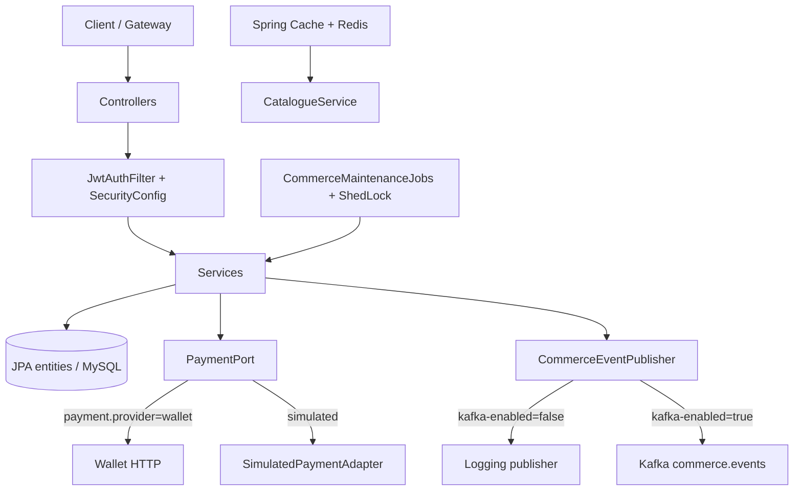
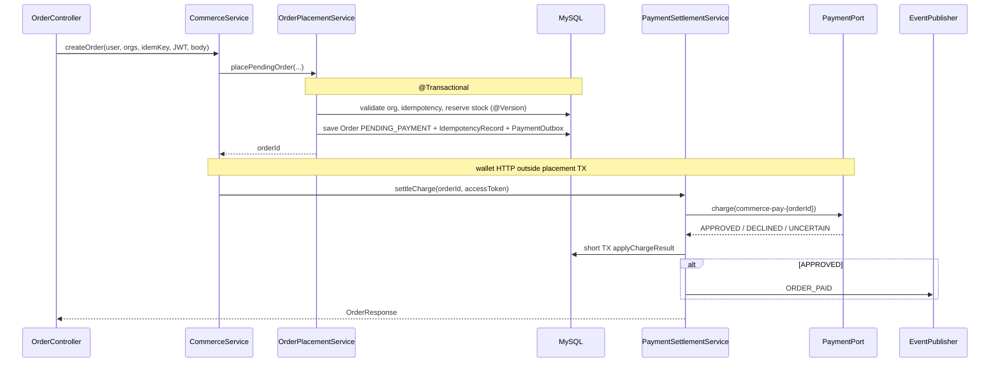

# Commerce Service — Architecture & API Lifecycle

**Scope:** `commerce-service` as implemented in this FinFlow workspace (Java 21, Spring Boot 3.5.6).  
**Assessment basis:** Source inspection + CodeGraph (2026-11-09). Not a claim of production certification. Runtime/tests were not executed in this audit pass.  
**Related docs:** [docs/ARCHITECTURE.md](../docs/ARCHITECTURE.md), [docs/SERVICE_DEPENDENCIES.md](../docs/SERVICE_DEPENDENCIES.md), [docs/commerce-service-13-class-retrospective.md](docs/commerce-service-13-class-retrospective.md).

---

## 1. Domain boundary

Commerce owns **catalogue, carts, coupons, orders, stock reservation, payment orchestration intent, returns, and commerce domain events**.

| Owns | Does not own |
|------|----------------|
| Products, categories, stock quantity | User identity / JWT issuance |
| Carts, coupons, orders, order items | Wallet balances / ledger |
| Payment outbox rows (local intent) | Cross-service 2PC |
| Return requests | Notification delivery |
| Optional Kafka publish of order events | Shared DB with wallet/identity |

**Money movement** goes through `PaymentPort` → `WalletPaymentAdapter` (HTTP + caller JWT) or `SimulatedPaymentAdapter` (tests/local).

**Port:** `18083` · **Schema:** MySQL `commerce` · **Auth:** RS256 JWT verified via Identity JWKS · **Permissions:** `commerce:read` / `commerce:write`.

---

## 2. High-level runtime view



---

## 3. Package map (current = package-by-layer)

```
com.finflow.commerce
├── controller/     HTTP adapters
├── service/        use-case orchestration
├── entity/         JPA aggregate roots + value types
├── repository/     Spring Data
├── dto/            request/response records
├── payment/        PaymentPort + adapters
├── event/          publisher SPI + Kafka/logging impls
├── security/       JWT filter, JWKS cache, SecurityConfig
├── config/         cache, ShedLock, transactions, payment RestClient
├── job/            scheduled maintenance entrypoints
├── mapper/         product mapping helpers
└── exception/      ApiException + advice
```

### Recommended evolution (package-by-feature, incremental)

Do **not** big-bang rename. Prefer extracting modules when a vertical grows:

| Feature package | Move first |
|-----------------|------------|
| `catalogue` | Product/Category controller+service+entity |
| `cart` | Cart* |
| `order` | Order* + Placement + Settlement + Cancel + Expiry |
| `payment` | already isolated port/adapters |
| `returns` | Return* |
| `shared` | security, ApiException, config |

Keep `PaymentPort` as the only wallet seam (AGENTS: do not add a second competing payment path).

---

## 4. Critical API lifecycles

### 4.1 Create order (direct checkout)

**Entry:** `POST /api/v1/orders` + header `Idempotency-Key`  
**Orchestrator:** `CommerceService.createOrder`



**Guarantees that exist today**

- Placement + stock + idempotency + payment_outbox row share one DB transaction.
- Wallet charge is **outside** that transaction (correct boundary).
- Product stock uses `@Version`; conflicts map to retryable API errors in advice.
- Order status changes go through `OrderStatus.canTransitionTo` via `CommerceOrder.transitionTo`.

**Guarantees that do not exist today**

- No worker drains `PaymentOutbox` via `findTop50ByStatus…` (query is unused). Settlement is synchronous after placement / `/pay`.
- Domain Kafka events are fire-and-forget (`KafkaTemplate.send` without ack handling); logging publisher is default.
- No durable **domain-event** outbox for ORDER_PAID / CANCELLED / FULFILLED.

### 4.2 Pay existing order

**Entry:** customer-only pay endpoint → `CommerceService.payOrder` → `settleCharge`  
Allowed statuses: `PENDING_PAYMENT`, `ACTION_REQUIRED`.  
Idempotent wallet key remains `commerce-pay-{orderId}`.

### 4.3 Cancel

**Entry:** `CommerceService.cancelOrder`

1. Org + customer checks; status ∈ `{CREATED, PENDING_PAYMENT, ACTION_REQUIRED, CONFIRMED}`.
2. If `CONFIRMED` → `settleRefund` (HTTP) **then** `OrderCancelService.finalizeCancel` (TX: release stock unless `PAYMENT_FAILED`, status `CANCELLED`, publish `ORDER_CANCELLED`).
3. No persisted refund-outbox bridging “refund succeeded / cancel failed” races.

### 4.4 Fulfilment

- Start: `CONFIRMED` → `FULFILMENT_PENDING`.
- Complete: `FULFILMENT_PENDING` or `CONFIRMED` → `FULFILLED` + `ORDER_FULFILLED` event.

### 4.5 Returns

`ReturnService`: request (FULFILLED only) → approve/reject → complete (refund via `PaymentSettlementService` outside TX, then stock restore + event in short TX).

### 4.6 Maintenance jobs

`CommerceMaintenanceJobs` (ShedLock):

| Job | Default | Effect |
|-----|---------|--------|
| expireReservations | every 60s after previous | Unpaid stale → `EXPIRED`, stock release, outbox mark failed |
| purgeAbandonedCarts | every 5m | Delete carts older than TTL |

ShedLock table is created at LockProvider bean init (`CREATE TABLE IF NOT EXISTS shedlock`).

---

## 5. Consistency & concurrency model

| Concern | Mechanism | Limit |
|---------|-----------|--------|
| Stock | `Product.@Version` + domain `reserveStock`/`releaseStock` | Optimistic only; high contention → retries |
| Cart | `Cart.@Version` | Concurrent cart edits vs checkout still weakly coordinated |
| Checkout idempotency | `IdempotencyRecord` + request hash | Global key namespace; no TTL/cleanup job |
| Wallet charge/refund | HTTP `Idempotency-Key` | Relies on wallet semantics |
| Payment ambiguity | `UNCERTAIN` → `ACTION_REQUIRED`, stock kept | Manual `/pay` or ops; no auto reconciler |
| Multi-instance jobs | ShedLock JDBC | Needs shared DB clock (`usingDbTime`) |
| Order FSM | `OrderStatus.canTransitionTo` | Enforced in entity |

---

## 6. Production-readiness pillars (current vs gap)

### Resiliency

| Present | Missing / weak |
|---------|----------------|
| Resilience4j CB annotation on `WalletPaymentAdapter` | No `@CircuitBreaker` fallback method observed; open breaker behavior depends on R4j defaults |
| Outcome mapping DECLINED vs UNCERTAIN | No explicit RestClient connect/read timeouts in reviewed adapter |
| | No Retry/TimeLimiter/Bulkhead beans configured for wallet |
| | Kafka send ignores completion / no DLT |

### Observability

| Present | Missing / weak |
|---------|----------------|
| Actuator health/info/metrics/prometheus | Health may be DOWN when Redis unavailable (cache) |
| micrometer-tracing-bridge-otel + OTLP deps | Exporter endpoint/sampling not fully proven in props |
| | Structured JSON logging not standardized service-wide |
| | No custom business metrics (orders_confirmed, payment_uncertain) |

### Security

| Present | Missing / weak |
|---------|----------------|
| Stateless JWT + JWKS cache | Prometheus/metrics exposure — confirm edge filtering |
| Method-family permission gates | Org membership is claim-based; JWT permission union limitations apply (see root AGENTS) |
| Caller JWT forwarded to wallet | Staff refund vs wallet ownership remains a known product gap |
| | Secrets in `application.properties` (local root/root) — env-only for real deploys |

### Data / config

| Present | Missing / weak |
|---------|----------------|
| Explicit payment TX split | `ddl-auto=update` unsuitable for production |
| Payment outbox **row** written with order | No outbox **processor**; naming implies pattern that is incomplete |
| | Flyway/Liquibase absent |
| | Fail-fast validation for `wallet.base-url` / JWKS URL incomplete |

---

## 7. Controllers → capabilities

| Controller | Primary flows |
|------------|---------------|
| `ProductController` / `CategoryController` | Catalogue CRUD/list (cached where annotated) |
| `CouponController` | Create coupon |
| `CartController` | Cart mutate + checkout (idempotent) |
| `OrderController` | Create/list/get/pay/cancel/fulfil |
| `ReturnController` | Request/approve/reject/complete |

All `/api/v1/**` require auth + `commerce:read|write` by HTTP method.

---

## 8. Operational runbook (local / learning)

1. Infra: `docker compose up -d` (MySQL `:3307`, Redis `:6379`; Kafka only if events enabled).
2. Start Identity (`18081`) → Wallet (`18082`) → Commerce (`18083`) under **Java 21** (`source finflow-env.sh`).
3. Login → ensure JWT contains org + `commerce:*` (re-login after org create).
4. Set `payment.provider=wallet` (current main props) or `simulated` for offline.
5. If ShedLock errors: confirm `shedlock` table / CREATE privilege (initializer in `ProductionFeaturesConfig`).
6. If Redis down: expect cache/health issues; fix Redis before relying on catalogue cache.
7. Uncertain payments: inspect order `ACTION_REQUIRED`, retry `/pay` with same customer JWT; reconcile wallet side manually if needed.

### Deployment checklist (production target)

- [ ] Replace `ddl-auto=update` with migrations + reviewed schema
- [ ] Provision JWKS URL, wallet base URL, Redis, Kafka via secrets/env
- [ ] Restrict actuator; scrape metrics privately
- [ ] Configure RestClient timeouts + CB fallback + alert on open circuit
- [ ] Implement payment/domain outbox workers **or** rename/document sync-only settlement
- [ ] Define ACTION_REQUIRED reconciliation SLO
- [ ] Multi-instance ShedLock verified against shared MySQL
- [ ] Load-test stock contention and idempotent checkout

---

## 9. Intentionally good patterns (keep)

1. **PaymentPort** seam with conditional adapters — single payment path.
2. **Wallet HTTP outside placement transaction** — avoids holding DB locks during remote I/O.
3. **Order status transition graph** on the enum/entity — not a free-form setter.
4. **Stock and money as domain methods** with `BigDecimal` scale 4 on commerce amounts.
5. **Idempotency-Key** on checkout + stable wallet keys `commerce-pay-*` / `commerce-refund-*`.
6. **ShedLock** for multi-instance maintenance jobs.

---

## 10. Suggested next engineering tasks (priority order)

1. **Critical:** Either implement a payment-outbox drain/reconciler for `PENDING`/`PROCESSING`/`UNCERTAIN`, or document+rename so “outbox” is not mistaken for async reliability.
2. **Critical:** RestClient timeouts + circuit-breaker fallback returning `PaymentResult.uncertain(...)`.
3. **High:** Durable domain-event publishing (outbox or transactional sync with retry) before depending on Kafka consumers.
4. **High:** Refund/cancel compensation state machine (persist refund intent).
5. **Medium:** Idempotency record TTL cleanup; cart-checkout concurrency hardening.
6. **Medium:** Replace startup `CREATE TABLE` / `ddl-auto` with migrations.
7. **Low:** Incremental package-by-feature moves; trim verbose comments when learning goals are met.

---

*Generated for FinFlow learning/audit. Prefer this file for commerce lifecycle; keep root `docs/ARCHITECTURE.md` as the cross-service map.*
