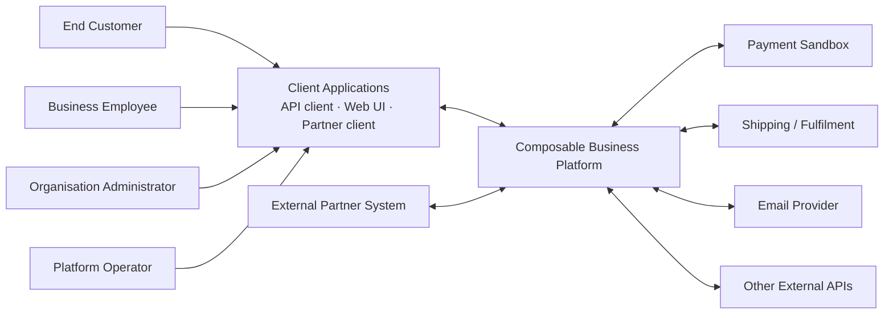
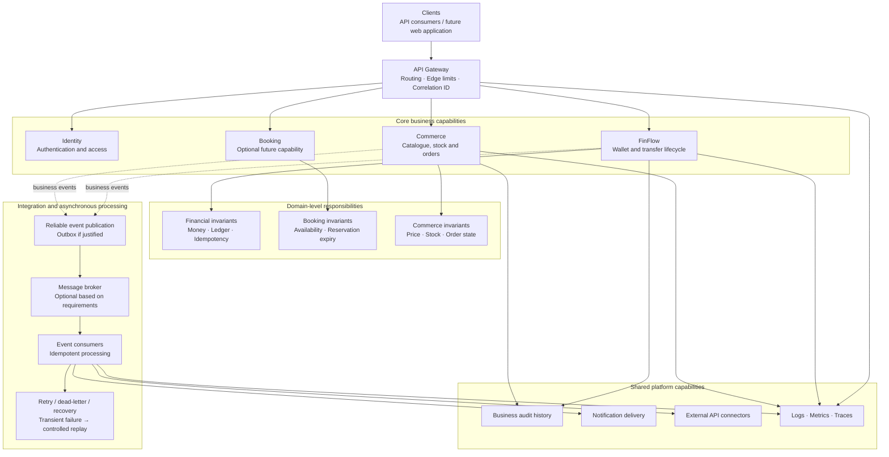
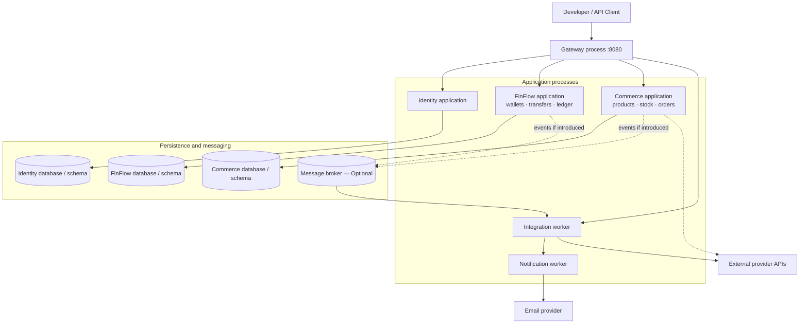
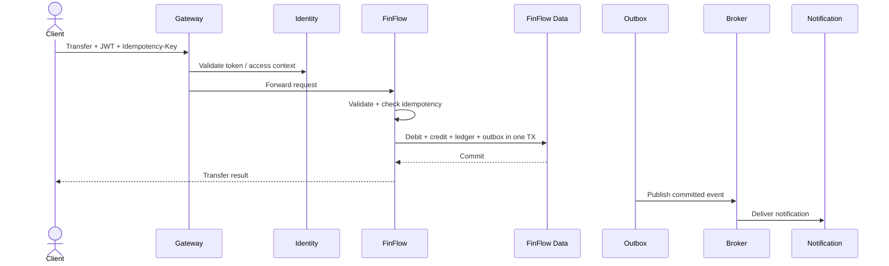
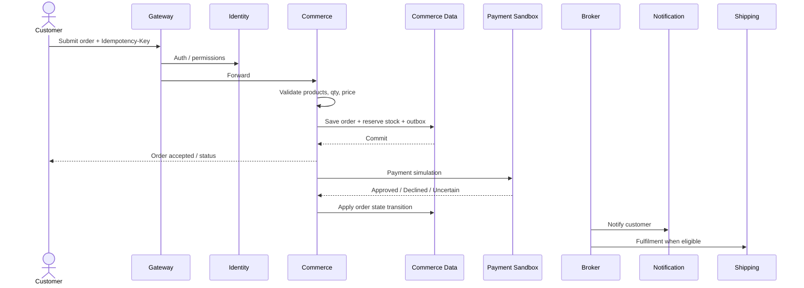

# FinFlow — Complete System Architecture

Composable Business Platform architecture, aligned with the SystemDesign notes and diagrams.

A box is a **responsibility**. It becomes a separate deployable service only when ownership and scaling justify it.

---

## 1. System context

Who uses the platform, and what sits outside it.

---

## 2. Complete platform architecture

Full logical design — same structure as the SystemDesign blueprint and `mermaid-diagram.png`.

```mermaid
flowchart TB

    subgraph USERS["1. Users and External Clients"]
        CUSTOMER[End Customer]
        EMPLOYEE[Business Employee]
        ADMIN[Business Administrator]
        PARTNER[External Partner System]
        OPERATOR[Platform Operator]
    end

    subgraph CLIENTS["2. Client Applications"]
        WEB[Web Application]
        MOBILE[Mobile Application]
        ADMIN_UI[Admin and Operations UI]
        API_CLIENT[API / Partner Client]
    end

    subgraph ENTRY["3. API Entry and Security"]
        GATEWAY[API Gateway\nRouting · Rate limits · Correlation ID]
        IDENTITY[Authentication and Authorisation]
        ORGANISATION[Organisation and Membership]
    end

    subgraph DOMAINS["4. Business Domains"]
        FINFLOW[FinFlow\nWallets · Transfers · Ledger]
        COMMERCE[Commerce\nProducts · Stock · Orders]
        BOOKING[Booking and Subscriptions\nLater if required]
    end

    subgraph SHARED["5. Shared Platform Capabilities"]
        API_CONV[API Contracts and Errors]
        AUDIT[Audit History]
        NOTIFICATION[Notification Delivery]
        CONFIG[Configuration and Secrets]
        IDEMPOTENCY[Idempotency and Duplicate Protection]
        OBS[Logs · Metrics · Tracing · Health]
    end

    subgraph INTEGRATION["6. Integration and Event Processing"]
        OUTBOX[Reliable Event Publication\nOutbox if justified]
        BROKER[Message Broker\nOptional · Kafka]
        CONSUMERS[Event Consumers\nIdempotent processing]
        CONNECTORS[External API Connectors]
        WEBHOOKS[Webhooks]
        RECOVERY[Retry · Dead-letter · Controlled Replay]
    end

    subgraph DATA["7. Domain-Owned Data"]
        IDENTITY_DB[(Identity and Organisation Data)]
        FINFLOW_DB[(FinFlow Data)]
        COMMERCE_DB[(Commerce Data)]
        BOOKING_DB[(Booking Data — Later)]
        OPERATIONS_DB[(Audit and Integration Records)]
    end

    subgraph EXTERNAL["8. External Dependencies"]
        PAYMENT[Payment Sandbox]
        MESSAGING[Email / Notification Provider]
        SHIPPING[Shipping / Fulfilment]
        THIRD_PARTY[Other External APIs]
    end

    subgraph OPERATIONS["9. Engineering and Operations"]
        TESTING[Automated Testing]
        CICD[CI/CD Pipeline]
        SECRETS[Security and Secrets]
        DEPLOY[Docker Compose Local\nCloud / K8s later]
    end

    CUSTOMER --> WEB
    CUSTOMER --> MOBILE
    EMPLOYEE --> WEB
    ADMIN --> ADMIN_UI
    OPERATOR --> ADMIN_UI
    PARTNER --> API_CLIENT

    WEB --> GATEWAY
    MOBILE --> GATEWAY
    ADMIN_UI --> GATEWAY
    API_CLIENT --> GATEWAY

    GATEWAY --> IDENTITY
    IDENTITY --> ORGANISATION
    ORGANISATION --> IDENTITY_DB

    GATEWAY --> FINFLOW
    GATEWAY --> COMMERCE
    GATEWAY -.-> BOOKING

    FINFLOW --> FINFLOW_DB
    COMMERCE --> COMMERCE_DB
    BOOKING -.-> BOOKING_DB

    FINFLOW -.-> API_CONV
    COMMERCE -.-> API_CONV
    FINFLOW -.-> AUDIT
    COMMERCE -.-> AUDIT
    AUDIT --> OPERATIONS_DB

    FINFLOW -.-> IDEMPOTENCY
    COMMERCE -.-> IDEMPOTENCY

    FINFLOW -.-> NOTIFICATION
    COMMERCE -.-> NOTIFICATION
    NOTIFICATION --> MESSAGING

    FINFLOW -.-> OUTBOX
    COMMERCE -.-> OUTBOX
    OUTBOX -.-> BROKER
    BROKER -.-> CONSUMERS
    CONSUMERS -.-> RECOVERY
    RECOVERY --> OPERATIONS_DB
    WEBHOOKS --> OPERATIONS_DB

    CONNECTORS --> PAYMENT
    CONNECTORS --> SHIPPING
    CONNECTORS --> THIRD_PARTY
    COMMERCE -.-> CONNECTORS
    FINFLOW -.-> CONNECTORS

    DOMAINS -.-> OBS
    TESTING --> CICD
    CICD --> DEPLOY
    SECRETS -.-> DEPLOY
```

**How to read it**

| Layer | Role |
|---|---|
| 1–2 Users and clients | Humans and partners use web, mobile, admin, or API clients |
| 3 Entry and security | Gateway + identity + organisation membership |
| 4 Business domains | FinFlow, Commerce, Booking each own their rules |
| 5 Shared capabilities | Cross-cutting: audit, notifications, idempotency, observability |
| 6 Integration | Outbox, broker, consumers, connectors, webhooks, recovery |
| 7 Data | Each domain owns its data — no cross-domain table writes |
| 8 External systems | Payment sandbox, email, shipping, other APIs |
| 9 Engineering | Tests, CI/CD, secrets, local Docker Compose |

Dotted edges = **when introduced / optional**. Booking, broker, and some connectors are not day-one.

---

## 3. Business capabilities and invariants

Same view as `mermaid-diagram (3).png` — what each domain must protect.

| Domain | Owns | Critical invariants |
|---|---|---|
| **Identity** | Users, organisations, memberships, roles | Authn ≠ Authz. Tenant scope on every protected call |
| **FinFlow** | Wallets, transfers, ledger | Decimal money. Ledger nets to zero. Idempotent retries. No silent ledger edit |
| **Commerce** | Products, stock, orders | Price snapshots. Conditional stock update. Order state machine. Uncertain payment ≠ declined |
| **Booking** | Availability, reservations | No double booking. Reservation expiry |

---

## 4. Deployment architecture

Same view as `mermaid-diagram (4).png` — how processes and data sit at runtime.

| Process | Responsibility | Data |
|---|---|---|
| Gateway | Public entry, JWT, routing, rate limit | None |
| Identity application | Register, login, org membership | `identity_db` |
| FinFlow application | Wallet, transfer, ledger | `finflow_db` |
| Commerce application | Catalogue, stock, orders | `commerce_db` |
| Integration worker | Connectors, webhook delivery, recovery | Integration / outbox records |
| Notification worker | Deliver notifications from events | Notification records |
| Message broker | Optional async bus | Topics (e.g. `transaction.completed`, `order.confirmed`) |

FinFlow in this deployment is the **wallet + transfer + ledger** capability. In the current repository that maps primarily to `wallet-service` + `transaction-service` behaviour — whether those stay as two processes or one FinFlow process is a later service-depth decision.

---

## 5. Core request flows

### 5.1 FinFlow transfer

### 5.2 Commerce order

---

## 6. Shared capabilities — what they do

| Capability | What it guarantees |
|---|---|
| Authentication | Who is calling |
| Authorisation | What that identity may do |
| Organisation membership | Tenant / business boundary |
| API Gateway | One entry, routing, edge limits, correlation ID |
| Idempotency | Same key → same business effect once |
| Audit history | Durable record of important business actions |
| Notifications | Delivery after commit — failure must not undo money/order |
| Outbox | Business write + event write in one local TX |
| Retry / DLQ / replay | Transient failure recovery without silent loss |
| Observability | Logs, metrics, traces, health for every critical path |
| CI/CD + tests | Change is verified before it reaches an environment |

A shared capability is **not automatically a microservice**. Identity is usually a service. API conventions and idempotency helpers can be libraries. Notification may start as a worker.

---

## 7. Technology baseline

| Area | Direction |
|---|---|
| Language | Java 21 |
| Framework | Spring Boot 3.5.x |
| APIs | REST |
| Persistence | MySQL 8 + Spring Data JPA · Flyway for schema |
| Messaging | Kafka when a real consumer exists |
| Cache | Redis only when measured need exists |
| Security | Spring Security · JWT |
| Local runtime | Docker Compose |
| Observability | Actuator → OpenTelemetry / Prometheus later |
| Tests | JUnit 5 · Testcontainers · API / contract / concurrency tests |

---

## 8. Phased introduction

| Phase | What is live |
|---|---|
| **Now** | Architecture + FinFlow foundation (wallet path already started in repo) |
| **Phase A** | Identity + FinFlow wallets/transfers/ledger + idempotency + gateway |
| **Phase B** | Outbox + Kafka + Notification worker |
| **Phase C** | Commerce catalogue/stock/orders + payment sandbox |
| **Phase D** | Integration connectors, webhooks, recovery tooling |
| **Phase E** | Booking if required · Redis / K8s only with evidence |

---

## 9. Capability designs (complete)

In-depth design for every layer is in `docs/03-lld/`:

1. [API Gateway](../03-lld/01-API-GATEWAY.md)
2. [Identity and Organisation](../03-lld/02-IDENTITY-AND-ORGANISATION.md)
3. [FinFlow](../03-lld/03-FINFLOW.md)
4. [Commerce](../03-lld/04-COMMERCE.md)
5. [Integration / Events / Notification](../03-lld/05-INTEGRATION-EVENTS-NOTIFICATION.md)
6. [Observability and Deployment](../03-lld/06-OBSERVABILITY-AND-DEPLOYMENT.md)

Index: [docs/03-lld/README.md](../03-lld/README.md)
