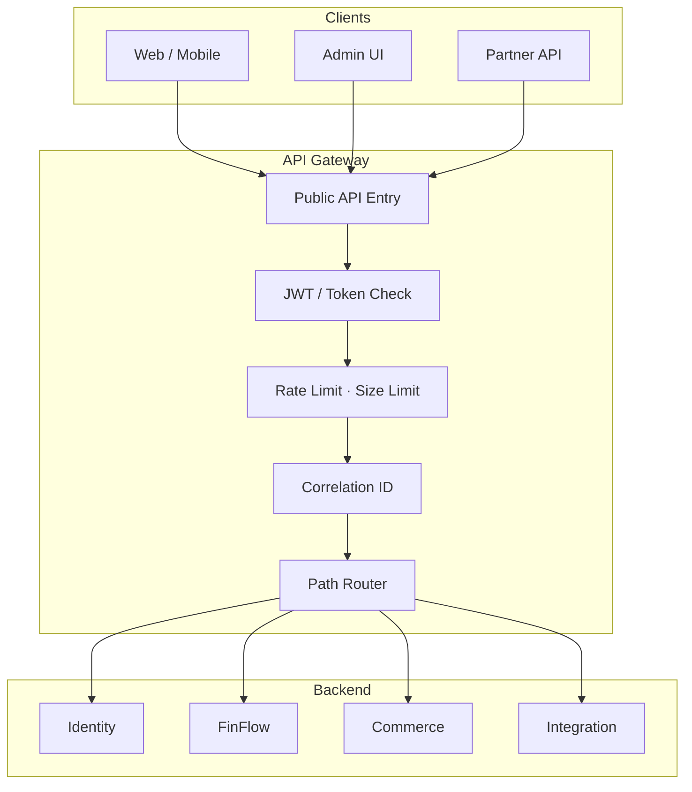
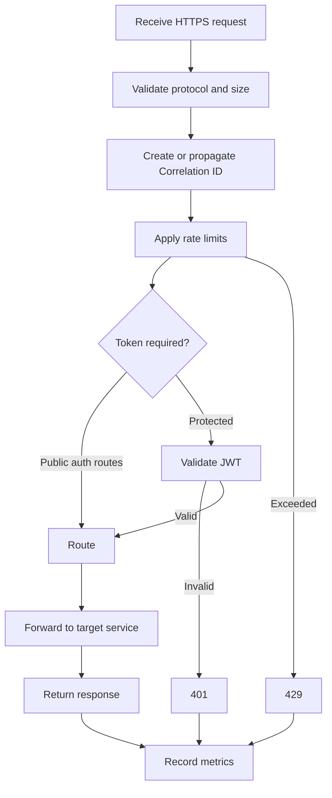

# 1. API Gateway — Complete Design

**Process:** `api-gateway` · Port `8080` · Spring Cloud Gateway  
**Owns:** Routing, edge security, rate limits, correlation ID  
**Does not own:** Business rules, databases, inventory, balances, order state

---

## 1. Position



**Rule:** Gateway checks *who is calling* and *where to send*. Backend checks *what they may do to this resource*.

---

## 2. Internal pipeline



---

## 3. Routes

| Path | Target | Auth |
|---|---|---|
| `POST /api/v1/auth/register` | Identity `:8081` | Public |
| `POST /api/v1/auth/login` | Identity `:8081` | Public |
| `GET /api/v1/users/me` | Identity `:8081` | JWT |
| `/api/v1/organisations/**` | Identity `:8081` | JWT |
| `/api/v1/wallets/**` | FinFlow `:8082` | JWT |
| `/api/v1/transfers/**` | FinFlow `:8082` | JWT |
| `/api/v1/transactions/**` | FinFlow `:8082` | JWT |
| `/api/v1/products/**` | Commerce `:8085` | JWT |
| `/api/v1/orders/**` | Commerce `:8085` | JWT |
| `/api/v1/integrations/**` | Integration `:8086` | JWT |
| `/internal/**` | — | **Not published** |

Headers after gateway:

- `Authorization` (original or stripped per policy)
- `X-User-Id` (from JWT `sub`)
- `X-Organisation-Id` (if present in token claims)
- `X-Correlation-Id`

---

## 4. Gateway vs backend

| Concern | Gateway | Backend |
|---|---|---|
| Route request | Yes | Receives |
| Rate / size limit | Yes | Optional business limit |
| JWT signature / expiry | Yes | Re-validate if needed |
| Resource ownership | No | Yes |
| Stock / balance / order rules | No | Yes |
| Database | No | Own DB |
| Retry POST | **Never** | Idempotent handling |

---

## 5. Failure behaviour

| Case | Response |
|---|---|
| Missing / invalid token | `401` |
| Rate exceeded | `429` |
| Unknown route | `404` |
| Downstream timeout | `504` |
| Downstream down | `502` / `503` |

Timeout ≠ business failure. Client retries with the same `Idempotency-Key`.

---

## 6. Package structure

```text
com.finflow.apigateway
  ApiGatewayApplication
  config.RouteConfig
  config.SecurityConfig
  filter.CorrelationIdFilter
  filter.JwtAuthFilter
  filter.RateLimitFilter
```

No database. No domain entities.
