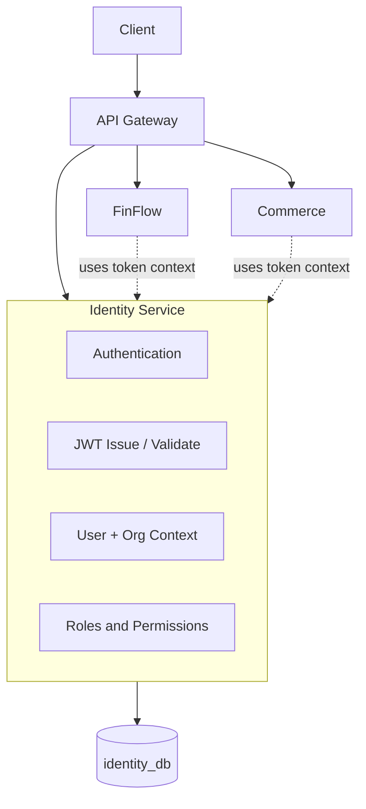
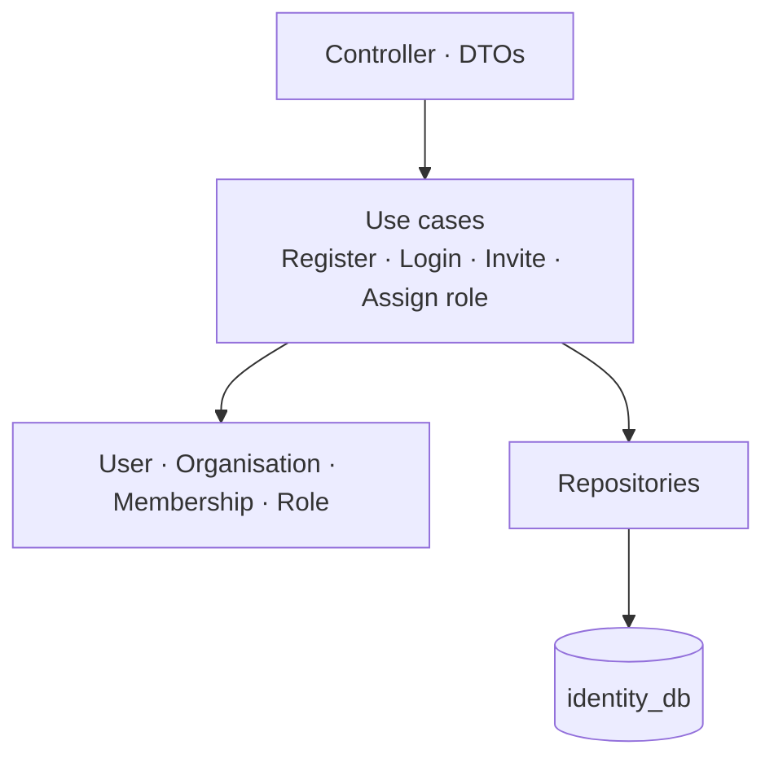
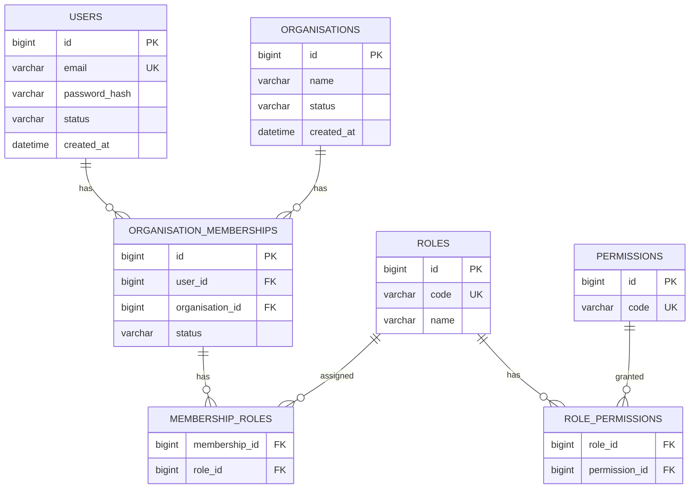
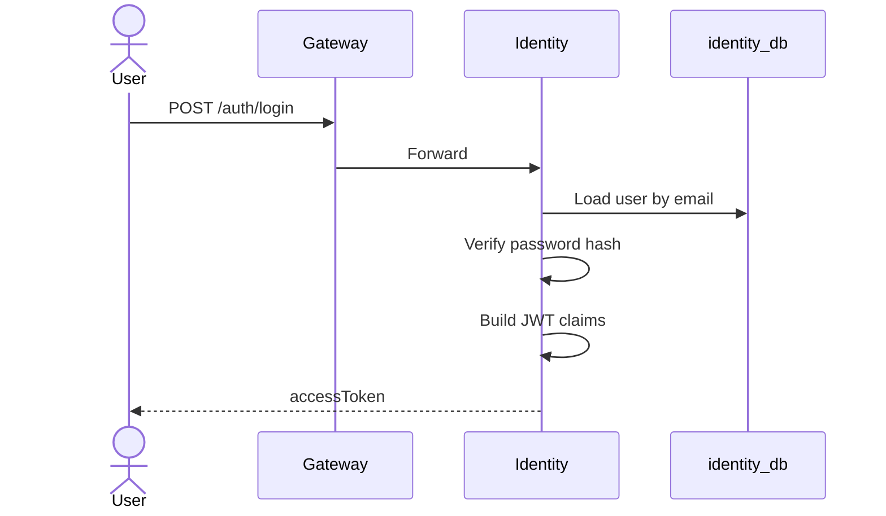
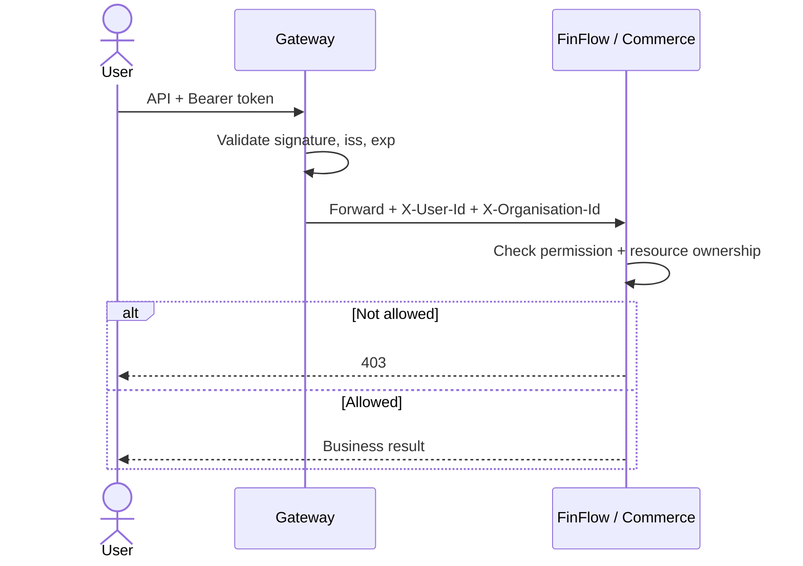
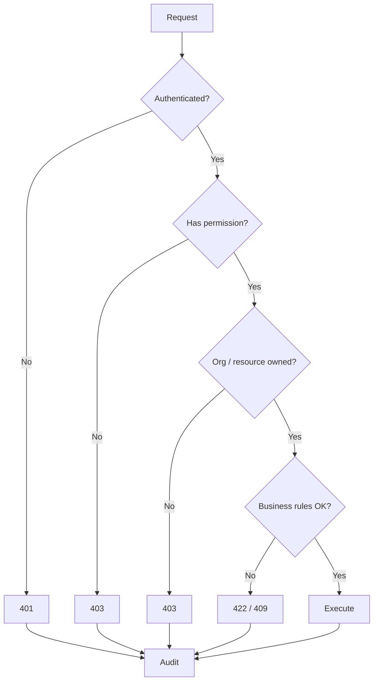

# 2. Identity and Organisation — Complete Design

**Process:** `identity-service` · Port `8081` · Spring Boot + Security + JPA  
**Owns:** Users, organisations, memberships, roles, permissions, JWT issue  
**Database:** `identity_db`

---

## 1. Position



**Three questions every request answers**

| Question | Concept |
|---|---|
| Who are you? | Authentication |
| What may you do? | Authorisation (permission) |
| Which resource? | Resource + organisation ownership (in domain) |

---

## 2. Internal architecture



```text
com.finflow.identity
  api
  application
  domain
  infrastructure.persistence
  infrastructure.security
```

---

## 3. Domain model



**Membership status:** `INVITED` → `ACTIVE` → `SUSPENDED` / `REMOVED`

**Example roles:** `ORG_ADMIN`, `FINANCE_OPERATOR`, `ORDER_MANAGER`, `MEMBER`, `READ_ONLY`

**Example permissions:** `wallets:read`, `transfers:create`, `orders:create`, `orders:cancel`, `organisation:members:manage`

---

## 4. APIs

| Method | Path | Purpose |
|---|---|---|
| POST | `/api/v1/auth/register` | Create user |
| POST | `/api/v1/auth/login` | Issue JWT |
| GET | `/api/v1/users/me` | Current user |
| POST | `/api/v1/organisations` | Create organisation |
| POST | `/api/v1/organisations/{id}/members` | Invite / add member |
| PUT | `/api/v1/organisations/{id}/members/{userId}/roles` | Assign roles |
| GET | `/api/v1/organisations/{id}/members` | List members |

**Register**

```json
{ "email": "a@example.com", "password": "long-secret" }
```

**Login response**

```json
{
  "accessToken": "<jwt>",
  "expiresIn": 900,
  "tokenType": "Bearer"
}
```

**JWT claims:** `sub` (userId), `email`, `orgIds[]`, `permissions[]`, `iss`, `exp`

Password: BCrypt. Never return hash. Disabled user cannot login.

---

## 5. Auth flows

### Login



### Protected call



Gateway JWT check is **not enough**. FinFlow/Commerce still verify wallet/order ownership.

---

## 6. Authorisation cascade



---

## 7. Rules

- Knowing an id is not permission (no BOLA / IDOR).
- Role in Org A does not grant Org B.
- Client-supplied `organisationId` is untrusted — verify membership.
- Do not forward user JWT to every internal service by default.
- Service-to-service uses a service identity / client credentials.
- Membership removal must invalidate or short-expire access (short JWT lifetime).
