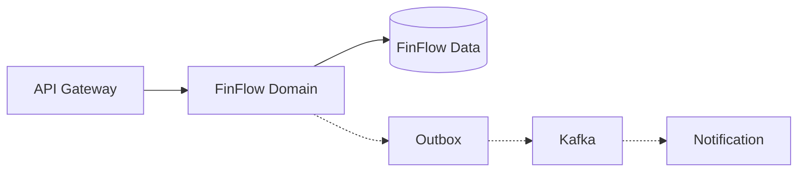
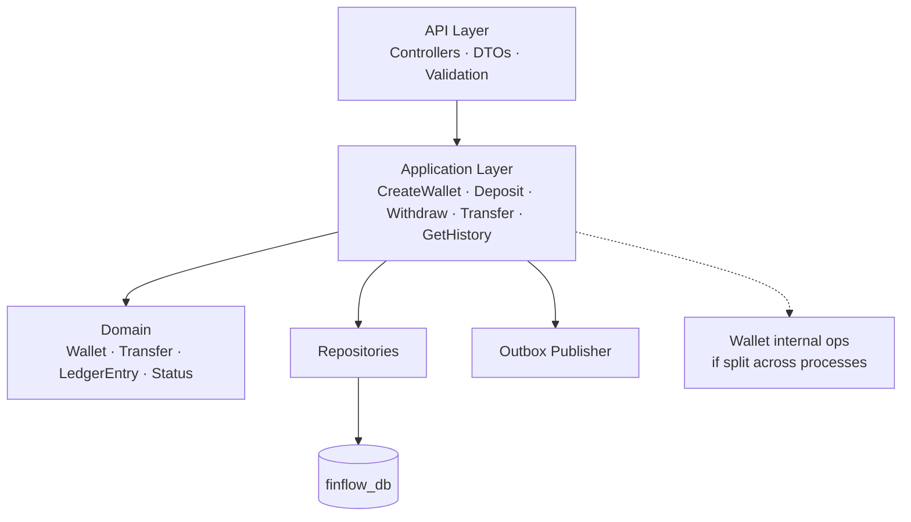
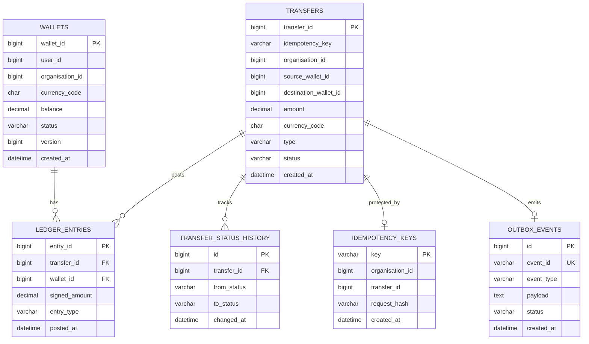
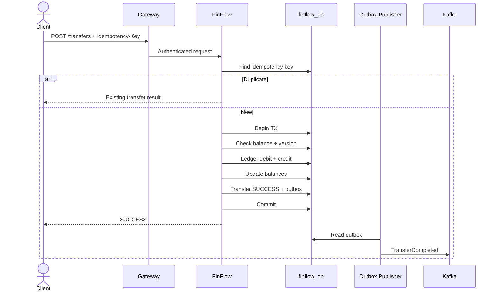
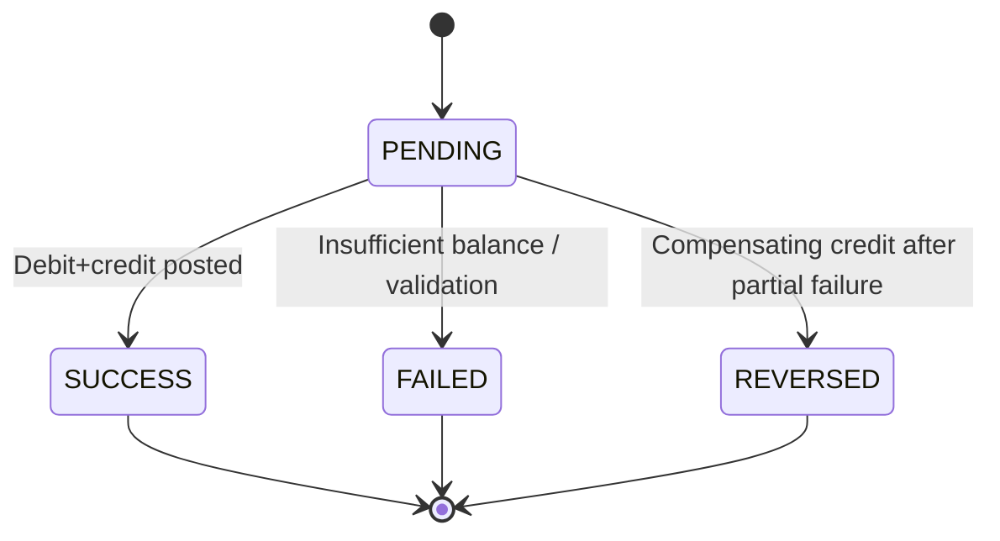

# 3. FinFlow — Complete Design

**Capability:** Simulated wallets, transfers, ledger, transaction history  
**Processes (current repo mapping):** `wallet-service` (:18082) — wallets, transfers, balance history  
**Logical ownership:** One FinFlow domain — one `finflow_db` (or schemas under FinFlow ownership)  
**Invariants:** Decimal money · Ledger nets to zero · Idempotent retries · No silent ledger edits

---

## 1. Position



FinFlow owns financial state. Commerce never updates FinFlow tables. Payment simulation may call FinFlow or stay in Commerce — contract is explicit either way.

---

## 2. Internal architecture



```text
com.finflow.wallet / com.finflow.transaction
  api
  application
  domain
  infrastructure.persistence
  infrastructure.messaging
```

Preferred: **one FinFlow application** (`wallet-service`) owning wallet + transfer + ledger in one local transaction.  
A separate orchestrator process is optional interview depth — not required for the platform to work.

---

## 3. Data model



**Unique:** `(user_id, currency_code)` on wallets · `(organisation_id, idempotency_key)` on transfers  
**Money:** `DECIMAL(19,2)` — never float  
**Ledger rule:** For a transfer, debit + credit signed amounts = `0`  
**Balance:** Materialised on wallet; must reconcile to sum of ledger entries

`type`: `DEPOSIT` | `WITHDRAWAL` | `TRANSFER`  
`status`: `PENDING` | `SUCCESS` | `FAILED` | `REVERSED`

---

## 4. APIs

| Method | Path | Purpose |
|---|---|---|
| POST | `/api/v1/wallets` | Create wallet |
| GET | `/api/v1/wallets/{walletId}` | Get wallet |
| GET | `/api/v1/users/{userId}/wallet` | Get by user |
| POST | `/api/v1/transfers` | Transfer (header: `Idempotency-Key`) |
| POST | `/api/v1/transactions/deposits` | Deposit |
| POST | `/api/v1/transactions/withdrawals` | Withdraw |
| GET | `/api/v1/transactions/{id}` | Get transaction |
| GET | `/api/v1/transactions?walletId=` | History |

**Create wallet**

```json
{ "currency": "INR" }
```

**Transfer**

```json
{
  "sourceWalletId": 10,
  "destinationWalletId": 22,
  "amount": "150.00"
}
```

**Response**

```json
{
  "transferId": 9,
  "status": "SUCCESS",
  "amount": "150.00",
  "currency": "INR"
}
```

---

## 5. Transfer flow (happy path)



---

## 6. State machine



---

## 7. Failure and recovery

| Failure | Handling |
|---|---|
| Duplicate request | Return stored result via idempotency key |
| Concurrent update | Optimistic `@Version` → `409` → client retries same key |
| Insufficient balance | No ledger post · status `FAILED` |
| Timeout after commit | Client retries same key · no second money move |
| Split-process credit fails after debit | Compensating credit to sender · status `REVERSED` |
| Duplicate Kafka event | Consumer dedupe by `event_id` |
| Wrong ledger entry | New reversing entry — never edit posted row |

---

## 8. Concurrency

```sql
UPDATE wallets
SET balance = balance - :amount, version = version + 1
WHERE wallet_id = :id
  AND balance >= :amount
  AND version = :expectedVersion;
```

Zero rows → reject (insufficient funds or stale version).

---

## 9. Use cases FinFlow must satisfy

| ID | Use case |
|---|---|
| F1 | Create wallet balance 0 |
| F2 | Deposit increases balance + ledger credit |
| F3 | Withdraw decreases only if enough |
| F4 | Transfer moves money with balanced ledger |
| F5 | Same idempotency key → one effect |
| F6 | Owner-only read |
| F7 | History readable |
| F8 | Reconciliation: balance = sum(ledger) |
| F9 | Event published only after commit |

---

## 10. Repo today vs target

| Today (`wallet-service`) | Target |
|---|---|
| Create / get / deposit | Keep and extend |
| Balance column only | Add ledger + transfer |
| No idempotency | Add keys |
| No org | Add organisation scope |
| Direct public deposit | Prefer deposit via transaction/transfer API |

Do not rewrite the existing wallet; evolve it into this model.
