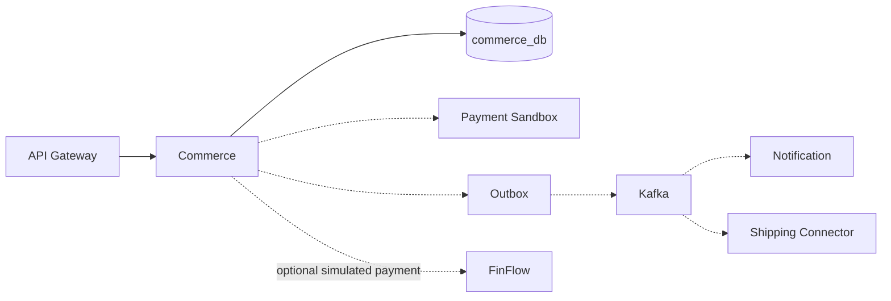
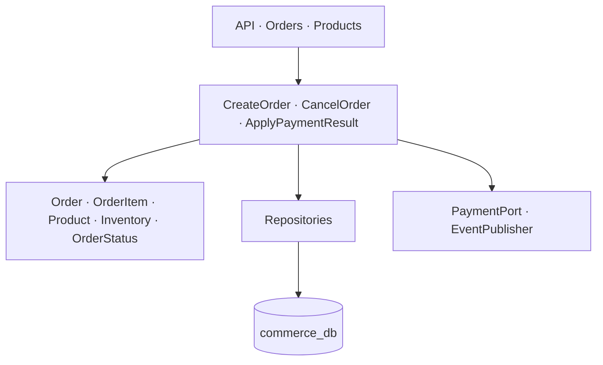
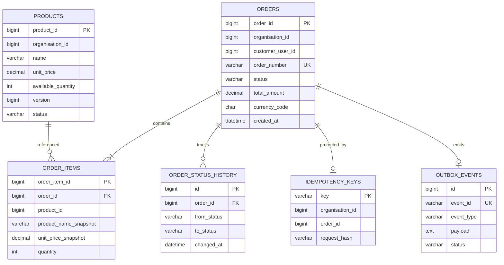
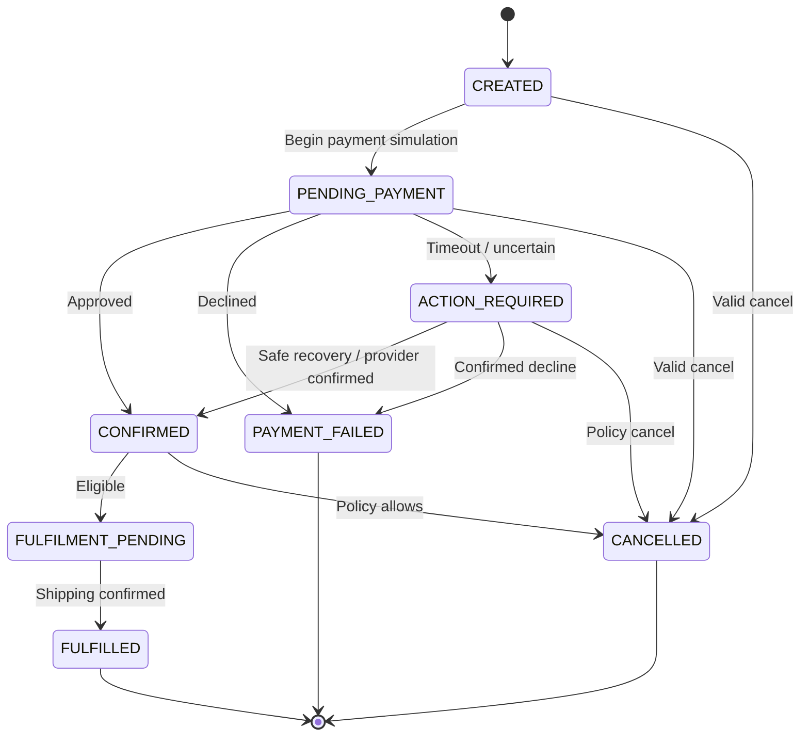
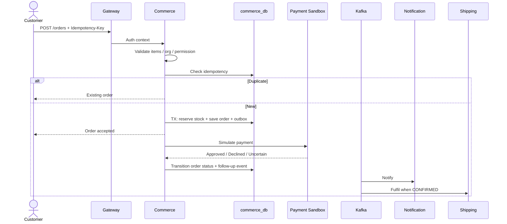

# 4. Commerce — Complete Design

**Capability:** Products, stock, orders, simulated payment, fulfilment handoff  
**Process:** `commerce-service` · Port `8085`  
**Database:** `commerce_db`  
**Invariants:** Price snapshot · Conditional stock · Order state machine · Uncertain payment ≠ declined

---

## 1. Position



Commerce owns catalogue, inventory, and orders. It does **not** write FinFlow tables. Payment is a simulation or an explicit FinFlow API call.

---

## 2. Internal architecture



```text
com.finflow.commerce
  api
  application
  domain
  infrastructure.persistence
  infrastructure.payment
  infrastructure.messaging
```

---

## 3. Data model



Stock update must be conditional:

```sql
UPDATE products
SET available_quantity = available_quantity - :qty, version = version + 1
WHERE product_id = :id
  AND available_quantity >= :qty
  AND version = :expectedVersion;
```

---

## 4. Order state machine



**Never use a single `FAILED` for declined, timeout, and cancelled.**

---

## 5. APIs

| Method | Path | Purpose |
|---|---|---|
| POST | `/api/v1/products` | Create / manage product |
| GET | `/api/v1/products` | List products |
| POST | `/api/v1/orders` | Create order (`Idempotency-Key`) |
| GET | `/api/v1/orders/{orderId}` | Get order |
| POST | `/api/v1/orders/{orderId}/cancel` | Cancel if allowed |

**Create order**

```json
{
  "organisationId": 1,
  "items": [
    { "productId": 100, "quantity": 2 }
  ]
}
```

Totals and prices come from **authoritative product data**, not client-supplied prices.

---

## 6. Create order flow



---

## 7. Failure matrix

| Failure | Behaviour |
|---|---|
| Invalid items / qty | `400` / `422` — no stock change |
| Insufficient stock | Reject — no order |
| Duplicate idempotency key | Return original order |
| Payment declined | `PAYMENT_FAILED` — release reserved stock |
| Payment timeout | `ACTION_REQUIRED` — reconcile; do not invent decline |
| Notification fails | Order stays confirmed — retry notify |
| Shipping fails | Fulfilment retry / DLQ — order remains confirmed until policy says otherwise |

---

## 8. Use cases Commerce must satisfy

| ID | Use case |
|---|---|
| C1 | Create product with price and stock |
| C2 | Create order with price snapshots |
| C3 | Concurrent last-item stock — only one wins |
| C4 | Idempotent order create |
| C5 | Payment approved → CONFIRMED |
| C6 | Payment declined → PAYMENT_FAILED + stock release |
| C7 | Payment uncertain → ACTION_REQUIRED |
| C8 | Cancel only when policy allows |
| C9 | Cross-org access denied |
| C10 | Event published after commit only |

---

## 9. Introduction phase

Commerce is **Phase C** after Identity + FinFlow foundation. No commerce tables in FinFlow DB. No FinFlow tables in Commerce DB.
