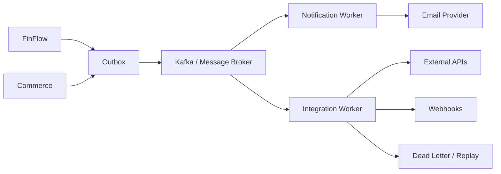
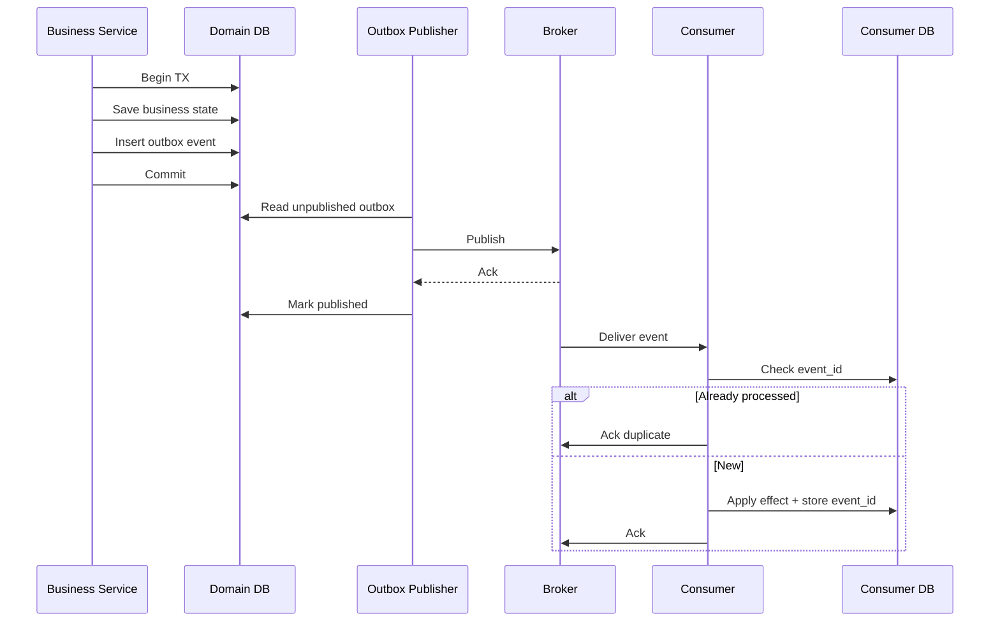
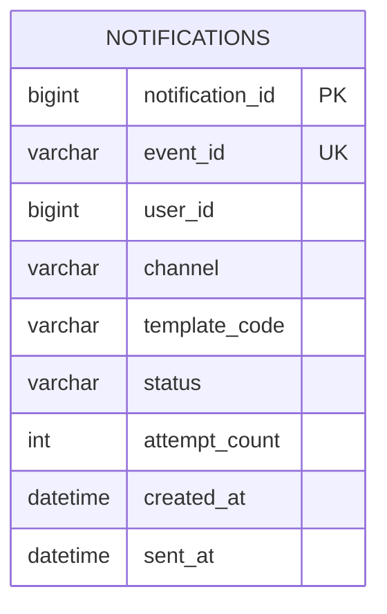
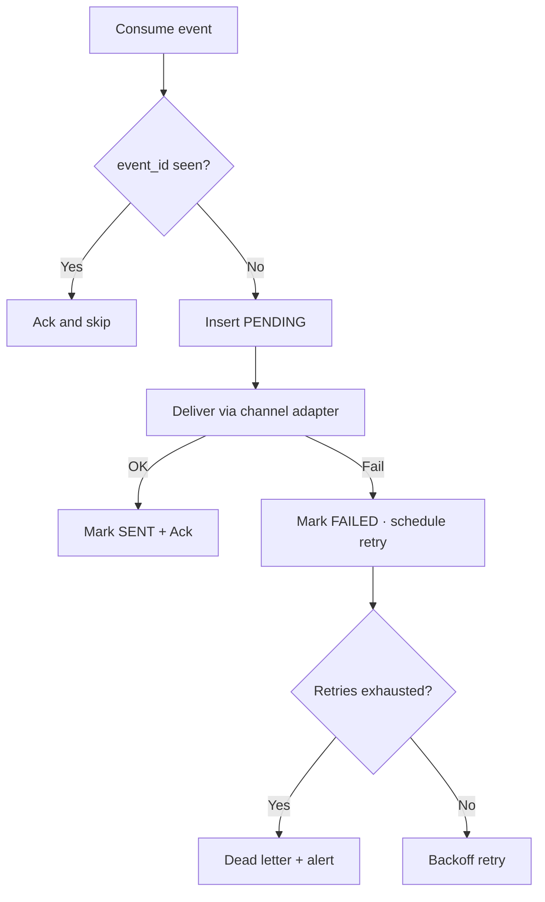
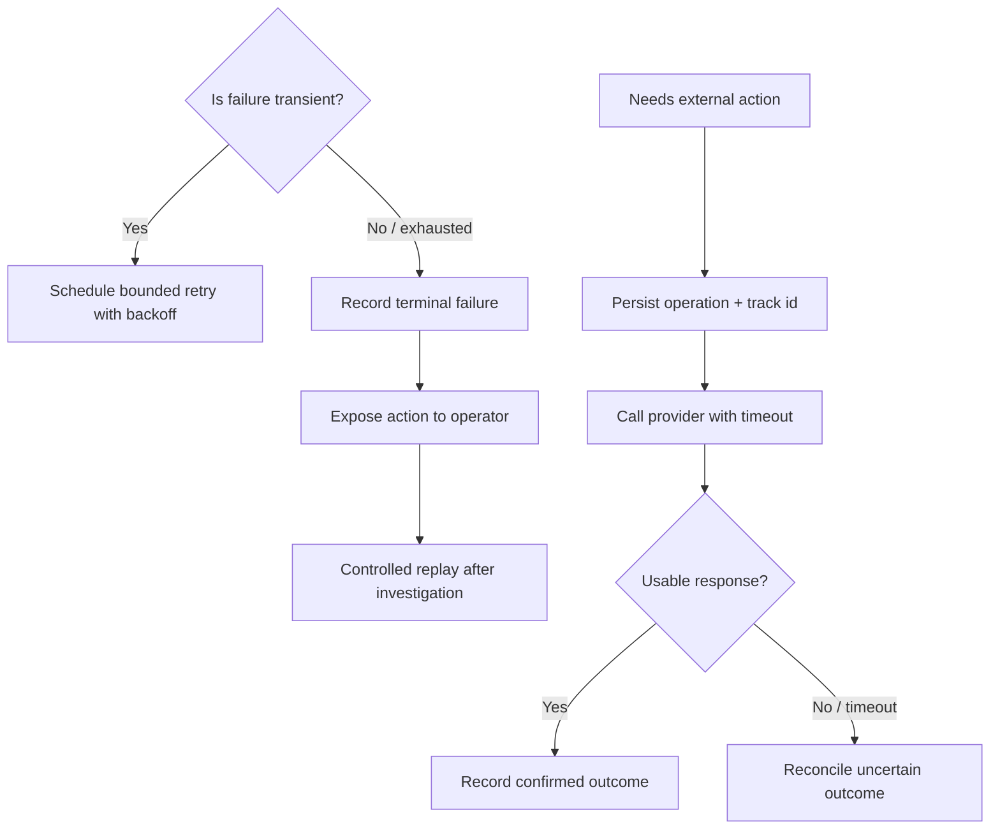

# 5. Integration, Events, and Notification — Complete Design

**Processes:** Integration worker · Notification worker · (optional) message broker  
**Owns:** Outbox publication, event consumption, connectors, webhooks, delivery attempts, retry / DLQ  
**Does not own:** Wallet balances, order totals, identity membership

---

## 1. Position



Domains commit business state + outbox in **one local TX**. Workers publish and consume after commit. Notification failure never rolls back money or orders.

---

## 2. Transactional outbox + idempotent consumer



**Delivery semantic:** at-least-once. Exactly-once effect via outbox + consumer dedupe.

---

## 3. Topics and events

| Topic | Publisher | Consumers | Payload essentials |
|---|---|---|---|
| `transfer.completed` | FinFlow | Notification | `eventId`, `transferId`, `amount`, `status`, wallets |
| `order.confirmed` | Commerce | Notification, Shipping connector | `eventId`, `orderId`, `orgId`, `total` |
| `order.cancelled` | Commerce | Notification, Inventory release if needed | `eventId`, `orderId` |
| `notification.requested` | Optional internal | Notification | `eventId`, `userId`, `channel`, `template` |

Event rules:

- Include `eventId` (UUID) and `occurredAt`
- Version events (`eventType` + `schemaVersion`)
- Key by business id (`transferId` / `orderId`) for partition ordering per aggregate
- Do not assume global ordering across partitions

---

## 4. Notification worker

**Database:** `notification_db`



`status`: `PENDING` | `SENT` | `FAILED`  
`channel` v1: `LOG` (then `EMAIL`)



---

## 5. Integration worker

Responsibilities:

| Capability | Behaviour |
|---|---|
| Outbound connector | Call payment / shipping / CRM with timeout |
| Webhook delivery | Sign payload, deliver, record attempt |
| Retry | Exponential backoff + jitter · bounded attempts |
| Dead letter | Store poison / exhausted messages for replay |
| Replay | Operator-triggered controlled reprocess |



---

## 6. Internal structure

```text
com.finflow.integration
  application.OutboxPublisher
  application.WebhookDispatcher
  application.ConnectorOrchestrator
  application.ReplayService
  infrastructure.kafka
  infrastructure.http
  infrastructure.persistence

com.finflow.notification
  application.NotificationConsumer
  application.DeliveryService
  channel.LogChannel / EmailChannel
  infrastructure.persistence
```

---

## 7. Use cases

| ID | Use case |
|---|---|
| I1 | Business commit includes outbox row |
| I2 | Publisher sends only unpublished events |
| I3 | Consumer processes event once (dedupe) |
| I4 | Notification failure does not change transfer/order |
| I5 | Transient provider error retries with backoff |
| I6 | Exhausted retries go to DLQ |
| I7 | Operator can replay a DLQ message safely |
| I8 | Webhook delivery is signed and audited |

---

## 8. When to introduce

| Piece | Introduce when |
|---|---|
| Outbox table | First cross-process event is required |
| Kafka | A real consumer exists (notification / shipping) |
| Notification worker | User must be informed after commit |
| Webhooks / connectors | First external partner integration |
| DLQ tooling | Retries are in production paths |

Do not add Kafka only because the architecture diagram shows a broker.
