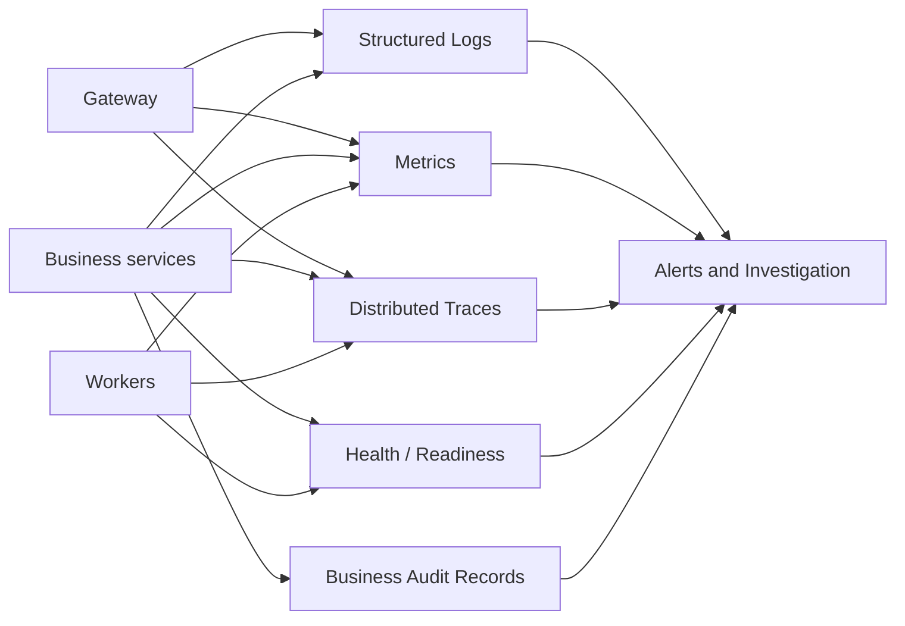
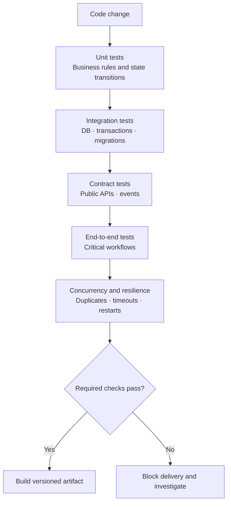
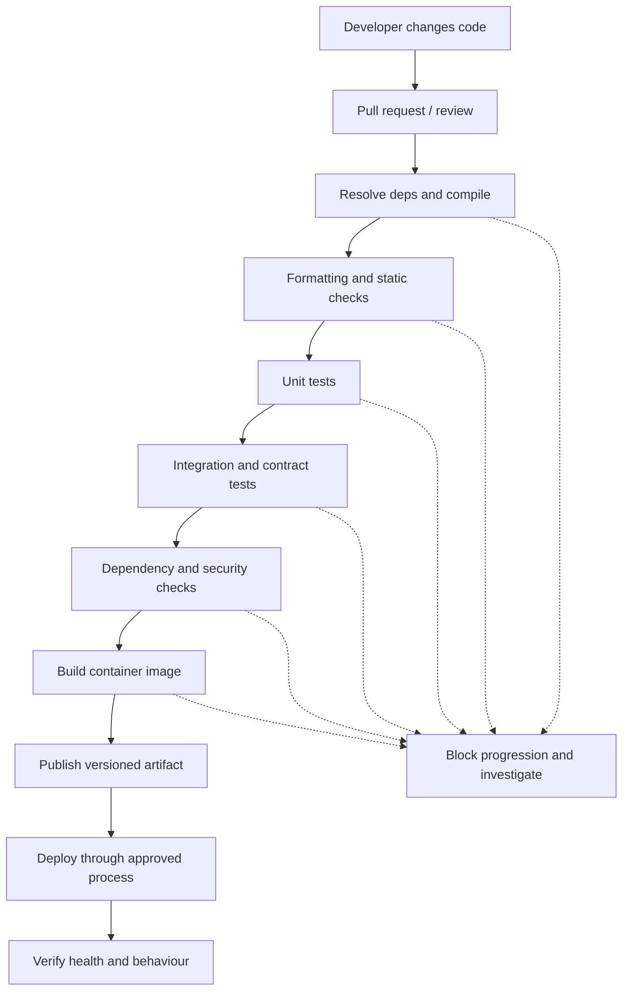
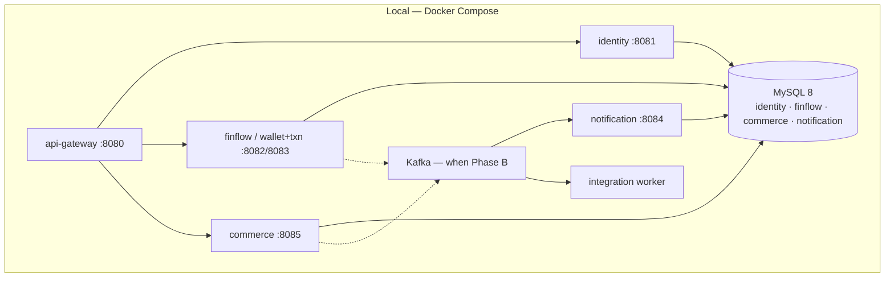

# 6. Observability and Deployment — Complete Design

Cross-cutting layer for the whole platform. Applies to Gateway, Identity, FinFlow, Commerce, Integration, Notification.

---

## 1. Observability architecture

| Signal | Answers |
|---|---|
| Logs | What happened on this request |
| Metrics | How often / how slow / how saturated |
| Traces | Where time was spent across services |
| Health | Should this instance receive traffic |
| Audit | What business action was committed (durable) |

**Correlation ID** = business/request join key across logs  
**Trace ID** = distributed tracing join key  
Both propagate from Gateway.

---

## 2. What every service must emit

| Type | Examples |
|---|---|
| Logs | `correlationId`, `userId`, `orgId`, `transferId` / `orderId`, outcome — never passwords, tokens, full card data |
| Metrics | request rate, latency p95, error rate, DB pool usage, consumer lag, outbox age |
| Traces | Gateway → service → DB / downstream |
| Health | liveness = process up; readiness = can accept traffic (DB reachable for stateful services) |
| Audit | login, role change, transfer SUCCESS, order CONFIRMED / CANCELLED |

---

## 3. Quality / CI pipeline

---

## 4. CI/CD release pipeline

**Build once, promote the same artifact** through environments.

---

## 5. Local and target runtime

| Environment | Purpose |
|---|---|
| Local Compose | Develop and verify full slice |
| CI | Automated gates on every PR |
| Staging | Smoke + failure drills |
| Production | Controlled deploy + health verify |

Kubernetes / cloud only when Compose + one host is no longer enough.

---

## 6. Database migration rules

- Flyway / Liquibase owned by each service
- Expand → migrate → contract for breaking changes
- Application rollback does **not** undo committed money/orders
- Never run destructive migrations during discovery

---

## 7. Deployment strategies

| Strategy | When |
|---|---|
| Stop and replace | Early local / single instance |
| Rolling | Multiple instances, backward-compatible change |
| Blue-green | Need instant switch / fast rollback of traffic |
| Canary | High risk change with gradual traffic |

For FinFlow transfer/ledger releases: verify deposit, transfer, idempotent retry, and ledger invariant after deploy — process start alone is not success.

---

## 8. Operational checklist

| Check | Required |
|---|---|
| Correlation ID on every request log | Yes |
| Liveness vs readiness separated | Yes |
| Secrets not in Git | Yes |
| Outbox lag / consumer lag alert when Kafka exists | Yes |
| Stuck PENDING transfer / ACTION_REQUIRED order alert | Yes |
| Backup + restore drill for FinFlow / Commerce DBs | Yes |
| RPO / RTO defined after first real environment | Yes |

---

## 9. Use cases this layer satisfies

| ID | Use case |
|---|---|
| O1 | Trace one transfer across gateway → FinFlow → outbox → notification |
| O2 | Detect consumer lag / stuck PENDING |
| O3 | Failed build cannot publish artifact |
| O4 | Failed deploy detected by health / smoke |
| O5 | Rollback / roll-forward path documented |
| O6 | Secrets rotated without code change |
