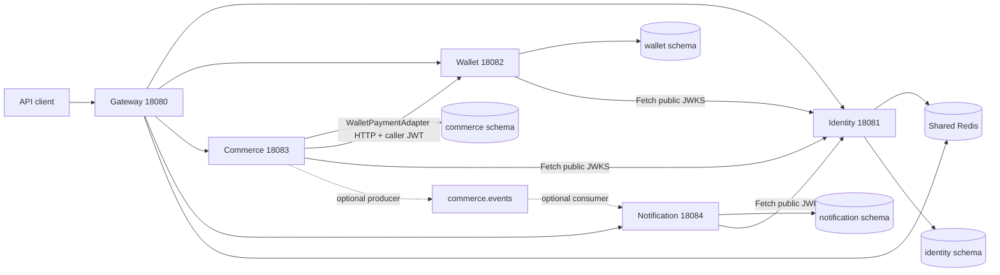

# Actual FinFlow architecture

Source assessment: **2026-11-07**, commit `5d79a90`. This is an implementation map; [02-hld/ARCHITECTURE.md](02-hld/ARCHITECTURE.md), [03-lld](03-lld/README.md) and SystemDesign describe a wider target. Verification and risks are in [PROJECT_STATUS.md](../PROJECT_STATUS.md).

## Repository and technology

Five independent Maven applications, all `com.finflow:*-service:0.0.1-SNAPSHOT` (gateway artifact `api-gateway`), Java 21 and Spring Boot 3.5.6. No root POM, shared library, service-discovery server or frontend was found.

Service ownership, ports and entry points are maintained in [SERVICE_CATALOG.md](SERVICE_CATALOG.md). The actual communication/contract impact matrix is in [SERVICE_DEPENDENCIES.md](SERVICE_DEPENDENCIES.md); sequences and runtime behaviour remain here.

Gateway dependencies: Spring Cloud BOM **2025.0.3**, Gateway server WebFlux, Security/OAuth2 resource server, reactive Redis, Reactor Resilience4j, Actuator, Micrometer Prometheus and Brave. Other modules use Spring Web/MVC, Security, JPA/Hibernate, Jakarta Validation, MySQL Connector/J, JJWT **0.12.6**, Actuator, H2 test scope, Boot Test/Security Test. Identity adds blocking Redis; commerce and notification add Spring Kafka/Kafka Test. Identity, wallet and commerce include DevTools. Transitive versions follow BOMs; no transitive-version audit was performed.

## Component and runtime interactions

Kafka arrows are disabled by default. Logging publication creates no notification record. Direct service HTTP ports exist; gateway is not the only security boundary.

MVC modules use controller -> service -> repository/entity layering, DTO records and constructor injection. Identity DTOs separate request/response packages; others use dto. Services enforce user/organisation access; domain methods enforce selected invariants. PaymentPort is a port/adapter seam, not evidence of a full hexagonal architecture throughout the repository.

## Workflows traced through source

### Identity and organisation onboarding

1. AuthController -> AuthService.register normalizes email, checks uniqueness, hashes password with BCrypt, creates unverified ACTIVE user and SHA-256 verification token, calls logging MailService, records audit. Default response exposes raw dev token.
2. verifyEmail loads hash, checks unused/unexpired, marks user verified/token used, records audit. Login rejects inactive/wrong credentials/unverified users.
3. Login loads ACTIVE memberships, unions their permissions, issues RS256 access JWT with sub/email/orgIds/permissions and a hashed opaque refresh token. JwtService loads a durable RSA private key through SigningKeyStore; local bootstrap creates a 2048-bit key only when absent. kid is derived from SHA-256 of the encoded public key and remains stable across restarts. A deployment can explicitly set IDENTITY_SIGNING_KEY_PATH and IDENTITY_GENERATE_KEY_IF_MISSING=false to require a provisioned key; there is no separate prod properties file. Base settings allow local bootstrap. Corrupt existing keys fail startup. One public key is published; overlapping rotation is not implemented.
4. Refresh revokes presented usable token and issues a new pair; logout revokes matching refresh hash. Reset/change password revoke all refresh tokens. Already-issued JWTs are not revoked.
5. Any authenticated user may create an organisation; creator gets ACTIVE ORG_ADMIN membership. Existing registered users can be invited by members:manage holders; invitee must log in and accept a usable matching-email token. Identity rechecks membership permissions in its own DB for protected organisation operations.
6. Last-admin checks protect sequential demotion/removal, not concurrent races. Re-login/refresh after org creation or invite acceptance is needed to get updated downstream claims.
7. TokenCleanupJob uses scheduled hourly JPQL deletes for expired/revoked/used tokens. AuditService writes in local transactions; it is not a platform-wide immutable audit system.
8. Direct identity security-filter failures use JSON code/message: missing or unusable bearer authentication on protected endpoints returns 401 with WWW-Authenticate: Bearer; authenticated Spring Security access denial returns 403. Controller/domain errors keep their own advice mapping. Public endpoints remain public even with an invalid optional token. MockMvc regressions verify these paths; live Redis and edge-to-identity behavior are separate checks.

### Wallet movement

WalletController obtains owner from JWT, not request body. SecurityConfig checks wallets:read/write or transfers:create. WalletService checks ownership for reads/mutations and party membership for transfer reads.

Deposit/withdraw use a local transaction: owned wallet -> global history-key lookup -> credit/debit -> wallet save -> history saveAndFlush. Wallet enforces ACTIVE, positive amount and sufficient balance; current balance normalizes to 2 decimals. Transfer checks global transfer-key replay, sender ownership, different wallet and same currency, debits/credits both, saves transfer and SENT/RECEIVED history in one transaction. Wallet @Version detects conflicting updates; unique keys constrain duplicates. Sequential replay is tested; scope and concurrent replay limitations are R2/R11.

Wallet lifecycle: ACTIVE <-> BLOCKED; ACTIVE/BLOCKED -> CLOSED only at zero balance; CLOSED cannot reopen. A wallet owner with wallets:write can block/unblock their own wallet. Funding/deposit is a direct API operation, not proof of an external payment received.

### Order placement and payment

1. OrderController -> CommerceService.createOrder -> OrderPlacementService.placePendingOrder (proxied @Transactional).
2. Validate requested org access/key; replay lookup is global. For a new order, load active same-org products, decrement available stock, snapshot name/price/quantity; optionally embed address/apply active nonexpired percent coupon. Currency is INR.
3. Save PENDING_PAYMENT order + item rows, idempotency record and PENDING payment_outbox in one transaction. Product @Version handles stock conflicts.
4. After placement returns/commits, PaymentSettlementService calls PaymentPort outside that transaction. Main defaults use WalletPaymentAdapter; tests use SimulatedPaymentAdapter.
5. Wallet adapter gets customer's own wallet, checks currency, POSTs withdrawal with caller bearer JWT and stable commerce-pay-{orderId} key. Refund POSTs deposit with commerce-refund-{orderId}. 4xx generally declines; transport/5xx ambiguity returns UNCERTAIN. No explicit client timeout/retry configuration exists here.
6. A follow-up TransactionTemplate updates order/work state: APPROVED -> CONFIRMED/DONE with wallet/transaction IDs; DECLINED -> PAYMENT_FAILED/FAILED and stock released; UNCERTAIN -> ACTION_REQUIRED/PENDING with stock retained.
7. ORDER_PAID publishes after settlement commit. No automatic work-draining worker exists. /pay is customer-only and retries pending/action-required orders; work lookup query alone is not recovery.

### Cart, cancellation, fulfilment, expiry and returns

- Cart is per user+org. Reads return current catalogue prices; no cart-level reservation. Add increments, PUT replaces/removes quantity, DELETE removes/clears.
- Checkout snapshots lines in a short transaction, creates/settles order, then separately clears cart even for declined/uncertain outcomes. Checkout requires shipping address; direct order permits no address. Replay/concurrent cart edits are not safely coordinated.
- Customer-only cancel permits CREATED/PENDING_PAYMENT/ACTION_REQUIRED/CONFIRMED. Confirmed orders refund first over HTTP; a separate transactional service releases stock and assigns CANCELLED. No persisted refund work/state bridges failures.
- Fulfilment start requires CONFIRMED; completion accepts CONFIRMED or FULFILMENT_PENDING and emits ORDER_FULFILLED. No shipping provider is called.
- Maintenance defaults: every 60 s expire PENDING_PAYMENT/ACTION_REQUIRED older than 30 min (createdAt), release stock, fail unfinished work, emit ORDER_EXPIRED; every 300 s delete carts untouched for 72 h. Jobs are disabled in commerce tests; service methods are tested directly.
- Customer of FULFILLED order requests a return. Same-org write callers may approve/reject; complete requires APPROVED, refunds outside DB transaction then restocks/completes in TransactionTemplate and emits RETURN_COMPLETED. Original order stays FULFILLED. No live refund/return tests, single-return constraint, partial-return model, return window or external logistics integration exists.

### Events and notifications

Commerce publishes ORDER_PAID, ORDER_CANCELLED, ORDER_EXPIRED, ORDER_FULFILLED, RETURN_COMPLETED through CommerceEventPublisher. Default is logging; enabled Kafka publisher sends JSON keyed by orderId, topic commerce.events, three partitions/one replica. Producer send completion is ignored. Publication is not backed by a durable domain-event outbox; payment_outbox serves a different purpose.

Notification conditional @EnableKafka/config/listener accepts JSON into a locally duplicated CommerceDomainEvent record (type headers disabled, trusted packages '*'). Dispatcher checks (eventType,orderId), inserts/flushed NotificationRecord, then calls MailChannel in the DB transaction. Initial status is SENT. Both mail flag branches only log userId/subject/body; no recipient email lookup/provider exists. Inbox filters by JWT subject. Sequential duplicate tests pass; concurrent unique-violation rollback and delivery atomicity are unresolved.

## API inventory and current behaviour

All paths below include the /api/v1 prefix unless explicitly absolute. Behaviour is source-traced; full HTTP contracts were **not exercised**. Success defaults to 200 unless noted. Request validation may return 400; domain ApiException maps 401/403/404/409/422 (plus auth rate-limit 429). See DTOs for exact wire fields.

### Identity

Public POST endpoints (no access JWT required):

| Path | Body / success behaviour |
|---|---|
| /auth/register | email/password (8–72 chars) -> 201 profile + dev token; 409 duplicate |
| /auth/verify-email | token -> 204; invalid/used/expired -> 401 |
| /auth/resend-verification | email -> generic message + dev token when applicable |
| /auth/login | email/password -> accessToken/refreshToken/tokenType/expiresInSeconds/userId/email/orgIds/permissions; 401 rejection |
| /auth/refresh | refreshToken -> rotated pair; unusable -> 401 |
| /auth/logout | refreshToken -> 204; unknown token ignored |
| /auth/forgot-password | email -> generic message + optional dev token |
| /auth/reset-password | resetToken/newPassword -> 204 |

Public GET **/.well-known/jwks.json** returns current RSA key. Authenticated POST /auth/change-password accepts currentPassword/newPassword -> 204; GET /users/me returns current profile/DB memberships.

| Organisation path | Behaviour |
|---|---|
| POST /orgs; GET /orgs | 201 create with creator admin; list caller ACTIVE memberships |
| GET /orgs/{orgId} | Active member only |
| POST /orgs/{orgId}/invites | email/role; members:manage in that org -> 201 invite, existing user required |
| POST /orgs/invites/accept | token; logged-in matching-email user -> membership |
| GET /orgs/{orgId}/members | Active member; returns ACTIVE/INVITED members |
| PUT /orgs/{orgId}/members/{userId}/role | role; members:manage; guard last admin |
| DELETE /orgs/{orgId}/members/{userId} | members:manage; soft-remove -> 204; guard last admin |
| GET /orgs/{orgId}/audit | org:manage; newest first |

### Wallet

GETs require wallets:read; POSTs wallets:write except transfer requires transfers:create. Owner/party checks are additional.

| Method/path | Behaviour |
|---|---|
| POST /wallets | currency INR/USD/EUR/GBP, case-insensitive -> 201 zero wallet for caller; one per user |
| GET /wallets/{walletId} | Owner-only balance/status |
| GET /users/{userId}/wallet | Path user must equal caller |
| POST /wallets/{walletId}/deposits; /withdrawals | amount, required Idempotency-Key -> transaction response with replay flag; positive, <=1,000,000.00, <=2 decimal places at HTTP boundary |
| GET /wallets/{walletId}/transactions | Full newest-first statement |
| POST /wallets/{walletId}/block; /unblock; /close | Owner status change; close needs zero |
| POST /transfers | fromWalletId/toWalletId/amount + required Idempotency-Key -> transfer and balance snapshots; sender owned, equal currencies |
| GET /transfers/{transferId} | Sender or recipient owner only |

### Commerce

All GET /api/v1/** require commerce:read; POST/PUT/PATCH/DELETE require commerce:write. Services also check orgIds; pay/cancel/request-return check customer identity. MEMBER currently has commerce:write.

| Method/path | Behaviour |
|---|---|
| POST /categories; GET /categories?organisationId= | 201 create name/slug for org; list by name |
| POST /products; GET /products?organisationId= | 201 create org/name/unitPrice/availableQuantity/optional categoryId; list |
| GET /products/search?organisationId=&q=&categoryId= | Optional substring/category filter; pageable, default size 20 |
| PATCH /products/{productId} | Optional price/availableQuantity/categoryId; no name/status update or category removal via null |
| POST /coupons | 201 org/code/percentOff (1–90)/optional expiry; no list/deactivate endpoint |
| GET /carts?organisationId= | Caller cart, or unsaved empty view |
| POST /carts/items | organisationId/productId/quantity -> updated cart |
| PUT /carts/items/{productId} | organisationId/quantity; zero removes |
| DELETE /carts/items/{productId}?organisationId=; DELETE /carts?organisationId= | Updated cart after remove/clear |
| POST /carts/checkout | Required Idempotency-Key; org/address/optional coupon/paymentOutcome -> 201 order |
| POST /orders | Required Idempotency-Key; org/items/optional address/coupon/paymentOutcome -> 201 order, including failed/action-required status |
| GET /orders?organisationId=&mineOnly= | mineOnly defaults true; false lists all org orders for any allowed reader |
| GET /orders/{orderId} | Any allowed org reader, not customer-only |
| POST /orders/{orderId}/pay; /cancel | Customer-only; forwards caller JWT |
| POST /orders/{orderId}/fulfilment/start; /fulfilment/complete | Same-org write caller; state updates |
| POST /orders/{orderId}/returns | Customer + reason -> 201 return; FULFILLED only |
| GET /orders/{orderId}/returns | Same-org reader |
| POST /returns/{returnId}/approve; /reject; /complete | Same-org writer; complete forwards caller JWT for customer wallet refund |

paymentOutcome only controls simulator; wallet provider ignores it. No delete product/category, product activation, shipping tracking, coupon-management suite or general order-edit endpoints exist.

### Notification and gateway

Authenticated GET **/api/v1/notifications/me** returns caller's full newest-first inbox. No REST notification-create/mark-read/retry endpoints exist.

Gateway preserves downstream paths. Routes: /api/v1/users/me -> identity; /api/v1/users/*/wallet -> wallet; /api/v1/auth/**, /api/v1/orgs/** and JWKS -> identity; /api/v1/wallets/** and /api/v1/transfers/** -> wallet; commerce path families above -> commerce; /api/v1/notifications/** -> notification.

Gateway default route filters configure Redis token bucket 50/s with burst 100, 1 MB body limit and deduped CORS headers. Each route has circuit breaker fallback **/fallback/{service}** (503 UPSTREAM_UNAVAILABLE), GET-only retry twice on 502/503/504, 2 s connect and 5 s response/time-limiter defaults. Non-GET money/auth operations are not retried by this configuration. The unused app.max-body-bytes binding was removed during cleanup; active RequestSize remains the literal 1MB in YAML. HTTP timeout properties are consumed directly by YAML, without a duplicate typed Http binding.

JWT protects /api/v1/** except listed public POST auth routes; public JWKS/OPTIONS/health/info/prometheus/fallback. Other gateway exchanges permit access by default, so exposed actuator metrics/gateway endpoints require deployment review. Wildcard allowed origin patterns with credentials false. CorrelationIdFilter is a route GlobalFilter, not a pre-security WebFilter; uniform IDs/logging on security rejections are not proven.

## Security, validation, errors and logging

- Identity issues and verifies locally; gateway uses resource-server JWKS; wallet/commerce/notification use custom JJWT filters and cached RSA JWKS keys (300 s, refresh on unknown kid). Invalid token exceptions are swallowed to clear authentication.
- No issuer/audience claims/checks in custom issuance/validation; keys now persist across restarts; file replacement still changes trust, and overlapping rotation remains unimplemented. Identity-org operations use DB permissions; downstream claims may be stale.
- DTO records have Jakarta constraints and @Valid; coverage/consistency varies (for example price precision/create versus update). Controller method constraints and malformed JSON paths lack HTTP regressions.
- Identity/wallet/commerce advice emits code/message and validation details; wallet/commerce handle optimistic conflicts. Wallet/commerce security send explicit JSON 401/403. Identity has no equivalent custom entry-point/error body; framework behaviour should be verified rather than copied from comments. Notification has auth JSON entry point but no domain controller advice.
- Gateway has security JSON errors, reactive global exception mapping and fallback JSON. Filter-produced errors are not guaranteed to pass its exception handler.
- SLF4J logs gateway method/path/status/duration/correlation and service events. No complete downstream MDC propagation, central collector or distributed tracing backend is configured. Identity audit records selected successes, not failed login attempts; identity mail-stub logs omit token-bearing bodies after cleanup; local API responses still expose development tokens when mail.enabled=false.

## Persistence, build and deployment

See [DATABASE_DESIGN.md](../DATABASE_DESIGN.md) for all 22 mapped tables. Main schemas use localhost:3307 and Hibernate update, open-in-view false. H2 test schemas use MySQL mode/create-drop. No migrations were found.

Compose: MySQL 8.4 host 3307, Redis 7.4-alpine host 6379, Kafka 3.8.1 single-node KRaft host 9092; finflow-net. mysql-data/redis-data are external named volumes. Only wallet-service is in apps profile and points JWKS to host.docker.internal:18081. Kafka advertises localhost; full container-to-container Kafka use needs listener configuration.

Each Dockerfile builds with Maven/JDK21, skips tests, and runs Temurin21 JRE as non-root uid10001. Four modules include Maven wrappers configured for Maven 3.10.0; commerce has no wrapper. Gateway/identity/wallet .mvn/maven.config automatically select local maven-settings.xml, mirroring all repositories to Maven Central; commerce has the settings file but no automatic selector, and notification has neither settings file nor selector. The identity settings comment identifies avoiding company Nexus 401 errors as the reason. Docker contexts exclude these settings/wrappers and test sources. No CI/CD manifests were found. Postman environment/collections and Python generators support manual flows; not executed during this assessment.

Testing combines context-load tests and H2 service tests, with mock HTTP wallet-adapter checks. No HTTP security/controller, live infrastructure, return workflow, concurrency, or full-stack automated verification was found. See status for actual executed outcomes and packaging failures.
