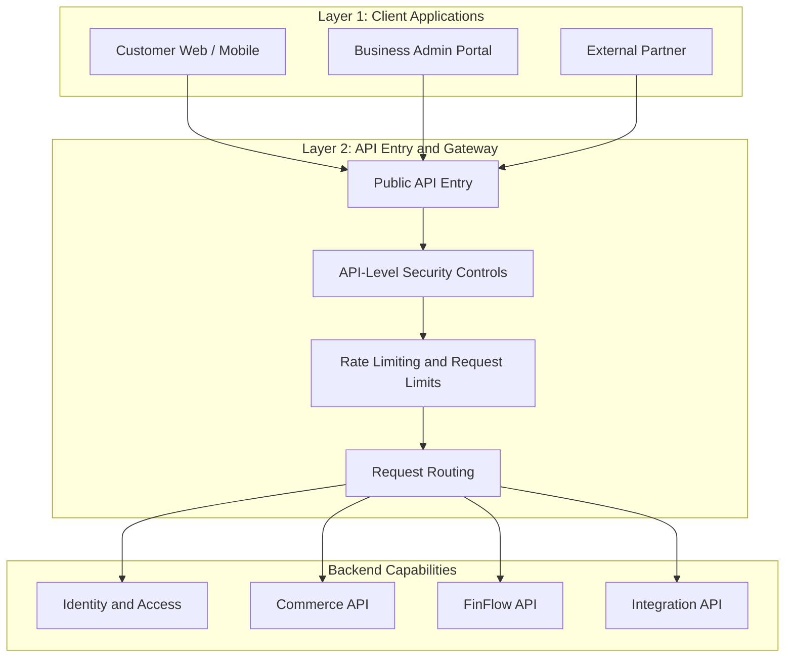
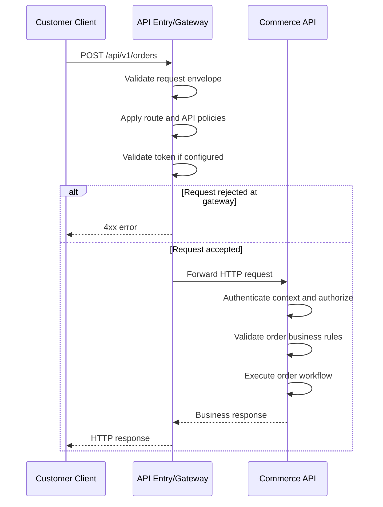
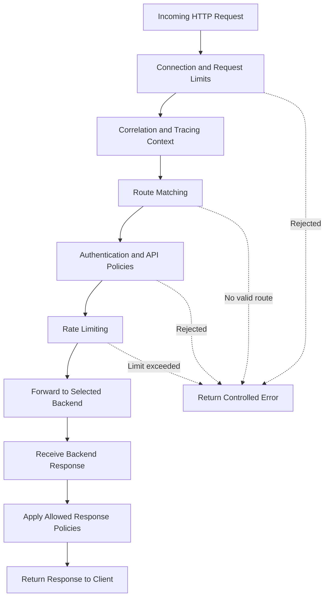

# Layer 2 — API Entry and Gateway

## 1. Purpose of This Layer

The API Entry and Gateway layer is the controlled entry point between client applications and backend capabilities.

In Layer 1, we established that web, mobile, admin, and partner clients send HTTP requests to the backend. This layer explains how those requests enter the system, how common API-level controls are applied, and how the request is routed to the appropriate backend component.

For example, when a customer places an order, the request should reach the Commerce capability responsible for orders. It should not reach an unrelated FinFlow account service.

The API Entry and Gateway layer helps answer these questions:

- Where do external API requests enter the platform?
- How does the platform route requests to the correct backend?
- Where should authentication be checked?
- Where should authorization be enforced?
- How do we protect the platform from excessive requests?
- How do we trace a request across multiple services?
- How should the platform handle timeouts, unavailable services, and invalid requests?
- Which responsibilities belong to the gateway, and which belong to backend services?

**Core principle:** The gateway provides common entry-point controls. Business services remain responsible for business rules and business-level decisions.

---

## 2. Position in the Overall Architecture

The API Entry and Gateway layer sits between external clients and the internal backend capabilities.

### High-level architecture



This diagram shows logical responsibilities. It does not require every box to be a separate deployable application.

For example, API-level security checks, rate limiting, and routing may be configured within one gateway product. They are shown separately to make their responsibilities easier to understand.

The identity, Commerce, FinFlow, and Integration components are candidate backend capabilities. Their final deployment structure will be decided later.

---

## 3. What Is an API Gateway?

An API gateway is a component that accepts API requests from clients and forwards them to the appropriate backend destination while applying common entry-point policies.

Consider this request:

```http
POST /api/v1/orders
```

The gateway must know which backend handles the `/api/v1/orders` route.

An illustrative routing rule could be:

```text
/api/v1/orders/**       -> Commerce API
/api/v1/products/**     -> Commerce API
/api/v1/accounts/**     -> FinFlow API
/api/v1/transfers/**    -> FinFlow API
/api/v1/integrations/** -> Integration API
```

These are proposed route examples, not finalized API contracts.

The gateway generally does not need to understand how an order is created, how a transfer is validated, or how an inventory reservation works. It needs to route the request correctly and enforce the entry-point policies assigned to it.

### Gateway versus backend service

| Responsibility | API Gateway | Backend Service |
|---|---|---|
| Accept external API traffic | Primary responsibility | Usually not the public entry point |
| Route requests | Yes | Handles requests routed to it |
| Apply API-level rate limits | Commonly | May also apply business-specific limits |
| Enforce request size limits | Commonly | May validate additional constraints |
| Propagate correlation IDs | Commonly | Adds or propagates tracing context |
| Validate access tokens | May perform initial validation | Must enforce the security guarantees required for its own operations |
| Enforce resource ownership | Not the primary responsibility | Yes |
| Validate business rules | No | Yes |
| Check available inventory | No | Commerce responsibility |
| Check transfer limits | No | FinFlow responsibility |
| Execute a business transaction | No | Appropriate business service |
| Persist business data | No | Appropriate data-owning service |
| Return a response to the client | Forwards or transforms permitted API responses | Produces the business result |

The exact split depends on the gateway product, security model, and deployment architecture.

**Important:** A request passing through the gateway does not automatically mean the user is authorized to perform the requested business operation.

---

## 4. Do We Need a Separate Gateway Service?

Not necessarily.

A gateway is a useful architectural capability, but it does not have to be implemented as a custom microservice.

There are several possible approaches.

### Option A: Managed or infrastructure-level gateway

An API gateway product or cloud-managed gateway accepts public traffic, applies common policies, and routes requests to backend services.

Potential advantages:

- Centralized routing and API policies.
- Managed scaling and availability features, depending on the product.
- Reduced need to build infrastructure-level functionality ourselves.

Potential trade-offs:

- Product-specific configuration and operational costs.
- Possible vendor dependency.
- Some policies may be harder to test locally.

### Option B: Spring Cloud Gateway

Spring Cloud Gateway is one possible Java/Spring ecosystem solution for routing and gateway filters.

It may be appropriate if we decide that a dedicated application-level gateway is justified and fits our operational needs.

Potential advantages:

- Integration with a Spring-based environment.
- Customizable filters and routing rules.
- Ability to apply common request-processing policies.

Potential trade-offs:

- Another application to deploy, monitor, secure, and maintain.
- Additional infrastructure and operational responsibility.
- Gateway code can become overly complex if business logic is added to it.

### Option C: Direct backend access behind suitable infrastructure

For an early-stage system, an existing reverse proxy or ingress layer may be sufficient to route requests to backend APIs.

This can avoid introducing a dedicated gateway before we understand the requirements.

However, public exposure, authentication, authorization, rate limiting, and service isolation must still be designed appropriately.

### Current decision

```text
Decision: API gateway implementation

Status: Not finalized

Required investigation:
1. Audit the existing finflow-microservices project.
2. Identify its current API entry point and routing mechanism.
3. Determine whether the platform needs centralized API policies.
4. Assess authentication and authorization requirements.
5. Assess deployment, availability, and operational requirements.
6. Choose the simplest architecture that satisfies those requirements.
```

We should not introduce a new gateway solely because the architecture contains microservices.

---

## 5. Detailed Internal Responsibilities

We can divide the gateway's logical responsibilities into the following areas.

### 5.1 Request reception

The entry point receives HTTP requests from supported clients.

For example:

```http
POST /api/v1/orders HTTP/1.1
Host: api.example.com
Authorization: Bearer <access-token>
Content-Type: application/json
X-Correlation-ID: 3b7d8e7a-1b8c-4a42-a122-123456789abc
Idempotency-Key: order-request-001
```

The gateway or its surrounding infrastructure may be responsible for:

- Accepting supported HTTP traffic.
- Enforcing HTTPS at the appropriate public boundary.
- Rejecting unsupported request methods or protocols where configured.
- Applying request-size limits.
- Applying connection and request timeouts.
- Rejecting malformed traffic where appropriate.

The example hostname, correlation ID, and idempotency key are illustrative.

The gateway should not automatically trust arbitrary client-supplied headers. Security-sensitive headers must be validated, overwritten, or stripped according to the platform's trust model.

### 5.2 Request routing

Routing determines which backend receives a request.

An illustrative route configuration:

```text
Route: Commerce Orders

Match:
    Path = /api/v1/orders/**

Destination:
    Commerce API
```

Another route:

```text
Route: FinFlow Accounts

Match:
    Path = /api/v1/accounts/**

Destination:
    FinFlow API
```

Routing may depend on path, HTTP method, host, or other explicitly configured attributes.

Routing must be deterministic and maintainable.

Avoid creating many overlapping routes with unclear precedence. Route changes should be reviewed and tested because an incorrect route could expose the wrong API or send traffic to an incompatible service version.

### 5.3 Authentication

Authentication answers:

**Who is making this request, and can the supplied credentials be trusted?**

A common API authentication approach is an access token.

For example:

```http
Authorization: Bearer <access-token>
```

The gateway may validate a token before forwarding the request. Depending on the authentication design, this may involve verifying a token signature, issuer, audience, expiry, and other required claims.

If an OAuth 2.0 or OpenID Connect-based approach is selected, the identity provider and token-validation responsibilities must be defined.

Possible outcomes include:

```text
Valid credentials
    -> Continue processing

Missing credentials
    -> 401 Unauthorized

Invalid or expired credentials
    -> 401 Unauthorized
```

These status codes are the usual HTTP semantics; the final API contract should define consistent error responses.

A gateway must not treat the mere presence of an `Authorization` header as proof of authentication.

### 5.4 Authorization

Authorization answers:

**Is this authenticated identity allowed to perform this operation on this particular resource?**

Authentication and authorization are different.

Consider a user who successfully authenticates and requests:

```http
GET /api/v1/accounts/account-200
```

The token may be valid, but the account may belong to another customer.

The backend must enforce the applicable resource-ownership and access-control rules.

For example:

```text
User A requests Account A
    -> Access may be allowed

User A requests Account B
    -> Access must be denied if User A lacks permission
```

The gateway can enforce coarse-grained policies where appropriate, such as requiring an authenticated identity for a protected route.

The business service must enforce the authorization rules that depend on business data, ownership, membership, transaction state, or domain-specific permissions.

For the Composable Business Platform, this distinction is important because organisation membership and user permissions may differ across FinFlow, Commerce, and other domains.

### 5.5 Rate limiting

Rate limiting controls how frequently requests are accepted from a defined identity or client.

For example:

```text
Illustrative policy:

Client A
    Maximum 100 requests per minute

Requests within the limit
    -> Continue

Requests exceeding the limit
    -> Reject with 429 Too Many Requests
```

These limits are examples only and must not be treated as production values.

A real policy must define:

- What identifies a client: user, API key, organisation, IP address, or another key.
- Which endpoints have separate limits.
- Whether limits are applied over fixed windows, sliding windows, token buckets, or another mechanism.
- Whether limits must be shared across multiple gateway instances.
- What happens when the rate-limit store or policy mechanism is unavailable.
- Whether internal service-to-service traffic uses different limits.

An IP-only limit may be insufficient when many legitimate users share an address. A user-only limit may also be insufficient when an abusive client sends requests without authenticating.

Rate limiting is an availability and abuse-control measure, not a substitute for authentication or business validation.

### 5.6 Correlation IDs and tracing

A request may pass through multiple backend components.

For example:

```text
Client
  -> API Gateway
  -> Commerce API
  -> Inventory capability
  -> Order persistence
```

A correlation ID helps operators find related log entries.

The gateway may accept a trusted correlation ID or generate one when needed. It should validate its format and avoid blindly trusting arbitrary values.

Example:

```http
X-Correlation-ID: 3b7d8e7a-1b8c-4a42-a122-123456789abc
```

The ID should be propagated to backend services and included in relevant logs.

Where distributed tracing is implemented, a standard tracing context can provide more detailed relationships between operations. A correlation ID and a distributed trace are related concepts, but they are not interchangeable.

Avoid placing access tokens, passwords, payment credentials, or other secrets in tracing metadata or logs.

### 5.7 Timeouts and request limits

The gateway should define appropriate limits for incoming requests and upstream calls.

Examples include:

- Maximum request body size.
- Connection timeout.
- Backend response timeout.
- Maximum header size.
- Connection limits.
- Request-rate limits.

Timeouts must reflect the nature of each operation. A quick catalogue read and a long-running administrative export may need different handling.

A timeout does not necessarily mean the backend operation failed.

For example:

```text
Client sends POST /api/v1/orders
    |
    v
Gateway forwards request
    |
    v
Commerce creates the order
    |
    v
Response is delayed or lost
    |
    v
Gateway times out
```

The client may receive a timeout even though the order was successfully created.

Therefore, clients must not assume that retrying every timed-out POST request is safe. Idempotency and outcome-recovery behavior must be designed for operations where duplicate execution would be harmful.

---

## 6. End-to-End Request Flow

Let's trace an order-creation request through the gateway.

### Sequence diagram



The sequence is simplified. The actual request path depends on the authentication design and the Commerce implementation.

In particular, the gateway should not be responsible for deciding whether the requested products are available or whether the order total is valid. Those are business-level concerns.

### Step-by-step explanation

1. The client sends the request to the public API entry point.
2. The entry layer checks request-level constraints.
3. The gateway determines the matching route.
4. Applicable API security and traffic policies are applied.
5. The request is forwarded to the Commerce API.
6. Commerce enforces the security guarantees required for the operation.
7. Commerce validates the order and executes the business workflow.
8. Commerce returns a business response.
9. The gateway forwards the response to the client.

Not every request reaches the backend. A request may be rejected early because of invalid credentials, an unsupported route, an oversized body, or a rate limit.

---

## 7. Example HTTP Request and Response

### Request

```http
POST /api/v1/orders HTTP/1.1
Host: api.example.com
Authorization: Bearer <access-token>
Content-Type: application/json
X-Correlation-ID: 3b7d8e7a-1b8c-4a42-a122-123456789abc
Idempotency-Key: order-request-001
```

```json
{
  "customerId": "customer-101",
  "items": [
    {
      "productId": "product-501",
      "quantity": 2
    }
  ]
}
```

The request body is illustrative. The final API contract must determine whether the customer identifier is supplied by the client or derived from the authenticated identity.

For sensitive operations, the backend should not trust a client-supplied customer identifier without checking that the authenticated caller is permitted to act for that customer.

### Successful response

```http
HTTP/1.1 201 Created
Content-Type: application/json
```

```json
{
  "orderId": "order-9001",
  "status": "CREATED"
}
```

The gateway forwards the response. The Commerce API owns the order creation and generates or obtains the actual business result.

The example does not imply that the system already implements this endpoint.

### Example gateway-level errors

Unauthenticated request:

```http
HTTP/1.1 401 Unauthorized
Content-Type: application/json
```

```json
{
  "error": {
    "code": "UNAUTHENTICATED",
    "message": "Authentication is required."
  }
}
```

Rate-limited request:

```http
HTTP/1.1 429 Too Many Requests
Content-Type: application/json
```

```json
{
  "error": {
    "code": "RATE_LIMIT_EXCEEDED",
    "message": "Too many requests."
  }
}
```

These error bodies are proposed examples. The platform should define one consistent error contract for gateway-level and backend-generated errors without exposing internal details.

---

## 8. What Happens When Something Fails?

A production-ready API entry design must consider failure behavior, not only successful routing.

| Failure | Possible response or behavior | Important consideration |
|---|---|---|
| Unknown route | `404 Not Found` | Do not disclose internal route configuration |
| Unsupported HTTP method | `405 Method Not Allowed` where appropriate | Keep API behavior consistent |
| Missing or invalid credentials | `401 Unauthorized` | Do not forward a request that fails required authentication |
| Authenticated caller lacks permission | `403 Forbidden`, or a privacy-preserving alternative where justified | Enforce the correct policy at the responsible layer |
| Rate limit exceeded | `429 Too Many Requests` | Apply the configured throttling policy |
| Request too large | `413 Content Too Large` | Reject before unnecessary backend processing |
| Invalid request syntax | `400 Bad Request` where validated at entry | Business validation remains in the backend |
| Backend unavailable | Often `502 Bad Gateway` or `503 Service Unavailable`, depending on the failure | Do not expose internal exception details |
| Backend response timeout | Often `504 Gateway Timeout` | The business operation may still have completed |
| Gateway itself unavailable | Client may receive a connection failure or infrastructure-level error | Requires deployment and availability planning |

Status-code selection should follow the final API contract and the actual failure condition.

### Should the gateway retry failed requests?

Not automatically.

Retrying a failed read may be acceptable under a carefully designed policy. Retrying a state-changing operation can create duplicate effects if the original request reached the backend and completed.

For example:

```text
POST /api/v1/orders
    |
    v
Gateway forwards request
    |
    v
Commerce creates order successfully
    |
    v
Response is lost
    |
    v
Gateway retries POST
    |
    v
Possible duplicate order
```

For state-changing operations, retries must account for idempotency, the backend's actual guarantees, and the failure mode. An idempotency key is useful only when the receiving application implements a correct deduplication and result-recovery strategy.

The gateway must not invent a successful business result simply because it cannot reach the backend.

### Circuit breakers and fallbacks

A circuit breaker can help prevent repeated calls to an unhealthy backend, depending on the selected gateway and service architecture.

However, a circuit breaker does not make a failed business operation successful. It changes how calls are attempted and how failures are surfaced.

Fallback responses must be appropriate for the operation. Returning cached product information may be acceptable in some contexts; pretending that an order or transfer succeeded is not.

---

## 9. Security Boundaries

The gateway is one security layer, not the entire security architecture.

### Recommended conceptual flow

```text
External Client
      |
      v
Public API Entry
      |
      +--> Transport and request protections
      |
      +--> Applicable token and API policies
      |
      v
Internal Backend API
      |
      +--> Verify required authentication context
      |
      +--> Enforce resource-level authorization
      |
      +--> Validate business rules
      |
      v
Business Operation
```

The actual implementation may use trusted identity propagation, token forwarding, token exchange, or another explicitly designed mechanism.

The platform must define how downstream services establish caller identity and what they are allowed to trust from the gateway.

Important controls include:

- Do not expose internal services directly to the public internet unless explicitly required and secured.
- Restrict network access to internal services where practical.
- Prevent clients from spoofing trusted identity or internal-routing headers.
- Validate tokens according to the chosen identity architecture.
- Apply authorization at the correct business boundary.
- Avoid logging credentials, access tokens, or sensitive request payloads.
- Keep secrets out of source code and ordinary configuration files.
- Use TLS for external traffic and secure internal traffic according to the deployment threat model.
- Define safe, consistent error responses.
- Apply appropriate request-size and traffic limits.

If the gateway is bypassable, backend services must not rely on the gateway as their only security control.

---

## 10. API Versioning and Route Evolution

The proposed examples use versioned paths such as:

```text
/api/v1/orders
/api/v1/products
/api/v1/accounts
```

Versioning helps us evolve APIs without unintentionally breaking existing clients.

However, including `/v1/` in a URL does not itself provide version management.

The platform should define:

- What constitutes a breaking API change.
- How new API versions are introduced.
- Whether multiple versions may coexist.
- How deprecated versions are communicated and retired.
- How gateway routes map to backend versions.
- How compatibility is tested.

For example:

```text
/api/v1/orders -> Compatible Commerce API version
/api/v2/orders -> New API contract, if required
```

This is an illustration, not a commitment to maintain multiple versions from the beginning.

We should avoid adding new versions for every internal implementation change. API versioning is primarily about the contract exposed to clients.

---

## 11. Internal Request-Processing Model

The gateway's conceptual processing pipeline can be represented as follows.



The order above is conceptual. The actual order depends on the selected gateway, security configuration, and required policies.

Some checks may happen before route matching, while others may run after the destination is selected. Certain failures also occur during forwarding or response processing.

The purpose of the diagram is to establish the responsibilities that the final implementation must account for.

---

## 12. Observability at the API Entry Point

The gateway should provide enough operational visibility to answer questions such as:

- Which routes receive the most traffic?
- Which backend destinations are failing?
- What is the latency distribution for each route?
- How often are requests rejected by rate limits?
- How many requests fail because of authentication problems?
- Are upstream timeouts increasing?
- Which requests can be correlated with backend logs?

Useful measurements include:

```text
Request count by route and status
Request latency
Upstream latency
Gateway error count
Rate-limit rejection count
Authentication failure count
Backend connection failures
Timeout count
```

Metrics should use bounded-cardinality labels. Avoid labels containing arbitrary customer IDs, account IDs, raw URLs, or other values that can create unbounded metric series.

Logs and traces should follow the platform's privacy and retention requirements.

The gateway should also distinguish between:

- A request rejected before forwarding.
- A request forwarded to the backend.
- A backend returning a business error.
- A request for which the final business outcome is unknown because of a timeout or lost response.

These cases have different operational meanings.

---

## 13. Testing Strategy

The gateway must be tested independently from business logic and in combination with backend services.

### 13.1 Route tests

Verify that each configured route reaches the intended backend.

Examples:

```text
/api/v1/orders       -> Commerce API
/api/v1/products     -> Commerce API
/api/v1/accounts     -> FinFlow API
/api/v1/integrations -> Integration API
```

Also test unknown routes, unsupported methods, and overlapping route patterns.

### 13.2 Security tests

Verify that:

- Requests without required credentials are rejected.
- Invalid or expired tokens are rejected.
- Valid tokens are handled according to the configured policy.
- A valid token does not bypass resource-level authorization in the backend.
- Untrusted identity headers cannot impersonate another user.
- Internal services cannot be accessed through unintended public routes.

### 13.3 Rate-limit tests

Verify that requests within the configured limit are accepted and excess requests are handled according to policy.

If limits are shared across gateway instances, test the behavior with multiple instances.

### 13.4 Failure tests

Verify behavior when:

- A backend is unavailable.
- A backend responds slowly.
- A connection is refused.
- A request is too large.
- A rate-limit dependency fails.
- The gateway cannot validate required credentials.
- A state-changing request times out after reaching the backend.

For the final case, verify the application's idempotency and recovery behavior instead of assuming that a retry is harmless.

### 13.5 Contract tests

Verify that gateway routing preserves the intended API contract:

- HTTP methods and paths.
- Required headers.
- Request and response content types.
- Status codes.
- Error response structure.
- Correlation and tracing context.
- Any explicitly supported forwarding behavior.

### 13.6 Operational tests

Test health checks, logging, metrics, configuration loading, and deployment behavior.

Where gateway configuration is managed as code, validate configuration changes in CI/CD before they are applied to production.

---

## 14. Example Spring-Based Implementation Direction

If we later choose Spring Cloud Gateway, the implementation might conceptually include:

```text
api-gateway/
├── src/
│   ├── main/
│   │   ├── java/
│   │   │   └── .../
│   │   └── resources/
│   │       └── application.yml
│   └── test/
│       └── java/
├── build.gradle or pom.xml
└── README.md
```

This is an illustrative structure only. The actual package layout should follow the repository conventions and the chosen gateway implementation.

A configuration-driven gateway should keep simple routing and policy configuration out of unnecessary custom Java code.

Custom filters should be introduced only when built-in configuration cannot satisfy a justified requirement.

Business logic such as order creation, account ownership checks, inventory reservation, or transfer validation should not be implemented inside gateway filters.

We should also avoid creating a large collection of custom filters before the required behavior is known.

---

## 15. Interview Questions and Answers

### Q1. What is an API gateway?

An API gateway is an entry-point component that accepts API requests, applies common policies, and routes requests to appropriate backend services.

### Q2. Why do we need an API gateway in a microservices architecture?

It can centralize routing, API-level security policies, rate limiting, and observability while providing a controlled external entry point. Its value depends on the requirements; not every application needs a dedicated gateway product.

### Q3. What is the difference between authentication and authorization?

Authentication establishes the identity associated with a request. Authorization determines whether that identity is allowed to perform a particular operation on a particular resource.

### Q4. Should the gateway contain business logic?

Generally, no. It should handle cross-cutting entry-point concerns. Business rules belong to the services that own the relevant domain.

### Q5. If the gateway validates a JWT, why should the backend care about security?

The backend still needs to enforce the security guarantees required for its operations, particularly resource ownership and business-specific authorization. The system must also prevent untrusted callers from bypassing the gateway or spoofing trusted identity information.

### Q6. What is rate limiting?

Rate limiting restricts how frequently requests are accepted for a defined client or identity. It helps control abuse and protect service capacity.

### Q7. What is the difference between `401` and `403`?

`401 Unauthorized` usually means valid authentication credentials are missing or unacceptable. `403 Forbidden` usually means the request is understood but the caller is not permitted to perform the operation.

### Q8. What happens when a backend service times out?

The gateway may return a timeout-related error, but the business operation's outcome may remain unknown. The caller should not automatically assume the operation failed.

### Q9. Why are retries dangerous for POST requests?

The original request might have completed even though the response was lost. Retrying without suitable idempotency guarantees can execute the operation more than once.

### Q10. What is a correlation ID?

A correlation ID helps associate logs and events from related processing steps. Distributed tracing provides richer relationships between operations, often using a separate standard tracing context.

### Q11. Is Spring Cloud Gateway mandatory for Spring Boot microservices?

No. It is one possible option. An existing gateway, managed service, reverse proxy, or simpler routing arrangement may be sufficient depending on the requirements.

### Q12. What is the difference between a gateway and a load balancer?

A load balancer distributes traffic across available destinations according to its configured policy. An API gateway can also route traffic, but commonly adds API-aware capabilities such as authentication policies, rate limiting, request processing, and API-level observability. The exact capabilities depend on the products used.

### Q13. What happens if the gateway itself fails?

Clients may lose access to the APIs exposed through it. Availability depends on deployment topology, health checks, redundancy, scaling, and infrastructure. A single gateway instance can become a single point of failure.

### Q14. Should all internal service-to-service requests pass through the public gateway?

Not necessarily. Internal communication may use a different network path and security model. Internal services must still be authenticated and authorized appropriately, and network access must be controlled.

---

## 16. Key Design Decisions to Carry Forward

Before implementation, we need to establish the following:

1. What public APIs will the platform expose?
2. Which backend capability owns each API?
3. What authentication mechanism will be used?
4. How will identity and authorization context reach backend services?
5. Which rate limits and request-size limits are required?
6. How will correlation IDs and distributed tracing work?
7. What are the timeout and retry policies for each type of operation?
8. How will state-changing operations handle uncertain outcomes?
9. Does the existing `finflow-microservices` project already contain suitable entry-point infrastructure?
10. Is a dedicated gateway justified, and if so, which implementation best fits the requirements?

These decisions should be documented before the gateway is implemented.

---

## 17. Layer 2 Summary

The API Entry and Gateway layer provides a controlled path from client applications to backend APIs.

Its main responsibilities are:

- Accepting incoming API traffic.
- Matching requests to configured routes.
- Applying appropriate API-level security and traffic policies.
- Propagating correlation and tracing context.
- Enforcing request and timeout limits.
- Handling forwarding failures consistently.
- Providing operational visibility into API traffic.

The gateway is not responsible for executing business transactions or replacing domain-level authorization.

**Remember this distinction:**

```text
Gateway:
    Can this request enter the platform and reach the intended API?

Backend service:
    Is this caller allowed to perform this business operation,
    and are the business rules satisfied?
```

The gateway's exact implementation remains an architectural decision to be made after reviewing the existing project and the platform's requirements.

---

## 18. Next Layer

**Layer 3 — Identity, Authentication, and Authorization**

In the next section, we will examine the identity and access capability in detail:

- Users, organisations, memberships, roles, and permissions.
- Authentication versus authorization.
- Access tokens and token validation.
- Role-based and resource-level access control.
- How a user belongs to an organisation.
- How services determine which user is making a request.
- How customer and administrator access differ.
- How identity information flows from the client through the gateway to the backend.
- Security boundaries, failure scenarios, tests, and interview questions.

This layer will build on the gateway without confusing API entry-point security with the platform's complete identity and access model.
