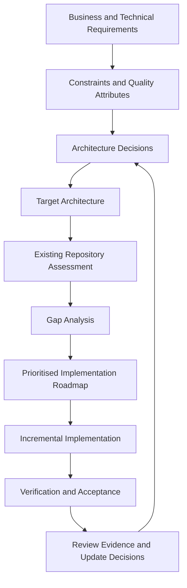
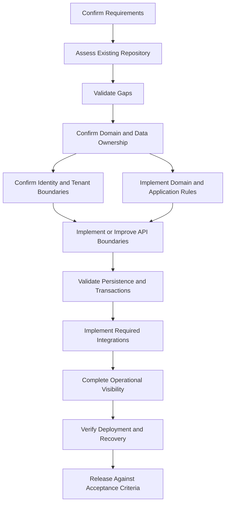

# Layer 11 — Architecture Decision Records, Repository Assessment, and Implementation Roadmap

## 11.1 Purpose of This Layer

We now have the architecture direction for the Composable Business Platform:

- Layer 1 — Client Applications
- Layer 2 — Edge and API Entry
- Layer 3 — Identity and Access Boundaries
- Layer 4 — Backend API and Application Architecture
- Layer 5 — Database Architecture and Persistence
- Layer 6 — Service-to-Service Communication and Distributed Workflows
- Layer 7 — Security, Identity, Authorisation, and Multi-Tenancy
- Layer 8 — Audit, Observability, Logging, and Operational Reliability
- Layer 9 — Testing Architecture and Quality Strategy
- Layer 10 — Deployment Architecture, CI/CD, Configuration, and Release Strategy

The next challenge is turning those architectural ideas into an implementation plan that fits the existing `finflow-microservices` repository.

We must answer five questions:

1. What already exists?
2. What works correctly and should be retained?
3. What is missing or needs improvement?
4. Which architectural decisions must be made before implementation?
5. What should we implement first, and how will we prove it works?

The goal is not to create the largest possible architecture. The goal is to build the **simplest maintainable architecture that satisfies the verified requirements and can evolve safely**.

### Core principle

**Do not rewrite existing code merely because the target architecture suggests a different structure.**

First understand the current implementation, identify the problem, compare alternatives, and document the reason for any proposed change.

---

## 11.2 The Relationship Between Requirements, Architecture, and Code

Architecture should not begin with a technology choice or a folder structure.

It should begin with the problem the system must solve.



### Example

Suppose the platform needs to support multiple organisations.

That requirement does not automatically mean we must introduce a separate database for every organisation.

We must first understand:

- How organisations are represented.
- Whether users can belong to multiple organisations.
- Whether data isolation is required at the application, database, or infrastructure level.
- What the security and compliance requirements are.
- What scale and operational constraints exist.

Only then can we compare possible tenancy models.

Similarly, a requirement for asynchronous processing does not automatically mean we must introduce Kafka. We first need to establish the workflow requirements, delivery guarantees, throughput, failure handling, and existing infrastructure.

**Requirements determine which options are acceptable. Architecture decisions explain why we choose one of those options.**

---

## 11.3 Architecture Decision Records (ADRs)

An Architecture Decision Record, or ADR, is a short document that records an important architectural decision and the reasoning behind it.

An ADR should explain more than the technology selected.

It should capture:

- The context and problem.
- The decision to be made.
- The options considered.
- The decision and its rationale.
- The consequences and trade-offs.
- The evidence or assumptions supporting the decision.

ADRs are particularly useful when a future developer asks why the system was designed a certain way.

### Example: Choosing a service architecture

Suppose we need to decide whether Commerce and FinFlow should be separate deployable services.

Possible options include:

1. A modular monolith with clear domain boundaries.
2. Separate deployable services with independent persistence and APIs.
3. A hybrid approach in which only domains with demonstrated independent requirements are separated.

We should not automatically select option 2 simply because the project is called `finflow-microservices`.

The repository name is not evidence that every domain needs an independent deployment boundary.

The correct choice depends on deployment requirements, security boundaries, data ownership, operational capability, and the current implementation.

---

## 11.4 Recommended ADR Structure

Use a consistent template for important architectural decisions.

A possible repository structure is:

```text
docs/
└── architecture/
    ├── README.md
    ├── adr/
    │   ├── ADR-001-system-boundaries.md
    │   ├── ADR-002-data-ownership.md
    │   ├── ADR-003-tenant-isolation.md
    │   └── ADR-004-service-communication.md
    ├── diagrams/
    └── implementation-roadmap.md
```

This is a proposed structure, not an instruction to create these files before inspecting the existing repository. If the project already has an appropriate documentation structure, retain it where practical.

### ADR template

```markdown
# ADR-NNN: Decision Title

## Status

Proposed | Accepted | Superseded | Deprecated

## Date

YYYY-MM-DD

## Context

What problem are we solving?

What business requirements, constraints, or technical limitations
make this decision necessary?

## Decision Drivers

- Requirement 1
- Requirement 2
- Operational constraint
- Security requirement

## Options Considered

### Option A

Description, advantages, disadvantages, and risks.

### Option B

Description, advantages, disadvantages, and risks.

### Option C

Description, advantages, disadvantages, and risks.

## Decision

What are we choosing?

Be precise about what is included and what is not.

## Rationale

Why is this option the best fit for the verified requirements?

## Consequences

### Positive

- Benefit 1

### Negative

- Trade-off 1

### Risks and Mitigations

- Risk:
- Mitigation:

## Verification

What evidence will prove that this decision works?

## Revisit Conditions

What new information would justify reviewing this decision?
```

### Why record negative consequences?

Every meaningful architecture choice has trade-offs.

For example, splitting a service may improve independent deployment but increase network failure modes, deployment coordination, and operational overhead.

Recording only the advantages makes the ADR a justification document rather than a useful decision record.

---

## 11.5 Which Decisions Deserve an ADR?

Not every code-level choice requires an ADR.

An ADR is most useful when a decision:

- Affects multiple modules or services.
- Introduces a new infrastructure dependency.
- Changes data ownership or transaction boundaries.
- Affects security or tenant isolation.
- Has substantial operational consequences.
- Is expensive to reverse.
- Involves a meaningful trade-off between competing approaches.

Routine implementation choices generally belong in code reviews, design notes, or normal technical documentation.

### Candidate decisions for this platform

| Decision area | Questions to resolve |
|---|---|
| Application boundaries | Which domains need independent deployment? |
| Domain ownership | Which module owns each business rule? |
| Data ownership | Which component owns each database schema and table? |
| Transaction boundaries | Which operations must be atomic? |
| Tenant isolation | How is organisation-scoped access enforced? |
| API versioning | How are incompatible contract changes managed? |
| Asynchronous workflows | When is asynchronous processing necessary? |
| Event delivery | How are duplicate messages and retries handled? |
| Idempotency | Which business operations must tolerate repeated requests? |
| Audit | Which business and administrative actions require durable audit records? |
| Security | How are authentication, authorisation, and service identities enforced? |
| Observability | Which logs, metrics, traces, and business signals are required? |
| Deployment | How are artifacts released and recovered? |
| Testing | Which quality gates must pass before release? |

These are candidate decisions, not a requirement to create an ADR for every row immediately.

We should resolve them in the order their answers affect implementation.

---

## 11.6 Repository Assessment Before Implementation

The repository assessment establishes the factual starting point.

We need to understand the actual project, not an imagined version of it.

### Assessment objectives

1. Identify the modules and applications that exist.
2. Understand the build system and runtime versions.
3. Locate controllers, application services, domain models, and persistence adapters.
4. Understand database schemas and migrations.
5. Identify authentication and authorisation mechanisms.
6. Map current service-to-service calls.
7. Review tests and build verification.
8. Inspect deployment and configuration mechanisms.
9. Identify operational and security gaps.
10. Establish which existing components can be retained.

### Initial repository inventory

Start with the repository's current state and documentation.

For a local Git checkout, read-only inspection commands might include:

```bash
# Confirm the repository location
pwd

# Inspect the working tree
git status --short

# Inspect the current branch
git branch --show-current

# Inspect recent commits
git log -5 --oneline

# Inspect top-level files
find . -maxdepth 2 -type f \
  -not -path './.git/*' \
  -not -path './target/*' \
  | sort
```

These commands are examples for a compatible shell. They are not a claim that the repository is currently available in this conversation.

The file listing is intentionally limited in depth. Large repositories may need more targeted inspection.

### Inspect build and configuration files

Look for files such as:

```text
pom.xml
mvnw
build.gradle
build.gradle.kts
settings.gradle
gradlew
application.yml
application.properties
Dockerfile
docker-compose.yml
compose.yaml
.gitlab-ci.yml
.github/workflows/
Jenkinsfile
```

Their presence or absence must be verified. Do not assume that every file exists.

Inspect relevant configuration before running builds, tests, migration commands, or deployment scripts. Some build and test configurations can execute plugins or external processes, so the verification environment and command behaviour matter.

### Important safety rule

During the initial assessment, prefer read-only inspection.

Do not run production migrations, destructive database commands, deployment commands, or data-changing scripts merely to understand the project.

Before any command that changes data or infrastructure, establish its purpose, scope, target environment, expected effects, and recovery plan.

---

## 11.7 Build a Repository Inventory

After inspection, create a factual inventory.

An illustrative inventory might look like this:

| Area | What to identify | Evidence |
|---|---|---|
| Build | Maven or Gradle, modules, plugins | Build files |
| Runtime | Java and framework versions | Build configuration and runtime metadata |
| API | Controllers, routes, request and response DTOs | Source code and API documentation |
| Application | Use cases and application services | Source packages |
| Domain | Entities, value objects, invariants | Domain code and tests |
| Persistence | Repositories, ORM mappings, SQL | Persistence code and schema |
| Migrations | Migration tool and applied versions | Migration files and environment metadata |
| Security | Authentication and authorisation | Security configuration and tests |
| Tenancy | Organisation context and isolation | Queries, filters, policies, and tests |
| Integration | HTTP clients, events, scheduled jobs | Client and worker code |
| Testing | Unit, integration, contract, and end-to-end tests | Test source and CI configuration |
| Observability | Logging, metrics, traces, health checks | Dependencies and configuration |
| Deployment | Packaging, runtime, release process | Scripts, manifests, pipeline configuration |
| Documentation | Setup, architecture, operations | README and documentation |

For each item, distinguish:

- Confirmed present.
- Confirmed absent.
- Present but not yet verified.
- Not applicable.
- Blocked by missing access or information.

**Absence of evidence is not automatically evidence of absence.** For example, a deployment process may be documented outside the repository.

---

## 11.8 Map the Existing Code to the Target Architecture

The target architecture is a reference model, not an instruction to rename every existing package.

For each existing component, identify its responsibility and dependencies.

An example mapping table:

| Existing component | Actual responsibility | Target responsibility | Action |
|---|---|---|---|
| Existing REST controller | To be inspected | API boundary | Keep, improve, or replace based on evidence |
| Existing application service | To be inspected | Use-case orchestration | Assess transaction and dependency boundaries |
| Existing domain class | To be inspected | Domain model | Verify invariants and ownership |
| Existing repository | To be inspected | Persistence abstraction | Assess query correctness and isolation |
| Existing HTTP client | To be inspected | Service integration | Assess timeouts, retries, and error handling |
| Existing security configuration | To be inspected | Security boundary | Verify authentication and access enforcement |
| Existing tests | To be inspected | Quality gates | Assess coverage of critical behaviours |

Do not populate the table with guessed package names or assumed implementation details.

### Example: Existing controller

Suppose an existing controller contains request validation, business rules, SQL queries, and HTTP response mapping.

We should not immediately delete it and create a new controller.

Instead:

1. Identify the business behaviour it currently implements.
2. Find all routes and callers that depend on it.
3. Review existing tests.
4. Identify the concerns that are mixed together.
5. Define the desired separation.
6. Refactor incrementally.
7. Run regression tests after each meaningful change.

This approach reduces the risk of changing externally visible behaviour unintentionally.

---

## 11.9 Gap Analysis

Once the inventory is complete, compare the current state with the requirements and target architecture.

A gap is a verified difference between what is needed and what currently exists.

It is not simply a difference between the repository and a preferred coding style.

### Gap classification

Use categories such as:

- **Missing capability:** A required capability does not exist.
- **Correctness defect:** Existing behaviour violates a requirement or invariant.
- **Security gap:** A required security control is missing or ineffective.
- **Reliability gap:** Failure handling or recovery is insufficient.
- **Maintainability concern:** Code structure creates a demonstrable maintenance problem.
- **Performance concern:** Measured or evidenced performance fails a requirement.
- **Documentation gap:** Required knowledge or operational instructions are missing.
- **Optional improvement:** A potential improvement without an established requirement.

### Gap register template

| ID | Finding | Evidence | Impact | Priority | Proposed action | Acceptance criteria |
|---|---|---|---|---|---|---|
| GAP-001 | Record an observed issue | File, test, or reproducible result | Explain the risk | P0–P3 | Proposed correction | Testable outcome |
| GAP-002 | Record another observed issue | Supporting evidence | Explain the risk | P0–P3 | Proposed correction | Testable outcome |

The entries above are placeholders, not findings about the actual repository.

### Priority definitions

| Priority | Meaning |
|---|---|
| P0 | Critical security, data integrity, or availability risk requiring immediate controlled attention |
| P1 | Essential requirement or major correctness issue blocking the intended release |
| P2 | Important quality or maintainability improvement |
| P3 | Optional improvement or work that can be deferred |

Priorities must reflect actual impact and context. A suspected issue may require investigation before it can be assigned a final priority.

---

## 11.10 Dependency-Aware Implementation Planning

Not every task can be implemented independently.

For example, adding an audit record for a business operation depends on knowing:

- What the operation is.
- Which component owns it.
- Which actor or system initiated it.
- What information must be recorded.
- Where the record is persisted.
- How failures in audit recording are handled.

Likewise, implementing tenant-scoped repository queries depends on a clear tenant identity and authorisation model.

The implementation plan should respect these dependencies.



This diagram shows conceptual dependencies, not a mandatory sequence for every file.

Some work can proceed in parallel once its dependencies and contracts are clear.

---

## 11.11 Recommended Implementation Roadmap

The roadmap below is a proposed sequence. Its exact scope should be adjusted after repository inspection.

### Phase 0 — Establish the baseline

**Objective:** Understand what exists and protect the current working state.

Activities:

- Review the repository and its documentation.
- Identify build and test commands.
- Record current runtime and dependency versions.
- Identify existing applications, modules, and service boundaries.
- Inspect database schemas and migrations.
- Review security, configuration, and deployment mechanisms.
- Record current tests and known failures.
- Establish a safe local or non-production verification environment.

Deliverables:

- Repository inventory.
- Current architecture diagram.
- Initial gap register.
- Baseline build and test results.
- List of unknowns and required decisions.

Acceptance criteria:

- The existing project structure is understood well enough to explain its main execution paths.
- The baseline build and tests have recorded outcomes.
- Known failures are distinguished from newly introduced failures.
- No unnecessary source or database changes have been made.

### Phase 1 — Confirm requirements and architecture decisions

**Objective:** Resolve decisions that materially affect implementation.

Activities:

- Confirm the required business workflows.
- Establish domain boundaries and data ownership.
- Decide which components require independent deployment.
- Define identity, organisation membership, and tenant isolation.
- Define critical business invariants.
- Establish API and integration compatibility expectations.
- Record high-impact decisions as ADRs.

Deliverables:

- Accepted or explicitly provisional ADRs.
- Updated target architecture.
- Confirmed scope and exclusions.
- Prioritised implementation plan.

Acceptance criteria:

- Each major architectural decision has a documented rationale.
- Important assumptions are visible.
- Unresolved decisions have an owner and a resolution plan.
- Technology choices have a demonstrated requirement or an explicit reason to defer them.

### Phase 2 — Establish the quality and security foundation

**Objective:** Ensure changes can be validated safely.

Activities:

- Confirm reproducible build and test commands.
- Add missing automated tests for critical existing behaviour.
- Review dependency and secret-handling practices.
- Establish appropriate static analysis and dependency checks.
- Define test configuration and safe test-data management.
- Verify authentication and authorisation boundaries.
- Identify critical tenant-isolation tests where multi-tenancy applies.

Deliverables:

- Reliable local verification workflow.
- Initial CI quality gates.
- Documented security assumptions.
- Tests covering the most important existing behaviours.

Acceptance criteria:

- Required checks run repeatably.
- Critical business rules have meaningful tests.
- Test execution does not depend on production credentials or data.
- Security and tenant boundaries have explicit verification criteria.

### Phase 3 — Improve domain and application boundaries

**Objective:** Make the core business behaviour understandable and testable.

Activities:

- Identify use cases and their owners.
- Separate API concerns from application orchestration where needed.
- Separate domain rules from infrastructure details where appropriate.
- Review transaction boundaries.
- Establish repository contracts and persistence ownership.
- Refactor only where evidence justifies the change.

Deliverables:

- Clearer responsibilities across API, application, domain, and infrastructure code.
- Defined use-case transaction boundaries.
- Tests for critical state transitions and business invariants.

Acceptance criteria:

- Core business rules can be tested without unnecessary infrastructure dependencies.
- API handlers do not become the sole location of complex business logic.
- Transaction boundaries are deliberate.
- Existing externally visible behaviour remains compatible unless a change is explicitly required.

### Phase 4 — Strengthen persistence and data integrity

**Objective:** Make data access correct, consistent, and recoverable.

Activities:

- Review entity mappings and database constraints.
- Verify transaction boundaries.
- Review concurrency-sensitive operations.
- Verify tenant-scoped access where applicable.
- Review migration versioning and compatibility.
- Define backup, restore, and data-recovery expectations according to operational requirements.

Deliverables:

- Verified persistence behaviour.
- Migration and compatibility rules.
- Tests for data-integrity constraints.
- Documented recovery limitations.

Acceptance criteria:

- Critical invariants are enforced at the appropriate application and database boundaries.
- Duplicate and concurrent operations behave according to their defined contracts.
- Tenant isolation is verified where required.
- Migration and recovery procedures are understood.

### Phase 5 — Strengthen service communication and workflows

**Objective:** Make integrations predictable under failure.

Activities:

- Review synchronous dependencies.
- Add appropriate timeouts and bounded retry policies.
- Ensure retries are safe for the operation being retried.
- Establish idempotency where required.
- Verify API and event contracts.
- Implement durable workflow state where needed.
- Introduce outbox, deduplication, or other delivery controls only where justified by the delivery requirements.

Deliverables:

- Documented service contracts.
- Defined failure-handling policies.
- Tests for timeouts, duplicate requests, and partial failure.
- Explicit workflow state transitions where applicable.

Acceptance criteria:

- Failure behaviour is defined rather than accidental.
- Retrying an operation cannot silently violate business invariants.
- Asynchronous workflows expose failure and recovery states.
- Cross-service assumptions are documented.

### Phase 6 — Complete audit and operational visibility

**Objective:** Make production behaviour understandable and supportable.

Activities:

- Define required audit events.
- Establish structured application logging.
- Add relevant metrics and tracing.
- Define health and readiness behaviour.
- Establish alerting thresholds from actual operational requirements.
- Document common failure investigation procedures.

Deliverables:

- Audit requirements and implementation.
- Operational dashboards or equivalent visibility.
- Health-check behaviour.
- Initial runbooks.

Acceptance criteria:

- Important failures can be investigated using available evidence.
- Sensitive data is not unnecessarily exposed in logs.
- Required business actions have appropriate audit coverage.
- Technical health is distinguished from business success.

### Phase 7 — Establish controlled deployment and recovery

**Objective:** Release verified changes consistently.

Activities:

- Confirm artifact packaging.
- Establish versioned build artifacts.
- Validate environment-specific configuration.
- Configure deployment permissions.
- Validate database migration ordering.
- Establish staging and production release gates appropriate to the environment.
- Rehearse rollback or roll-forward procedures.

Deliverables:

- Repeatable build and deployment process.
- Release acceptance criteria.
- Deployment verification steps.
- Recovery procedures and rehearsal results.

Acceptance criteria:

- The deployed artifact is identifiable.
- Required checks run before release.
- Production configuration and secrets are handled appropriately.
- Failed releases can be detected and safely investigated.
- Recovery procedures have been tested in an appropriate environment.

### Phase 8 — Validate the complete platform

**Objective:** Verify the complete business workflows rather than isolated components only.

Activities:

- Run critical end-to-end scenarios.
- Test relevant failure and recovery paths.
- Verify security and organisation isolation.
- Validate data consistency and reconciliation.
- Test performance against explicit requirements.
- Review operational readiness.
- Resolve release-blocking defects.

Deliverables:

- End-to-end test evidence.
- Security and data-integrity verification results.
- Performance findings where applicable.
- Release readiness assessment.

Acceptance criteria:

- Critical user and business workflows meet their defined acceptance criteria.
- Known high-impact risks are resolved or explicitly accepted by the appropriate decision-maker.
- Operational support and recovery responsibilities are clear.
- Release evidence is available and reviewable.

---

## 11.12 Avoid Turning the Roadmap into a Big-Bang Rewrite

A phased roadmap does not mean that every phase must finish completely before any useful business feature can be delivered.

A better implementation strategy is to establish a safe foundation and then deliver thin, testable slices.

For example, a Commerce order-creation slice might include:

1. API request and validation.
2. Application use case.
3. Domain rules.
4. Persistence and transaction boundary.
5. Authorisation.
6. Automated tests.
7. Structured logs and required metrics.
8. Deployment and acceptance verification.

The slice should be complete enough to demonstrate the business outcome and its operational behaviour.

Then the same approach can be reused for the next capability.

### Vertical slice versus horizontal rewrite

A horizontal rewrite might first create all controllers, then all services, then all repositories, without completing an end-to-end workflow.

A vertical slice completes one meaningful workflow across the necessary layers.

For a maintainable platform, vertical slices often provide faster feedback because they reveal integration problems before large amounts of code accumulate.

However, foundational work such as authentication, database migration tooling, or build configuration may need to be completed first when the slice depends on it.

---

## 11.13 Example: Implementing a Commerce Order Slice

Consider a requirement:

"A customer can submit an order, and repeating the same request with the same idempotency key must not create a second logical order."

### Step 1 — Confirm the requirement

Clarify:

- What makes an order request unique?
- How is the idempotency key scoped?
- How long must the key remain valid?
- What happens if the same key is reused with a different request body?
- What response is returned when the original request is still processing?
- What happens if the server commits the order but the client times out?

These questions affect the data model, API contract, transaction boundaries, and tests.

### Step 2 — Inspect existing implementation

Find the existing order endpoint, application service, persistence code, and tests.

Establish whether idempotency already exists and whether it works under concurrent requests.

Do not create a second idempotency mechanism until the existing implementation has been assessed.

### Step 3 — Define the design

A suitable design may involve:

- A validated API request.
- An application use case.
- A domain model that enforces order invariants.
- A persistence transaction.
- A durable uniqueness mechanism for the idempotency scope.
- A defined response for repeated requests.
- Observability for rejected or failed requests.

The precise implementation depends on the existing schema, database capabilities, and API contract.

### Step 4 — Implement incrementally

Make the smallest justified changes.

Add or update tests for:

- A valid new order.
- An invalid order.
- The same key and same request.
- The same key with a different request.
- Concurrent requests using the same key.
- A timeout after the order is committed.
- A database or dependency failure.

### Step 5 — Verify the complete slice

Verify not only that the unit tests pass, but also that the persistence constraints, API behaviour, error handling, and release process support the requirement.

### Acceptance criteria

The slice is complete when the documented idempotency contract is satisfied under the tested conditions, data integrity is preserved, and failures are observable and recoverable according to the defined requirements.

This is a better measure of completion than the number of Java classes created.

---

## 11.14 Definition of Done for Architectural Work

Each implementation task should have explicit acceptance criteria.

A useful general definition of done is:

- [ ] The requirement and intended behaviour are documented.
- [ ] Existing behaviour and affected callers have been identified.
- [ ] The design respects domain and data ownership.
- [ ] Security and authorisation requirements have been addressed.
- [ ] Relevant automated tests have been added or updated.
- [ ] Required quality checks pass.
- [ ] Database changes are versioned and compatible where applicable.
- [ ] Logging, metrics, and audit requirements are addressed.
- [ ] Configuration and secret-handling requirements are satisfied.
- [ ] Operational and recovery implications are understood.
- [ ] Documentation is updated where necessary.
- [ ] The change has been reviewed and its acceptance evidence recorded.

Not every task requires every item. A documentation-only change, for example, may not require a database migration.

The checklist should be applied proportionately without silently skipping important controls.

---

## 11.15 Architecture Governance Without Unnecessary Bureaucracy

Architecture decisions should be documented, but the process should not prevent ordinary development.

Use lightweight governance:

1. Record decisions that materially affect boundaries, data, security, reliability, or operational cost.
2. Keep ADRs short enough to review.
3. Link each decision to the requirements that justify it.
4. Record consequences and rejected alternatives.
5. Revisit decisions when their assumptions change.
6. Avoid creating ADRs for every class, method, or routine implementation detail.

### When should an ADR be reconsidered?

Suppose an early release uses a synchronous service call because traffic is modest and the workflow benefits from immediate results.

Later, the business requires durable processing during downstream outages.

That new requirement may justify revisiting the original communication decision.

The original ADR was not necessarily wrong. It was based on a particular set of requirements and constraints.

**Good architecture records why a decision made sense at the time and what evidence would justify changing it.**

---

## 11.16 How to Measure Progress

Measure implementation progress through verified capabilities rather than raw file counts.

Useful indicators include:

| Measure | What it tells us |
|---|---|
| Critical requirements with acceptance criteria | Whether the expected outcomes are defined |
| Critical business rules with automated tests | Whether core behaviour is protected |
| High-priority gaps resolved | Whether material risks are being addressed |
| Security requirements verified | Whether security controls have evidence |
| Database migrations tested | Whether schema changes are controlled |
| Critical workflows tested end to end | Whether the layers work together |
| Release verification completed | Whether the release process is repeatable |
| Recovery exercises completed | Whether documented recovery is practical |
| Open architecture decisions | Whether important uncertainties remain unresolved |

Avoid treating code coverage as the sole measure of quality. High line coverage does not guarantee meaningful assertions, correct business behaviour, or safe failure handling.

Progress should reflect requirements satisfied and risks reduced.

---

## 11.17 Common Architecture and Planning Mistakes

### Mistake 1: Rewriting the repository before understanding it

This can discard working behaviour, remove useful constraints, and introduce new defects.

**Better:** Establish a baseline and create an evidence-based gap register first.

### Mistake 2: Treating the architecture diagram as a mandatory folder structure

A diagram explains responsibilities and relationships. It does not automatically dictate package names or require a separate deployable service for every box.

**Better:** Translate responsibilities into the simplest maintainable structure that fits the requirements.

### Mistake 3: Selecting infrastructure before validating the need

Introducing a message broker, cache, orchestrator, or additional service creates maintenance and failure-handling responsibilities.

**Better:** Record the requirement, compare alternatives, and introduce infrastructure only when its benefits justify its cost.

### Mistake 4: Writing ADRs after the decision has already been forgotten

This leaves the team unable to reconstruct the original reasoning.

**Better:** Record significant decisions when they are made, including assumptions and trade-offs.

### Mistake 5: Treating optional improvements as mandatory gaps

This can lead to unnecessary work and an oversized platform.

**Better:** Separate essential requirements, verified defects, quality improvements, and speculative future needs.

### Mistake 6: Implementing all layers before testing a complete workflow

The individual components may work independently but fail when integrated.

**Better:** Deliver small vertical slices after the necessary foundations are established.

### Mistake 7: Using a roadmap without acceptance criteria

Tasks can be marked complete even when the intended behaviour remains incorrect.

**Better:** Define observable outcomes and verification evidence before implementation.

### Mistake 8: Ignoring unknowns

Assumptions about the database, hosting platform, service boundaries, or existing security configuration can produce incorrect plans.

**Better:** Maintain an explicit list of unknowns and resolve those that block the next decision.

### Mistake 9: Treating a repository assessment as a one-time activity

The implementation evolves, and architectural assumptions may change.

**Better:** Update the inventory, ADRs, and gap register when material changes occur.

### Mistake 10: Confusing technical completion with business completion

A successful build does not prove that the customer workflow or data-integrity requirements are satisfied.

**Better:** Measure completion against the business and operational acceptance criteria.

---

## 11.18 Interview Questions and Follow-Ups

### Q1. What is an Architecture Decision Record?

An ADR documents an important architectural decision, including its context, alternatives, rationale, consequences, and conditions under which it might be revisited.

**Follow-up:** Why record rejected alternatives?

They explain the trade-offs considered and prevent the team from repeatedly revisiting the same decision without new evidence.

### Q2. How would you assess an existing microservices repository before changing it?

I would inspect its modules, dependencies, build process, API boundaries, domain logic, persistence, security, integrations, tests, observability, and deployment process.

Then I would map the findings against verified requirements and document the gaps before proposing changes.

### Q3. Would you rewrite a poorly structured controller?

Not automatically. I would first understand its behaviour, callers, tests, and dependencies. If its responsibilities are mixed together, I would define a target separation and refactor incrementally with regression tests.

### Q4. What is the difference between a requirement and an architectural decision?

A requirement describes an outcome or constraint that must be satisfied.

An architectural decision selects an approach for satisfying that requirement within the relevant constraints.

For example, organisation data must be isolated is a requirement. The chosen tenancy and enforcement model is an architectural decision.

### Q5. How do you prioritise architectural improvements?

I consider correctness, security, data integrity, availability, business impact, dependencies, implementation cost, and risk.

Critical security or data-integrity issues may require immediate attention, while optional improvements can be deferred.

### Q6. Why is a modular monolith sometimes preferable to microservices?

A modular monolith can preserve clear domain boundaries without introducing unnecessary network calls, independent deployments, distributed transactions, and operational overhead.

Microservices are justified when independent deployment, scaling, ownership, security, or other verified requirements outweigh those costs.

### Q7. What is a vertical slice?

A vertical slice implements a complete business capability across the necessary layers, from the API or entry point through business logic and persistence to testing and operational verification.

It provides early evidence that the architecture works end to end.

### Q8. How would you avoid unnecessary technology choices?

I would identify the actual requirement, compare viable alternatives, document the trade-offs, and select the simplest option that meets the requirement. I would defer expensive infrastructure decisions until the evidence justifies them.

### Q9. What is a gap register?

A gap register records verified differences between the current system and required capabilities. It includes evidence, impact, priority, proposed action, and acceptance criteria.

### Q10. How do you know an architectural improvement is complete?

The intended requirement is satisfied, relevant tests and checks pass, security and operational implications are addressed, and the result has evidence of correctness.

The completion criteria depend on the change; adding a new class is not itself proof of success.

### Q11. What should happen when an ADR becomes obsolete?

Record the newer decision and mark the old ADR as superseded, linking the two. Preserve the historical reasoning rather than silently deleting it.

### Q12. How do you decide whether to introduce asynchronous processing?

I would assess durability, response-time requirements, workload, downstream failure tolerance, ordering, delivery semantics, operational complexity, and whether the business workflow can support eventual consistency.

Asynchronous processing should solve a demonstrated requirement, not merely increase architectural complexity.

### Q13. How would you start work on an unfamiliar production codebase?

I would establish a safe baseline, inspect the architecture and build process, identify critical paths, understand the existing tests, and verify the highest-risk behaviour before making changes.

I would keep the first changes small and evidence-based.

---

## 11.19 Final Summary

Layer 11 establishes the process for turning architecture into maintainable, verifiable software.

The most important principles are:

1. Understand the requirements before choosing technologies.
2. Inspect the repository before proposing a rewrite.
3. Distinguish verified gaps from optional improvements.
4. Record important architectural decisions and trade-offs.
5. Respect domain ownership, transaction boundaries, and security constraints.
6. Prioritise work according to risk and dependency.
7. Implement complete, testable business slices.
8. Define acceptance criteria before declaring work complete.
9. Update architecture decisions when requirements or evidence change.
10. Measure progress by verified capabilities rather than code volume.

The architecture is a means to achieve reliable business outcomes—not an end in itself.

---

# Next Step — Repository Assessment and Implementation Planning

At this point, we have documented the architecture from client applications through deployment and implementation planning.

The next activity should move from architecture documentation toward the actual `finflow-microservices` repository.

Before implementing new modules, services, messaging infrastructure, or deployment scripts, establish the current state and map it to the target architecture.

The first deliverable should be a **repository assessment and gap register**, followed by a prioritised implementation plan.

That gives us a factual foundation for deciding what to retain, improve, introduce, or defer.
