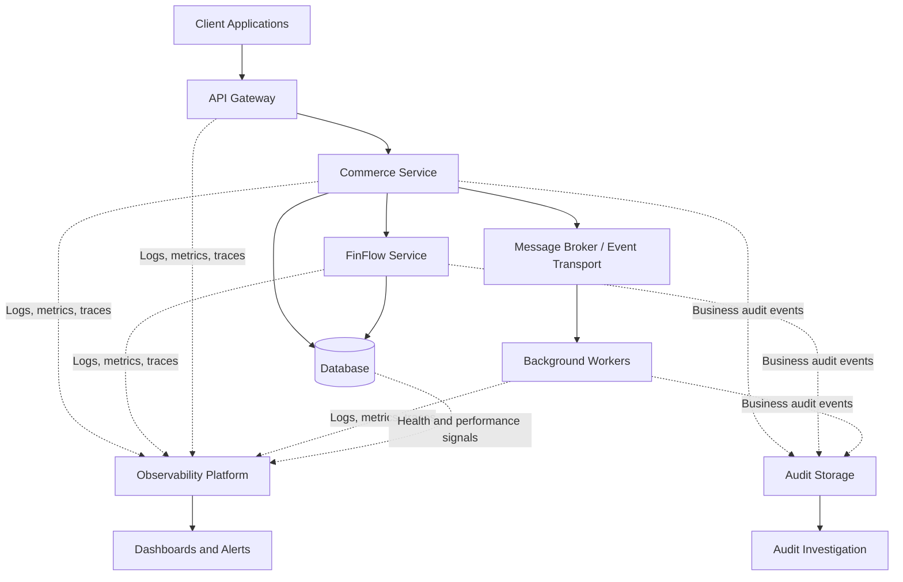
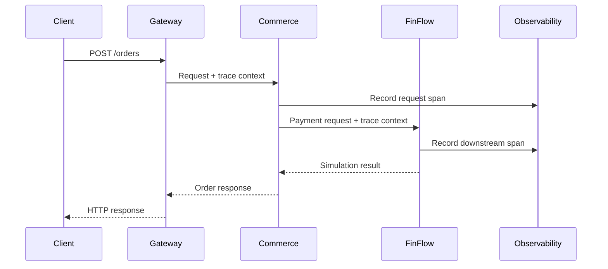
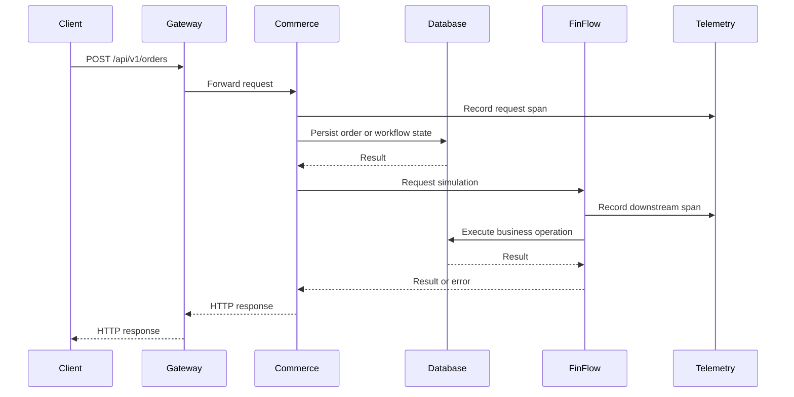

# Layer 8 — Audit, Observability, Logging, and Operational Reliability

## 8.1 Purpose of This Layer

A platform is not production-ready merely because its APIs work and its database stores correct records.

We must also be able to answer:

- Is the platform available?
- Are requests succeeding?
- Which service is causing a failure?
- Why did a particular order or simulated transfer fail?
- Did a request time out before or after a state change?
- Are failures affecting one tenant or the entire platform?
- Are asynchronous workflows stuck?
- Are database connections, thread pools, or downstream dependencies becoming exhausted?
- Can we investigate an incident without exposing sensitive information?
- Can an engineer identify the cause of a failure without manually searching every service?

Layer 8 establishes the shared operational capabilities that make these questions answerable.

The objectives are to:

1. Standardise structured application logging.
2. Propagate correlation identifiers across service boundaries.
3. Trace distributed requests and workflows.
4. Collect metrics about technical health and business outcomes.
5. Define health checks and dependency monitoring.
6. Establish actionable alerts and incident-response practices.
7. Separate operational logs from business audit records.
8. Monitor asynchronous processing and distributed workflows.
9. Protect sensitive information in logs, traces, and metrics.
10. Define measurable reliability expectations.

### Core principle

**Logs explain individual events, metrics show patterns, traces explain request journeys, and audit records establish what happened to important business operations.**

These capabilities complement one another; none replaces all the others.

---

## 8.2 Where Observability Fits in the Architecture

Observability is a cross-cutting platform capability.



The message broker and background workers in this diagram are architectural possibilities, not a requirement to introduce a particular messaging technology immediately.

Likewise, observability and audit storage can share underlying infrastructure where appropriate, but their access, retention, integrity, and availability requirements must remain explicit.

### Architectural responsibilities

| Component | Responsibility |
|---|---|
| Client | Propagate supported request context and capture relevant client-side failures. |
| API Gateway | Record request outcomes, latency, routing, and edge-security failures. |
| Business services | Emit structured logs, traces, metrics, and relevant business audit events. |
| Database | Expose suitable performance, availability, and connection-health signals. |
| Message consumers | Record processing outcomes, retries, failures, and processing lag. |
| Observability platform | Collect, query, visualise, and correlate operational signals. |
| Audit storage | Preserve important business and security records under defined controls. |
| Alerting system | Notify the responsible people about actionable conditions. |

The exact tools can be selected later. The architecture should first establish what must be observed and why.

---

## 8.3 The Four Important Operational Signals

The most useful starting point is the relationship between logs, metrics, traces, and audit records.

### 1. Logs

Logs are timestamped records of events that occurred.

Example:

```json
{
  "timestamp": "2026-10-27T10:00:00Z",
  "level": "ERROR",
  "service": "commerce-service",
  "event": "payment_simulation_failed",
  "orderId": "order-101",
  "correlationId": "req-456",
  "errorCode": "FINFLOW_TIMEOUT"
}
```

This is an illustrative log record.

It tells us that Commerce recorded a payment-simulation failure and provides identifiers for further investigation.

Logs should be structured so that engineers can filter by service, event, error code, and correlation identifier.

### 2. Metrics

Metrics are numerical measurements collected over time.

Examples:

- Number of HTTP requests.
- Percentage of failed requests.
- Request latency.
- Database connection pool utilisation.
- Queue processing lag.
- Number of failed payment simulations.
- Number of retries.
- Number of stuck workflows.

Metrics help answer questions such as whether failures are increasing or whether a dependency is becoming slower.

### 3. Distributed traces

A distributed trace follows a request across multiple components.

For example:

```text
POST /api/v1/orders
    |
    +-- Commerce API: 12 ms
    |
    +-- Database query: 8 ms
    |
    +-- FinFlow request: 1,450 ms
    |       |
    |       +-- FinFlow database operation: 20 ms
    |
    +-- Commerce response: timeout
```

The numbers are illustrative.

A trace helps identify which operation consumed the time and where the request failed.

### 4. Business audit records

Audit records capture important business or security actions and their outcomes.

Example:

```json
{
  "eventType": "ORDER_CREATION_FAILED",
  "orderId": "order-101",
  "organisationId": "org-A",
  "actorId": "user-123",
  "outcome": "FAILED",
  "reasonCode": "PAYMENT_SIMULATION_REJECTED",
  "correlationId": "req-456"
}
```

An audit record is not simply a diagnostic message. It has defined business meaning and may have stronger retention, integrity, and access-control requirements.

### Comparison

| Capability | Main question | Typical retention concern |
|---|---|---|
| Logs | What happened during execution? | Operational troubleshooting needs |
| Metrics | How is the system behaving over time? | Trend analysis and alerting |
| Traces | Where did a request spend time or fail? | Diagnostic usefulness and storage cost |
| Audit | Which important action occurred, and what was its outcome? | Business, security, and compliance requirements |

Do not put every log line into a metric label or use diagnostic traces as the only record of a business transaction.

---

## 8.4 Correlation IDs and Trace Context

A correlation identifier allows related events to be associated with the same request or workflow.

Suppose a customer creates an order in Commerce, which requests a simulated payment from FinFlow.

Without correlation:

```text
Commerce log: request failed
FinFlow log: request received
Database log: query completed
```

These events may be difficult to connect.

With correlation:

```text
correlationId = req-456

Commerce: order creation started
FinFlow: payment simulation requested
FinFlow: simulation completed
Commerce: order creation failed during response handling
```

The events become easier to investigate.

### Correlation ID versus trace ID

These concepts are related but are not necessarily identical.

- A **correlation ID** is an application-level identifier used to associate related operations or business workflow events.
- A **trace ID** identifies a distributed trace composed of spans.
- A **span ID** identifies an individual operation within a trace.

A single business workflow may involve multiple HTTP requests, retries, scheduled jobs, or message consumers. In that case, its correlation ID may remain stable while individual trace IDs differ.

The architecture must define which identifiers are propagated and how they relate.

### Request flow



### Important rules

- Accept valid trace context according to the configured tracing standard.
- Generate a new request or trace identifier when required.
- Propagate trace context through supported service calls.
- Include identifiers in structured logs where useful.
- Preserve workflow correlation across asynchronous boundaries.
- Do not trust arbitrary client-supplied identifiers for authentication or authorisation.
- Avoid returning internal diagnostic details to clients.
- Do not use correlation identifiers as secrets or access credentials.

A trace identifier helps with diagnosis; it does not grant access to a request or resource.

---

## 8.5 Structured Logging

Structured logging records named fields instead of relying only on free-form text.

### Weak logging

```java
log.error("Payment failed for order " + orderId);
```

This may be readable to a human, but it is harder to query consistently.

### Better conceptual approach

```java
log.atError()
   .addKeyValue("event", "payment_simulation_failed")
   .addKeyValue("orderId", orderId)
   .addKeyValue("correlationId", correlationId)
   .addKeyValue("errorCode", errorCode)
   .log("Payment simulation failed");
```

The example uses an SLF4J-style fluent logging API; the exact supported API depends on the logging implementation and version selected for the project.

The important principle is consistent, queryable fields.

### Recommended common fields

| Field | Purpose |
|---|---|
| `timestamp` | When the event occurred |
| `level` | Severity |
| `service` | Service that emitted the event |
| `environment` | Environment in which the event occurred |
| `event` | Stable event name |
| `correlationId` | Application-level correlation |
| `traceId` | Distributed trace reference, when available |
| `requestId` | Individual request identifier, where used |
| `tenantId` | Tenant context when necessary and safe |
| `actorType` | User, service, or another recognised actor type |
| `errorCode` | Stable, queryable failure category |

Not every field belongs in every log event.

For example, a high-volume metric or log stream should not automatically include a customer email address or other personal information just because it is available.

### Logging levels

- `TRACE`: Very detailed execution information, generally used selectively.
- `DEBUG`: Diagnostic information useful during development or investigation.
- `INFO`: Significant normal events.
- `WARN`: Unexpected conditions that may require attention but do not necessarily indicate immediate failure.
- `ERROR`: Failures that prevented an operation or component from completing its intended work.

Avoid logging every successful method call at `INFO`. Excessive logging increases cost and can obscure genuinely important events.

Also avoid classifying every expected business rejection as an application error. A valid request rejected by a business rule may be a normal business outcome.

### Logging requirements

- Use stable event names.
- Prefer structured fields.
- Include enough context to investigate the failure.
- Avoid logging complete request or response bodies by default.
- Redact sensitive fields.
- Avoid logging the same exception repeatedly at every layer without adding value.
- Keep log severity consistent.
- Ensure timestamps use a consistent representation and are synchronised appropriately.

---

## 8.6 Sensitive Data and Observability Security

Observability data can itself become a security risk.

Logs, traces, and dashboards may contain identifiers, request parameters, stack traces, or data copied from application payloads.

### Never log unnecessarily

- Passwords.
- Access tokens and refresh tokens.
- API secrets.
- Private keys.
- Database credentials.
- Full payment or account credentials.
- Sensitive personal data without a justified purpose.
- Complete request bodies containing confidential information.

### Safer alternatives

Instead of:

```text
Authorization: Bearer eyJ...
```

Record:

```json
{
  "event": "authentication_completed",
  "outcome": "SUCCESS",
  "service": "commerce-service",
  "correlationId": "req-456"
}
```

Instead of recording an entire account object, record the event, safe internal identifier, and relevant outcome where permitted.

### Tenant and personal data

Even an organisation identifier can be sensitive in some contexts. Include it only when useful and permitted.

For metrics, avoid unbounded labels such as:

- Individual order IDs.
- User IDs.
- Unique request IDs.
- Arbitrary URL parameters.
- Full customer email addresses.

These labels create high cardinality and may increase storage cost substantially.

Use controlled dimensions such as service, endpoint template, status class, operation type, and error category.

### Access controls

Observability and audit systems need their own security controls:

- Restrict dashboard and log access.
- Protect export and query capabilities.
- Apply retention and deletion policies.
- Mask sensitive fields before storage where appropriate.
- Audit privileged access to sensitive records.
- Prevent untrusted users from injecting misleading log messages.
- Avoid exposing internal stack traces to external API clients.

---

## 8.7 Metrics: Measuring System Behaviour

Metrics turn individual events into measurable system behaviour.

A useful starting point is to classify metrics into four groups.

### A. Request metrics

- Request count.
- Request error count.
- Error ratio.
- Request latency.
- HTTP response status distribution.

### B. Resource metrics

- CPU utilisation.
- Memory utilisation.
- Garbage collection behaviour.
- Thread pool utilisation.
- Database connection pool usage.
- File descriptor usage where relevant.

### C. Dependency metrics

- Downstream request latency.
- Downstream timeout count.
- Retry count.
- Circuit-breaker state.
- Database query latency.
- Message processing lag.

### D. Business workflow metrics

- Orders created.
- Orders rejected.
- Simulated transfers completed.
- Simulated transfers rejected.
- Workflows stuck in intermediate states.
- Outbox records awaiting publication.
- Dead-letter or permanently failed messages, if messaging is used.

Business metrics should be designed carefully. A rejected transaction may be a legitimate outcome rather than a system failure.

### Example: request success ratio

Suppose the Commerce API processes 10,000 requests and 200 fail with server-side errors during a measurement window.

The server-error ratio is:

\[
\text{Error Ratio} = \frac{200}{10000} = 0.02 = 2\%
\]

This does not automatically mean the service violates its reliability target. The target, measurement window, endpoint scope, and definition of a bad request must be specified.

### Example: latency

Latency can be measured using percentiles:

- p50: median latency.
- p95: latency at the 95th percentile.
- p99: latency at the 99th percentile.

If p95 is 500 ms, approximately 95% of the measured requests completed within 500 ms during the selected measurement window, subject to the metric's measurement and aggregation method.

Averages alone can hide a small but important group of very slow requests.

### Metric design rules

- Define metric names and units consistently.
- Distinguish request count from request duration.
- Use controlled label values.
- Avoid sensitive information in labels.
- Avoid high-cardinality identifiers.
- Measure both technical outcomes and important business outcomes.
- Use histograms or suitable distributions for latency analysis.
- Define the measurement window and population for every SLI.

---

## 8.8 SLIs, SLOs, and SLAs

These concepts are often discussed together, but they mean different things.

**SLI — Service Level Indicator**

A measurement of service behaviour.

Example:

```text
Percentage of eligible order-creation requests that complete successfully.
```

**SLO — Service Level Objective**

An internal target for an SLI over a defined period.

Example:

```text
99.9% of eligible order-creation requests succeed over a rolling 30-day window.
```

This is an illustrative target, not a commitment that the platform must adopt.

**SLA — Service Level Agreement**

An external commitment to customers, potentially including contractual consequences when the agreed service level is not met.

An SLA should not be invented simply because the engineering team has defined an SLO.

### Example SLI definition

A meaningful order-creation SLI must define:

1. Which endpoint and request population are included.
2. Which outcomes count as success.
3. Whether expected business rejections are excluded.
4. How timeouts and server errors are counted.
5. The measurement period.
6. How monitoring gaps are handled.

Without these definitions, two dashboards may report different success ratios for the same service.

### Error budgets

If an SLO allows a small proportion of bad requests, the corresponding error budget represents the allowed unreliability over the defined period.

For an illustrative 99.9% success objective, the permitted bad-event ratio is 0.1%.

How that translates into an absolute number depends on the SLI and measurement population.

An error budget can help teams balance feature delivery with reliability work, but the governance process should be proportionate to the project's maturity.

### Initial platform approach

Start by defining a small set of meaningful SLIs for critical operations:

- Order creation.
- Order retrieval.
- Simulated transfer initiation.
- Core database availability.
- Important asynchronous workflow completion, if applicable.

Set numerical SLOs after establishing expected usage, user expectations, and operational capability.

---

## 8.9 Health Checks and Readiness

Health checks communicate different aspects of a service's state.

### Liveness

Answers:

**Is this process alive, or is it irrecoverably stuck and in need of restart?**

A liveness check should not normally fail merely because an optional downstream dependency is unavailable. Otherwise, a dependency outage can cause many healthy application processes to restart repeatedly.

### Readiness

Answers:

**Is this instance prepared to receive the traffic it is expected to handle?**

Readiness may depend on required initialisation, mandatory dependencies, and the service's ability to process requests safely.

### Startup health

Answers:

**Has the service completed its startup process?**

This can be useful when application initialisation takes longer than the normal liveness-check interval.

### Example

```text
GET /actuator/health/liveness
GET /actuator/health/readiness
```

These are illustrative Spring Boot Actuator-style paths. The exact paths and implementation depend on configuration and framework version.

### Important distinction

| Condition | Liveness | Readiness |
|---|---|---|
| Process is functioning normally | Healthy | Ready, if required dependencies are available |
| Startup has not completed | Depends on startup-check design | Not ready |
| Required database is unavailable | Often still healthy | Potentially not ready |
| Optional analytics service is unavailable | Usually healthy | Usually still ready |
| Application process is irrecoverably stuck | Potentially unhealthy | Not ready |

The precise policy depends on the service's responsibilities and recovery behaviour.

Do not make a liveness endpoint perform expensive database queries or contact every downstream service on every check.

---

## 8.10 Distributed Tracing Across Synchronous Calls

Consider an order-creation request.



A distributed trace can show:

- Which service handled each operation.
- Which dependency call consumed the most time.
- Where a timeout occurred.
- Whether retries were attempted.
- Which spans failed.
- Whether the problem is isolated or widespread.

### Trace context propagation

Use a standard trace-context propagation mechanism supported by the selected instrumentation and libraries.

Avoid manually inventing incompatible headers for every service.

### Important limitations

A trace is diagnostic evidence, not the complete business history.

Sampling may mean that not every request has a retained trace. Trace storage may also have retention limits.

For critical business actions, use durable application records and audit events rather than relying on a trace being available forever.

---

## 8.11 Observability for Asynchronous Workflows

Asynchronous workflows require special attention because the request that initiated the work may finish before the work itself completes.

Suppose Commerce creates an order and records an event for downstream processing.

```text
HTTP request
    |
    v
Commerce creates order
    |
    v
Outbox record is committed
    |
    v
Event publisher delivers event
    |
    v
Consumer processes event
    |
    v
FinFlow or another service processes work
    |
    v
Workflow reaches a terminal state
```

The outbox and event transport are architectural options already discussed in the distributed-workflow layer. They do not need to be introduced solely for observability.

### What must be observable?

- Number of pending outbox records.
- Age of the oldest pending record.
- Publication failure count.
- Consumer processing rate.
- Consumer retry count.
- Age of the oldest unprocessed message.
- Duplicate-message handling.
- Permanently failed messages.
- Workflow completion latency.
- Workflows stuck in intermediate states.

### Example alert conditions

These are illustrative conditions, not final thresholds:

- Oldest pending outbox record exceeds an agreed duration.
- Consumer processing lag increases continuously.
- A critical event repeatedly fails processing.
- A workflow remains in `PENDING` longer than its expected maximum.
- A dead-letter queue begins accumulating messages.

### Why queue depth alone is insufficient

A queue can have a low number of messages but still be unhealthy if one important message has been stuck for a long time.

Similarly, a large queue may be acceptable during a predictable burst if processing capacity is sufficient and the backlog drains within the required time.

Monitor both backlog size and message age, along with processing rate and failure rate.

### Correlation across asynchronous boundaries

Preserve the business correlation identifier in the event envelope or metadata where appropriate.

When creating new traces for consumers, use the selected tracing standard's supported propagation and linking mechanisms.

Do not assume that one HTTP trace can remain active across an arbitrarily long workflow. A workflow can span multiple traces and still share a stable business correlation identifier.

---

## 8.12 Alerting: Notify on Actionable Problems

An alert should lead to a clear investigation or response.

Bad alert:

```text
CPU > 70%
```

This may be useful as a diagnostic signal, but by itself it does not always indicate a user-impacting problem.

A more useful alert could combine sustained resource pressure with rising request latency or error rates.

### Recommended alert categories

**Availability**

- Critical endpoint unavailable.
- Required service cannot accept requests.
- Database connectivity failure affecting core operations.

**Latency**

- p95 or p99 latency exceeds the agreed objective.
- Downstream calls are approaching their timeout budget.

**Errors**

- Server-error ratio exceeds its threshold.
- A critical operation experiences repeated unexpected failures.
- Authentication or authorisation failures show a suspicious pattern.

**Capacity**

- Database connection pool approaches exhaustion.
- Thread pools or worker pools are saturated.
- Memory pressure threatens service stability.

**Asynchronous processing**

- Critical workflow is stuck.
- Oldest pending event exceeds its expected processing time.
- Failed messages exceed the accepted operational threshold.

**Security**

- Unusual authentication failures.
- Repeated cross-tenant access attempts.
- Unexpected privileged operations.
- Credential or configuration changes requiring investigation.

### Alert design principles

- Prefer alerts tied to user impact or a clear operational risk.
- Define the threshold, evaluation window, and severity.
- Identify the responsible team.
- Link to a dashboard or runbook.
- Avoid duplicate alerts for the same underlying incident.
- Use warning alerts for developing issues and critical alerts for urgent conditions.
- Review noisy alerts and remove or improve those that do not prompt useful action.

---

## 8.13 Incident Investigation Workflow

When a production issue occurs, the response should follow a repeatable process.

### Example incident

Users report that some orders remain in an intermediate state.

### Step 1 — Establish the scope

Determine:

- Which endpoint or workflow is affected?
- Which environment is affected?
- When did the issue start?
- Are all tenants affected or only a subset?
- Is the problem intermittent or continuous?

### Step 2 — Check service-level metrics

Review:

- Request success ratio.
- Request latency.
- Downstream failure rate.
- Database latency and connection usage.
- Queue lag, where applicable.

### Step 3 — Find a representative request

Use a request identifier, correlation identifier, or trace identifier.

Search the relevant structured logs and traces.

### Step 4 — Reconstruct the execution path

Determine:

- Which service received the request?
- Which operations completed?
- Which dependency failed?
- Was the request retried?
- Did the business state change before the failure?
- Is the outcome known or uncertain?

### Step 5 — Inspect durable business state

For example:

- Does the order exist?
- Is its state consistent with the recorded events?
- Is an outbox record still pending?
- Did the downstream operation complete?
- Is reconciliation required?

Do not assume that an HTTP timeout means the downstream operation failed. The operation might have succeeded while its response was lost.

### Step 6 — Mitigate safely

Depending on the cause:

- Restore a dependency.
- Reduce traffic.
- Disable a faulty feature using an approved mechanism.
- Retry safely using the documented idempotency contract.
- Pause or isolate a failing consumer.
- Recover stuck work using a controlled procedure.

Avoid blind retries of state-changing operations when their outcome is unknown.

### Step 7 — Verify recovery

Confirm:

- Error rates have returned to acceptable levels.
- Latency has recovered.
- Queues are draining.
- Stuck workflows are progressing.
- No duplicate or inconsistent business operations were introduced.

### Step 8 — Record the learning

Document:

- Root cause or contributing factors.
- User impact.
- Detection method.
- Recovery steps.
- Corrective actions.
- Missing alerts, metrics, or runbooks.

The objective is not merely to fix the immediate incident, but to make similar incidents easier to detect and resolve.

---

## 8.14 Reliability Patterns and Operational Behaviour

Observability should work with the resilience patterns described in Layer 6.

### Timeouts

Record timeout counts, latency distributions, and affected dependencies.

A timeout should have a stable error category that can be queried consistently.

### Retries

Measure retry count and retry exhaustion.

A rising retry rate may indicate a dependency problem even when the final request succeeds.

### Circuit breakers

Expose circuit-breaker state and transition events where applicable.

A circuit breaker that remains open may indicate a dependency outage or a configuration issue.

### Bulkheads

Monitor the resource pools that isolate workloads, such as worker pools or connection pools.

A saturated pool can reveal that one dependency is consuming capacity needed by other operations.

### Idempotency

Record duplicate-request handling and idempotency conflicts without treating every legitimate duplicate request as a system error.

### Reconciliation

Where financial-style simulations or multi-step workflows can temporarily diverge, reconciliation jobs should expose:

- Number of records examined.
- Number of mismatches found.
- Number of mismatches resolved.
- Number of unresolved exceptions.
- Age of the oldest unresolved exception.

The exact measures depend on the business process and the guarantees the platform promises.

---

## 8.15 Database and Persistence Observability

Database health is essential because database failures can affect multiple business operations simultaneously.

Monitor suitable signals such as:

- Connection pool utilisation.
- Connection acquisition latency.
- Query latency.
- Slow queries.
- Transaction failures.
- Deadlocks.
- Lock wait time.
- Connection errors.
- Storage capacity.
- Replication lag, if applicable.
- Backup and restore health.

### Important distinctions

A healthy database process does not necessarily mean the application can use it effectively.

For example:

- The database is reachable, but the connection pool is exhausted.
- Queries succeed, but lock contention causes unacceptable latency.
- Read operations work, but a storage limit prevents writes.
- A backup completes, but restore procedures have never been tested.

Monitor the application and database together.

### Do not expose database details publicly

Detailed health information should be available only to the appropriate operational audience.

Public health endpoints should not reveal credentials, internal addresses, schema details, or sensitive infrastructure information.

---

## 8.16 Operational Readiness and Runbooks

A runbook describes how to investigate or respond to a known operational condition.

Examples:

- Database connection pool exhausted.
- FinFlow dependency repeatedly times out.
- Order-processing queue is delayed.
- A critical workflow remains stuck.
- A deployment causes elevated server errors.
- Authentication begins failing after a signing-key rotation.

A useful runbook contains:

1. Symptoms and alert identifiers.
2. Likely causes.
3. Dashboards and queries to inspect.
4. Safe diagnostic commands or checks.
5. Mitigation steps.
6. Conditions that require escalation.
7. Recovery verification.
8. Rollback or recovery constraints.
9. Follow-up actions.

### Operational readiness checklist

Before a service is considered production-ready, verify that:

- Logs are structured and searchable.
- Correlation and trace context are propagated appropriately.
- Important technical and business metrics exist.
- Health checks have well-defined semantics.
- Alerts are actionable.
- Sensitive fields are redacted.
- Access to logs and dashboards is restricted.
- Critical workflows have diagnostic identifiers.
- Dependency failure modes are documented.
- Recovery procedures are tested.
- Database backup and restore expectations are defined.
- Security and business audit requirements are satisfied.

The checklist should be adapted to the environment rather than treated as a requirement to introduce every possible monitoring tool.

---

## 8.17 Technology Direction

The architecture should define the required capabilities before selecting tools.

A possible Java/Spring Boot implementation may use:

- Structured logging through an appropriate SLF4J-compatible logging stack.
- Framework instrumentation and metrics.
- OpenTelemetry-compatible tracing and context propagation.
- A metrics and dashboard platform.
- Centralised log collection.
- A trace backend.
- Alerting and incident-management integrations.
- Protected audit storage.

These are implementation options, not final technology decisions.

The exact stack depends on the existing repository, deployment environment, operational requirements, licensing, cost, and team capability.

### Selection principles

- Prefer standards-based instrumentation where practical.
- Avoid coupling business code directly to a specific telemetry vendor.
- Standardise common field names and metric conventions.
- Keep instrumentation lightweight enough for production workloads.
- Use sampling and retention policies deliberately.
- Protect observability data with appropriate access controls.
- Ensure that the selected platform supports the required investigation workflows.

### Keep business logic independent of telemetry vendors

Business code should emit meaningful events and measurements through stable application-level abstractions where that provides real value.

Do not build an elaborate telemetry abstraction framework merely to wrap every logging or metrics call.

Use the smallest design that maintains the required consistency and testability.

---

## 8.18 Testing Strategy

Observability must be verified, not merely configured.

| Test category | What to verify |
|---|---|
| Logging tests | Required structured fields and stable event names are emitted. |
| Redaction tests | Tokens, passwords, and prohibited sensitive fields are not logged. |
| Trace tests | Trace context is propagated across relevant service calls. |
| Metrics tests | Important request and workflow measurements are recorded. |
| Health-check tests | Liveness and readiness behave correctly under dependency failures. |
| Alert tests | Alert rules detect the intended conditions. |
| Audit tests | Critical business actions produce the required durable records. |
| Asynchronous workflow tests | Correlation survives publication, retries, and consumption. |
| Failure-injection tests | Timeouts and dependency outages produce useful diagnostic signals. |
| Recovery tests | Operators can verify that the system has recovered. |

### Example scenario

Given that FinFlow becomes unavailable:

1. Commerce receives an order-creation request.
2. The downstream call times out.
3. The request produces a structured failure event.
4. The trace identifies the downstream call as the failure point.
5. The timeout metric increases.
6. An alert triggers if the agreed threshold is exceeded.
7. The business workflow remains in a documented state.
8. An engineer can identify the affected request using its correlation information.
9. Recovery can proceed without blindly duplicating a potentially completed operation.

This tests the connection between application behaviour, telemetry, alerting, and operational recovery.

---

## 8.19 Common Mistakes to Avoid

1. Logging only free-form text without stable fields.
2. Treating logs, metrics, traces, and audit records as interchangeable.
3. Using an average latency as the only performance measurement.
4. Including unique customer or request identifiers in high-cardinality metric labels.
5. Logging complete request bodies by default.
6. Allowing access tokens or secrets to appear in logs.
7. Assuming every HTTP timeout means the operation failed.
8. Treating every business rejection as a server error.
9. Creating alerts for every metric fluctuation.
10. Making liveness checks depend on every downstream service.
11. Assuming a successful health check proves the entire business workflow works.
12. Relying on sampled traces as the permanent record of a critical operation.
13. Ignoring background workers and scheduled jobs.
14. Monitoring queue depth without measuring message age and processing rate.
15. Recording security failures without protecting the resulting logs.
16. Building dashboards without defining who responds to the alerts.
17. Declaring a backup strategy complete without testing restoration.
18. Adding monitoring tools without defining the questions they must answer.
19. Instrumenting every method call and generating excessive telemetry.
20. Failing to connect operational evidence to the actual business state.

---

## 8.20 Interview Questions and Follow-Ups

### Q1. What is observability?

**Answer:** Observability is the ability to understand a system's internal behaviour from its outputs, primarily through logs, metrics, traces, and other relevant signals.

**Follow-up:** How is it different from monitoring?

Monitoring tracks known conditions and alerts on them. Observability also helps engineers investigate unfamiliar failure modes and understand why a system behaved as it did.

### Q2. What is the difference between a correlation ID and a trace ID?

**Answer:** A correlation ID associates related application or business workflow events. A trace ID identifies a distributed trace, which contains related spans. A long-running workflow may use one correlation ID across several traces.

### Q3. Why are structured logs better than plain text?

**Answer:** Structured logs provide consistent fields that can be filtered, aggregated, and queried reliably.

**Follow-up:** Should every log contain the user ID and order ID?

No. Include only the context required for diagnosis and permitted by the data-handling policy.

### Q4. What is the difference between p95 and average latency?

**Answer:** Average latency describes the arithmetic mean. p95 describes the point at or below which approximately 95% of measured requests completed. Percentiles help reveal slow requests that an average can hide.

### Q5. What is the difference between an SLI, SLO, and SLA?

**Answer:** An SLI is a measurement, an SLO is a target for that measurement, and an SLA is an external service commitment that may have contractual consequences.

### Q6. Why should liveness and readiness be separate?

**Answer:** Liveness determines whether the process is functioning, while readiness determines whether it should receive traffic. Separating them avoids unnecessary restarts when a required dependency is temporarily unavailable.

### Q7. How do you trace an asynchronous workflow?

**Answer:** Propagate business correlation metadata through the workflow, use the tracing standard's context propagation or linking mechanisms, and record processing outcomes. Do not assume one HTTP trace remains active throughout a long-running workflow.

### Q8. Why is a queue-depth metric insufficient?

**Answer:** Queue depth does not show how old the oldest message is, whether processing is progressing, or whether one important message is permanently stuck. Monitor message age, throughput, errors, and lag together.

### Q9. What happens if the downstream operation succeeds but the response times out?

**Answer:** The caller may not know the outcome. Use durable workflow state, idempotency, appropriate retries, and reconciliation where needed. Observability should help investigate the operation but must not replace authoritative business state.

### Q10. What is an error budget?

**Answer:** It is the amount of unreliability permitted by an SLO over its defined measurement period. It can inform decisions about whether to prioritise feature delivery or reliability improvements.

### Q11. Why separate audit records from operational logs?

**Answer:** They serve different purposes. Logs diagnose execution; audit records preserve the meaning and outcome of important business or security actions and may require stronger durability and integrity guarantees.

### Q12. How would you investigate an order stuck in an intermediate state?

**Answer:** Establish the scope, inspect metrics, find a representative correlation or trace identifier, reconstruct the service calls, inspect durable order and workflow state, determine whether downstream processing succeeded, and recover using a documented procedure that avoids duplicate operations.

---

## 8.21 Final Architecture Summary

Layer 8 defines how the platform will be observed, diagnosed, and operated.

The platform should have:

- Structured, searchable logs.
- Consistent correlation and trace context.
- Distributed tracing across relevant service boundaries.
- Technical and business metrics.
- Clearly defined SLIs and appropriate SLOs.
- Meaningful liveness and readiness checks.
- Actionable alerts and runbooks.
- Observability for asynchronous processing.
- Protected audit records.
- Redaction and access controls for telemetry.
- Tested incident recovery procedures.

The central principle is:

**Every critical workflow should be diagnosable from its observable execution and authoritative business state without depending on guesswork or exposing sensitive information.**

Select tools only after defining the required operational outcomes, and keep the instrumentation proportionate to the system's needs.

---

## Next Section — Layer 9: Testing Architecture and Quality Strategy

Layer 9 will establish how we verify the platform from individual classes to end-to-end business workflows, including:

- Unit tests and domain tests.
- Application-service and repository tests.
- API and contract tests.
- Integration tests with real infrastructure where appropriate.
- Service-to-service compatibility.
- Tenant isolation and security regression tests.
- End-to-end workflow testing.
- Test data and test environment strategy.
- CI quality gates.
- Performance, resilience, and failure-injection testing.
- A practical test pyramid for the Java/Spring Boot platform.
