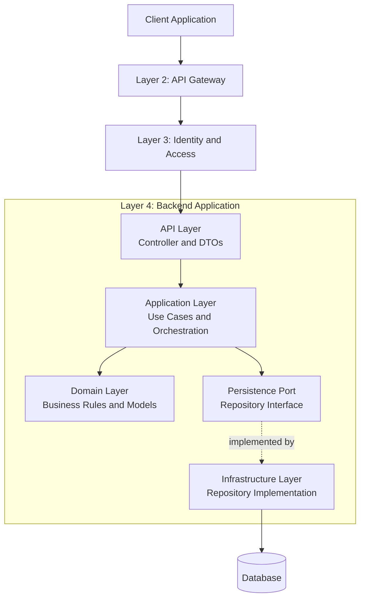
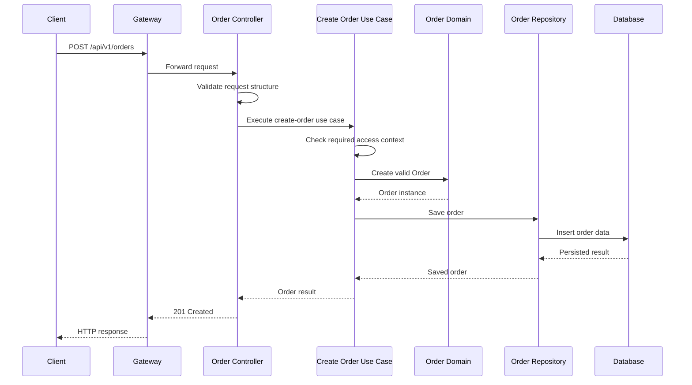
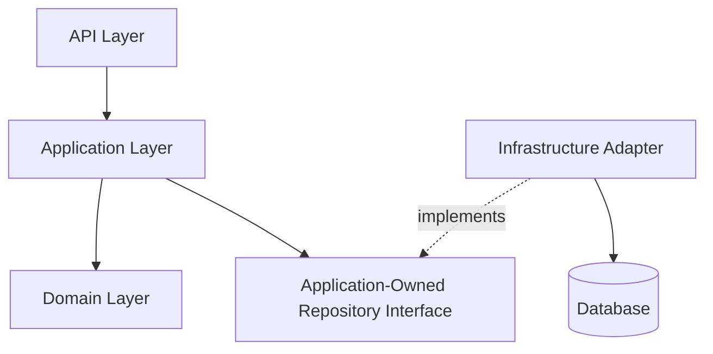

# Layer 4 — Backend API and Application Architecture

## 1. Purpose of This Layer

The Backend API and Application Architecture layer explains how each backend capability processes a request after it passes through the API entry point and the required security checks.

For example, when a customer creates an order, the backend must:

1. Receive the HTTP request.
2. Validate its structure.
3. establish the caller's security context.
4. Check whether the caller is allowed to create the order.
5. Execute the order-creation use case.
6. Apply the relevant business rules.
7. Persist the order through the appropriate persistence boundary.
8. Return a well-defined HTTP response.

These responsibilities are related, but they should not all be placed in one controller method.

A maintainable backend separates HTTP handling, use-case orchestration, business rules, and technical infrastructure.

### The main architectural question

How do we organize the backend so that business logic remains understandable, testable, secure, and maintainable as the platform grows?

Our initial answer is to use clear logical boundaries:

- **API layer:** Handles HTTP requests and responses.
- **Application layer:** Coordinates use cases.
- **Domain layer:** Represents business concepts and enforces business rules.
- **Infrastructure layer:** Implements technical integrations such as database access and external communication.

These are logical layers. They do not automatically require four separate applications, projects, or microservices.

---

## 2. Position in the Overall Architecture

The backend sits behind the gateway and uses the shared identity and access model established in Layer 3.

### High-level architecture



The diagram represents the logical flow rather than a mandatory implementation sequence.

For example, the application service may invoke a domain operation and then call a repository interface. The domain model does not have to call the database directly.

The most important boundary is that **business rules should not depend on HTTP frameworks, database implementation details, or gateway configuration**.

---

## 3. The Four Main Layers

Let's understand each layer before looking at code.

### 3.1 API layer

The API layer is responsible for translating between HTTP and application use cases.

Typical responsibilities:

- Receive HTTP requests.
- Map request bodies and path parameters to DTOs.
- Perform structural input validation.
- Obtain the authenticated caller context through trusted application security mechanisms.
- Invoke the appropriate application use case.
- Convert the result into an HTTP response.
- Map application errors to suitable HTTP status codes.

Typical components:

```text
api/
├── controller/
├── request/
├── response/
└── mapper/
```

The API layer should not become the place where the complete business workflow is implemented.

### 3.2 Application layer

The application layer coordinates a specific business use case.

Examples:

- Create an order.
- Cancel an order.
- Register a customer.
- Create a simulated transfer.
- Reconcile a batch of simulated transactions.

Typical responsibilities:

- Coordinate the steps required by a use case.
- Establish the appropriate transaction boundary.
- Call domain operations.
- Interact with repository interfaces.
- Invoke required external capabilities through defined interfaces.
- Coordinate application-level authorization checks when appropriate.
- Return an application result.

Typical components:

```text
application/
├── service/
├── usecase/
├── command/
├── result/
└── port/
```

We do not need every folder from the beginning. Introduce them when they represent a useful separation in the actual codebase.

### 3.3 Domain layer

The domain layer represents the business concepts and rules of the capability.

For Commerce, examples include:

- Order.
- OrderItem.
- OrderStatus.
- Order cancellation rules.
- Quantity and order invariants.

For FinFlow, examples include:

- Account.
- Transfer.
- LedgerEntry.
- Transfer state transitions.
- Simulated balance and transaction rules.

Typical components:

```text
domain/
├── model/
├── service/
├── policy/
└── exception/
```

The domain layer should not need to know whether an HTTP request came through a particular gateway or whether a database uses PostgreSQL or another technology.

### 3.4 Infrastructure layer

The infrastructure layer implements the technical mechanisms required by the application.

Typical responsibilities:

- Database persistence.
- ORM configuration and mappings.
- Repository implementations.
- External API clients.
- Messaging adapters, if later justified.
- Technical configuration.
- Integration with infrastructure-specific libraries.

Typical components:

```text
infrastructure/
├── persistence/
├── client/
├── messaging/
└── configuration/
```

The exact structure depends on the chosen architecture and technology.

Infrastructure is where we isolate implementation details so that business code does not become tightly coupled to them.

---

## 4. Example: Create an Order

We will use a Commerce order-creation workflow to make the boundaries concrete.

Assume the client submits:

```http
POST /api/v1/orders
Content-Type: application/json
Authorization: Bearer <access-token>
```

Illustrative request body:

```json
{
  "organisationId": "org-200",
  "items": [
    {
      "productId": "product-501",
      "quantity": 2
    }
  ]
}
```

This request is an example, not a finalized API contract.

The order-creation use case should not be implemented entirely inside the controller.

Instead, the request moves through the backend layers.

### Request-flow diagram



The actual request path depends on the authentication and persistence design. This diagram focuses on the logical responsibilities.

### What each component does

| Component | Responsibility |
|---|---|
| OrderController | Receives the HTTP request and returns the HTTP response |
| CreateOrderUseCase | Coordinates the order-creation workflow |
| Order | Represents the order and enforces its domain invariants |
| OrderRepository | Defines the persistence operations needed by the application |
| OrderRepositoryAdapter | Implements persistence using the selected database technology |
| Database | Stores the committed order data |

A key point is that these are logical responsibilities. Some may be implemented in fewer classes when the workflow is small.

---

## 5. API Layer in Detail

### 5.1 Controller

A controller should be thin.

Its job is to receive the request, delegate to the application layer, and produce the HTTP response.

Illustrative Spring Boot example:

```java
@RestController
@RequestMapping("/api/v1/orders")
public class OrderController {

    private final CreateOrderUseCase createOrderUseCase;

    public OrderController(CreateOrderUseCase createOrderUseCase) {
        this.createOrderUseCase = createOrderUseCase;
    }

    @PostMapping
    public ResponseEntity<CreateOrderResponse> createOrder(
            @Valid @RequestBody CreateOrderRequest request) {

        CreateOrderCommand command = new CreateOrderCommand(
                request.organisationId(),
                request.items().stream()
                        .map(item -> new CreateOrderCommand.Item(
                                item.productId(),
                                item.quantity()))
                        .toList()
        );

        CreateOrderResult result = createOrderUseCase.execute(command);

        CreateOrderResponse response = new CreateOrderResponse(
                result.orderId(),
                result.status()
        );

        return ResponseEntity
                .created(URI.create("/api/v1/orders/" + result.orderId()))
                .body(response);
    }
}
```

This example illustrates the separation between HTTP handling and the use case.

The supporting types are introduced in later sections.

In a production implementation, the controller must also operate within the chosen authentication and authorization configuration. The use case or another trusted application boundary must receive the necessary caller context when access decisions require it.

### Why keep the controller thin?

Imagine that the controller contains:

- Request validation.
- Organisation membership checks.
- Inventory availability checks.
- Order-total calculations.
- Order-status transitions.
- Database operations.
- Error handling.
- Response mapping.

The controller would become difficult to test and reuse. Business rules would be coupled to HTTP handling, and the same rules might be duplicated in other entry points.

A thin controller keeps the API boundary focused on HTTP responsibilities.

### 5.2 Request DTO

A Data Transfer Object (DTO) represents the data exchanged through an API.

Example:

```java
public record CreateOrderRequest(
        @NotBlank
        String organisationId,

        @NotEmpty
        List<@Valid CreateOrderItemRequest> items
) {
}
```

```java
public record CreateOrderItemRequest(
        @NotBlank
        String productId,

        @Min(1)
        int quantity
) {
}
```

These examples require the relevant Jakarta Bean Validation annotations and Spring validation support.

The request DTO describes the API contract. It should not automatically become the domain model or database entity.

### 5.3 Why use separate DTOs?

The API request and domain model serve different purposes.

For example, a request may contain:

```json
{
  "organisationId": "org-200",
  "items": [
    {
      "productId": "product-501",
      "quantity": 2
    }
  ]
}
```

The internal domain model may additionally contain:

- Order identifier.
- Creation timestamp.
- Current order status.
- Calculated totals.
- Version information.
- Other business-managed values.

The client should not be allowed to control protected fields merely because those fields exist in the internal model.

Separate DTOs allow the API contract to evolve without automatically exposing internal implementation details.

### 5.4 Structural validation versus business validation

These are two different types of validation.

Structural validation checks whether the request is correctly formed.

Examples:

- Required field is present.
- Quantity is a positive integer.
- Item list is not empty.
- Identifier has an acceptable format.

Business validation checks whether the requested operation is valid in the business context.

Examples:

- The product exists and can be ordered.
- The organisation can access the product.
- Inventory rules allow the requested quantity.
- The order can be created in the current system state.

Bean Validation can handle many structural checks. Business validation belongs in the appropriate application or domain workflow.

---

## 6. Application Layer in Detail

The application layer coordinates the use case without taking over every business rule.

### 6.1 Use case

A use case represents a business action that the application supports.

Examples:

```text
CreateOrderUseCase
CancelOrderUseCase
GetOrderUseCase

CreateSimulatedTransferUseCase
GetAccountBalanceUseCase
ReconcileTransactionsUseCase
```

These names are illustrative.

The purpose of a use case is to make the application's behavior explicit and provide a clear entry point for that operation.

### 6.2 Command

A command carries the information needed to request a particular action.

Example:

```java
public record CreateOrderCommand(
        String organisationId,
        List<Item> items
) {
    public record Item(
            String productId,
            int quantity
    ) {
    }
}
```

The command is an application-level input, not necessarily the same type as the HTTP request DTO.

The API layer can map the HTTP request to the command. Another entry point, such as a scheduled job or message handler, could potentially invoke the same use case without pretending to be an HTTP controller.

The application must still establish an appropriate security context for any operation requiring authorization.

### 6.3 Use-case orchestration

Illustrative example:

```java
@Service
public class CreateOrderService implements CreateOrderUseCase {

    private final OrderRepository orderRepository;
    private final OrderFactory orderFactory;

    public CreateOrderService(
            OrderRepository orderRepository,
            OrderFactory orderFactory) {
        this.orderRepository = orderRepository;
        this.orderFactory = orderFactory;
    }

    @Override
    @Transactional
    public CreateOrderResult execute(CreateOrderCommand command) {

        Order order = orderFactory.create(
                command.organisationId(),
                command.items()
        );

        Order savedOrder = orderRepository.save(order);

        return new CreateOrderResult(
                savedOrder.id(),
                savedOrder.status().name()
        );
    }
}
```

This is a simplified example of application orchestration. It deliberately omits the complete authorization, catalogue, inventory, pricing, and idempotency workflows that a real order-creation implementation would require.

The example assumes those responsibilities will be introduced through appropriate application and domain interfaces after the requirements are defined.

### What belongs in this class?

It can coordinate:

1. Obtaining or validating the relevant application context.
2. Calling required business operations.
3. Loading or saving domain objects through repositories.
4. Invoking required external capabilities.
5. Coordinating the transaction boundary.
6. Returning a use-case result.

The exact sequence depends on the business requirements.

### What should not happen?

The application service should not become a giant class containing every rule for every domain.

If order creation, cancellation, returns, inventory management, and payments all live in one enormous service class, the design will be difficult to maintain.

Start with cohesive use cases and introduce further abstractions only where they improve clarity or support genuine requirements.

---

## 7. Domain Layer in Detail

The domain layer represents business meaning rather than transport or persistence mechanics.

For Commerce, an order is not merely a row in a database. It has a lifecycle and invariants that must remain valid.

### 7.1 Domain model

Illustrative example:

```java
public enum OrderStatus {
    CREATED,
    CONFIRMED,
    CANCELLED
}
```

```java
public final class Order {

    private final String id;
    private final String organisationId;
    private final List<OrderItem> items;
    private OrderStatus status;

    public Order(
            String id,
            String organisationId,
            List<OrderItem> items) {

        if (id == null || id.isBlank()) {
            throw new IllegalArgumentException(
                    "Order ID is required");
        }

        if (organisationId == null || organisationId.isBlank()) {
            throw new IllegalArgumentException(
                    "Organisation ID is required");
        }

        if (items == null || items.isEmpty()) {
            throw new IllegalArgumentException(
                    "An order must contain at least one item");
        }

        this.id = id;
        this.organisationId = organisationId;
        this.items = List.copyOf(items);
        this.status = OrderStatus.CREATED;
    }

    public void cancel() {
        if (status != OrderStatus.CREATED) {
            throw new IllegalStateException(
                    "Only a created order can be cancelled");
        }

        status = OrderStatus.CANCELLED;
    }

    public String id() {
        return id;
    }

    public String organisationId() {
        return organisationId;
    }

    public List<OrderItem> items() {
        return items;
    }

    public OrderStatus status() {
        return status;
    }
}
```

An illustrative item model:

```java
public record OrderItem(
        String productId,
        int quantity
) {
    public OrderItem {
        if (productId == null || productId.isBlank()) {
            throw new IllegalArgumentException(
                    "Product ID is required");
        }

        if (quantity < 1) {
            throw new IllegalArgumentException(
                    "Quantity must be at least one");
        }
    }
}
```

This example demonstrates domain invariants and a state transition. It is not a complete production order model.

For example, real cancellation rules may depend on fulfilment status, inventory reservations, payment state, and other workflows.

### 7.2 Why does the domain model protect its own state?

Suppose the application allows any caller to write:

```java
order.setStatus(OrderStatus.CANCELLED);
```

That can bypass the cancellation rules.

A behavior-oriented model instead exposes an operation:

```java
order.cancel();
```

The method checks whether the transition is valid.

This helps keep business invariants close to the state they protect.

Not every domain object needs complex behavior. Simple data structures can be appropriate when the domain rules are genuinely simple. The goal is to protect meaningful business invariants, not to add complexity for its own sake.

### 7.3 Domain services

Some business rules do not naturally belong to a single entity.

A domain service may coordinate a rule involving multiple domain concepts.

For example, a pricing policy might calculate a total using product prices, discounts, and applicable business rules.

A domain service should remain focused on business behavior. It should not become a generic place for HTTP calls, database queries, and unrelated application workflows.

---

## 8. Persistence Boundary: Repository Interface

The application needs to save and retrieve orders, but it should not need to know the database implementation details.

A repository interface defines the persistence operations required by the application.

Illustrative example:

```java
public interface OrderRepository {

    Order save(Order order);

    Optional<Order> findById(String orderId);
}
```

The application depends on this abstraction rather than directly depending on a particular SQL client or ORM implementation.

The interface should expose meaningful operations needed by the use case. It should not automatically become a generic repository containing every imaginable query.

### Why introduce this boundary?

Consider two designs.

**Tightly coupled design:**

```text
CreateOrderService
    -> SQL statements
    -> Database-specific connection handling
```

The application service now knows about database mechanics.

**Separated design:**

```text
CreateOrderService
    -> OrderRepository interface
          |
          v
      Persistence adapter
          |
          v
       Database
```

The application knows what persistence operation it needs, while infrastructure determines how to perform it.

This separation improves testability and limits the spread of technology-specific dependencies.

---

## 9. Infrastructure Layer: Repository Implementation

The infrastructure layer implements the repository interface using the chosen persistence technology.

A possible structure is:

```text
infrastructure/
└── persistence/
    ├── entity/
    ├── springdata/
    ├── mapper/
    └── adapter/
```

The exact folders depend on the ORM and repository strategy.

For example, with Spring Data JPA, we may have a database entity and a Spring Data repository.

Illustrative database entity:

```java
@Entity
@Table(name = "orders")
public class OrderEntity {

    @Id
    private String id;

    @Column(name = "organisation_id", nullable = false)
    private String organisationId;

    @Enumerated(EnumType.STRING)
    @Column(nullable = false)
    private OrderStatus status;

    protected OrderEntity() {
    }

    // Mapping and access methods omitted.
}
```

Illustrative Spring Data interface:

```java
public interface SpringDataOrderRepository
        extends JpaRepository<OrderEntity, String> {
}
```

An adapter implements the application-facing repository interface:

```java
@Repository
public class OrderRepositoryAdapter implements OrderRepository {

    private final SpringDataOrderRepository springDataRepository;
    private final OrderMapper orderMapper;

    public OrderRepositoryAdapter(
            SpringDataOrderRepository springDataRepository,
            OrderMapper orderMapper) {
        this.springDataRepository = springDataRepository;
        this.orderMapper = orderMapper;
    }

    @Override
    public Order save(Order order) {
        OrderEntity entity = orderMapper.toEntity(order);

        OrderEntity saved = springDataRepository.save(entity);

        return orderMapper.toDomain(saved);
    }

    @Override
    public Optional<Order> findById(String orderId) {
        return springDataRepository.findById(orderId)
                .map(orderMapper::toDomain);
    }
}
```

This example is illustrative. The entity, mapper, and domain model require compatible mapping implementations, and the complete persistence design must account for order items, identifiers, concurrency, and schema constraints.

### Why not use the JPA entity everywhere?

Using one class as an API DTO, domain model, and database entity can create tight coupling.

For example:

- A database column change may affect the public API.
- ORM behavior may leak into business logic.
- Persistence annotations may influence domain design.
- API clients may gain access to internal fields.
- Domain tests may require unnecessary persistence setup.

Separate representations can help when those boundaries have different responsibilities.

However, separation should be proportional to complexity. A small application does not need multiple nearly identical models solely to follow a diagram.

---

## 10. Dependency Direction

The four-layer design becomes more useful when we understand dependency direction.

A maintainable design generally keeps business concepts independent of infrastructure-specific details.



Notice that the application defines the persistence interface it needs, and the infrastructure adapter implements it.

The application does not have to import a concrete database adapter merely to declare its persistence requirements.

This is an example of dependency inversion, a principle associated with SOLID.

### Important distinction

The runtime call flow and the source-code dependency flow are not always identical.

At runtime:

```text
Application Service
    -> Repository Interface
    -> Infrastructure Adapter
    -> Database
```

In source-code dependencies:

```text
Application Code
    -> Repository Interface

Infrastructure Code
    -> Repository Interface
    -> Database Technology
```

The adapter implements the interface, allowing the application to depend on an abstraction.

This makes it easier to test the application with a substitute implementation or change the persistence adapter without rewriting the use case.

---

## 11. Transaction Boundaries

A transaction groups related database operations into a unit of work.

For example, creating an order may require inserting an order record and its order-item records.

Conceptually:

```text
BEGIN TRANSACTION

Insert order
Insert order items
Update required database state

COMMIT
```

If a required database operation fails before commit, the transaction may be rolled back according to the database and transaction configuration.

### Where should the transaction begin?

For a use case that requires several related database changes, the application service is often a suitable place to define the transaction boundary.

Example:

```java
@Transactional
public CreateOrderResult execute(CreateOrderCommand command) {
    // Coordinate required database operations.
}
```

This example uses Spring's transaction management.

The annotation alone does not guarantee that every operation in the workflow is atomic. The result depends on transaction propagation, the persistence resources involved, exception behavior, and whether operations cross external system boundaries.

### Important transaction considerations

- A database transaction generally cannot make an unrelated remote API call atomic with the database commit.
- Checked and unchecked exceptions may have different rollback behavior under the configured framework defaults.
- Transactions should not remain open unnecessarily during slow network calls.
- Concurrent requests may require optimistic locking, pessimistic locking, unique constraints, or other concurrency controls.
- Database constraints remain valuable even when application validation exists.

For example, if an order creation workflow updates a database and then calls an external payment provider, the database transaction cannot automatically undo a successful external payment. The overall workflow needs a separate consistency and recovery design.

For this platform, payment behavior is simulated within the initial scope, and the exact workflow remains a later design decision.

---

## 12. Error Handling and HTTP Responses

Errors can originate at different layers.

Examples:

- Invalid request structure.
- Missing or invalid authentication.
- Failed authorization.
- A business rule violation.
- A missing resource.
- A persistence constraint violation.
- An unexpected infrastructure failure.

These failures should be translated into consistent API responses.

### Example mapping

| Failure | Possible HTTP status |
|---|---|
| Invalid request format | `400 Bad Request` |
| Missing or invalid authentication | `401 Unauthorized` |
| Caller lacks permission | `403 Forbidden` |
| Resource not found | `404 Not Found` |
| Conflicting state or duplicate resource | `409 Conflict` |
| Request exceeds configured limits | `413 Content Too Large` |
| Unexpected server failure | `500 Internal Server Error` |
| Temporary service unavailability | `503 Service Unavailable` |

The appropriate status depends on the actual condition and the platform's API contract.

### Use a consistent error response

Illustrative response:

```json
{
  "error": {
    "code": "ORDER_NOT_FOUND",
    "message": "The requested order could not be found.",
    "correlationId": "3b7d8e7a-1b8c-4a42-a122-123456789abc"
  }
}
```

The error code and message are examples.

The response should not reveal stack traces, database details, internal hostnames, secrets, or sensitive information.

### Centralized exception handling

In Spring Boot, a controller advice mechanism such as `@RestControllerAdvice` can centralize the mapping of known application exceptions to API responses.

This prevents every controller from implementing its own inconsistent error-handling logic.

However, centralized handling should not convert every exception into the same success or error response without considering its meaning.

Known business errors, authentication failures, validation errors, and unexpected infrastructure failures should be handled appropriately.

---

## 13. Security Inside the Backend

The backend must not assume that a request is safe merely because it passed through the gateway.

Important checks include:

### Authentication context

The application must obtain caller identity from a trusted security mechanism, not from arbitrary client-supplied identity fields.

### Authorization

The appropriate layer must verify access to the requested operation and resource.

### Input validation

Input should be validated before it is used in business logic or persistence operations.

### Mass-assignment protection

Do not automatically bind every client-provided property to an internal domain object or database entity.

For example, a client should not be allowed to set protected fields such as:

```text
createdBy
organisationOwner
approvalStatus
internalBalance
administrativeRole
```

unless the API explicitly permits that operation and the caller is authorized.

### Sensitive logging

Do not log access tokens, passwords, secrets, or sensitive request content unnecessarily.

### Database access

Use parameterized queries or appropriate ORM mechanisms rather than building unsafe SQL from user input.

### Tenant isolation

Every resource access must respect the appropriate organisation and ownership boundaries.

These controls should be applied consistently across all entry points into the business capability.

---

## 14. Testing the Backend Layers

Testing should follow the architectural boundaries.

### 14.1 Controller tests

Verify:

- HTTP routes and methods.
- Request DTO validation.
- Request-to-command mapping.
- Response status codes.
- Response body structure.
- Error mapping.
- Security configuration at the API boundary.

Controller tests should not require a real database unless the test specifically targets an integration behavior.

### 14.2 Application service tests

Test the use case independently from HTTP and database implementation details.

For example:

```text
Given:
    A valid create-order command

When:
    The use case executes

Then:
    A valid order is created
    The repository is called as expected
    The correct result is returned
```

Also test failure scenarios:

```text
Given:
    A request that violates a required business rule

When:
    The use case executes

Then:
    The operation is rejected
    No prohibited persistence side effect occurs
```

Authorization failures should also be tested where authorization is part of the use case's responsibilities.

### 14.3 Domain tests

Test business invariants directly.

Examples:

- An order cannot be created without required items.
- An item cannot have a non-positive quantity.
- An order cannot be cancelled from a disallowed state.
- A domain operation preserves its invariants.

Domain tests should generally be fast and independent of Spring and the database.

### 14.4 Repository integration tests

Verify that the persistence adapter:

- Saves and retrieves the expected data.
- Correctly maps between domain and persistence representations.
- Handles database constraints.
- Implements tenant-scoped queries correctly.
- Handles relevant concurrency and transaction behavior.

### 14.5 End-to-end tests

Verify a complete request path:

```text
HTTP request
    -> Security
    -> Controller
    -> Application use case
    -> Domain behavior
    -> Persistence
    -> HTTP response
```

End-to-end tests are valuable, but they should complement rather than replace focused unit and integration tests.

### Test coverage matrix

| Layer | Main testing focus |
|---|---|
| API | HTTP contract and validation |
| Application | Use-case orchestration and failure behavior |
| Domain | Business invariants and state transitions |
| Infrastructure | Database and external-system integration |
| End to end | Complete behavior across boundaries |

---

## 15. Suggested Backend Package Structure

For a domain-oriented Spring Boot application, a possible package structure is:

```text
commerce-service/
└── src/
    ├── main/
    │   ├── java/
    │   │   └── com/example/platform/commerce/
    │   │       ├── api/
    │   │       │   ├── controller/
    │   │       │   ├── request/
    │   │       │   ├── response/
    │   │       │   └── mapper/
    │   │       ├── application/
    │   │       │   ├── usecase/
    │   │       │   ├── service/
    │   │       │   ├── command/
    │   │       │   ├── result/
    │   │       │   └── port/
    │   │       ├── domain/
    │   │       │   ├── model/
    │   │       │   ├── policy/
    │   │       │   └── exception/
    │   │       ├── infrastructure/
    │   │       │   ├── persistence/
    │   │       │   ├── client/
    │   │       │   └── configuration/
    │   │       └── CommerceApplication.java
    │   └── resources/
    │       ├── application.yml
    │       └── db/
    │           └── migration/
    └── test/
        └── java/
```

This is an illustrative structure, not a requirement to create every directory immediately.

The package organization should reflect actual business capabilities and the boundaries of the existing project.

### Why use domain-oriented packaging?

It keeps related behavior together and makes responsibilities easier to locate.

As the platform grows, Commerce and FinFlow can have different business models while following consistent architectural principles.

We should not automatically create a separate microservice for every entity, use case, or folder.

A class boundary, package boundary, module boundary, and deployable-service boundary are different things.

---

## 16. Common Design Mistakes

### Mistake 1: Putting business logic in controllers

This couples business behavior to HTTP handling and makes reuse and testing harder.

### Mistake 2: Building one giant application service

A service that coordinates every workflow becomes difficult to understand and maintain. Prefer cohesive use cases.

### Mistake 3: Exposing JPA entities directly through APIs

This couples public contracts to database implementation details and can expose internal fields.

### Mistake 4: Letting domain objects depend on Spring or the database

This makes the business model more difficult to test independently and can spread infrastructure concerns throughout the codebase.

### Mistake 5: Creating abstractions without a real need

Not every method needs an interface, and not every entity needs a factory, mapper, or separate service.

Introduce abstractions when they express a meaningful boundary or make the design easier to change and test.

### Mistake 6: Treating a repository as the business layer

A repository should handle persistence operations. Business rules should remain in the appropriate domain or application components.

### Mistake 7: Assuming `@Transactional` solves every consistency problem

A database transaction does not automatically make remote calls, messages, or multiple independent databases part of the same atomic operation.

### Mistake 8: Testing only successful requests

Test validation failures, authorization failures, business-rule violations, concurrency conditions, and persistence errors.

### Mistake 9: Assuming the gateway is the only security boundary

Backend services must preserve the required authentication and authorization guarantees even if a request reaches them through another path.

---

## 17. Interview Questions and Answers

### Q1. What are the responsibilities of the controller, service, and repository?

The controller handles HTTP concerns, the application service coordinates a use case, and the repository provides the persistence operations required by the application.

The domain model contains business behavior and invariants where appropriate.

### Q2. Why should controllers be thin?

Thin controllers reduce coupling between HTTP handling and business logic. They also make use cases easier to test and reuse.

### Q3. What is the difference between a DTO and an entity?

A DTO represents data exchanged across an application boundary. A persistence entity represents data in the persistence model. A domain entity represents a business concept with identity and potentially behavior. These models may sometimes share a representation, but they have different responsibilities.

### Q4. What is the difference between the application and domain layers?

The application layer coordinates a use case. The domain layer represents the business concepts and rules that determine valid business behavior.

### Q5. What is dependency inversion?

Dependency inversion means that high-level policy should not depend directly on low-level implementation details. Both can depend on abstractions. For example, an application use case depends on an order repository interface, while a database adapter implements that interface.

### Q6. Why use a repository interface?

It defines the persistence operations the application needs without requiring the application to depend directly on a particular database implementation. It can also simplify testing and replacement of infrastructure adapters.

### Q7. Where should `@Transactional` be used?

A use-case or application-service boundary is often appropriate when several related persistence operations must succeed or fail together. The actual boundary depends on the transaction requirements, propagation behavior, and infrastructure.

### Q8. Does a database transaction roll back a remote API call?

Generally, no. A normal database transaction does not automatically undo a remote service's completed operation. Cross-system workflows need explicit consistency, compensation, or recovery mechanisms where required.

### Q9. How should validation be handled?

Structural validation belongs at the API boundary where appropriate. Business validation belongs in the application or domain workflow that understands the relevant rules. Persistence constraints provide an additional layer of data integrity.

### Q10. Why not return database entities directly?

Doing so can couple the public API to internal persistence details, expose fields unintentionally, and make schema changes affect API contracts. DTOs help keep these concerns separate.

### Q11. What is the difference between unit, integration, and end-to-end testing?

Unit tests focus on a component in isolation. Integration tests verify interactions between components or infrastructure. End-to-end tests verify the complete behavior across the relevant application boundaries.

### Q12. Does a microservices architecture require every layer to be a separate service?

No. Layers represent responsibilities and dependencies. They can exist as packages or modules within a service. Separate deployment should be justified by requirements such as independent scaling, ownership, deployment, or isolation.

---

## 18. Decisions We Must Carry Forward

Before implementation, we need to decide:

1. Which backend capabilities are required in the initial release?
2. Which API contracts belong to Commerce and FinFlow?
3. What validation belongs at the API boundary versus the business boundary?
4. How authentication context is passed to the application.
5. Where resource-level authorization is enforced.
6. Which application use cases require database transactions.
7. Which domain invariants must be protected.
8. How repository interfaces and persistence adapters are organized.
9. Which error codes and HTTP responses form the API contract.
10. Which database technology and ORM, if any, fit the requirements.
11. How integration tests and database migrations will be managed.
12. Whether the existing `finflow-microservices` project already follows some of these boundaries.

We should inspect the existing project before creating a new package structure or replacing working components.

---

## 19. Layer 4 Summary

The Backend API and Application Architecture layer explains how the backend converts an incoming request into a validated business operation and a consistent response.

Its key responsibilities are:

- Handling HTTP requests through controllers.
- Separating request and response DTOs from internal models.
- Coordinating use cases through the application layer.
- Enforcing business invariants in the appropriate domain components.
- Defining persistence interfaces at suitable boundaries.
- Implementing persistence and technical integrations in infrastructure.
- Establishing transaction boundaries.
- Handling errors consistently.
- Testing each architectural boundary.

Remember the basic responsibility split:

```text
API Layer:
    How does the client communicate with the backend?

Application Layer:
    What steps are required to execute this use case?

Domain Layer:
    What business rules determine whether the operation is valid?

Infrastructure Layer:
    How are technical operations such as database access implemented?
```

The objective is not to create the maximum number of classes or layers. It is to make business behavior clear, testable, secure, and maintainable.

---

## 20. Next Layer

**Layer 5 — Database Architecture and Persistence**

We have now established the logical backend boundaries. Next, we will examine the database layer in detail.

We will cover:

- How to identify data ownership for Commerce, FinFlow, and shared platform capabilities.
- Database tables, relationships, primary keys, and foreign keys.
- Normalization and data integrity.
- Repository queries and persistence mapping.
- Transaction management and rollback behavior.
- Database migrations and schema versioning.
- Indexes, constraints, and query performance.
- Concurrent updates and optimistic versus pessimistic locking.
- Multi-tenant data isolation.
- Audit data and retention considerations.
- Backup, recovery, and migration testing.
- How to trace a request from an HTTP endpoint through a use case to committed database records.

We will distinguish the logical data model from the physical database implementation, and we will avoid selecting a database technology before the requirements and existing project have been reviewed.
