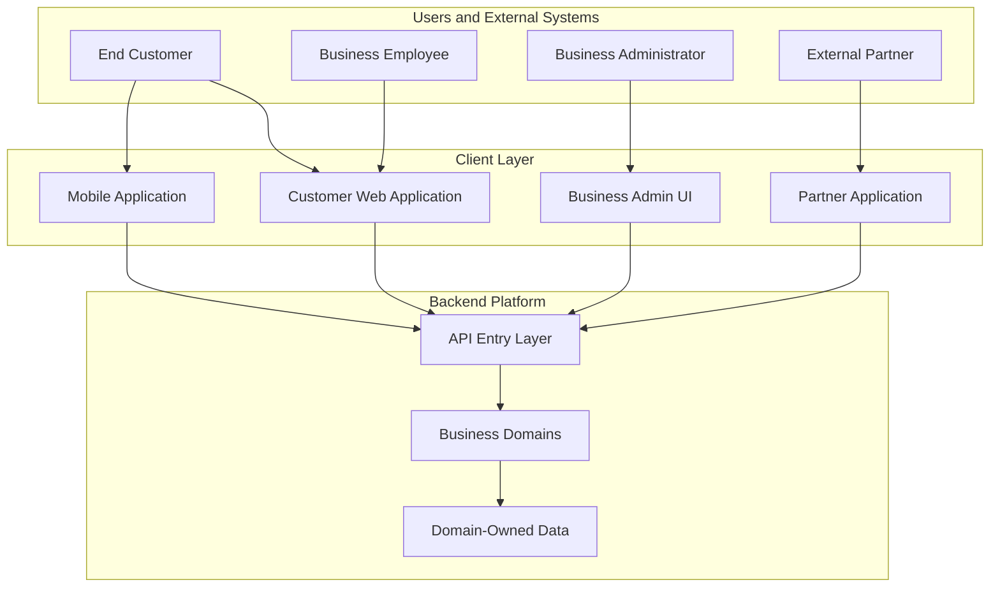
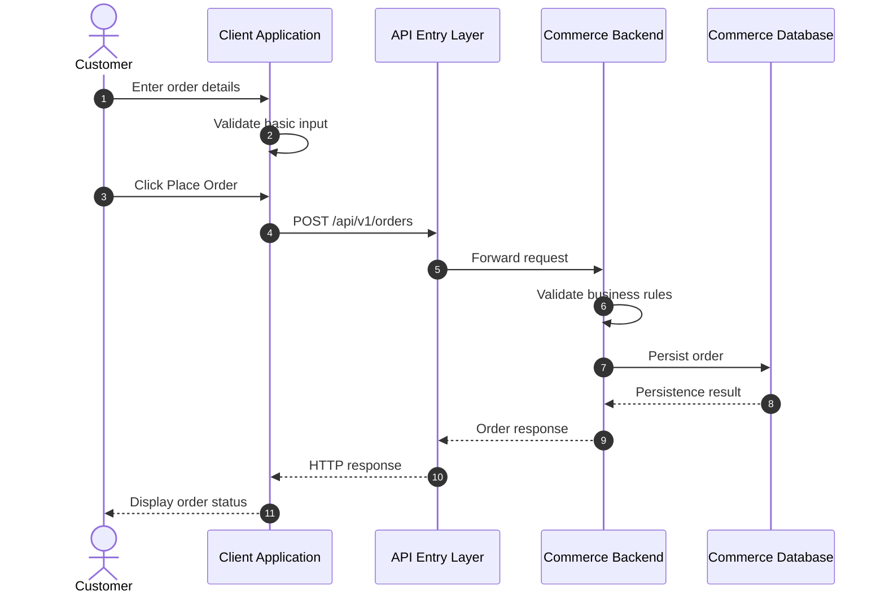

# Layer 1: Client Applications

## 1. Purpose

The client layer is the entry point through which customers, business users, administrators and external systems interact with the platform.

Its responsibilities include collecting input, presenting information, calling backend APIs and displaying success or failure responses.

The client is not the authoritative source of business rules or permissions. The backend must validate and enforce them independently.

## 2. High-Level Client Architecture



### Diagram explanation

- **Users and external systems:** Initiate operations.
- **Client applications:** Provide the interface or integration code that initiates requests.
- **API entry layer:** Receives requests and routes them to the appropriate backend capability.
- **Business domains:** Apply authoritative business rules.
- **Domain-owned data:** Stores the records managed by each domain.

The diagram intentionally keeps the backend abstract. We will expand the API entry layer, business internals and database in subsequent sections.

## 3. Types of Clients

### 3.1 Customer application

Used by an end customer to interact with business features.

Potential operations:

- View products.
- Create an order.
- View order status.
- View simulated transaction history.
- Check or manage a reservation when Booking is introduced.

### 3.2 Business administration application

Used by authorised business employees and administrators.

Potential operations:

- Review orders.
- Manage product information.
- Review transactions.
- Manage organisation members and roles.
- Investigate business-operation failures where permitted.

Administrative access must be controlled by backend permissions, not merely by hiding buttons in the UI.

### 3.3 External partner application

A partner system may call the platform without a human using the UI.

Examples:

- An external system creates an order.
- An integration sends a webhook.
- A partner retrieves an operation's status.

Partner integrations need documented API contracts and appropriate authentication. Their permissions must be limited to the operations they are authorised to perform.

## 4. What Does the Client Actually Do?

The client has several responsibilities.

| Responsibility | Explanation |
|---|---|
| Collect input | Captures information entered by a user. |
| Basic validation | Checks simple input issues, such as missing fields or invalid formatting. |
| Send API requests | Calls the backend using the agreed API contract. |
| Manage UI state | Displays loading, success, failure and pending states. |
| Display responses | Converts backend responses into understandable information. |
| Handle network failures | Informs the user when a request cannot be completed or its outcome is unknown. |
| Authentication interaction | Uses the approved authentication flow and handles session or token state appropriately. |
| Avoid duplicate submissions | Can disable repeated clicks, while relying on backend safeguards for correctness. |

### Important distinction: client validation versus backend validation

Suppose a customer enters an order quantity of `-5`.

The client can immediately display a validation message. However, someone could bypass the UI and call the API directly.

Therefore, the backend must independently reject invalid quantities.

**Rule:** Client validation improves the user experience; backend validation protects the system.

## 5. End-to-End Request Flow

We will use a Commerce example: a customer creates an order.



### Step-by-step explanation

1. The customer enters the required order details.
2. The client checks simple input constraints.
3. The client sends an HTTP request to the backend.
4. The API entry layer receives the request.
5. The request reaches the Commerce backend.
6. Commerce validates the business rules.
7. Commerce persists the order using the agreed transaction strategy.
8. The backend returns the result.
9. The client displays the outcome.

This is a simplified successful path. The complete order workflow may later include inventory reservation, payment processing, event publication and recovery. Those steps require separate diagrams because they introduce additional consistency and failure-handling decisions.

## 6. Example API Request

The client sends data, not database instructions.

Example request:

```http
POST /api/v1/orders HTTP/1.1
Content-Type: application/json
Authorization: Bearer <access-token>
Idempotency-Key: order-request-12345
```

Request body:

```json
{
  "items": [
    {
      "productId": "PROD-101",
      "quantity": 2
    }
  ]
}
```

The exact authentication mechanism, identifier format and idempotency contract are still to be confirmed. This is an illustrative API contract, not an approved production endpoint.

Notice that the client does not send SQL or directly insert a row into the database. It expresses the requested business operation, and the backend decides how to validate and persist it.

## 7. What Happens When Things Go Wrong?

The client must handle more than the successful path.

| Scenario | Expected client behaviour |
|---|---|
| Missing required input | Display a useful validation message. |
| Backend returns a validation error | Show the relevant error returned by the API. |
| User is unauthenticated | Follow the configured authentication flow. |
| User lacks permission | Display an appropriate access-denied message. |
| Backend is unavailable | Show a recoverable error and avoid unsafe automatic retries. |
| Request times out | Explain that the result may be unknown; provide a safe way to check status or retry according to the API contract. |
| Request succeeds | Display the returned business status. |
| Operation is pending | Show that processing is not yet complete. |

### Important timeout example

Suppose the client sends a create-order request. The backend saves the order, but the response is lost because the network connection fails.

The client cannot safely assume the order was not created.

Blindly sending a new request could create a duplicate. The client should use the backend's agreed idempotency or status-checking mechanism.

This is why frontend handling and backend reliability must be designed together.

## 8. Security Responsibilities

The client is not a trusted security boundary.

- Never rely on hidden UI controls as the only authorisation mechanism.
- Do not embed permanent secrets in frontend code.
- Use the agreed secure authentication flow.
- Avoid logging access tokens or sensitive request data.
- Treat all client-supplied identifiers, prices, quantities and status values as untrusted.
- Let the backend verify permissions and business constraints.

For example, hiding a Refund button from a customer does not prevent them from manually sending a refund request. The backend must reject that request unless the actor has the required permission.

## 9. Testing the Client-to-API Boundary

We should test the client and API contract independently of the database implementation where possible.

Candidate checks include:

1. The client sends the expected HTTP method and path.
2. Request fields follow the agreed contract.
3. Loading and error states are displayed correctly.
4. Authentication information is handled appropriately.
5. Validation errors are presented clearly.
6. Timeouts do not cause uncontrolled duplicate submissions.
7. Pending operations are displayed as pending rather than successful.
8. Client behaviour matches the backend's documented response contract.

The backend must separately test its own validation and security rules because client-side tests cannot establish backend enforcement.

## 10. Interview Questions

### Q1. Why do we need backend validation if the client already validates input?

Client validation can be bypassed. Backend validation is authoritative and protects business rules regardless of which client sends the request.

### Q2. Should the client communicate directly with the database?

No. The client should communicate through the backend API. The backend enforces business rules, permissions and data-access boundaries.

### Q3. What happens if the client times out after submitting an order?

The operation's outcome may be unknown. The client should follow the API's status-checking or idempotent retry contract rather than assuming the operation failed.

### Q4. Is the API Gateway responsible for business validation?

It can enforce general request controls, but domain-specific validation belongs in the relevant business backend. The gateway should not become the owner of Commerce or FinFlow business rules.

### Q5. Do web, mobile and partner clients need separate business logic?

They may have different user experiences and authentication flows, but the authoritative business rules should remain in the backend. This prevents each client from implementing its own conflicting interpretation of the same operation.

## 11. What We Have Covered

In this layer, we established:

- The purpose of the client layer.
- The three main types of clients.
- The responsibilities of a client application.
- The distinction between client and backend validation.
- The basic request and response flow.
- A sample API request.
- Failure handling and security considerations.
- Client-to-API testing responsibilities.

We have not yet designed the internal API Gateway, identity implementation, backend controller, service layer, repository layer or database schema.

## 12. Next Layer: API Entry and Gateway

The next section will explain the first backend boundary in detail:

1. What an API Gateway is and whether we actually need a separate gateway service.
2. How a request reaches the backend.
3. Routing to Commerce, FinFlow or another domain.
4. Authentication versus authorisation.
5. Rate limiting, request validation and correlation IDs.
6. HTTP status codes and error responses.
7. Gateway failure scenarios.
8. High-level and sequence diagrams.
9. How the gateway fits into a Java/Spring Boot architecture.

```

```
