# Composable Business Platform
## Product Vision, Purpose, Scope and High-Level Architecture

**Document status:** Initial planning draft  
**Version:** 0.1  
**Purpose:** Define what we intend to build, why we are building it, what problems it should solve, and the major components of the proposed system.

---

# 1. What Are We Building?

We are planning to build a **Composable Business Platform** using Java and Spring Boot as the primary backend technologies.

The platform will provide a common technical foundation for multiple business capabilities. Instead of building completely unrelated applications, we will organise the system into clearly defined business domains that can work together through well-defined APIs and, where justified, asynchronous events.

The initial candidate business domains are:

1. **FinFlow** — simulated financial accounts, transfers and transaction management.
2. **Commerce** — products, inventory, orders, simulated payments and fulfilment.
3. **Booking and Subscriptions** — availability, reservations and subscription lifecycle management.
4. **Integration and Workflows** — external system integrations, webhooks, event processing, retries and failure recovery.

The platform will also provide shared capabilities such as authentication, authorisation, organisation management, audit history, notifications, API conventions, monitoring, testing and deployment automation.

These are candidate capabilities for the overall platform. We will decide which ones belong in the first release after reviewing the existing project and agreeing on the initial business workflow.

## 1.1 The Main Idea

Imagine that we want to build a system that supports different types of business operations.

A business may need to:
- Manage customers and their access.
- Create and manage orders.
- Track inventory.
- Execute simulated financial transfers.
- Manage reservations.
- Communicate with external systems.
- Track failures and recover unsuccessful operations.

We do not want every business domain to implement its own unrelated security, error handling, logging and operational conventions.

Instead, we want a platform in which common capabilities are reusable while each business domain remains responsible for its own business rules and authoritative data.

For example:

- Commerce decides how an order is created and managed.
- FinFlow decides how a simulated transfer is validated and recorded.
- Booking decides how availability and reservations are managed.
- The shared security capabilities determine whether a user is allowed to perform an operation.
- The integration capabilities help communicate with external systems and manage failures.

The objective is to combine reusable technical capabilities with clearly separated business responsibilities.

---

# 2. Why Are We Building This Platform?

The project has two main objectives.

## 2.1 Product Objective

Build a coherent backend platform that demonstrates how multiple business capabilities can operate together without becoming tightly coupled.

The platform should support:
- Clear business boundaries.
- Well-defined APIs and contracts.
- Reliable data management.
- Secure access to business operations.
- Controlled communication between components.
- Traceability of important operations.
- Safe handling of failures and retries.
- Automated testing and repeatable delivery.
- Future expansion without unnecessary architectural complexity.

## 2.2 Engineering and Learning Objective

Use the project to develop practical Java backend and senior-engineer skills through realistic business requirements.

We intend to apply concepts such as:

- Core Java and object-oriented design.
- SOLID principles.
- Clean and maintainable package structures.
- Spring Boot application design.
- REST API design.
- Database transactions and persistence.
- SQL and data modelling.
- Concurrency control and locking.
- Idempotency and duplicate-request protection.
- Design patterns where they solve actual problems.
- Microservices and modular architecture trade-offs.
- Synchronous and asynchronous communication.
- Retry strategies and failure recovery.
- Authentication and authorisation.
- Unit, integration and contract testing.
- Logging, metrics, tracing and health checks.
- CI/CD and deployment practices.

We will not introduce a technology or design pattern simply to add it to the project. Every significant architectural choice should solve a requirement or demonstrate a meaningful engineering trade-off.

---

# 3. What Problems Will the Platform Solve?

## 3.1 Duplicated Technical Functionality

**Problem:**

If every business application independently implements authentication, error responses, logging and notification handling, the system becomes inconsistent and difficult to maintain.

**Proposed solution:**

Provide shared capabilities and common conventions wherever the responsibilities genuinely overlap.

**Example:**

FinFlow and Commerce can follow the same API error format and use the same authentication conventions without sharing their business rules.

## 3.2 Tightly Coupled Business Domains

**Problem:**

If one business domain directly depends on another domain's internal code or private database tables, changes become risky. A database schema change in one domain could unexpectedly break another.

**Proposed solution:**

Define clear domain responsibilities and explicit communication contracts.

**Example:**

Commerce should not directly update FinFlow's private database tables. If an order requires a financial operation, the domains should communicate through an agreed API or event-based workflow.

## 3.3 Unreliable Business Operations

**Problem:**

Requests may be repeated, databases may reject changes, external APIs may time out, and components may fail while processing work.

**Proposed solution:**

Introduce appropriate transactions, idempotency, validation, timeouts, retries and recovery procedures.

**Example:**

If a client retries a transfer request because it did not receive the first response, the system should use an idempotency mechanism to avoid creating a duplicate transfer.

## 3.4 Poor Visibility Into Failures

**Problem:**

When an operation fails, engineers may struggle to determine which request caused it, which component failed, or whether recovery is needed.

**Proposed solution:**

Use structured logging, correlation identifiers, metrics, tracing, audit records and operational diagnostics.

**Example:**

An operator should be able to investigate a failed integration using its execution identifier and related logs rather than searching manually through unrelated application messages.

## 3.5 Difficulty Adding New Business Capabilities

**Problem:**

A system built without clear boundaries can become difficult to extend. New features may require changes across unrelated modules.

**Proposed solution:**

Organise the platform around business responsibilities and reusable technical capabilities.

**Example:**

A future Booking domain should be able to use the platform's agreed security and observability conventions without having to reuse Commerce's order-specific business logic.

---

# 4. Who Will Use the Platform?

The following are candidate actors. The final roles and permissions must be defined before implementation.

| Actor | Purpose |
|---|---|
| End customer | Places orders, views transactions or manages reservations. |
| Business employee | Performs authorised business operations. |
| Business administrator | Manages organisation membership and business-level access. |
| Platform operator | Monitors application health and investigates operational failures. |
| External partner system | Integrates through documented APIs, webhooks or other approved contracts. |

A platform operator should not automatically receive unrestricted access to all business data merely because they manage the infrastructure.

Authentication establishes identity. Authorisation determines which actions that identity is permitted to perform.

---

# 5. What Are We Planning to Include?

## 5.1 FinFlow — Simulated Financial Operations

FinFlow is a candidate business domain for financial-style workflows.

### Planned capabilities

- Account or wallet representation.
- Simulated transfers.
- Transaction lifecycle management.
- Ledger-style records.
- Transaction history.
- Idempotent request handling.
- Reconciliation checks.
- Rejected, pending and failed operation handling.

### What it will do

It will demonstrate how to model operations that require careful validation, consistent data changes, traceability and protection against duplicate requests.

### Example

A customer requests a simulated transfer.

The system validates the request, checks applicable business rules, records the operation and exposes its status. If a request is repeated, the idempotency mechanism helps prevent an unintended duplicate.

**Scope boundary:** This is a learning simulation. Real funds, live banking integrations and regulated financial processing are not assumed.

## 5.2 Commerce — Products and Orders

Commerce is a candidate business domain for order-related operations.

### Planned capabilities

- Product catalogue.
- Product prices.
- Inventory and stock availability.
- Order creation and management.
- Order items and totals.
- Simulated payment outcomes.
- Fulfilment status.
- Cancellation and returns.
- Handling for concurrent orders and failed payments.

### What it will do

It will demonstrate how a business request moves through multiple states while maintaining data consistency.

### Example

A customer creates an order.

The system validates the items, checks stock, creates the order and processes the agreed simulated-payment workflow. Depending on the outcome, the order may proceed, remain pending or enter an appropriate failure or cancellation path.

The exact order and payment state transitions will be specified in a later section.

## 5.3 Booking and Subscriptions — Future Candidate Domain

### Potential capabilities

- Availability management.
- Reservations.
- Reservation expiry and cancellation.
- Prevention of conflicting bookings.
- Subscription lifecycle management.
- Recurring business-operation records.
- Optional calendar or billing sandbox integrations.

### What it will do

It will demonstrate resource availability, reservation conflicts, lifecycle management and recurring operations.

This domain is a possible later expansion. It is not automatically part of the first release.

## 5.4 Integration and Workflows

### Potential capabilities

- Outbound API connectors.
- Inbound and outbound webhooks.
- Event producers and consumers.
- Retry policies and backoff.
- Idempotent processing.
- Failed-operation tracking.
- Dead-letter handling where appropriate.
- Controlled recovery and replay.
- Integration execution history.

### What it will do

It will help the platform communicate with external systems and deal with temporary failures without losing track of important work.

A generic visual workflow designer is not included in the initial scope unless a specific requirement justifies it.

## 5.5 Shared Platform Capabilities

| Capability | Responsibility |
|---|---|
| Authentication | Verifies the identity of a user or system. |
| Authorisation | Enforces permissions for protected operations. |
| Organisation management | Represents businesses and their memberships. |
| API entry and routing | Provides a consistent entry point where required. |
| API conventions | Standardises request validation and error responses. |
| Audit history | Records important business and administrative actions. |
| Notifications | Provides a common notification-delivery abstraction. |
| Configuration | Manages environment-specific and application settings. |
| Correlation identifiers | Connects related requests and diagnostic records. |
| Observability | Supports logs, metrics, tracing and health reporting. |
| Automated testing | Checks expected behaviour and failure scenarios. |
| Delivery automation | Automates agreed build, test and deployment steps. |

A shared capability does not automatically need its own microservice. Some capabilities may initially be implemented as modules or libraries.

---

# 6. What Is Outside the Initial Scope?

Unless requirements explicitly change, we will not assume that the first release includes:

- Real financial transactions or live banking connections.
- A complete commercial e-commerce platform.
- All booking and subscription features.
- A generic workflow-design engine.
- A separate microservice for every logical component.
- Kafka or another message broker without a justified need.
- Redis or distributed caching without a justified need.
- Kubernetes without a deployment requirement that warrants it.
- Complex multi-region infrastructure.
- Unnecessary abstraction layers or design patterns.

The purpose is to build a manageable, coherent first release and expand it based on real requirements.

---

# 7. High-Level System Architecture

The diagram below presents the proposed logical architecture of the complete platform.

It groups the major responsibilities into layers:

1. Users and client applications.
2. API entry and security.
3. Business domains.
4. Shared capabilities.
5. Integration and external systems.
6. Domain-owned data.
7. Operations and engineering delivery.

The diagram is a planning view. It does not mean that every box must be a separate deployable application.

```mermaid
flowchart TB

    subgraph USERS["1. Users and External Clients"]
        CUSTOMER["End Customer"]
        EMPLOYEE["Business Employee"]
        ADMIN["Business Administrator"]
        PARTNER["External Partner System"]
        OPERATOR["Platform Operator"]
    end

    subgraph CLIENTS["2. Client Applications"]
        WEB["Web Application"]
        MOBILE["Mobile Application"]
        ADMIN_UI["Admin and Operations UI"]
    end

    subgraph ENTRY["3. API Entry and Security"]
        GATEWAY["API Gateway or Entry Layer"]
        IDENTITY["Authentication and Authorisation"]
        ORGANISATION["Organisation and Membership"]
    end

    subgraph DOMAINS["4. Business Domains"]
        FINFLOW["FinFlow"]
        COMMERCE["Commerce"]
        BOOKING["Booking and Subscriptions - Later"]
    end

    subgraph SHARED["5. Shared Platform Capabilities"]
        API["API Contracts and Error Handling"]
        AUDIT["Audit History"]
        NOTIFICATION["Notification Abstraction"]
        CONFIG["Configuration"]
        IDEMPOTENCY["Idempotency and Duplicate Protection"]
    end

    subgraph INTEGRATION["6. Integration Capabilities"]
        CONNECTORS["External API Connectors"]
        WEBHOOKS["Webhooks"]
        EVENTS["Optional Event Messaging"]
        RECOVERY["Retry and Failure Recovery"]
    end

    subgraph DATA["7. Domain-Owned Data"]
        IDENTITY_DB[("Identity and Organisation Data")]
        FINFLOW_DB[("FinFlow Data")]
        COMMERCE_DB[("Commerce Data")]
        BOOKING_DB[("Booking Data - Later")]
        OPERATIONS_DB[("Audit and Integration Records")]
    end

    subgraph EXTERNAL["8. External Dependencies"]
        PAYMENT["Payment Sandbox or Provider"]
        MESSAGING["Email or Notification Provider"]
        THIRD_PARTY["Other External APIs"]
    end

    subgraph OPERATIONS["9. Reliability and Engineering"]
        OBSERVABILITY["Logs, Metrics, Tracing and Health"]
        TESTING["Automated Tests"]
        CICD["Build and CI/CD Pipeline"]
        DEPLOYMENT["Deployment Environment"]
    end

    CUSTOMER --> WEB
    CUSTOMER --> MOBILE
    EMPLOYEE --> WEB
    ADMIN --> ADMIN_UI
    OPERATOR --> ADMIN_UI
    PARTNER --> GATEWAY

    WEB --> GATEWAY
    MOBILE --> GATEWAY
    ADMIN_UI --> GATEWAY

    GATEWAY --> IDENTITY
    IDENTITY --> ORGANISATION
    ORGANISATION --> IDENTITY_DB

    GATEWAY --> FINFLOW
    GATEWAY --> COMMERCE
    GATEWAY -.-> BOOKING

    FINFLOW --> FINFLOW_DB
    COMMERCE --> COMMERCE_DB
    BOOKING -.-> BOOKING_DB

    FINFLOW -.-> API
    COMMERCE -.-> API
    BOOKING -.-> API

    FINFLOW -.-> AUDIT
    COMMERCE -.-> AUDIT
    BOOKING -.-> AUDIT
    AUDIT --> OPERATIONS_DB

    FINFLOW -.-> IDEMPOTENCY
    COMMERCE -.-> IDEMPOTENCY

    FINFLOW -.-> NOTIFICATION
    COMMERCE -.-> NOTIFICATION
    NOTIFICATION --> MESSAGING

    FINFLOW -.-> CONNECTORS
    COMMERCE -.-> CONNECTORS
    CONNECTORS --> PAYMENT
    CONNECTORS --> THIRD_PARTY

    INTEGRATION -.-> WEBHOOKS
    INTEGRATION -.-> EVENTS
    EVENTS -.-> RECOVERY
    WEBHOOKS --> OPERATIONS_DB
    RECOVERY --> OPERATIONS_DB

    DOMAINS -.-> OBSERVABILITY

    TESTING --> CICD
    CICD --> DEPLOYMENT
    DEPLOYMENT -.-> DOMAINS
```

## 7.1 How to Read the Architecture

### Users and clients

Users interact with web, mobile or administrative applications. External partner systems can communicate through the platform's approved API contracts.

### API entry and security

Requests enter through the configured entry layer. Authentication verifies identity, and authorisation checks permissions. Organisation membership can be used to enforce business-level access boundaries.

### Business domains

Each domain owns its business rules.

- FinFlow owns simulated financial operations.
- Commerce owns product, inventory and order operations.
- Booking owns reservation and subscription operations if introduced.

A domain should not directly modify another domain's private data.

### Shared capabilities

Common technical responsibilities are implemented consistently where appropriate. Their deployment boundaries depend on requirements and operational needs.

### Integrations

External connectors and webhooks allow controlled communication with other systems. Optional event messaging can support asynchronous work when it is justified.

### Data ownership

Each domain owns its authoritative data. Separate boxes represent ownership boundaries; they do not necessarily imply separate database servers.

### Operations and engineering

Testing, observability, build automation and deployment practices help ensure that the system can be validated, diagnosed and maintained.

---

# 8. Important Architecture Principles

## 8.1 Requirements First

We will not begin implementation by creating every component shown in the diagram.

First, we will define the business requirements and acceptance criteria. Then we will decide which components are necessary.

## 8.2 Clear Business Ownership

Each domain owns its business rules and authoritative data. Other domains interact through defined contracts rather than directly modifying its private tables.

## 8.3 Reuse Without Unnecessary Coupling

Shared capabilities should remove genuine duplication without forcing unrelated domains to share business logic.

## 8.4 Reliability by Design

Important workflows should account for validation, transactions, duplicate requests, concurrent operations, timeouts, failures and recovery.

## 8.5 Architecture Should Match the Need

A logical component does not automatically need a separate microservice. We will choose between a modular application and separate deployable services based on the requirements, existing repository and operational trade-offs.

## 8.6 Preserve and Assess Existing Work

The existing `finflow-microservices` project must be reviewed before deciding whether to retain, refactor or replace its components.

We should not assume that a rewrite is necessary.

---

# 9. Initial Technology Direction

The following is a candidate technology direction, not a final approved stack.

| Area | Candidate direction | Decision status |
|---|---|---|
| Backend language | Java | Primary direction |
| Backend framework | Spring Boot | Primary direction |
| APIs | REST and documented API contracts | Proposed |
| Persistence | Relational database where appropriate | Confirm after repository audit |
| Security | Established authentication and authorisation mechanisms | To be selected |
| Messaging | Broker only if justified | Optional |
| Caching | Introduce only for a demonstrated need | Not assumed |
| Testing | Unit, integration and contract testing as appropriate | Planned |
| Observability | Structured logs, metrics, tracing and health checks | Planned |
| Delivery | Automated build and test pipeline | Planned |
| Deployment | Select according to the agreed environment | Undecided |

Java and Spring Boot versions, database choice, deployment topology and optional infrastructure must be verified against the existing project and the approved requirements.

---

# 10. Proposed Delivery Roadmap

## Phase 1 — Requirements and Repository Audit

- Review the existing project structure and implementation.
- Identify existing features and business behaviour.
- Determine what can be reused.
- Define the initial users and workflow.
- Agree on acceptance criteria and scope.

## Phase 2 — Architecture and Foundation

- Confirm the application and domain boundaries.
- Define API conventions and data ownership.
- Establish the agreed security and configuration approach.
- Establish automated testing and basic observability.
- Document the major architectural decisions.

## Phase 3 — First End-to-End Business Workflow

- Implement one selected business workflow.
- Add persistence, validation and business rules.
- Cover relevant failure cases.
- Add automated tests.
- Verify the workflow from API request to final outcome.

## Phase 4 — Reliability and Integration

- Add justified idempotency and concurrency controls.
- Define external integration contracts.
- Implement suitable timeout, retry and recovery behaviour.
- Improve diagnostics and operational visibility.

## Phase 5 — Expansion

- Add further business domains when justified.
- Reassess architecture based on actual requirements.
- Introduce optional infrastructure only when needed.
- Improve performance, deployment and operational practices.

---

# 11. Decisions Still Open

Before implementation, we need to decide:

1. Which business workflow should be implemented first: FinFlow, Commerce or an integration-focused workflow?
2. What existing behaviour and code can be retained from `finflow-microservices`?
3. Which user roles and permissions are required for the first release?
4. Which database and data-ownership arrangement fit the selected workflow?
5. Should the first release be a modular application or use separate deployable services?
6. Which external integrations are genuinely required?
7. Which operational and deployment requirements apply to the initial release?

These decisions must be resolved using requirements and repository evidence rather than assumptions.

---

# 12. Definition of Success

The initial platform will be successful when it demonstrates one complete, understandable and testable business workflow with:

- Clear business responsibilities.
- Well-defined APIs.
- Appropriate data consistency.
- Secure access controls.
- Correct handling of important failure cases.
- Automated tests.
- Useful logs and operational diagnostics.
- Documented architectural decisions.
- A maintainable foundation for future expansion.

The goal is not to build the largest possible collection of microservices. The goal is to build a coherent, reliable and maintainable system that can grow when real requirements justify it.

---

# 13. Next Section

Once this product scope is reviewed, the next document section should cover:

**Detailed System Architecture and Component Responsibilities**

That section will explain each major component, what it owns, how it communicates with other components, what data it manages, and whether it should initially be a module, library or separately deployable service.
