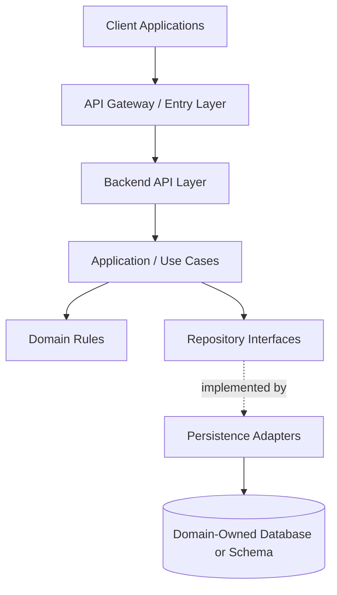
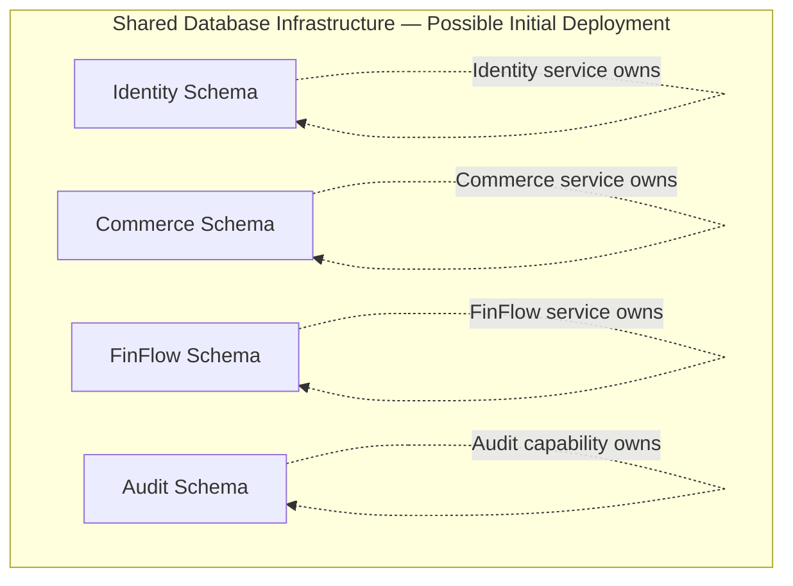
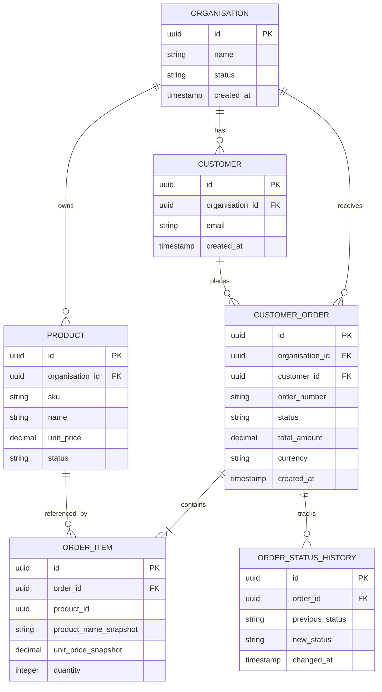
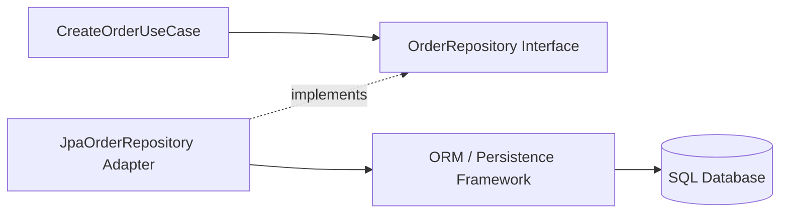
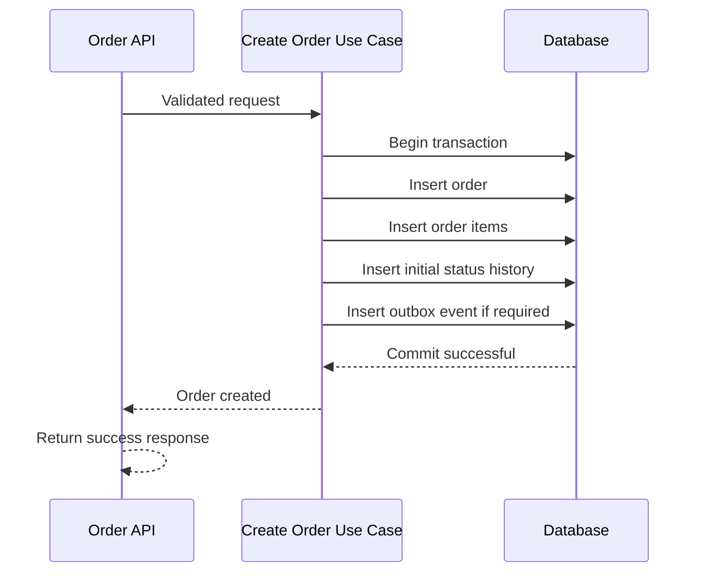
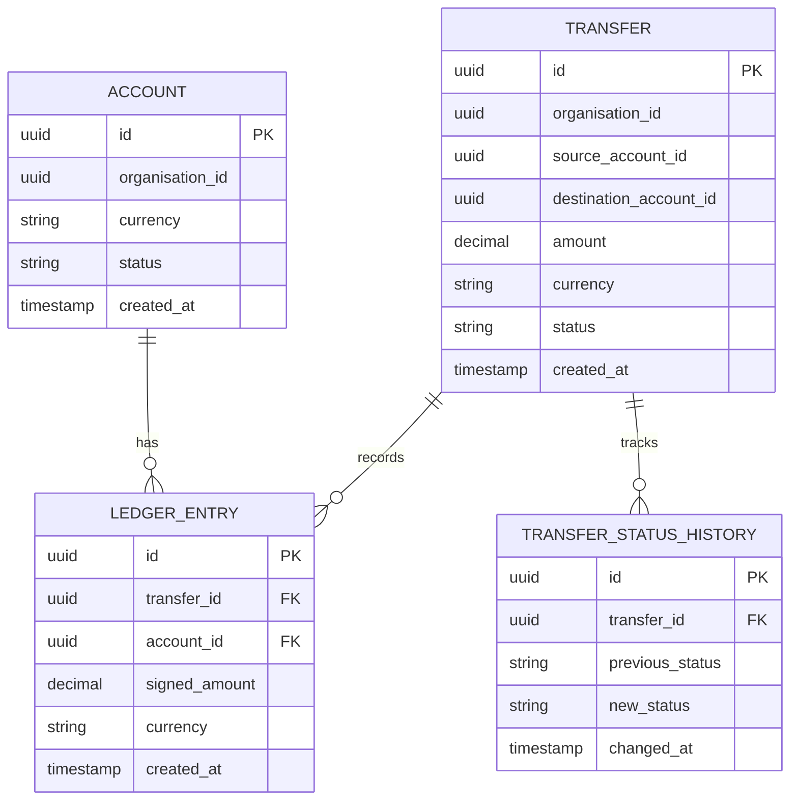
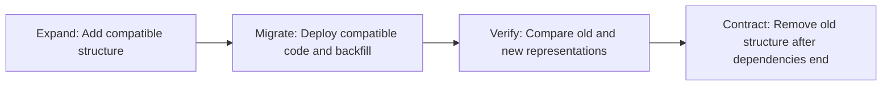
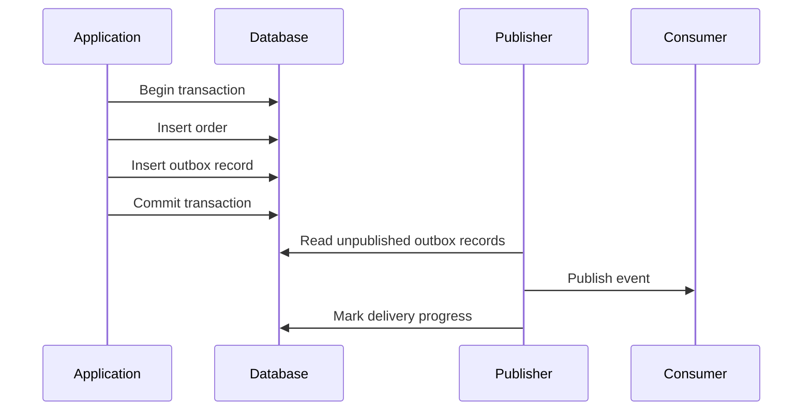
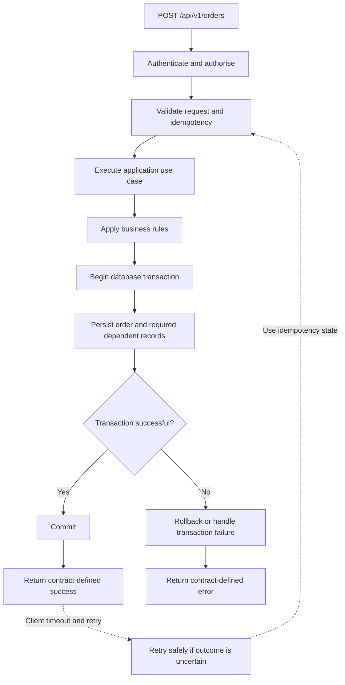

# Layer 5 — Database Architecture and Persistence

**Status:** Architecture design baseline — decisions remain subject to requirements and repository inspection.

**Objective:** Define how the Composable Business Platform stores business data, maintains consistency, handles concurrent updates, and recovers from failures without creating unnecessary coupling between domains.

> Core principle: Every business domain must have a clear owner for its authoritative data. A shared platform does not mean every service should freely read and write the same database tables.

---

## 5.1 Where the Database Layer Fits

The database is the persistence boundary beneath each backend domain. It stores durable business state, but it must not become the place where business ownership and application boundaries are accidentally mixed.



### Responsibility of each part

| Component | Responsibility |
|---|---|
| API | Receives requests and validates request structure. |
| Application | Coordinates the use case and defines the transaction boundary. |
| Domain | Enforces business invariants and rules. |
| Repository interface | Defines the persistence operations the application needs. |
| Persistence adapter | Implements database access using the selected persistence technology. |
| Database | Enforces supported data constraints and durably stores committed state. |

The database should not be accessed directly by controllers or unrelated services. Persistence details should not leak into public API contracts.

---

## 5.2 Database Architecture: Logical Ownership

The first design decision is not whether to use one database server or several. It is **which domain owns each type of data**.

### Candidate data ownership

| Domain or capability | Authoritative data examples | Ownership rule |
|---|---|---|
| Identity and access | Users, credentials references, roles, permissions | Owns identity and access-control records. |
| Organisations | Organisations, memberships, capability assignments | Owns organisation membership and configuration. |
| Commerce | Products, inventory, orders, order items, returns | Owns Commerce business state. |
| FinFlow | Accounts, transfers, ledger entries, reconciliation records | Owns simulated financial-operation state. |
| Notifications | Delivery attempts, notification status, templates | Owns notification processing records. |
| Integration and workflows | External integration configuration, webhook delivery attempts, workflow execution state | Owns integration execution and recovery state. |
| Audit capability | Security and business audit records, subject to agreed boundaries | Owns audit retention and access rules where implemented as a separate capability. |

This is a candidate ownership model. The actual service boundaries and existing database structure must be audited before implementation.

### Important distinction: database server versus data ownership

These are different architectural decisions:

1. **One database server:** Several applications or schemas may use the same database infrastructure.
2. **Separate schemas:** Different domains have separate namespaces and potentially different permissions.
3. **Separate databases:** Domains have stronger physical isolation and independent operational control.
4. **Separate database servers:** Domains can have stronger infrastructure isolation, at additional operational cost.

We can begin with shared database infrastructure if it is appropriate, while still preserving logical ownership and access boundaries.

A service must not depend on another service's private tables merely because those tables are accessible.

### Recommended evolution



The repeated self-references above represent ownership, not runtime calls. In implementation, ownership is enforced through service responsibilities, database permissions, migrations, and review rules.

**Important:** This arrangement does not imply that every domain should have a separate microservice immediately. A modular application can preserve domain-owned schemas and module boundaries while deployment topology remains simpler.

---

## 5.3 Logical Data Model

A logical model describes business concepts and relationships independently of a particular SQL dialect, ORM, or physical deployment.

The following is an illustrative Commerce model, not a final approved schema.



### Why are order items separate from orders?

One order may contain multiple products.

If we put every product into a single order row, we would either need a fixed number of product columns or store a complicated collection in one field.

A separate `ORDER_ITEM` table provides:

- One row per order line.
- A clear relationship to the order.
- Quantity and price for each item.
- Better validation and querying.
- A way to preserve the price agreed at purchase time.

### Why preserve a product snapshot?

Suppose a product costs £20 when an order is placed. The product price later changes to £25.

The old order should normally retain its original agreed price. Therefore, `unit_price_snapshot` records the price used by the order.

The current product record and the historical order are different business facts.

For a production design, define exactly which attributes must be snapshotted, how product changes are handled, and whether historical records require additional version information.

---

## 5.4 Keys, Relationships and Constraints

A database schema must represent both relationships and business invariants.

### Primary keys

A primary key uniquely identifies a record.

Example:

```sql
CREATE TABLE customer_order (
    id UUID PRIMARY KEY,
    organisation_id UUID NOT NULL,
    order_number VARCHAR(64) NOT NULL,
    status VARCHAR(32) NOT NULL,
    created_at TIMESTAMP NOT NULL
);
```

The SQL types and syntax are illustrative. Adjust them to the chosen database.

A surrogate identifier such as a UUID can be useful when records are created across multiple application instances. However, UUIDs are not automatically better for every database or workload.

### Foreign keys

A foreign key prevents a row from referencing a nonexistent row in the referenced table.

For example, an order item can reference an existing order:

```sql
CREATE TABLE order_item (
    id UUID PRIMARY KEY,
    order_id UUID NOT NULL,
    product_id UUID NOT NULL,
    quantity INTEGER NOT NULL,
    unit_price_snapshot DECIMAL(19, 4) NOT NULL,

    CONSTRAINT fk_order_item_order
        FOREIGN KEY (order_id)
        REFERENCES customer_order(id),

    CONSTRAINT chk_order_item_quantity
        CHECK (quantity > 0),

    CONSTRAINT chk_order_item_price
        CHECK (unit_price_snapshot >= 0)
);
```

This example assumes that zero-priced items are permitted. If the business rules differ, the constraints must change.

### Unique constraints

A unique constraint prevents duplicate values for a defined key.

For example, an order number might be unique within an organisation:

```sql
ALTER TABLE customer_order
ADD CONSTRAINT uq_order_org_number
UNIQUE (organisation_id, order_number);
```

The exact migration syntax depends on the database.

**Interview point:** Application validation improves error messages, but database constraints protect data against concurrent requests, bugs, and other database writers.

### Where should each rule live?

| Rule | Primary enforcement |
|---|---|
| Request contains a valid field format | API validation |
| Requested transition is permitted | Domain/application rules |
| Quantity must be positive | Domain validation and database constraint where appropriate |
| Order identifier must be unique within an organisation | Database unique constraint plus application error handling |
| Referenced order must exist | Database foreign key where applicable |
| User may access this organisation's order | Authorisation and tenant-scoped data access |
| Transfer debit and credit must balance | FinFlow domain rules, transactional persistence, and integrity checks |

Database constraints complement business logic; they do not replace it.

---

## 5.5 Normalisation and Data Duplication

Normalisation helps reduce unnecessary duplication and update anomalies.

Consider a poorly designed table:

| order_id | customer_name | customer_email | product_1 | product_2 |
|---|---|---|---|---|
| 101 | Alex | alex@example.test | Keyboard | Mouse |

Problems include:

- An order has a fixed number of product columns.
- Repeated customer details may disagree across orders.
- Adding a product requires changing the structure.
- Queries become more complicated as the number of products grows.

A more structured model separates customers, orders, and order items.

### Does normalisation mean never duplicating data?

No.

Some duplication is intentional and protects historical meaning.

Examples include:

- The price captured when an order was placed.
- The product description shown on an invoice at the time of purchase.
- A stable external reference received from a partner.
- A read-optimised projection built from an authoritative source.

The key is to distinguish **intentional snapshots or projections** from accidental duplication.

For every duplicated field, document:

1. Which copy is authoritative?
2. Why is the copy needed?
3. When is it created or updated?
4. How are inconsistencies detected or corrected?

---

## 5.6 Persistence Mapping and Repository Boundaries

In a Java backend, persistence mapping converts database rows into application/domain representations and back.

The exact implementation depends on the existing project, selected ORM, and complexity of the domain.

### Illustrative dependency structure



The application depends on a repository contract, not directly on a particular database implementation.

This supports testing and keeps persistence-specific decisions at the infrastructure boundary.

### Example repository contract

```java
public interface OrderRepository {

    boolean existsByOrganisationIdAndOrderNumber(
        UUID organisationId,
        String orderNumber
    );

    Optional<Order> findByIdAndOrganisationId(
        UUID orderId,
        UUID organisationId
    );

    Order save(Order order);
}
```

This is illustrative Java, not a requirement to introduce an interface for every trivial data-access operation.

The repository should express meaningful operations required by the use case. Avoid creating generic abstraction layers without a demonstrated need.

### Separate API DTOs from persistence models

Do not automatically expose ORM entities as public HTTP responses.

A database entity may contain internal fields such as:

- Organisation identifiers.
- Internal processing status.
- Optimistic-lock version.
- Persistence relationships.
- Internal audit metadata.

The API should expose an intentional response contract.

Similarly, a request DTO should not be treated as a trusted database entity. Validate the request and map permitted values into the application/domain model.

---

## 5.7 Transaction Boundaries and ACID

A database transaction groups operations into one logical unit of work.

The usual ACID properties are:

| Property | Meaning | Example |
|---|---|---|
| Atomicity | All operations in the transaction commit or roll back together. | Creating an order and its order items must not leave a partially created order. |
| Consistency | Defined invariants remain satisfied. | An order item cannot have a non-positive quantity. |
| Isolation | Concurrent transactions are controlled according to the selected isolation level. | Two requests must not both consume the last available inventory unit. |
| Durability | Committed data survives failures according to the database's durability guarantees and configuration. | A committed order remains stored after a process restart. |

ACID is not a substitute for correctly designing business invariants, transaction scope, or recovery procedures.

### Example: create an order

A single database transaction may include:

1. Creating the order.
2. Creating its order-item records.
3. Recording an initial status-history entry.
4. Recording an idempotency result, if it belongs in the same transactional boundary.
5. Recording an event-outbox entry, if an outbox is selected.

The exact set depends on the chosen design.



The key guarantee is that the order and its required dependent records are committed together.

If a required insert fails, the transaction should roll back rather than leave the database in an unintended partial state.

### Illustrative Spring transaction boundary

```java
@Service
public class CreateOrderUseCase {

    private final OrderRepository orderRepository;
    private final OrderItemRepository orderItemRepository;

    public CreateOrderUseCase(
            OrderRepository orderRepository,
            OrderItemRepository orderItemRepository) {
        this.orderRepository = orderRepository;
        this.orderItemRepository = orderItemRepository;
    }

    @Transactional
    public OrderResult execute(CreateOrderCommand command) {
        // Validate business rules.
        // Construct the order and order items.
        // Persist all required records.
        // Return the result only after the transaction succeeds.
        throw new UnsupportedOperationException(
            "Illustrative skeleton: implement after schema and rules are approved"
        );
    }
}
```

This is a structural illustration, not a complete runnable use case.

Before implementing it, define how the order total is calculated, how prices are captured, how inventory is reserved, and how duplicate requests are handled.

### Where should the transaction begin and end?

The transaction should normally surround the smallest complete unit of database work that must be atomic.

Avoid:

- Beginning a transaction in a controller.
- Keeping a database transaction open while waiting for a slow external HTTP API.
- Wrapping an entire multi-step business process in one enormous transaction.
- Assuming a transaction in one service automatically includes another service's database.

### Database transaction versus distributed transaction

A local transaction normally controls changes within one database transaction manager.

Suppose Commerce creates an order and then calls FinFlow to simulate a payment. If these are independently deployed services with separate databases, the Commerce transaction cannot automatically roll back a committed FinFlow transaction.

A safer design may use explicit states and a workflow:

1. Create the order as pending.
2. Request the simulated payment.
3. Record the payment outcome.
4. Confirm or cancel the order according to defined rules.
5. Retry or reconcile uncertain outcomes.

A saga or similar workflow may be appropriate if the requirements justify it. It should not be introduced merely because multiple services exist.

---

## 5.8 Isolation Levels and Concurrency

Multiple requests may read and modify the same record at the same time.

Transaction isolation controls which concurrent effects a transaction can observe. Exact behaviour depends on the database and its implementation.

Common isolation levels are:

| Isolation level | General behaviour | Main consideration |
|---|---|---|
| Read Uncommitted | May permit reading uncommitted changes in systems that support this behaviour. | Dirty reads can produce unreliable decisions. |
| Read Committed | Prevents dirty reads. Repeated reads may observe committed changes. | A value can change during a transaction. |
| Repeatable Read | Provides stronger guarantees for repeated reads; exact phantom and concurrency behaviour varies by database. | Verify database-specific semantics. |
| Serializable | Aims to make concurrent transactions equivalent to some serial execution. | May cause blocking or transaction retries. |

Do not assume that the same isolation-level name has identical implementation details across all databases.

### Example: inventory race condition

Suppose inventory contains one unit.

Two requests execute concurrently:

```text
Request A reads stock = 1
Request B reads stock = 1
Request A decides the item is available
Request B decides the item is available
Request A reduces stock to 0
Request B reduces stock to 0
```

A poorly implemented read-then-write sequence can oversell inventory.

One option is an atomic conditional update:

```sql
UPDATE inventory
SET available_quantity = available_quantity - :requested_quantity
WHERE product_id = :product_id
  AND available_quantity >= :requested_quantity;
```

The application must check the number of affected rows:

- One row updated: the reservation succeeded.
- Zero rows updated: the item was unavailable or the row did not match.

For multi-tenant data, the actual predicate must also include the correct ownership context where relevant.

This operation must participate in the intended transaction, and its concurrency semantics should be verified against the chosen database.

---

## 5.9 Optimistic and Pessimistic Locking

These are two common approaches to controlling concurrent changes.

### Optimistic locking

Optimistic locking assumes conflicts are relatively uncommon and detects them when an update occurs.

A record may contain a version number:

```text
id | status  | version
---|---------|--------
42 | PENDING | 3
```

An update conceptually checks that the version is still 3 before changing the record.

```sql
UPDATE customer_order
SET status = :new_status,
    version = version + 1
WHERE id = :order_id
  AND version = :expected_version;
```

If zero rows are updated, the record may have changed since it was read. The application must detect and handle the conflict.

In an ORM such as JPA, an entity version field can support this approach, provided the mapping and transaction handling are configured correctly.

**Useful for:** order status changes, administrative edits, and other workloads where conflicts are possible but not constant.

### Pessimistic locking

Pessimistic locking acquires a database lock to prevent incompatible concurrent operations during a critical section.

Conceptually:

```sql
SELECT *
FROM inventory
WHERE product_id = :product_id
FOR UPDATE;
```

Exact syntax and behaviour vary by database.

The transaction can inspect and update the locked row, subject to database semantics.

**Useful for:** selected critical updates where serial access is justified and contention is manageable.

### Comparison

| Question | Optimistic locking | Pessimistic locking |
|---|---|---|
| Main strategy | Detect conflicts | Prevent conflicting access through locks |
| Typical cost | Failed updates and possible retries | Lock waiting and possible blocking |
| Best fit | Lower contention | Carefully chosen high-contention operations |
| Main risk | Excessive conflict retries | Deadlocks, long waits, reduced throughput |

Do not add locks everywhere. Choose a concurrency-control mechanism for each invariant and workload.

---

## 5.10 Idempotency and Duplicate Requests

A client may send a request, experience a timeout, and retry even though the original request succeeded.

The server must distinguish a retry from a new business operation when the API contract requires idempotent behaviour.

For example, an order request may include:

```http
POST /api/v1/orders
Idempotency-Key: 9d6e-example-key
```

An idempotency record might conceptually contain:

```text
organisation_id
idempotency_key
request_fingerprint
operation_status
resource_id
response_reference
created_at
```

These fields are illustrative; the final design depends on the API contract.

### Expected behaviour

1. Authenticate and authorise the caller.
2. Validate the request.
3. Identify the caller's idempotency scope.
4. Check whether the key already exists.
5. If it exists with a matching request, return or resume the original operation according to its status.
6. If it exists with a different request, reject the conflicting reuse.
7. If it is new, create the operation and its idempotency record atomically where possible.
8. Return the result only when the operation reaches the state required by the API contract.

A unique database constraint should prevent two concurrent requests from independently claiming the same idempotency key.

The application must handle the resulting uniqueness conflict correctly.

Do not assume that a timeout means a database rollback. The transaction may have committed while the response was lost.

---

## 5.11 FinFlow: Ledger and Transfer Persistence

FinFlow is intended for simulated account and transfer operations. Even though the platform does not move real money, the data model should demonstrate reliable financial-style invariants.

### Candidate logical model



This model is illustrative. A complete ledger requires explicit decisions about entry direction, posting states, reversals, account balances, currency precision, and how entries are grouped into balanced transactions.

### Example transfer invariant

For a simple simulated transfer between two accounts using the same currency:

```text
Source account:       -100.00
Destination account:  +100.00
--------------------------------
Net ledger movement:     0.00
```

The application must ensure that the entries represent the intended transfer and that the transfer follows the allowed lifecycle.

### Important design rules

- Use an appropriate exact decimal representation for amounts rather than binary floating-point types.
- Define currency and permitted precision explicitly.
- Prevent an invalid or duplicate posting.
- Keep a durable relationship between transfer records and ledger entries.
- Do not silently rewrite posted ledger history to correct a business error.
- Define controlled reversal or adjustment operations.
- Make reconciliation discrepancies visible and auditable.
- Define the authoritative source for account balances.

### Ledger entries versus cached balances

There are two different concepts:

1. **Ledger entries:** Durable records of posted movements.
2. **Account balance:** A representation of the resulting amount available or recorded for an account.

A balance may be calculated from ledger entries or maintained as a derived balance for performance.

If a cached or materialised balance is maintained, define how it is updated atomically with the ledger, how concurrent transfers are controlled, and how it is reconciled against the authoritative entries.

A balance that can drift silently from the ledger is not a reliable design.

### Why immutable history matters

If a posted transfer is wrong, the correction should normally be represented through a controlled reversal or adjustment with its own audit trail.

The exact accounting and lifecycle rules must be designed before implementing the transfer workflow.

---

## 5.12 Database-per-Service and Cross-Domain Queries

A domain should not bypass another domain's ownership by reading its private tables.

Suppose Commerce needs to know whether a simulated payment succeeded.

Avoid:

```text
Commerce application
    -> directly queries FinFlow's private transaction table
```

Prefer an explicit contract:

```text
Commerce application
    -> calls FinFlow API
    OR consumes an agreed payment-status event
    -> stores the required Commerce-side state or projection
```

The API or event contract must define what a status means, how it changes, and how retries and delayed updates are handled.

### What about reports spanning several domains?

Options include:

- Calling the relevant domain APIs for a small, bounded query.
- Building a reporting projection from authorised events or data exports.
- Using a dedicated analytics store when justified.
- Providing a carefully controlled reporting interface.

Avoid creating cross-domain SQL joins as a shortcut that permanently couples independently owned schemas.

A reporting projection is not automatically the authoritative source for business operations.

---

## 5.13 Schema Migrations and Version Control

Database structure changes over time. Tables, constraints, indexes, and data formats must evolve in a controlled way.

### Recommended migration principles

1. Store migration scripts in version control.
2. Use an established migration mechanism selected for the project.
3. Review schema changes alongside application changes.
4. Verify existing schema and data before applying changes.
5. Test migrations against representative data and supported environments.
6. Define rollback or forward-recovery procedures before deployment.
7. Avoid destructive changes until dependencies and recovery options are verified.

A migration history should allow engineers to determine which schema changes have been applied to an environment.

### Example migration sequence

```text
V001__create_customer_order.sql
V002__create_order_item.sql
V003__add_order_status_history.sql
V004__add_order_lookup_index.sql
```

These names are illustrative. The actual tool and naming convention remain undecided.

### Safe evolution: expand, migrate, contract

For a change that affects an existing column or API contract, consider three phases.



For example, replacing a column should not necessarily begin by dropping it.

A safer approach may be to add the new column, write or backfill data, verify consistency, switch reads, and remove the old column only after all dependent code is retired.

Not every migration needs this full sequence, but production-like changes should account for deployment ordering and rollback limitations.

### Rollback versus recovery

A database migration is not always safely reversible.

Dropping a column may destroy information that a reverse migration cannot reconstruct. A data transformation may also be lossy.

Before a migration, document:

- Expected schema changes.
- Expected data changes.
- Preconditions and postconditions.
- Affected rows and expected counts where relevant.
- Backup or recovery requirements.
- Rollback feasibility.
- Forward-fix procedure if rollback is unsafe.
- Application-version compatibility.
- Verification queries.

A transaction rollback only reverses work that is still inside the transaction and supported by the database. It does not undo every previously committed change or an external side effect.

---

## 5.14 Verification-First Database Change Procedure

For production-like work, database changes must follow a cautious verification process.

### Phase 1 — Read-only discovery

Before any mutation:

- Identify the actual database and schema.
- Inspect relevant tables, columns, constraints, indexes, and migration history.
- Identify the authoritative source for each field.
- Inspect the target records and their current values.
- Confirm record counts and uniqueness assumptions.
- Identify dependent applications, reports, and scheduled jobs.
- Capture the current state needed for verification and recovery.

Do not assume the database matches a diagram or an old script.

### Phase 2 — Preview

Construct read-only queries that identify the exact rows the proposed change would affect.

For example:

```sql
SELECT
    id,
    organisation_id,
    status,
    version
FROM customer_order
WHERE id = :target_order_id
  AND organisation_id = :expected_organisation_id;
```

This query is illustrative. The actual identifiers and predicates must come from the verified schema and requirements.

Review the result before preparing an update.

For bulk changes, calculate and inspect the expected affected-record set, not merely a total count. Two different record sets can have the same count.

### Phase 3 — Change and recovery plan

Before executing a mutation:

- Confirm the business requirement and exact target.
- Review the proposed SQL or migration.
- Identify uniqueness, foreign-key, and concurrency implications.
- Determine whether a transaction is appropriate.
- Define the expected affected-row count.
- Decide how the result will be verified.
- Establish rollback or forward-recovery steps.
- Obtain the required explicit approval.

**Do not run or recommend executing an `UPDATE`, `DELETE`, or destructive migration merely because a preview query returned plausible results.**

### Phase 4 — Apply and verify

After approval:

- Apply the smallest appropriate change.
- Check affected-row counts.
- Verify the resulting records and constraints.
- Compare against the expected state.
- Check related business invariants.
- Capture the outcome for the change record.

A successful SQL execution does not by itself prove that the business requirement was satisfied.

---

## 5.15 Indexing and Query Performance

Indexes help the database locate rows efficiently, but they also consume storage and add write overhead.

Indexes should be designed around actual query patterns.

### Example query

```sql
SELECT
    id,
    status,
    created_at
FROM customer_order
WHERE organisation_id = :organisation_id
  AND status = :status
ORDER BY created_at DESC;
```

A candidate composite index might be:

```sql
CREATE INDEX idx_order_org_status_created
ON customer_order (
    organisation_id,
    status,
    created_at
);
```

This is a candidate only. Whether it is useful depends on the database, query plan, data distribution, ordering requirements, and workload.

### Index design checklist

- What queries run frequently?
- Which columns are used in filters and joins?
- Is the query selective enough to benefit?
- Does the index order support the filter and sort?
- Are existing indexes already sufficient?
- What is the cost for inserts, updates, and deletes?
- Has the query execution plan been inspected?
- Has performance been measured using representative data?

Do not index every column automatically.

### Pagination

For small result sets, offset pagination can be straightforward. For large, frequently changing datasets, keyset pagination may be more appropriate.

For example, a query can continue from the last observed creation time and unique identifier rather than skipping a large offset.

The ordering must be deterministic. If multiple records share the same timestamp, include a stable tie-breaker such as the record ID.

---

## 5.16 Multi-Tenant Data Isolation

The platform may support multiple organisations. If so, tenant isolation is a core security requirement, not merely a query-performance concern.

### Example ownership rule

An order belongs to an organisation:

```text
customer_order
    id
    organisation_id
    customer_id
    status
```

A query should be scoped to the authorised organisation:

```sql
SELECT *
FROM customer_order
WHERE id = :order_id
  AND organisation_id = :authorised_organisation_id;
```

The organisation identifier must come from validated and authorised request context, not be trusted simply because the client supplied it.

### Required safeguards

- Authenticate the caller.
- Determine the caller's authorised organisation context.
- Verify the required permission for the operation.
- Scope data-access operations to the permitted organisation.
- Enforce tenant-aware uniqueness where required.
- Review foreign-key relationships and ownership constraints.
- Prevent object-level authorisation failures.
- Test that one organisation cannot read or mutate another organisation's records.
- Apply equivalent rules to background jobs, exports, reports, and administrative tools.

### Important distinction

A foreign key proves a relationship exists; it does not necessarily prove that both records belong to the same organisation.

If the schema requires a customer and order to belong to the same organisation, consider how that invariant is enforced, such as tenant-aware keys, suitable constraints, or carefully controlled application logic.

Choose the implementation after verifying the selected database's capabilities and the intended data model.

---

## 5.17 Audit History and Data Retention

The platform needs to distinguish ordinary application logs from durable business audit records.

### Ordinary operational logs

Used for:

- Debugging failures.
- Tracking request execution.
- Measuring latency.
- Investigating infrastructure problems.

### Business audit records

Used for:

- Recording significant business-state changes.
- Identifying the actor or system responsible.
- Recording the operation and affected resource.
- Supporting investigations and reconciliation.
- Demonstrating controlled corrections.

An illustrative audit record might contain:

```text
audit_id
organisation_id
actor_type
actor_reference
action
resource_type
resource_id
correlation_id
occurred_at
outcome
```

The exact fields depend on the security and compliance requirements.

Avoid logging credentials, access tokens, unnecessary personal information, or sensitive payloads.

### Retention questions

Define:

- Which records must be retained.
- For how long.
- Who can read them.
- Whether they can be corrected or deleted.
- How retention and deletion requests are handled.
- Whether archived records remain searchable.
- How backup retention interacts with deletion requirements.

Do not assume that every record must be retained forever or that every audit store must be immutable in exactly the same way. Requirements and applicable obligations determine the policy.

---

## 5.18 Outbox Pattern and Reliable Event Publication

If a committed database change must eventually produce an event, there is a failure window to address.

Consider:

```text
1. Save order in database.
2. Commit transaction.
3. Publish OrderCreated event.
```

If the process crashes after step 2 but before step 3, the order exists but the event may never be published.

Publishing first creates the opposite risk: the event is delivered even though the database transaction later fails.

### Transactional outbox

A common solution is to write the business change and an outbox record in the same database transaction.



The publisher can retry after failure.

However, delivery may occur more than once. Consumers should therefore tolerate duplicate delivery, and the event contract should define event identity and processing semantics.

The outbox improves reliable publication, but it does not magically provide exactly-once processing across arbitrary systems.

**Decision rule:** Add an outbox when reliable event publication is a demonstrated requirement. Do not introduce it simply because an event broker might be used in the future.

---

## 5.19 Backup, Recovery and Operational Readiness

Durable storage requires an operational recovery plan.

A backup is useful only if it can be restored successfully and within acceptable time.

### Required considerations

| Area | Question |
|---|---|
| Backup schedule | How frequently must recoverable copies be created? |
| Recovery Point Objective (RPO) | How much data loss can the system tolerate? |
| Recovery Time Objective (RTO) | How quickly must service be restored? |
| Restore testing | Has a backup actually been restored and verified? |
| Migration recovery | Can the application run against the recovered schema? |
| Access control | Who can create, access, and restore backups? |
| Encryption | How are backups protected in transit and at rest? |
| Retention | How long are backup copies retained? |
| Reconciliation | How is business state checked after recovery? |

RPO and RTO should be set from actual requirements rather than invented numbers.

For FinFlow, recovery verification should include ledger integrity, transfer state, account-balance consistency, and any incomplete workflows.

For Commerce, it may include order-item consistency, inventory reservations, payment outcomes, and pending order states.

Recovery must account for external side effects that are not rolled back when a database is restored.

---

## 5.20 Database Testing Strategy

Database tests should validate more than whether repository methods return the expected object.

| Test type | What it verifies |
|---|---|
| Domain unit tests | Business rules without a database. |
| Repository integration tests | Actual persistence mapping, queries, constraints, and transactions. |
| Migration tests | Schema changes apply correctly and preserve expected data. |
| Transaction tests | Required changes commit or roll back together. |
| Concurrency tests | Conflicting requests preserve the intended invariants. |
| Idempotency tests | Duplicate requests do not create duplicate business operations. |
| Tenant-isolation tests | One organisation cannot access another organisation's records. |
| Recovery tests | Backups or recovery procedures produce a usable, consistent system. |
| Performance tests | Important queries and transaction paths meet defined expectations. |

### Example rollback test scenario

Given:

- A new order.
- Two order items.
- A failure while persisting a required dependent record.

When the use case executes:

- The transaction should fail.
- The order should not remain partially committed.
- The dependent records should not remain partially committed.
- The application should return the contract-defined failure response.

The test should inspect the database after the transaction completes to verify the result.

### Why use a real database in integration tests?

In-memory databases and mocks can be useful, but they may not reproduce the chosen production database's:

- Locking behaviour.
- Constraint enforcement.
- SQL dialect.
- Isolation semantics.
- Query planning.
- Migration behaviour.

Use a test environment that gives sufficient confidence in the actual database behaviour. The exact approach depends on the technology selected and the cost of running it.

---

## 5.21 End-to-End Trace: Creating a Commerce Order

This section connects the API, application, domain, and persistence layers.

Assume the user submits an order for two items.

### Step 1 — Receive the request

```http
POST /api/v1/orders
Authorization: Bearer <access-token>
Idempotency-Key: <unique-key>
Content-Type: application/json
```

The request contains the customer's intended items and quantities.

The server authenticates the caller, determines the authorised organisation, and validates the request structure.

### Step 2 — Execute the use case

The application layer:

- Checks the request's idempotency state.
- Loads or verifies the necessary customer and product information through authorised boundaries.
- Applies business rules.
- Calculates the order total using defined price and currency rules.
- Constructs the order and its items.

The final rules for pricing, inventory reservation, and external payment remain explicit requirements.

### Step 3 — Begin the database transaction

The application persists the records that must be atomic.

Conceptually:

```text
BEGIN TRANSACTION

    Insert order
    Insert order items
    Insert initial order-status history
    Insert idempotency result if designed for this transaction
    Insert outbox event if required

COMMIT
```

This is a logical representation, not executable SQL. The actual transaction may use ORM-generated statements or explicit queries.

### Step 4 — Handle failure

If a required database operation fails before commit:

```text
ROLLBACK
```

The application must not report successful creation if the required transaction failed.

If the transaction committed but the HTTP response was lost, a retry must follow the API's idempotency contract rather than blindly creating another order.

### Step 5 — Return the response

A successful response might look like:

```json
{
  "orderId": "example-order-id",
  "status": "PENDING",
  "currency": "GBP",
  "totalAmount": "45.00"
}
```

This is an illustrative response. The actual API contract and amount representation must be agreed upon.

### Complete request-to-database flow



The key point is that the application coordinates the business operation, while the database transaction ensures atomicity for the records within its boundary.

---

## 5.22 Common Database Design Mistakes

| Mistake | Why it is problematic | Better approach |
|---|---|---|
| Every service reads every table | Creates hidden coupling and unclear ownership. | Define data ownership and explicit contracts. |
| Public DTOs mirror database entities | Leaks persistence structure into API contracts. | Use deliberate request and response models. |
| Business rules exist only in controllers | Rules are difficult to reuse and test consistently. | Place rules in the appropriate domain/application layer. |
| Transactions include slow external calls | Can hold locks and connections for too long. | Keep local transactions bounded and model cross-service workflows explicitly. |
| Read-then-write without concurrency control | Can lose updates or violate invariants. | Use constraints, atomic updates, locks, or version checks as appropriate. |
| Every column receives an index | Adds write overhead and storage cost. | Index measured, important query patterns. |
| A balance is updated separately from its ledger | Can create inconsistent financial-style records. | Define and enforce the atomic posting boundary. |
| A retry creates a second operation | Timeouts make the outcome uncertain. | Implement the required idempotency contract. |
| A migration is assumed reversible | Data loss may make rollback impossible. | Plan rollback or forward recovery before mutation. |
| Backups are never restored in tests | Recovery capability remains unproven. | Perform controlled restore and verification exercises. |
| Tenant IDs are trusted from the request | Can expose another organisation's data. | Derive authorised context and scope every operation. |
| A new database technology is selected too early | Adds complexity without proven benefit. | Inspect requirements and the existing repository first. |

---

## 5.23 Decisions to Make Before Implementation

The following decisions remain open until requirements and the existing project are inspected.

| Decision | What must be verified |
|---|---|
| Database engine | Existing technology, team needs, query requirements, deployment environment, and operational cost. |
| Database topology | Whether one database server with separate schemas is sufficient initially. |
| Service boundaries | Which capabilities truly require independent deployment and persistence. |
| ORM or SQL access | Existing persistence framework, query complexity, and control requirements. |
| ID generation | Database capabilities, distributed creation needs, and indexing implications. |
| Transaction model | Atomic records and business invariants for each use case. |
| Isolation and locking | Actual concurrency risks and database-specific behaviour. |
| Tenant isolation | Authorisation model, data ownership, and required enforcement mechanisms. |
| Migration tooling | Versioning, review, environment consistency, and recovery support. |
| Idempotency | Which APIs need it, its scope, and how long keys remain valid. |
| Event delivery | Whether events are required and whether an outbox is justified. |
| Ledger design | Posting model, reversals, balance calculation, precision, and reconciliation rules. |
| Audit and retention | Required records, access controls, retention periods, and deletion rules. |
| Backup and recovery | RPO, RTO, backup frequency, restore tests, and verification procedures. |

**Do not create all candidate schemas or tables immediately.** First inspect the current `finflow-microservices` repository, identify what already exists, and map the approved requirements to the smallest appropriate schema changes.

---

## 5.24 Database Architecture Interview Questions

### Fundamentals

1. What is the difference between a logical data model and a physical database schema?
2. What are primary keys, foreign keys, unique constraints, and check constraints?
3. Why is normalisation useful? When is deliberate denormalisation justified?
4. Why should API DTOs usually be separate from persistence entities?
5. What is the difference between a database server, database, schema, and table?

### Transactions and consistency

6. Explain ACID using an order-creation example.
7. What happens when one insert fails in a multi-record transaction?
8. Why should external HTTP calls usually not occur inside a long-running database transaction?
9. Can a transaction in one microservice roll back a committed transaction in another?
10. What is the difference between a local transaction and a distributed business workflow?

### Concurrency

11. What is a lost update?
12. Explain optimistic locking and version columns.
13. When might pessimistic locking be appropriate?
14. What is the purpose of a database unique constraint if the application already validates uniqueness?
15. How can two requests compete for the last available inventory item?
16. What are transaction isolation levels, and why should their implementation be verified for the chosen database?

### Reliability

17. Why is idempotency important when clients retry after timeouts?
18. What problem does the transactional outbox pattern solve?
19. Does an outbox guarantee exactly-once event processing?
20. What is the difference between rolling back a transaction and recovering a database after a committed change?
21. Why must a backup restore be tested?

### Architecture and security

22. What does database-per-service mean?
23. Why should one service not directly query another service's private tables?
24. How can multi-tenant queries expose data if organisation ownership is not enforced?
25. How would you investigate a slow query?
26. Why can an index improve reads but hurt writes?
27. How would you evolve a schema without breaking a running application?
28. How would you maintain the integrity of a simulated transfer ledger?
29. Why is a materialised or cached account balance not automatically the authoritative ledger?
30. How would you safely review and apply a production database migration?

### Senior-level follow-ups

- What if the database commits but the client never receives the response?
- What if a unique-constraint violation occurs because two requests run concurrently?
- What if a schema migration succeeds but the new application version fails to start?
- What if the restored database contains orders but the external payment workflow completed after the backup?
- What if a ledger entry is incorrect after posting?
- What evidence would you require before approving a bulk update?

A strong answer should explain the invariant being protected, the failure mode, the chosen mechanism, its trade-offs, and how the behaviour is tested.

---

## 5.25 Section Summary

The database layer is not simply a collection of tables. It is part of the system's consistency, security, and recovery design.

Remember these principles:

1. **Ownership:** Each domain has an authoritative source for its business data.
2. **Integrity:** Use domain rules and appropriate database constraints together.
3. **Atomicity:** Group the records that must succeed or fail together in a bounded transaction.
4. **Concurrency:** Design explicitly for simultaneous requests.
5. **Idempotency:** Treat retries as a business-correctness problem, not just an HTTP concern.
6. **Evolution:** Version schema changes and verify recovery before destructive operations.
7. **Isolation:** Enforce organisation-level data access throughout the application.
8. **Reliability:** Plan for backups, restoration, reconciliation, and uncertain outcomes.
9. **Performance:** Design indexes around measured query patterns.
10. **Pragmatism:** Choose database technologies and patterns only after verifying requirements and existing behaviour.

### Next section

**Layer 6 — Service-to-Service Communication and Distributed Workflows**

We will define how Commerce, FinFlow, identity, notifications, and integration capabilities communicate; when to use synchronous APIs versus asynchronous events; how to handle timeouts, retries, duplicate delivery, and partial failure; and how to keep workflows recoverable without prematurely introducing infrastructure.
