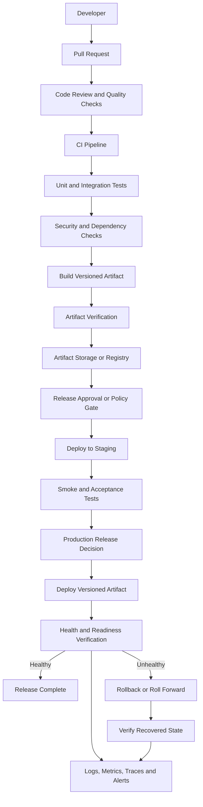
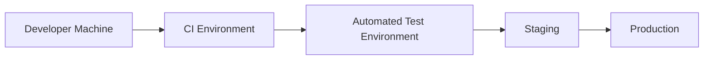
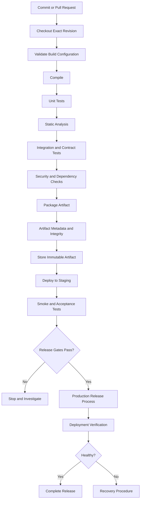
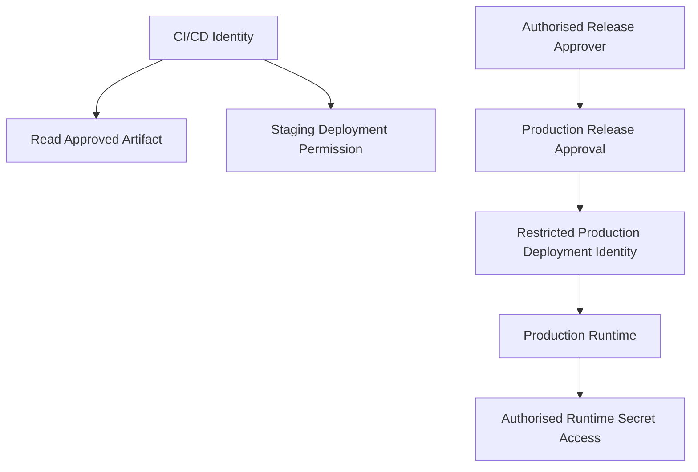
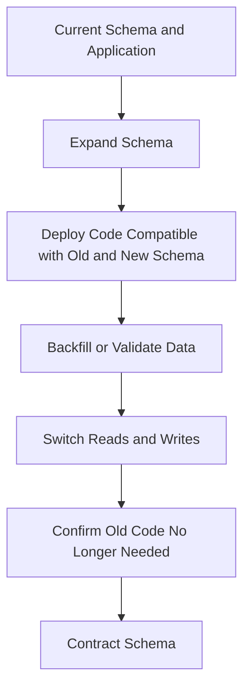
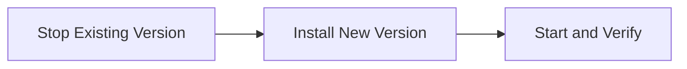
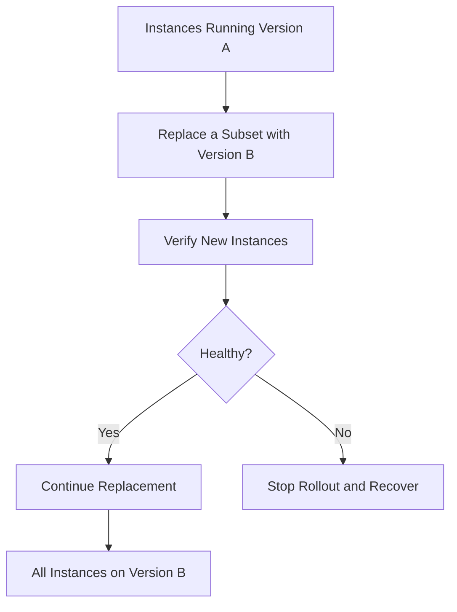
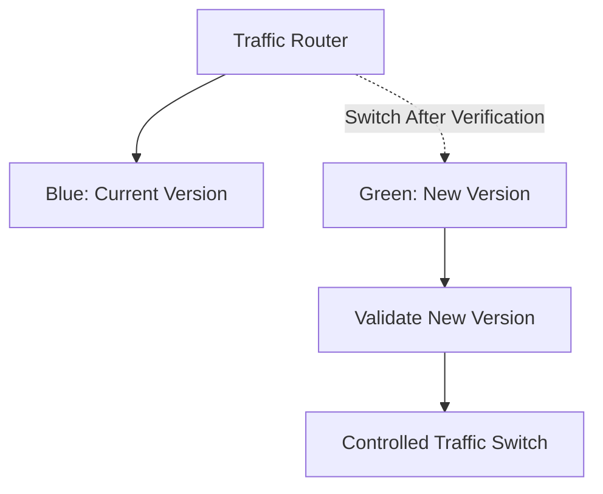
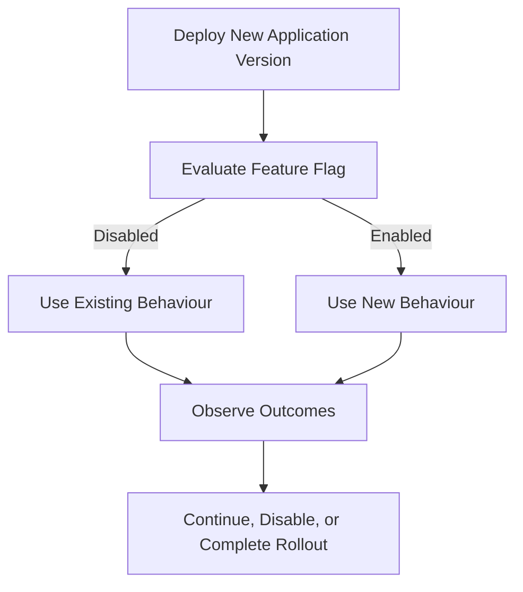

# Layer 10 — Deployment Architecture, CI/CD, Configuration, and Release Strategy

## 10.1 Purpose of This Layer

So far, we have designed how the platform is structured, how its services communicate, how data is stored, how security is enforced, and how we test the system.

The next question is:

**How do we move a code change safely from a developer's machine into a running production system—and recover if the release causes a problem?**

That is the responsibility of deployment architecture and release engineering.

This layer defines how the Composable Business Platform is built, packaged, configured, deployed, verified, monitored, and rolled back or rolled forward.

It applies to the platform's domains, including:

- Commerce and order management.
- FinFlow's simulated accounts, transfers, ledger, and reconciliation.
- Identity, access control, and organisation membership.
- Notifications, integrations, and workflow processing.
- Shared platform capabilities and their supporting infrastructure.

The design must work for a small initial deployment and remain adaptable as the platform grows.

### What this layer is responsible for

1. Producing repeatable, versioned build artifacts.
2. Validating changes before they reach production.
3. Managing environment-specific configuration and secrets.
4. Deploying compatible application and database changes.
5. Verifying that a release is healthy.
6. Reducing downtime and deployment risk.
7. Providing a controlled recovery strategy.
8. Recording what was released, where, when, and by whom.
9. Integrating deployment verification with observability and operational procedures.

### What this layer does not decide automatically

We will not assume that the platform must use Kubernetes, Docker, a particular cloud provider, a particular database deployment model, or a specific CI/CD product.

Those decisions depend on the existing repository, hosting environment, operational requirements, and team capabilities.

---

## 10.2 High-Level Deployment Architecture



### Understand the flow

Imagine a developer changes the order-creation logic in Commerce.

The developer does not manually copy source files to a production server.

Instead:

1. The change is reviewed.
2. Automated checks validate the change.
3. The application is built into a versioned artifact.
4. The artifact is stored so the exact version can be identified and retrieved.
5. The same artifact is deployed to a test environment.
6. Smoke tests and other release checks run.
7. An authorised release process deploys the artifact to production.
8. Health checks and business-level verification determine whether the release is behaving correctly.
9. If verification fails, the team follows a predefined recovery procedure.

The important principle is **repeatability**. A production deployment should not depend on somebody remembering undocumented manual steps.

---

## 10.3 Build Artifact Versus Deployment Unit

These terms are related but not identical.

### Build artifact

A build artifact is the output produced by the build process.

For a Java/Spring Boot application, it could be:

- An executable JAR.
- A WAR file, if the application is packaged for a compatible application server.
- A container image, if container packaging is selected.
- A library artifact, for a reusable module that is not deployed independently.

### Deployment unit

A deployment unit is the thing the deployment system installs or runs.

Examples:

| Application packaging | Possible deployment unit |
|---|---|
| Executable Spring Boot JAR | Java application process and its JAR |
| WAR deployment | WAR installed in a compatible application server |
| Containerised Spring Boot application | Versioned container image |
| Scheduled Java worker | Executable artifact plus its runtime configuration |

A deployment may also involve supporting changes, such as database migrations, configuration updates, or infrastructure changes. Those changes must be managed explicitly rather than being hidden inside an undocumented manual procedure.

### Example

Suppose the Commerce service produces:

`commerce-service-1.4.2.jar`

That artifact is identified as version `1.4.2`.

If we deploy it to staging and then production, we should deploy the **same verified artifact**, rather than rebuilding it independently for each environment.

Why?

Because rebuilding separately can introduce differences in dependencies, build inputs, or generated content. Promoting the same artifact reduces that risk.

The artifact must still be compatible with the destination environment's runtime, configuration, and database schema.

### Production principle

**Build once, verify the artifact, and promote the same artifact through environments.**

The build process should record enough metadata to identify the source revision, build, dependencies, and artifact checksum or digest.

---

## 10.4 Environment Architecture

An environment is an isolated deployment context with its own configuration, resources, credentials, and operational boundaries.

A typical progression is:



Not every project needs a separate permanent environment for every stage. The important thing is that validation and release controls are clear.

### Environment responsibilities

| Environment | Purpose | Data and access |
|---|---|---|
| Local development | Rapid development and debugging | Synthetic or local test data |
| CI | Repeatable automated validation | Disposable test data and isolated credentials |
| Integration/test | Validate service and dependency integration | Controlled non-production data |
| Staging | Validate a production-like release | Non-production data and restricted access |
| Production | Serve actual users and workloads | Production data and tightly controlled access |

### Why staging matters

Suppose the Commerce service is changed to call the FinFlow transfer API.

The change passes unit tests, but staging reveals that the configured service URL is wrong.

Without staging or equivalent pre-production verification, that configuration error might only be discovered after production deployment.

Staging should resemble production in the aspects that matter, including:

- Runtime versions.
- Configuration structure.
- Database engine and relevant schema behaviour.
- Authentication and authorisation integration.
- Network and dependency access patterns.
- Deployment and health-check mechanisms.

Staging does not have to duplicate production capacity exactly. Expensive production-scale capacity may not be necessary for every release test.

### Environment isolation

Production and non-production environments must not accidentally share privileged credentials or unrestricted data access.

For example:

- A staging application must not receive production database credentials.
- A test job must not be able to modify production data.
- Production secrets must not be copied into source control or build logs.
- A failed staging deployment must not affect production.

**Interview point:** Why not use the same database for staging and production?

Because staging tests, migrations, and test-data cleanup could affect production data. Separate data stores and credentials provide a strong isolation boundary.

---

## 10.5 CI and CD: Understanding the Difference

CI/CD is frequently discussed as one concept, but its parts solve different problems.

### Continuous Integration (CI)

CI automatically validates changes when code is committed or a pull request is opened or updated.

Typical checks include:

- Compilation.
- Unit tests.
- Static analysis and formatting checks.
- Integration tests.
- Dependency vulnerability checks.
- Secret scanning.
- Artifact creation.

The objective is to discover defects close to the time they are introduced.

### Continuous Delivery

Continuous Delivery keeps the software in a releasable state.

The build, validation, packaging, and deployment preparation are automated, but production release may require a human approval or a release decision.

### Continuous Deployment

Continuous Deployment automatically releases qualifying changes to production after all configured checks pass.

This is not the same as deploying every unverified commit. Production deployment still requires suitable automated safeguards.

For this platform, the initial preference should be **automated validation and controlled production releases**. The degree of production automation can increase when the deployment process and operational safeguards are proven.

---

## 10.6 A Practical CI/CD Pipeline

The following pipeline illustrates a production-oriented approach for a Spring Boot service.



### Step-by-step explanation

**Step 1: Checkout the exact revision**

The pipeline must operate on a clearly identified source revision.

This allows the team to trace a production artifact back to the code that produced it.

**Step 2: Compile**

Compilation catches invalid Java code, incompatible method signatures, and certain dependency problems.

A successful compilation does not prove that the application behaves correctly.

**Step 3: Run unit tests**

Validate domain rules, calculations, state transitions, and application logic.

For FinFlow, tests might verify that a simulated transfer cannot exceed the permitted available balance.

**Step 4: Run static analysis**

Detect issues such as likely bugs, unsafe patterns, formatting violations, and maintainability problems.

**Step 5: Run integration and contract tests**

Verify interactions with actual or appropriately simulated dependencies.

For example, confirm that Commerce sends a request matching the FinFlow API contract.

**Step 6: Run security checks**

Check dependency vulnerabilities, exposed secrets, and relevant application-security rules.

A scanner finding must be evaluated according to severity, exploitability, and policy. Critical unresolved findings may block release.

**Step 7: Package the artifact**

Build the deployable JAR or other selected artifact.

**Step 8: Store and identify the artifact**

Record the version, source revision, build information, and integrity identifier.

**Step 9: Deploy and test staging**

Validate the deployable artifact in an environment that resembles production.

**Step 10: Release and verify production**

Deploy according to the selected release strategy, then validate both technical health and essential business behaviour.

### What should fail the pipeline?

Examples include:

- Compilation failure.
- Required test failure.
- A violated security policy.
- Invalid or missing mandatory configuration.
- An incompatible database migration.
- A failed release smoke test.

A warning should not silently become a release blocker unless the project's policy says it is one. Conversely, mandatory gates should not be bypassed simply because the release is urgent.

---

## 10.7 Example: Spring Boot Build and Verification

The following is an illustrative Maven workflow. It is not a command to execute against the existing repository until its build configuration has been inspected.

```bash
# 1. Compile and run unit tests
./mvnw clean verify

# 2. Inspect the generated artifacts
find target -maxdepth 1 -type f -name '*.jar' -print

# 3. Generate an integrity checksum for the selected artifact
sha256sum target/commerce-service.jar
```

The actual JAR name depends on the Maven configuration. The example filename above is illustrative and should not be copied blindly.

`verify` runs the Maven lifecycle through its verification phase, including configured tests and verification plugins. It does not guarantee that every possible security, integration, performance, or deployment test is configured.

If the project uses Gradle, the equivalent workflow must follow its Gradle build configuration.

### Important distinction

A successful build proves that the configured build checks passed. It does **not** prove that:

- Production credentials are valid.
- Production database access works.
- All downstream services are available.
- The application is secure in every deployment context.
- The new version is compatible with every existing consumer.
- The deployment can be safely rolled back.

Those concerns need their own validation and operational controls.

---

## 10.8 Configuration Management

Application code and environment-specific configuration should be managed separately.

Consider a Spring Boot application that connects to a database.

The code should know how to obtain a database connection, but it should not contain the production database password.

### Example configuration

Illustrative `application.yml`:

```yaml
spring:
  datasource:
    url: ${DB_URL}
    username: ${DB_USERNAME}
    password: ${DB_PASSWORD}

server:
  port: ${SERVER_PORT:8080}
```

Here:

- `DB_URL` identifies the database endpoint.
- `DB_USERNAME` identifies the configured database account.
- `DB_PASSWORD` is supplied externally.
- `SERVER_PORT` can be provided externally, with `8080` as the example default.

These values must be supplied through an appropriate configuration mechanism in the actual runtime.

The application should fail clearly during startup if required configuration is missing or invalid. It should not silently fall back to unsafe production defaults.

### Configuration categories

| Category | Example | Handling |
|---|---|---|
| Application behaviour | Feature enablement | Controlled, validated configuration |
| Service endpoints | FinFlow API URL | Environment-specific configuration |
| Database connection | JDBC URL | Environment-specific configuration |
| Credentials | Database password | Secret-management mechanism |
| Cryptographic material | Signing key or private key | Protected secret/key-management mechanism |
| Operational limits | Timeout and connection-pool settings | Validated configuration with safe bounds |

### Configuration rules

1. Do not commit production secrets to Git.
2. Do not print passwords, tokens, or private keys in logs.
3. Restrict access to secrets using least privilege.
4. Rotate credentials using a planned procedure.
5. Validate configuration at startup where possible.
6. Avoid changing production configuration without traceability.
7. Separate configuration changes from code releases when operationally appropriate.
8. Record which configuration version or release settings were used when investigating incidents.

### Why not hardcode the production URL?

Hardcoding makes the application difficult to move between environments and increases the risk of connecting to the wrong system.

For example, a developer could accidentally run a local test against a production endpoint.

Configuration separation helps prevent this, but environment isolation, access controls, and explicit safeguards are also necessary.

---

## 10.9 Secrets and Deployment Permissions

Secrets are not ordinary configuration values.

Examples include:

- Database passwords.
- API credentials.
- Service-to-service credentials.
- Private keys.
- Signing keys.
- Deployment credentials.

The deployment design should specify how secrets are provisioned, accessed, rotated, and audited.

Possible approaches depend on the environment and may include a dedicated secret manager, an orchestrator's secret facility, or a protected host-level mechanism.

The platform should not choose one until the target environment is known.

### Least-privilege deployment design



The diagram represents logical boundaries, not a requirement for a particular identity provider.

The CI pipeline should not automatically have unrestricted access to every production secret and database.

A deployment identity should receive only the permissions required to deploy the approved artifact and perform its permitted checks.

Where the hosting platform supports it, short-lived credentials and workload identity are preferable to long-lived credentials that remain valid indefinitely.

**Interview question:** Should the CI pipeline contain the production database password?

No. The pipeline should use a controlled deployment identity and the appropriate secret-management mechanism. The running application should receive only the runtime secrets it needs.

---

## 10.10 Database Migrations and Application Compatibility

Database changes are one of the most important deployment risks in a service-based application.

Application code can often be redeployed. Data transformations may be difficult or impossible to reverse safely.

For that reason, application releases and schema changes must be designed together.

### Example problem

Version 1 of the Commerce application reads:

`customer_name`

Version 2 changes its code to read:

`display_name`

If the database column is renamed immediately, the old application version may fail during a rolling deployment or rollback.

The safer approach is usually to separate the change into compatible steps.

### Expand-and-contract migration



**Phase 1 — Expand**

Add the new column or structure while retaining the old structure.

The change should be safe for the currently running application.

**Phase 2 — Deploy compatible code**

Deploy code that can operate with the expanded schema. During a transition, it may need to support both old and new representations.

**Phase 3 — Migrate or backfill data**

Populate the new representation where necessary.

For large tables, consider batching, runtime impact, progress tracking, and restartability.

**Phase 4 — Switch application behaviour**

Move reads and writes to the new representation. Verify that data remains consistent.

**Phase 5 — Confirm compatibility requirements**

Ensure no active application version, worker, report, or integration still depends on the old structure.

**Phase 6 — Contract**

Remove the obsolete column or structure in a later release.

Do not perform the contract step while an older application version might still require the removed structure.

### Migration ownership

Each service should have clear ownership of its database schema and migration history.

The deployment process should identify:

- Which migration version is being applied.
- Whether the migration has already run.
- Whether the migration is compatible with the active application versions.
- Whether the operation locks large tables or causes significant load.
- Whether the migration can be safely retried.
- What recovery options exist if the migration partially completes.

A migration tool can help manage versioning, but the specific tool remains a repository decision.

### Critical distinction: application rollback versus database rollback

Rolling back an application artifact does not automatically roll back the database.

Suppose the new version writes data in a format that the previous version cannot understand. Reverting the JAR may restore the old code but leave the application unable to process the changed data.

Therefore, the preferred strategy is often to make schema changes backward-compatible and use a forward repair or roll-forward migration when reversing data changes would be unsafe.

Never assume that a database migration is reversible just because its migration script contains a corresponding `DROP`, `DELETE`, or reverse operation.

---

## 10.11 Deployment Strategies

Different deployment strategies provide different trade-offs between simplicity, downtime, infrastructure cost, and release risk.

### Strategy A — Stop and replace

The existing process is stopped and the new version is started.



Advantages:

- Simple to understand.
- May be suitable for small systems or controlled maintenance windows.

Disadvantages:

- Can cause downtime.
- A failed startup may leave the service unavailable.
- Does not provide automatic traffic switching or rapid version comparison.

Use it only when its downtime and recovery characteristics are acceptable.

### Strategy B — Rolling deployment

Instances are replaced incrementally while other instances continue serving traffic.



Advantages:

- Can reduce downtime.
- Allows gradual replacement.
- Can limit the number of instances exposed to a new release at once.

Disadvantages:

- Requires a deployment environment that supports multiple instances and controlled replacement.
- Old and new versions may run simultaneously.
- Requires backward-compatible APIs, events, and database changes.

A rolling deployment is not automatically zero-downtime. Traffic routing, startup time, readiness checks, capacity, and connection draining must also be handled.

### Strategy C — Blue-green deployment

Two deployment environments or equivalent application stacks are maintained.

One serves production traffic while the other is prepared and verified.



Advantages:

- Allows the new stack to be prepared before traffic is switched.
- Can simplify application-version recovery by switching traffic back.

Disadvantages:

- Requires additional capacity and infrastructure.
- Does not automatically reverse database changes.
- Background workers and scheduled jobs require special care to avoid duplicate processing.

### Strategy D — Canary deployment

A small portion of traffic is routed to the new version first.

The team compares health and business metrics before increasing the rollout.

For example, the new version may initially receive a small, controlled fraction of eligible traffic.

Advantages:

- Limits initial exposure.
- Can reveal issues that tests did not reproduce.

Disadvantages:

- Requires suitable routing and observability.
- Needs enough traffic and meaningful metrics to draw useful conclusions.
- Can complicate debugging when two versions run simultaneously.

### Which strategy should this platform use?

Do not choose based on popularity.

Choose according to:

- Hosting capabilities.
- Availability requirements.
- Number of running instances.
- Release frequency.
- Recovery requirements.
- Operational complexity.
- Database compatibility.
- Cost and team experience.

For an initial deployment with a single instance, a sophisticated canary system may create unnecessary complexity. A well-tested deployment procedure with strong health checks and a clear recovery path may be more appropriate.

---

## 10.12 Health Checks and Release Verification

A process starting successfully is not the same as an application being ready to serve production traffic.

The release process needs to verify more than whether the Java process exists.

### Three distinct checks

**1. Process or startup check**

Has the application process started?

**2. Liveness check**

Is the application process alive and capable of continuing to run?

A liveness check should not fail merely because a downstream dependency is temporarily unavailable. Otherwise, a dependency outage could cause unnecessary restart loops.

**3. Readiness check**

Is the application ready to receive traffic?

Readiness may depend on successful startup, required configuration, and essential local initialization.

A readiness check should not automatically require every optional downstream service to be healthy. The correct dependency policy depends on whether the application can still serve useful requests without that dependency.

### Release verification layers

| Verification | Example |
|---|---|
| Process | Application starts without a fatal error |
| Readiness | Application can accept traffic |
| API smoke test | A safe health or diagnostic endpoint responds as expected |
| Database | Required schema and database connectivity are valid |
| Authentication | An authorised test request follows the expected security path |
| Dependency integration | Required downstream calls succeed in a controlled test |
| Business behaviour | A safe simulated workflow completes correctly |
| Observability | Expected logs, metrics, and traces are available |

### Spring Boot Actuator

Spring Boot Actuator can provide operational endpoints such as health and readiness indicators, depending on the project's dependencies and configuration.

The following is an illustrative configuration for a Spring Boot version that supports these properties:

```yaml
management:
  endpoint:
    health:
      probes:
        enabled: true

  endpoints:
    web:
      exposure:
        include: health
```

This example exposes the health endpoint and enables probe support. Exact behaviour and endpoint availability depend on the Spring Boot version and runtime setup.

Do not expose sensitive diagnostic information or administrative endpoints publicly. Health endpoint access and exposure should be deliberately configured.

### Release acceptance rule

A release is not complete simply because the deployment command returned success.

It is complete only after the defined technical and business verification checks pass and the release outcome is recorded.

---

## 10.13 Rollback, Roll Forward, and Recovery

These three concepts must be understood separately.

### Rollback

Restore a previously deployed application version or otherwise return the system to a known-good state.

Rollback is suitable when the previous version remains compatible with the current data and external contracts.

### Roll forward

Deploy a corrected version that addresses the problem without attempting to reverse every change already made.

Roll forward may be safer when data changes cannot be reversed reliably.

### Recovery

Restore acceptable service behaviour using the appropriate combination of actions.

Recovery might involve:

- Switching traffic back to a previous compatible version.
- Deploying a hotfix.
- Disabling a problematic feature flag.
- Repairing invalid data.
- Applying a corrective database migration.
- Restoring a dependency or configuration.
- Replaying safely recoverable work.

### Example: Commerce release failure

Suppose release `1.5.0` introduces a defect that causes some order requests to fail.

The release procedure should answer:

1. How do we detect the problem?
2. How do we identify the affected version?
3. Can traffic be routed to the previous version?
4. Is the previous version compatible with the current database schema?
5. Could requests have been processed before the failure was detected?
6. Could retries create duplicate orders?
7. How do we verify that recovery succeeded?
8. How do we investigate and repair any inconsistent business state?

The team must not assume that restoring the previous application version reverses requests that were already processed.

### Example: FinFlow simulated transfer

A new release introduces a defect in the simulated transfer workflow.

Even though no real money moves, the system's internal balances, ledger entries, and transfer statuses may become inconsistent.

Recovery must preserve the platform's financial-style invariants.

Depending on the defect, recovery could require:

- Stopping or restricting the affected workflow.
- Identifying affected transfer IDs.
- Comparing transfer state with the ledger.
- Preventing duplicate processing.
- Applying a verified correction.
- Running reconciliation.
- Confirming that the invariant holds before normal processing resumes.

**Important:** A financial-style correction should be auditable and evidence-based. Do not silently edit ledger history to make a failed release appear successful.

---

## 10.14 Feature Flags and Controlled Activation

A feature flag allows application behaviour to be enabled or disabled separately from deploying the application code.

For example, Commerce might deploy new order-pricing logic while leaving the new behaviour disabled until validation is complete.



### Benefits

- Separate code deployment from feature activation.
- Enable controlled rollout.
- Disable certain new behaviour without rebuilding the artifact.
- Reduce the blast radius of some application defects.

### Risks and limitations

- A flag does not repair invalid data.
- A flag does not replace authorisation.
- Both code paths may need testing.
- Stale flags increase complexity.
- A flag that changes data formats may not make rollback safe.
- Flag configuration must be protected and observable.

For security-sensitive or financially significant behaviour, flag evaluation must not bypass domain invariants or access controls.

A feature flag should not become an undocumented permanent switch.

---

## 10.15 Release Versioning and Traceability

A production release should be identifiable without guesswork.

The team should be able to answer:

- Which application version is running?
- Which source revision produced it?
- Which build produced the artifact?
- Which artifact digest was deployed?
- Which database migrations were applied?
- Which configuration revision was active?
- Who or what authorised the release?
- When did the release begin and finish?
- Did verification pass?
- Was recovery required?

### Example release record

| Field | Illustrative value |
|---|---|
| Service | `commerce-service` |
| Application version | `1.5.0` |
| Source revision | `abc123...` |
| Artifact digest | Recorded SHA-256 or registry digest |
| Deployment environment | `staging` |
| Database migration version | Recorded migration identifier |
| Release status | `Verified` |
| Release time | Recorded timestamp |
| Release initiator | Authorised identity or automation |

The values are examples; a real release record must use actual identifiers.

Versioning rules should be consistent across build metadata, artifact storage, deployment records, and operational dashboards.

Avoid relying solely on mutable tags such as `latest` to identify production artifacts. Use immutable artifact identifiers or digests where supported.

---

## 10.16 Deployment Observability

Deployment and observability must work together.

The deployment system should record when a release starts, which version is deployed, and whether verification succeeds.

The application should expose enough operational information to help distinguish release defects from unrelated infrastructure or dependency problems.

### Important release signals

- Application startup and readiness failures.
- Increased HTTP error rates.
- Increased request latency.
- Database connection failures.
- Downstream timeout rates.
- Queue or workflow backlog, where asynchronous processing exists.
- Failed scheduled jobs.
- Business-operation failure rates.
- Reconciliation discrepancies.
- Unexpected changes in resource consumption.

### Compare before and after

Suppose the error rate was stable before a release but rises immediately after deployment.

The team should correlate:

- Deployment timestamp.
- Application version.
- Error rate and latency.
- Relevant traces.
- Database and downstream dependency behaviour.
- Business-operation failures.

Correlation does not prove that the release caused the incident, but it provides a strong starting point for investigation.

### Avoid misleading health signals

An application can be technically healthy while business operations are failing.

For example, the Commerce API might return HTTP 200 for a request that creates an order in a pending state, while a downstream workflow never completes.

Operational monitoring must distinguish technical availability from successful business outcomes.

---

## 10.17 Infrastructure and Runtime Security

Deployment architecture must enforce security beyond the application's Java code.

Relevant controls include:

- Restricted deployment identities.
- Protected production environments.
- Least-privilege runtime permissions.
- Network access restrictions.
- Secure transport between applicable components.
- Controlled secret access and rotation.
- Approved and traceable artifact sources.
- Dependency and artifact integrity checks.
- Appropriate runtime and operating-system patching.
- Restricted administrative and diagnostic endpoints.
- Audit records for privileged release actions.

### Build security versus runtime security

Build security protects the process that creates the artifact.

Runtime security protects the deployed application and the environment in which it operates.

Examples:

| Build-time control | Runtime control |
|---|---|
| Dependency scanning | Runtime patch management |
| Secret scanning | Protected secret delivery |
| Artifact integrity verification | Restricted deployment permissions |
| Code review | Runtime access controls |
| Automated security tests | Network and service identity controls |

Both are necessary. A secure build does not guarantee a secure runtime, and a secure runtime does not compensate for an untrusted artifact.

---

## 10.18 Deployment Architecture and Service Boundaries

Our platform contains multiple business domains and shared capabilities. Not every domain must become an independently deployed service immediately.

Deployment boundaries should reflect actual requirements.

For example, Commerce and FinFlow might initially be deployed separately if they have independent release needs, different security boundaries, or different scaling requirements.

However, introducing separate deployment units also introduces:

- Network failure.
- Service authentication.
- API compatibility concerns.
- Independent configuration.
- More deployment pipelines.
- Distributed tracing requirements.
- More complex recovery procedures.

A modular monolith can be a reasonable initial choice when independent deployment is not yet justified.

If services are independently deployed, each service needs an explicit operational owner, versioning approach, configuration contract, health checks, and recovery procedure.

### Shared database caution

If independently deployed services share a database schema without clear ownership, one service's migration can unexpectedly break another service.

Prefer clear schema ownership and compatible changes. If multiple services genuinely need shared data, explicitly document the ownership and migration constraints rather than assuming that independent application deployments guarantee independent evolution.

---

## 10.19 Deployment Testing Strategy

Deployment tests verify that the application can be installed, configured, started, and operated correctly—not merely that its business logic passes unit tests.

| Test category | Purpose |
|---|---|
| Build verification | Ensure the intended artifact can be produced |
| Artifact integrity | Verify the artifact being promoted is the expected one |
| Configuration validation | Detect missing or invalid settings |
| Migration testing | Validate schema changes and compatibility |
| Installation/startup test | Confirm deployment and application startup work |
| Readiness verification | Confirm the instance is ready for its intended role |
| Smoke test | Exercise a small set of critical paths |
| Rollback/recovery rehearsal | Validate the documented recovery procedure |
| Compatibility test | Confirm old and new versions can coexist when required |
| Security verification | Confirm release controls and runtime access boundaries |
| Performance check | Detect material regressions where appropriate |

### Recovery testing is important

A documented rollback procedure is not sufficient if nobody has tested it.

In a safe non-production environment, rehearse:

1. Deploy a known-good version.
2. Deploy a new version.
3. Simulate a controlled verification failure.
4. Execute the approved recovery procedure.
5. Confirm the service is healthy.
6. Confirm data and business invariants remain valid.
7. Record any manual steps or unexpected behaviour.

The test must use a safe environment and controlled data.

---

## 10.20 Practical End-to-End Example: Releasing Commerce

Consider a change to the order-creation workflow.

The application now validates a new pricing rule before accepting an order.

### Before deployment

The developer:

1. Implements the domain rule.
2. Adds unit tests for valid and invalid pricing cases.
3. Adds application-service tests for order creation.
4. Verifies that API responses and error handling remain compatible.
5. Checks any affected database migration.
6. Submits the change for review.

### During CI

The pipeline:

1. Checks out the exact revision.
2. Compiles the application.
3. Runs unit and integration tests.
4. Runs applicable security and quality checks.
5. Builds the versioned artifact.
6. Records its source revision and integrity identifier.
7. Stores the artifact.

### During staging

The deployment process:

1. Applies compatible schema changes if needed.
2. Supplies staging configuration and credentials.
3. Deploys the verified artifact.
4. Checks startup and readiness.
5. Exercises a safe order-creation scenario.
6. Verifies expected order state and pricing behaviour.
7. Checks logs, metrics, and error rates.

### During production release

The release process:

1. Confirms release approval and prerequisites.
2. Applies the deployment strategy appropriate to the environment.
3. Verifies health and readiness.
4. Monitors HTTP errors, latency, and order-creation outcomes.
5. Confirms the release has met its acceptance criteria.
6. Records the final release status.

### If verification fails

The team stops further rollout.

It identifies whether the failure is caused by code, configuration, schema compatibility, or a dependency.

Then it selects a safe recovery action: restore a compatible application version, disable the relevant feature where appropriate, or deploy a corrective version.

Finally, it verifies service health and business-state consistency.

The release is not considered recovered merely because the old JAR is running again.

---

## 10.21 Practical End-to-End Example: FinFlow Release

Now consider a release that changes the simulated transfer workflow.

The release affects transfer processing and ledger consistency.

### Required pre-release checks

- Transfer domain invariants pass.
- Duplicate requests cannot create duplicate logical transfers.
- Failure handling preserves the expected transfer state.
- Ledger writes remain consistent with transfer outcomes.
- Database migrations are compatible with the deployment sequence.
- Consumer or API contracts remain compatible.
- Reconciliation behaviour is tested.

### Required post-release checks

- The service starts and becomes ready.
- A controlled simulated transfer completes as expected.
- Failed transfers reach the correct state.
- Repeated requests follow the idempotency contract.
- Ledger entries remain consistent.
- Reconciliation detects no unexpected discrepancies in the tested scope.
- Error rates and workflow latency remain within acceptable limits.

### Why these checks differ from Commerce

The deployment mechanism can be similar, but business acceptance criteria differ.

For Commerce, an important outcome may be correct order creation and pricing.

For FinFlow, an important outcome is preservation of transfer and ledger invariants.

**The deployment pipeline can be shared, but domain-specific release verification must reflect each service's business risks.**

No real-money movement is assumed in this platform.

---

## 10.22 Common Deployment Mistakes

### Mistake 1: Building a different artifact for each environment

This creates avoidable uncertainty about whether staging tested the same code that reached production.

**Better:** Promote the same verified artifact and provide environment-specific configuration separately.

### Mistake 2: Treating a successful build as proof of production readiness

A build cannot verify every runtime dependency or production configuration.

**Better:** Combine build checks with staging validation, release gates, and post-deployment verification.

### Mistake 3: Storing secrets in source control

Secrets can persist in repository history and be copied into logs or build artifacts.

**Better:** Use an appropriate secret-management mechanism and rotate any credential that has been exposed.

### Mistake 4: Renaming or deleting a database column in one release

The active application version may still require the old column.

**Better:** Use a compatible expand-and-contract migration when appropriate.

### Mistake 5: Assuming application rollback reverses data changes

The old application version may not understand the new data format.

**Better:** Design schema compatibility in advance and define whether recovery means rollback, roll forward, or data repair.

### Mistake 6: Marking deployment successful as soon as the process starts

The application may still be unable to serve requests or complete business workflows.

**Better:** Verify readiness, critical dependencies, and domain-specific behaviour.

### Mistake 7: Making production changes manually without traceability

The team may not know which artifact, configuration, or command caused a change.

**Better:** Use a controlled release process and retain deployment records.

### Mistake 8: Assuming rolling deployment guarantees zero downtime

Readiness, routing, capacity, and compatibility still matter.

**Better:** Test the complete rollout procedure and define its availability guarantees honestly.

### Mistake 9: Allowing deployment automation unrestricted production access

A compromised pipeline could gain excessive privileges.

**Better:** Separate identities and permissions, restrict production access, and audit privileged actions.

### Mistake 10: Ignoring background workers during deployment

Two worker versions may process the same work or interpret events differently.

**Better:** Design safe concurrent processing, idempotency, compatible contracts, and controlled worker rollout.

### Mistake 11: Using feature flags as a substitute for security

A disabled feature flag is not an authorisation boundary.

**Better:** Enforce access control and domain invariants independently.

### Mistake 12: Choosing advanced deployment infrastructure too early

Sophisticated orchestration can create operational complexity without solving a demonstrated problem.

**Better:** Choose the simplest deployment strategy that meets verified availability, security, recovery, and scaling requirements.

---

## 10.23 Recommended Deployment Decisions for This Platform

The following are starting principles, not claims about the current repository.

| Area | Recommended direction | What must be verified |
|---|---|---|
| Build | Reproducible, automated build | Existing Maven/Gradle configuration |
| Artifact | Versioned and identifiable | Packaging and artifact storage |
| Environment progression | Isolated test and staging before production | Hosting and environment availability |
| Configuration | Externalised and validated | Existing configuration mechanism |
| Secrets | Protected and least-privileged | Available secret-management facility |
| Database migration | Versioned and compatibility-aware | Database engine and migration history |
| Release gates | Automated tests plus explicit production policy | Team and operational requirements |
| Deployment strategy | Simplest safe strategy for the environment | Downtime and availability requirements |
| Health checks | Startup/readiness and suitable runtime checks | Spring Boot version and hosting support |
| Recovery | Documented and rehearsed | Existing deployment and data-recovery procedures |
| Observability | Release-aware logs, metrics, and traces | Existing telemetry and alerting |
| Traceability | Link release to source, artifact, and outcome | Available CI/CD metadata and audit facilities |

### Repository assessment before implementation

Before adding deployment scripts or changing project configuration, inspect:

- The current project structure.
- The build tool and Java/Spring Boot versions.
- Existing test commands and test coverage.
- Current packaging and startup commands.
- Existing configuration files and profiles.
- Database migration tooling and migration history.
- Existing Dockerfiles or deployment manifests, if any.
- Existing CI workflows.
- Hosting/runtime requirements.
- Health endpoints and operational configuration.
- Existing logging, metrics, and tracing.
- Existing deployment and recovery documentation.

The assessment should distinguish three categories:

1. **Keep:** Existing mechanisms that already meet the requirement.
2. **Improve:** Existing mechanisms that work but need stronger validation, security, or operational controls.
3. **Introduce:** Missing capabilities that are justified by an actual requirement.

Do not replace an existing deployment approach merely because another technology is popular.

---

## 10.24 Deployment Readiness Checklist

Use this checklist during architecture review and before a production release.

### Build and artifact

- [ ] The exact source revision is identifiable.
- [ ] Required build and test checks have passed.
- [ ] The artifact has a clear version and integrity identifier.
- [ ] The promoted artifact is the one that passed validation.
- [ ] Build dependencies and artifact provenance are sufficiently traceable.

### Configuration and security

- [ ] Required configuration is documented and validated.
- [ ] Production secrets are not embedded in source or artifacts.
- [ ] Runtime and deployment identities have appropriate permissions.
- [ ] Production and non-production access are separated.
- [ ] Sensitive diagnostic endpoints are appropriately protected.

### Database and compatibility

- [ ] Database migrations are versioned.
- [ ] Migration compatibility with active application versions is understood.
- [ ] Data backfills and long-running changes have an operational plan.
- [ ] Rollback limitations and roll-forward options are documented.
- [ ] No required schema is removed before dependent versions stop using it.

### Deployment and verification

- [ ] The deployment strategy is documented.
- [ ] Startup and readiness checks are configured.
- [ ] Smoke tests cover critical application behaviour.
- [ ] Domain-specific invariants are verified.
- [ ] The rollout can be stopped if acceptance criteria fail.

### Operations and recovery

- [ ] Logs, metrics, traces, and release records can be correlated.
- [ ] Alerts and relevant runbooks are available.
- [ ] Recovery actions are documented.
- [ ] Recovery has been rehearsed in a safe environment.
- [ ] The release outcome and any corrective actions are recorded.

A checklist does not eliminate risk. It makes the expected controls explicit and reviewable.

---

## 10.25 Interview Questions and Follow-Ups

### Q1. What is the difference between CI, Continuous Delivery, and Continuous Deployment?

**Answer:**

- CI automatically validates code changes.
- Continuous Delivery keeps the application ready for release, potentially with an approval step.
- Continuous Deployment automatically releases changes that satisfy the configured production gates.

**Follow-up:** Does Continuous Deployment mean every commit goes directly to production?

No. Only changes that pass the required validation and release policies should be eligible.

### Q2. Why should we build once and promote the same artifact?

Because rebuilding separately for staging and production can introduce differences.

Promoting the same verified artifact improves repeatability and makes it easier to identify exactly what is running.

**Follow-up:** Does the same artifact mean the same configuration?

No. The artifact remains the same, but environment-specific configuration and secrets differ.

### Q3. What is the difference between a build artifact and a deployment unit?

The build artifact is produced by the build process. The deployment unit is what the environment installs or runs. Depending on the architecture, the artifact may be a JAR, WAR, container image, or another package.

### Q4. How do you manage configuration across environments?

Keep environment-specific settings outside application code, validate required values, protect secrets, restrict access, and record significant configuration changes.

### Q5. How would you deploy a database schema change without downtime?

Use backward-compatible changes where possible. Add the new structure first, deploy compatible code, migrate data, switch application behaviour, and remove the old structure only after dependent versions no longer need it.

The exact process depends on the database engine, schema change, traffic pattern, and compatibility requirements.

### Q6. What is the difference between rollback and roll forward?

Rollback restores a previous compatible state or application version. Roll forward applies a correction or a new version.

For data changes that cannot safely be reversed, a corrective migration or roll-forward release may be safer.

### Q7. What is a rolling deployment?

A deployment strategy that replaces instances incrementally rather than replacing every instance at once.

It can reduce downtime, but it requires compatible versions, adequate capacity, health checks, and appropriate traffic management.

### Q8. What is a blue-green deployment?

Two application environments or stacks are maintained. The new version is prepared and verified, then production traffic is switched to it.

This may simplify application-version recovery, but it does not automatically reverse database changes or background work.

### Q9. What is a canary deployment?

A controlled rollout in which a small portion of eligible traffic initially reaches the new version. The rollout expands if health and business signals remain acceptable.

### Q10. What is the difference between liveness and readiness?

Liveness indicates whether the process should continue running. Readiness indicates whether it is ready to receive traffic.

Conflating them can cause unnecessary restarts or send traffic to an unready instance.

### Q11. How would you prevent secrets from leaking through CI/CD?

Use protected secret-management facilities, restrict pipeline permissions, avoid printing secret values, scan for exposed credentials, and rotate credentials if exposure occurs.

### Q12. Why is deployment observability important?

It allows engineers to correlate a release with changes in error rates, latency, dependency behaviour, and business outcomes. This speeds up diagnosis and helps determine whether recovery is necessary.

### Q13. How would you deploy a change to FinFlow's simulated ledger workflow?

I would validate the transfer and ledger invariants, test duplicate processing and failure scenarios, verify database compatibility, deploy using the environment's safe release strategy, and run controlled post-deployment checks. If the release fails, I would stop the rollout and verify the ledger and transfer states before resuming normal processing.

### Q14. Would you introduce Kubernetes immediately?

Not without evidence that its capabilities are required.

I would first establish the deployment, availability, scaling, isolation, and operational requirements. Then I would compare the available deployment options against those requirements.

### Q15. How do you know a production deployment succeeded?

The deployment mechanism must complete successfully, the application must be ready, required smoke tests must pass, relevant technical and business signals must be acceptable, and the release outcome must be recorded.

A running process alone is insufficient.

---

## 10.26 Final Summary

Layer 10 defines how the platform moves safely from source code to a verified production release.

The central principles are:

1. Build and validate artifacts repeatably.
2. Promote the same verified artifact through environments.
3. Separate application code from environment-specific configuration.
4. Protect secrets and restrict deployment permissions.
5. Make database migrations compatible with active application versions.
6. Select deployment strategies according to actual operational requirements.
7. Verify technical health and business behaviour after deployment.
8. Plan for rollback, roll forward, and data recovery explicitly.
9. Correlate releases with logs, metrics, traces, and audit records.
10. Rehearse recovery procedures instead of relying on documentation alone.

For this platform, deployment must preserve the same business invariants that the application architecture enforces. In particular, a release of FinFlow must not be considered successful merely because its Spring Boot process starts; the simulated transfer and ledger behaviour must also remain correct.

The next step is to establish how the architecture will be translated into the actual repository, which existing decisions should be retained, and what implementation work should happen first.

---

# Next Section: Layer 11 — Architecture Decision Records, Repository Assessment, and Implementation Roadmap

The next layer will connect the architecture blueprint to the existing `finflow-microservices` project.

It will cover:

- How to inspect the existing repository before making changes.
- How to distinguish existing capabilities from missing capabilities.
- How to record architectural decisions and their trade-offs.
- How to identify dependencies and implementation order.
- How to avoid unnecessary rewrites and premature infrastructure choices.
- How to create an incremental, testable implementation roadmap.
- How to define acceptance criteria for each implementation stage.
