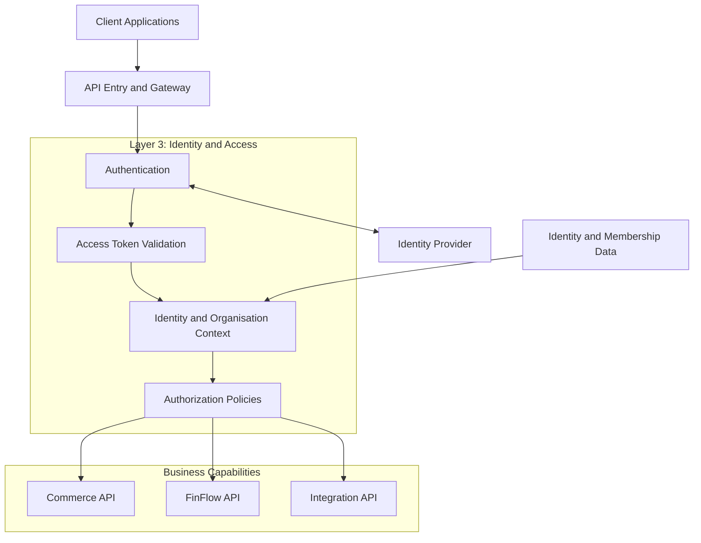
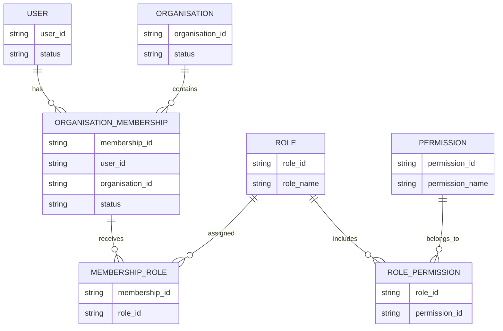
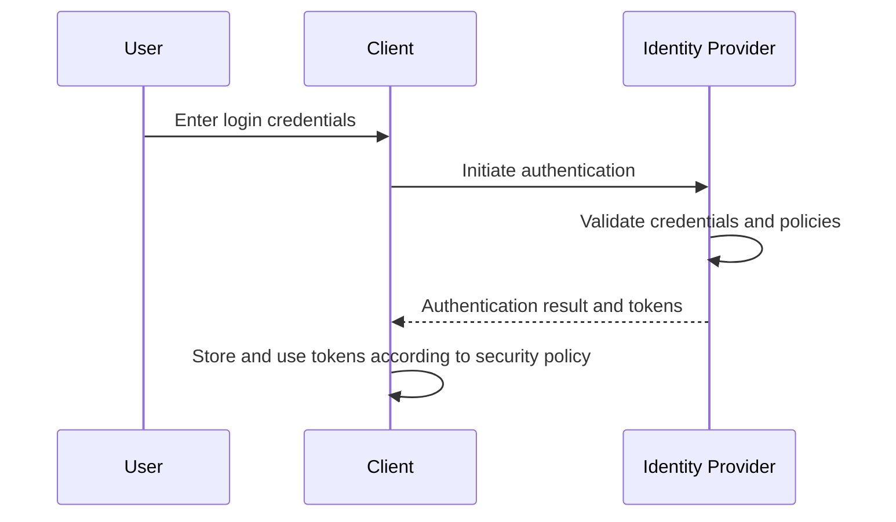
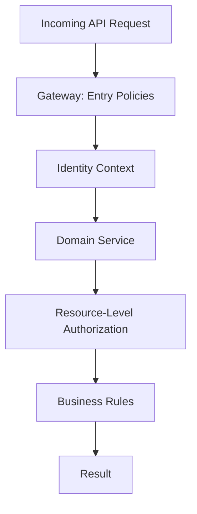
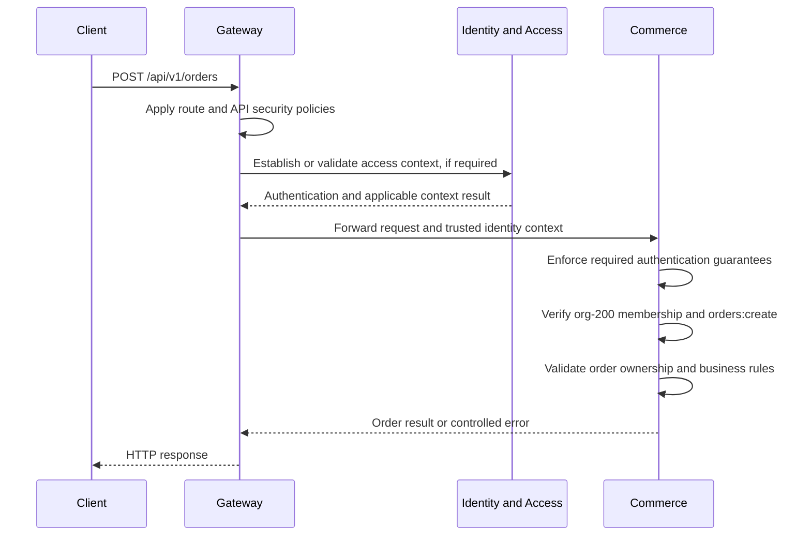
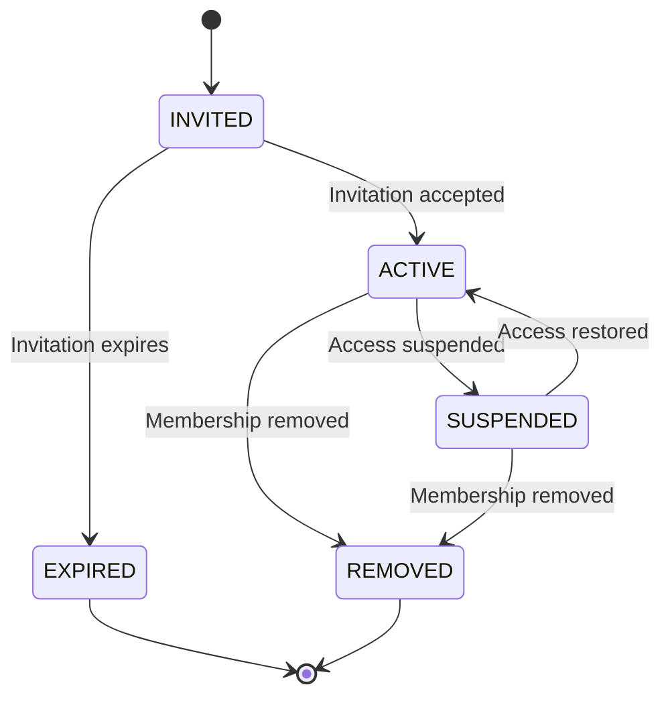

# Layer 3 — Identity, Authentication, and Authorization

## 1. Purpose of This Layer

Identity and Access Management (IAM) determines who can access the Composable Business Platform and what each identity is allowed to do.

Our platform may support multiple types of users:

- Customers who use FinFlow or Commerce.
- Business administrators who manage an organisation.
- Organisation members who have specific roles.
- External partners who integrate with the platform.
- Internal services that communicate with other backend capabilities.

These identities do not all need the same permissions.

For example, a customer may be allowed to view their own account, an organisation administrator may be allowed to manage organisation members, and an integration client may be allowed to submit orders through an approved API.

The identity and access capability establishes the common security model for these interactions.

### The three fundamental questions

| Question | Concept | Example |
|---|---|---|
| Who are you? | Authentication | Identify the logged-in customer |
| What are you allowed to do? | Authorization | Determine whether the customer can view an account |
| Which resource are you allowed to access? | Resource-level authorization | Determine whether that account belongs to the customer or an organisation they can access |

These questions are related, but they are not interchangeable.

**Core principle:** Authenticate the identity, establish the relevant access context, and authorize every protected operation.

---

## 2. Position in the Overall Architecture

Identity and access is a shared platform capability used by the gateway and business domains.

It is not necessarily a single standalone microservice. Its logical responsibilities may be implemented using an identity provider, application components, shared libraries, or a combination of these, depending on the final design.

### High-level architecture



This diagram is conceptual. The actual token-validation and authorization paths depend on the selected identity architecture.

For example, an identity provider may authenticate users and issue tokens, while the gateway and backend services validate those tokens locally. They do not necessarily call the identity provider for every API request.

Likewise, domain services may perform resource-level authorization themselves rather than sending every authorization decision to a central service.

---

## 3. Identity Model: Who Exists in the Platform?

Before choosing an authentication mechanism, we must define the identities and relationships our platform needs to represent.

A useful starting model contains:

1. User.
2. Organisation.
3. Organisation membership.
4. Role.
5. Permission.
6. Service identity.

These are proposed conceptual entities. Their exact representation and persistence model will be finalized after requirements are reviewed.

### 3.1 User

A user represents a human identity that can authenticate to the platform.

Illustrative example:

```text
User
----
userId: user-101
email: customer@example.com
status: ACTIVE
```

A user may access one or more platform capabilities, depending on the permissions granted to that identity.

Important considerations:

- A user identifier should be stable.
- An email address should not automatically be treated as the permanent identity key.
- User status must be checked according to the security policy.
- Authentication credentials should be handled by the chosen identity system.
- Sensitive authentication data must not be exposed through ordinary APIs.

If an external identity provider is used, the platform may store an internal user record linked to the provider's stable subject identifier.

### 3.2 Organisation

An organisation represents a business tenant or logical group that owns resources and has its own members and permissions.

Illustrative example:

```text
Organisation
------------
organisationId: org-200
name: Acme Retail
status: ACTIVE
```

An organisation could use Commerce to manage orders or use FinFlow to access simulated financial operations.

The organisation concept allows the platform to support multiple businesses without treating every user as having access to every business's resources.

### 3.3 Organisation membership

Membership represents the relationship between a user and an organisation.

A user may belong to multiple organisations. Each membership can have its own status and role assignments.

Example:

```text
User: user-101

Memberships:
    org-200 -> ADMIN
    org-300 -> MEMBER
```

This means the user may have administrative permissions in one organisation but only ordinary member permissions in another.

The user's role must be evaluated in the context of the relevant organisation.

**Important:** A user's role in one organisation must not automatically grant the same permissions in another organisation.

### 3.4 Roles

A role groups related permissions into a manageable set.

Illustrative roles:

```text
PLATFORM_ADMIN
ORGANISATION_ADMIN
FINANCE_OPERATOR
ORDER_MANAGER
MEMBER
READ_ONLY
```

These names are examples, not finalized platform roles.

Roles should represent responsibilities rather than arbitrary collections of unrelated permissions.

For example:

```text
ORDER_MANAGER
    -> View organisation orders
    -> Create orders
    -> Manage permitted order operations
```

Whether a role can perform a specific operation depends on the permissions assigned to that role and any additional authorization conditions.

### 3.5 Permissions

A permission represents an allowed action or capability.

Examples:

```text
orders:read
orders:create
orders:cancel

accounts:read
transfers:create
transfers:read

organisation:members:read
organisation:members:manage
```

Permission names should align with the platform's API and business capabilities.

A role can contain multiple permissions:

```text
Role: ORDER_MANAGER

Permissions:
    orders:read
    orders:create
    orders:cancel
```

The application must still check resource ownership, organisation boundaries, resource state, and other applicable rules.

A permission such as `orders:cancel` does not necessarily mean that every order can be cancelled. The order may already have been fulfilled, or the caller may not have access to the organisation that owns it.

### 3.6 Service identity

Not every caller is a human.

Internal backend services and approved external integrations may need their own identities.

For example:

```text
Service identity: inventory-worker

Allowed capabilities:
    Read permitted product information
    Update inventory reservations
```

The actual permissions should be limited to the work that the service needs to perform.

A service must not gain broad administrative privileges merely because it is running inside the platform's network.

Human users and machine identities may use different authentication flows. We should not assume that a service has a human user session.

---

## 4. Conceptual Relationship Between Users, Organisations, Roles, and Permissions

The following diagram shows a possible relationship model.



This is a logical relationship diagram, not a finalized database schema.

It illustrates a flexible model in which a user can belong to several organisations, a membership can have multiple roles, and roles can contain multiple permissions.

The implementation may use a simpler model if the actual requirements do not justify all these relationships.

### Why membership matters

Suppose a user belongs to two organisations:

```text
Organisation A
    Role: ORGANISATION_ADMIN

Organisation B
    Role: READ_ONLY
```

If the user requests an operation on Organisation B, the authorization process must evaluate the permissions applicable to Organisation B.

It must not simply select the user's most powerful role from Organisation A.

This is a fundamental multi-tenant security requirement.

---

## 5. Authentication: How Does a User Prove Their Identity?

Authentication establishes the identity associated with a request.

One common approach uses an identity provider and access tokens.

The platform could integrate with an external identity provider or implement a suitable authentication mechanism within its existing infrastructure. The final choice is not yet decided.

### Conceptual login flow



The exact flow depends on the selected protocol and client type.

For a browser or mobile application, a standards-based authorization flow such as OAuth 2.0 Authorization Code with PKCE may be appropriate when using a compatible identity provider.

The platform must define token storage, refresh, expiry, logout, and revocation behavior according to the chosen implementation.

Passwords and other authentication secrets should not be handled casually by application code.

### What happens after login?

After successful authentication, the client typically obtains an access token or another supported credential.

The client sends the access token when calling protected APIs:

```http
GET /api/v1/accounts/account-100
Authorization: Bearer <access-token>
```

The token provides evidence of an authenticated identity, subject to successful validation and the system's security model.

It does not automatically grant permission to access the requested account.

---

## 6. Access Tokens and JWT Validation

A JSON Web Token (JWT) is one possible access-token format. Not every access token is a JWT, so the platform should not assume this format before choosing the identity architecture.

If JWT access tokens are used, token validation typically checks:

- The token's cryptographic signature.
- The trusted issuer.
- The intended audience.
- Expiration and relevant time-based claims.
- The permitted signing algorithm and key configuration.
- Any required scopes, roles, or other claims.

The exact validation requirements depend on the issuer, protocol, and application.

### Illustrative JWT structure

A JWT commonly contains three encoded parts:

```text
header.payload.signature
```

The header and payload are encoded, not necessarily encrypted. Sensitive information must not be placed in a token merely because the token is signed.

A decoded payload might contain:

```json
{
  "sub": "user-101",
  "iss": "https://identity.example.com",
  "aud": "composable-platform-api",
  "exp": 1790000000,
  "scope": "orders:read orders:create"
}
```

This is an illustrative payload. Its claims, issuer, audience, and values are not configured platform settings.

### Important distinctions

**Signature validation is not authorization.**

A correctly signed token may still represent a user who lacks permission to access a particular resource.

**Token contents must not be blindly trusted.**

Claims should be used only after the token has been validated according to the relevant security requirements.

**Token expiry matters.**

An expired token should not be accepted simply because its signature is valid.

**Token revocation requires an explicit strategy.**

Short-lived tokens, revocation mechanisms, session controls, or other measures may be needed depending on the threat model. A self-contained JWT is not automatically invalidated everywhere when a user is disabled.

---

## 7. Authentication Versus Authorization: Complete Example

Consider the following request:

```http
GET /api/v1/accounts/account-200
Authorization: Bearer <access-token>
```

Assume the token belongs to `user-101`.

The access decision can be understood as a sequence of checks.

```text
Step 1: Is a credential supplied?
    No -> Reject the protected request.
    Yes -> Continue.

Step 2: Is the credential valid?
    No -> Reject the request.
    Yes -> Establish the authenticated identity.

Step 3: Is the identity active and eligible to access the platform?
    No -> Reject according to the security policy.
    Yes -> Continue.

Step 4: Does the user have the relevant organisation membership?
    No -> Deny access.
    Yes -> Continue.

Step 5: Does the membership have the required permission?
    No -> Deny access.
    Yes -> Continue.

Step 6: Is the requested account accessible to that membership?
    No -> Deny access.
    Yes -> Continue.

Step 7: Do the business rules permit the operation?
    No -> Return the appropriate business error.
    Yes -> Continue.
```

This sequence is illustrative. Some checks may be combined, and their order depends on the application design.

The important point is that a valid login does not replace resource-level authorization or business validation.

---

## 8. Authorization Models: RBAC and Resource-Level Checks

Two useful concepts are Role-Based Access Control (RBAC) and resource-level authorization.

### 8.1 Role-Based Access Control

RBAC grants permissions through roles.

Example:

```text
Role: ORDER_MANAGER

Permissions:
    orders:read
    orders:create
    orders:cancel
```

A request may be allowed when the authenticated user's applicable role assignments include the required permission.

RBAC is useful because permissions can be managed through roles rather than configured independently for every user.

However, RBAC alone may not be sufficient for multi-tenant applications.

### 8.2 Resource-level authorization

Resource-level authorization determines whether the caller can access the particular object being requested.

Example:

```text
User: user-101
Organisation: org-200
Order: order-9001
```

Before returning the order, Commerce must determine whether `user-101` has access to the organisation or customer context that owns `order-9001`.

Even if the user has `orders:read`, they must not automatically be able to read every order in the platform.

### 8.3 Business-state authorization

Some actions depend on the current state of the resource.

For example:

```text
Order status: CREATED
    -> Cancellation may be permitted.

Order status: SHIPPED
    -> Cancellation may require a different workflow.
```

This is a domain-level decision. The Commerce capability owns the order lifecycle and should enforce the applicable business rules.

### RBAC versus resource-level authorization

| Question | RBAC | Resource-level authorization |
|---|---|---|
| What does it evaluate? | Roles and permissions | Access to a particular resource |
| Example | Can create orders | Can access order-9001 |
| Usually depends on | Role assignments and permission configuration | Resource ownership, tenant, relationship, and applicable policy |
| Where is it useful? | General access management | Multi-tenant and object-level access control |

The platform may use RBAC together with resource-level rules. Additional policy models can be introduced if requirements justify them.

---

## 9. Multi-Tenancy and Organisation Isolation

Multi-tenancy means that multiple customers or organisations use the same platform while their data and operations remain appropriately isolated.

For this platform, organisation boundaries are especially important because multiple domains may handle organisation-owned resources.

### Example

```text
Organisation A
    Users: Alice, Bob
    Orders: A-101, A-102
    Accounts: A-201

Organisation B
    Users: Carol, David
    Orders: B-101, B-102
    Accounts: B-201
```

If Alice belongs only to Organisation A, she must not access Organisation B's protected resources simply by changing an identifier in a request.

For example:

```http
GET /api/v1/orders/B-101
```

The backend must verify access to the order's owning organisation.

A client-provided `organisationId` is not proof that the user belongs to that organisation.

### Safer request-processing approach

```text
1. Authenticate the caller.
2. Establish the relevant identity and organisation context.
3. Verify the caller's membership and permissions.
4. Retrieve the resource using an appropriate tenant-aware query.
5. Verify the resource's access rules.
6. Perform the operation only if authorization succeeds.
```

The exact data-access strategy depends on the eventual persistence design. Possible techniques include tenant-scoped queries, explicit ownership checks, and database-level safeguards where appropriate.

### Avoid insecure direct object references

An insecure direct object reference can occur when an API accepts an object identifier and returns or modifies the corresponding object without checking whether the caller is authorized to access it.

Example of a dangerous assumption:

```text
If the user knows the order ID,
the user can access the order.
```

Correct principle:

```text
Knowing an identifier does not grant permission
to access the resource.
```

Random or hard-to-guess identifiers do not replace authorization checks.

---

## 10. Where Should Authorization Logic Live?

Authorization is not necessarily implemented in one place.

The architecture should distinguish shared access policies from domain-specific decisions.

### Gateway responsibilities

The gateway may enforce:

- Whether a route requires authentication.
- Whether the presented token meets configured validation requirements.
- Coarse-grained API access policies.
- Client-level throttling.
- Other common entry-point controls.

### Identity and access capability responsibilities

The shared identity and access capability may manage:

- User identity records or identity-provider mappings.
- Organisation membership.
- Role assignments.
- Permission definitions.
- Shared access-management workflows.
- Administrative changes to roles and memberships.

Whether these responsibilities live in one application or multiple components is a later design decision.

### Business service responsibilities

Commerce and FinFlow should enforce the authorization rules required to protect their own resources and operations.

For example:

```text
Commerce:
    Can this user access this order?
    Can this organisation cancel this order?
    Is cancellation allowed in the current order state?

FinFlow:
    Can this user view this account?
    Can this organisation initiate this simulated transfer?
    Does the operation satisfy the relevant domain restrictions?
```

These examples do not imply real-money processing. FinFlow remains a simulated financial capability in the current platform scope.

### Responsibility diagram



This diagram represents logical responsibilities rather than a requirement for a network call to an identity service on every request.

The domain service may validate a token locally, use trusted identity context established by infrastructure, or apply another secure mechanism defined by the architecture.

---

## 11. Example: A User Creates an Order

Let's connect the concepts to a concrete platform workflow.

Assume:

```text
User: user-101
Organisation: org-200
Role: ORDER_MANAGER
Permission: orders:create
```

The user submits:

```http
POST /api/v1/orders
Authorization: Bearer <access-token>
Content-Type: application/json
```

Illustrative request body:

```json
{
  "organisationId": "org-200",
  "items": [
    {
      "productId": "product-501",
      "quantity": 2
    }
  ]
}
```

The body is an example, not a finalized API contract.

### Request flow



The identity and access interaction shown here is conceptual. A production implementation may validate access tokens locally rather than call IAM for each request.

### Successful scenario

```text
1. The access token is valid.
2. The identity is active.
3. user-101 belongs to org-200.
4. The membership has orders:create.
5. The order request passes resource-level authorization.
6. Commerce validates the order.
7. Commerce executes the order workflow.
8. The client receives the result.
```

### Failure scenario: wrong organisation

Suppose the user changes the request to:

```json
{
  "organisationId": "org-300",
  "items": [
    {
      "productId": "product-501",
      "quantity": 2
    }
  ]
}
```

If the user has no permitted access to `org-300`, Commerce must reject the request.

A valid access token does not change this result.

The platform should define whether such a failure returns `403 Forbidden` or a privacy-preserving response that does not reveal the existence of a protected resource.

---

## 12. Roles, Permissions, and Administrative Workflows

The platform will eventually need controlled workflows for managing users and access.

Possible workflows include:

- Creating an organisation.
- Inviting a user to an organisation.
- Accepting or rejecting an invitation.
- Assigning a role to a membership.
- Removing a membership.
- Disabling a user.
- Revoking a service identity.
- Auditing permission changes.

These are candidate requirements and should be validated before implementation.

### Example membership lifecycle



This state machine is illustrative. The final lifecycle may differ, and transitions must be authorized and audited.

For example, removing a user from an organisation should prevent future protected operations according to the platform's access-control policy.

The design must also consider existing access tokens. Removing a membership from the database does not necessarily invalidate a self-contained token containing previously issued claims. Resource-level checks, token lifetime, and revocation strategy must work together to prevent stale permissions from remaining effective longer than intended.

---

## 13. Security Considerations

Identity and access is security-sensitive. The implementation must avoid treating convenience as a substitute for a clear trust model.

### 13.1 Least privilege

Each user and service should receive only the permissions required for its responsibilities.

Avoid broad default roles such as granting every organisation member administrative access.

### 13.2 Deny by default

Protected operations should require an explicit authorization decision.

If a required authorization check cannot be completed, the system should not silently grant access.

The precise behavior when an authorization dependency is unavailable must be defined, but protected access should fail closed unless a specifically justified policy says otherwise.

### 13.3 Avoid trusting client-supplied identity

A request header such as:

```http
X-User-Id: user-101
```

must not be accepted as proof of identity merely because the client supplied it.

Identity context must originate from a trusted authentication mechanism or a secured, explicitly defined service-to-service mechanism.

If a gateway injects identity headers, it must prevent untrusted clients from spoofing them, and the backend must be protected against direct access that bypasses those controls.

### 13.4 Avoid logging sensitive credentials

Do not log:

- Passwords.
- Access tokens.
- Refresh tokens.
- Private signing keys.
- Authentication secrets.
- Sensitive personal information without a justified need.

Logs should contain enough information to support security investigation without exposing credentials.

### 13.5 Audit access-management changes

Changes to roles, memberships, permissions, or user status can affect many resources.

An audit record should capture relevant information such as:

```text
Actor
Action
Affected identity or membership
Organisation context
Timestamp
Outcome
Correlation ID
```

Additional fields depend on the audit requirements. Sensitive credentials should not be recorded.

Audit records should be protected against unauthorized modification and access.

### 13.6 Protect administrative operations

Administrative APIs must have their own explicit authorization policies.

A user who can read organisation members should not automatically be able to grant administrator privileges or modify access policies.

---

## 14. Testing Strategy

Identity and access tests should cover both allowed and denied operations.

A test suite that verifies only successful logins is incomplete.

### 14.1 Authentication tests

Verify that:

- Valid credentials can establish an authenticated session or obtain an access token.
- Invalid credentials are rejected.
- Expired tokens are rejected.
- Invalid signatures are rejected when JWT validation is used.
- Tokens with an unexpected issuer or audience are rejected where applicable.
- Disabled identities cannot continue accessing protected operations contrary to the security policy.

### 14.2 Authorization tests

Verify that:

- A user with the required permission can perform an allowed operation.
- A user without the required permission is denied.
- A read-only role cannot perform a protected write operation.
- A user cannot access another organisation's resources without permission.
- A user cannot access another customer's resources simply by changing an identifier.
- A service identity cannot exceed its granted capabilities.

### 14.3 Membership tests

Verify that:

- Memberships are scoped to the correct organisation.
- A user's role in one organisation does not grant access to another.
- Suspended or removed memberships are handled according to policy.
- Role changes take effect according to the documented token and authorization model.
- Organisation administrators cannot perform actions outside their allowed scope.

### 14.4 Security regression tests

Include tests for previously discovered access-control failures.

For example, if a user once accessed another organisation's order by changing the order ID, preserve a regression test that proves the vulnerability remains fixed.

### 14.5 Integration tests

Test the complete request path:

```text
Client
  -> Gateway
  -> Authentication / token validation
  -> Backend authorization
  -> Business operation
```

The tests should verify not just the HTTP response but also that unauthorized requests do not cause prohibited side effects.

---

## 15. Example Java/Spring Boot Design Direction

If we implement shared identity and access logic in Spring Boot, a possible domain-oriented structure is:

```text
identity-access/
└── src/
    ├── main/
    │   ├── java/
    │   │   └── com/example/platform/identityaccess/
    │   │       ├── api/
    │   │       │   ├── controller/
    │   │       │   ├── request/
    │   │       │   └── response/
    │   │       ├── application/
    │   │       │   ├── service/
    │   │       │   └── usecase/
    │   │       ├── domain/
    │   │       │   ├── model/
    │   │       │   ├── policy/
    │   │       │   └── repository/
    │   │       ├── infrastructure/
    │   │       │   ├── persistence/
    │   │       │   └── security/
    │   │       └── configuration/
    │   └── resources/
    └── test/
```

This is an illustrative package structure, not a decision to create a new microservice.

The actual structure should follow the existing repository and the chosen identity architecture.

### Responsibility separation

**API layer**

Receives administrative requests for users, memberships, roles, or permissions.

**Application layer**

Coordinates use cases such as inviting a member or assigning a role.

**Domain layer**

Defines identity-related rules and membership or permission invariants.

**Infrastructure layer**

Integrates with the selected persistence technology and external identity mechanisms.

The domain services, such as Commerce and FinFlow, should still enforce the authorization requirements for their own operations. They should not rely on a controller-level check that can be bypassed by another entry point.

We should avoid introducing a custom identity provider or a complex policy engine unless the requirements justify that additional responsibility.

---

## 16. Database Implications for This Layer

We are not designing the database layer in full yet, but identity and access introduces data concepts that will matter later.

Potential logical records include:

```text
users
organisations
organisation_memberships
roles
permissions
membership_roles
role_permissions
service_identities
audit_events
```

This is a candidate list, not a finalized schema.

Before creating these tables, we need to decide:

- Which identity data belongs to an external identity provider.
- Which user attributes the platform must store.
- Whether roles are global, organisation-specific, or both.
- Whether memberships can have multiple roles.
- How permission changes become effective.
- How user and membership states are represented.
- How audit events are stored and protected.
- Which capability owns each record.
- How data access is isolated between organisations.

We must not assume that every logical entity requires its own table or microservice.

For example, an external identity provider may manage credentials and login sessions while the platform stores organisation membership and domain access assignments.

Likewise, role and permission data may be managed together within a single identity-access component if that is the simplest maintainable design.

The final database schema should follow the validated requirements and ownership boundaries.

---

## 17. Common Design Mistakes to Avoid

### Mistake 1: Treating authentication as complete authorization

A valid token proves only what the validated authentication mechanism establishes. It does not automatically authorize access to every resource.

### Mistake 2: Trusting a client-supplied organisation ID

The supplied organisation identifier must be checked against the authenticated identity's allowed access context.

### Mistake 3: Using roles without resource checks

A user may have `orders:read` but still lack access to a specific organisation's order.

### Mistake 4: Putting every authorization rule in the gateway

The gateway should not become responsible for every domain's ownership, transaction, and lifecycle rules.

### Mistake 5: Giving every internal service broad permissions

Internal services need explicit identities and narrowly scoped permissions appropriate to their responsibilities.

### Mistake 6: Assuming token claims always reflect current permissions

Role changes, account disabling, membership removal, and token expiry must be handled according to a documented policy.

### Mistake 7: Building a custom identity system too early

We should first assess whether an established identity provider and a small application-owned access model can satisfy the requirements.

### Mistake 8: Ignoring negative tests

Unauthorized requests must be tested explicitly, including attempts to access another user's or organisation's resources.

---

## 18. Interview Questions and Answers

### Q1. What is the difference between authentication and authorization?

Authentication establishes who the caller is. Authorization determines whether the caller is permitted to perform a specific operation on a particular resource.

### Q2. What is RBAC?

Role-Based Access Control assigns permissions through roles. Users or organisation memberships receive roles, and those roles provide the permissions required for supported operations.

### Q3. Why is RBAC alone insufficient for many multi-tenant applications?

RBAC may establish that a user can read orders in general, but the application must still determine which organisation's orders the user can access. Resource-level authorization prevents cross-tenant data exposure.

### Q4. What is a JWT?

A JSON Web Token is a token format commonly represented as a header, payload, and signature. When used as an access token, it must be validated according to the issuer, audience, signature, expiry, and other applicable security requirements.

### Q5. Does decoding a JWT validate it?

No. Decoding reveals its encoded contents. Validation requires checking the token according to the expected security rules, including cryptographic validation when applicable.

### Q6. Should every backend call the identity provider?

Not necessarily. Services may validate access tokens locally or use another trusted identity-propagation mechanism. The architecture should balance security requirements, availability, latency, and operational complexity.

### Q7. What is the principle of least privilege?

Each identity receives only the permissions necessary to perform its intended responsibilities.

### Q8. What is a multi-tenant authorization vulnerability?

It occurs when a user or organisation can access another tenant's protected resources because the application fails to enforce the appropriate tenant boundary.

### Q9. Where should resource ownership be checked?

Usually in the domain service that owns or can reliably establish the resource's ownership and access rules. Shared authorization components can assist, but domain-specific security must not be bypassed.

### Q10. How do you handle role changes when access tokens are already issued?

The design must specify how quickly permission changes become effective. Options can include short-lived tokens, checking current membership data, revocation mechanisms, or other appropriate controls. The correct choice depends on security requirements and operational constraints.

### Q11. What is the difference between a user identity and a service identity?

A user identity represents a human or end-user principal. A service identity represents an application or workload acting on its own behalf or under a defined delegated context. Their authentication flows and permissions may differ.

### Q12. How would you test cross-tenant security?

Create users and resources belonging to different organisations, then verify that legitimate access succeeds while attempts to access another organisation's resources are denied. Also verify that denied requests cause no unauthorized side effects.

---

## 19. Layer 3 Summary

The Identity, Authentication, and Authorization layer establishes how identities are represented and how access decisions are made throughout the platform.

Its main responsibilities include:

- Establishing and validating caller identity.
- Integrating with the selected authentication mechanism.
- Managing organisation membership and access assignments where required.
- Defining roles and permissions.
- Supporting user and service identities.
- Enforcing the correct access context.
- Protecting organisation and resource boundaries.
- Supporting controlled administrative workflows.
- Auditing security-sensitive access changes.

The gateway, identity provider, shared identity-access capability, and business services have related but distinct responsibilities.

**Remember this distinction:**

```text
Authentication:
    Who is making the request?

Role / permission check:
    Is this identity allowed to perform this category of action?

Resource-level authorization:
    Can this identity access this particular resource?

Business validation:
    Is this operation valid in the resource's current business state?
```

The identity provider, token format, role model, persistence design, and authorization implementation remain open architectural decisions until the existing project and requirements have been reviewed.

---

## 20. Next Layer

**Layer 4 — Backend API and Application Architecture**

In the next section, we will move from the shared identity and access capability into the backend services themselves.

We will cover:

- How an HTTP request enters a Spring Boot application.
- Controllers, request DTOs, validation, and response DTOs.
- Application services and use-case orchestration.
- Domain models and business rules.
- Repository interfaces and persistence adapters.
- Separation between API, application, domain, and infrastructure responsibilities.
- How Commerce and FinFlow should structure their APIs.
- How authentication context reaches the application layer.
- Transaction boundaries and exception handling.
- Unit, integration, and API contract testing.
- End-to-end sequence diagrams and interview questions.

We will first establish the internal structure of a backend service before diving into individual business workflows and the database layer.
