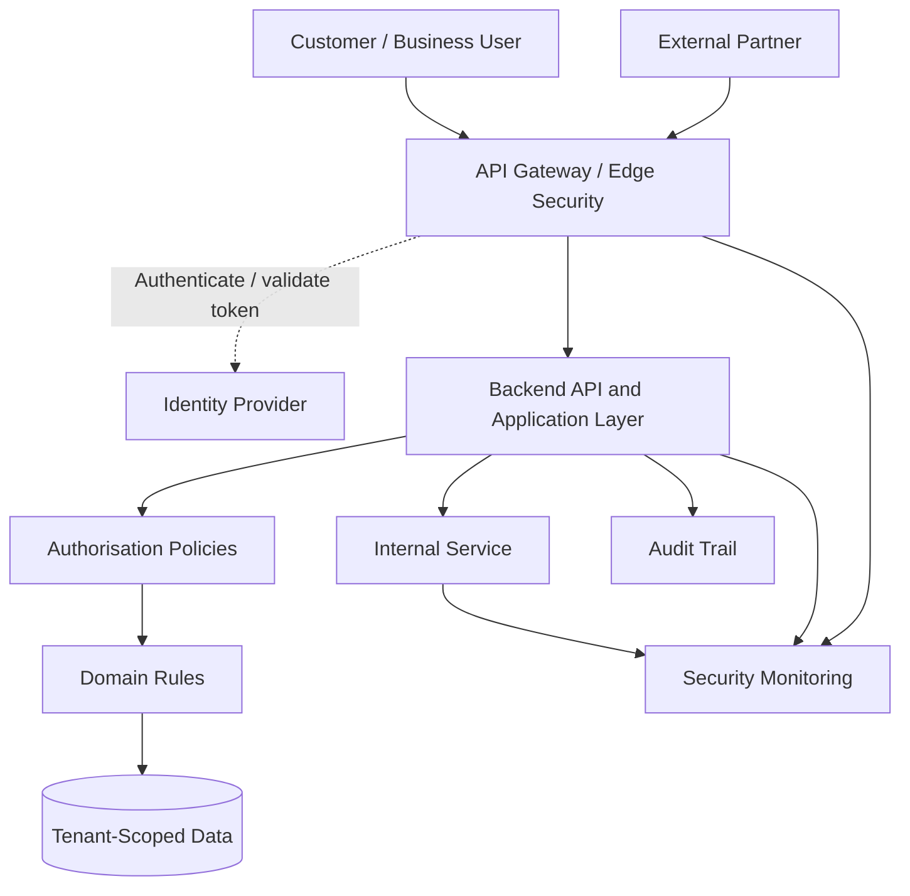
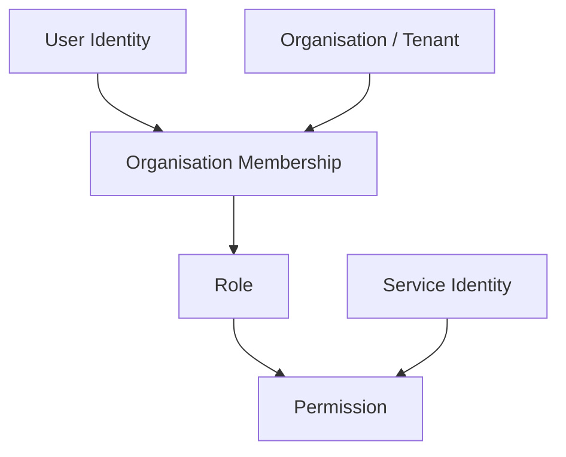
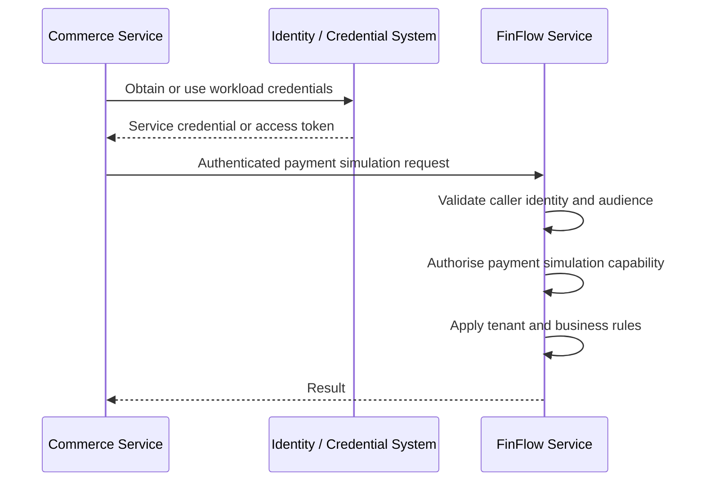
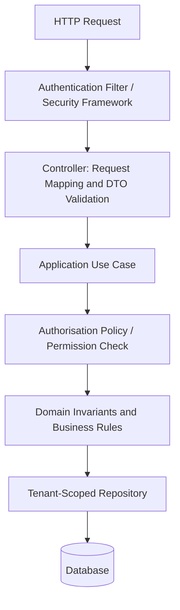
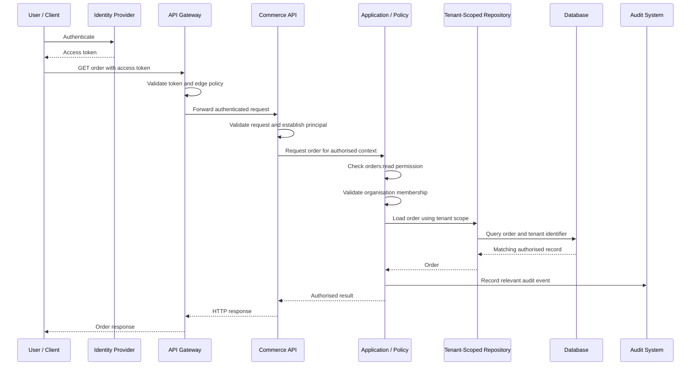

# Layer 7 — Security, Identity, Authorisation, and Multi-Tenancy

## 7.1 Purpose of This Layer

Security is not a feature that belongs only to the API Gateway or login page. It is a cross-cutting architectural responsibility that protects every entry point, service, data store, and communication channel.

Our Composable Business Platform contains several business capabilities:

- Commerce
- FinFlow
- Future booking and subscription modules
- Business administration
- External partner integrations
- Shared platform services

Each capability must enforce the appropriate security rules without requiring every team to invent its own authentication and authorisation implementation.

The objectives of this layer are to:

1. Establish who is making a request.
2. Determine what that identity is permitted to do.
3. Determine which organisation or tenant the identity is acting for.
4. Prevent access to another tenant's information.
5. Authenticate communication between services.
6. Protect credentials, tokens, secrets, and sensitive data.
7. Record security-relevant activities for investigation and audit.
8. Test both permitted and forbidden operations.
9. Keep security enforcement consistent across business modules.

### Fundamental principle

**Authentication establishes identity. Authorisation determines permission. Tenant isolation restricts the scope of access.**

These are related, but they are not interchangeable.

For example, a user may successfully sign in but still be forbidden from viewing financial information, initiating a transfer, or accessing another organisation's orders.

---

## 7.2 Where Security Fits in the Overall Architecture

Security crosses multiple layers rather than existing as a single standalone service.



The diagram represents logical responsibilities, not a requirement to deploy every box as an independent microservice.

In particular:

- The identity provider may be an external service.
- Gateway security may be implemented in the gateway or edge layer.
- Authorisation may use shared libraries, service-level policies, or a dedicated policy component.
- Tenant isolation must also be enforced at the data-access boundary.
- Audit and monitoring can use shared infrastructure, while business services remain responsible for producing meaningful security events.

A central identity provider does not eliminate the need for each business service to enforce its own access rules.

---

## 7.3 Authentication vs Authorisation vs Tenant Isolation

| Concept | Question answered | Example |
|---|---|---|
| Authentication | Who are you? | The request belongs to user `user-123`. |
| Authorisation | What are you allowed to do? | The user may view orders but cannot approve refunds. |
| Tenant isolation | Which organisation's resources may you access? | The user may access orders belonging to `org-A`, not `org-B`. |
| Audit | What security-relevant action occurred? | User `user-123` attempted to approve a refund. |

### Example

Suppose two organisations use the platform:

- `org-A`: Northstar Retail
- `org-B`: Greenfield Retail

Both organisations have users who can sign in successfully.

A user from Northstar requests:

```http
GET /api/v1/orders/order-9002
Authorization: Bearer <access-token>
```

Assume `order-9002` belongs to Greenfield Retail.

Even if the token is valid, the request must not return Greenfield's order.

The application must establish:

1. The token is valid.
2. The identity has the required permission.
3. The identity has an authorised relationship with the relevant organisation.
4. The requested order belongs to that organisation.
5. The action is allowed under the applicable business rules.

**A valid token does not automatically grant access to every resource.**

---

## 7.4 Identity Model

The platform must distinguish people, organisations, memberships, and machine identities.



### Core concepts

**User identity**

Represents a human user who signs in.

Examples:

- A customer
- A business administrator
- A finance operator
- A support operator

**Organisation / tenant**

Represents a logical customer or business boundary.

Examples:

- A retailer
- A booking business
- A company using FinFlow's simulated account functionality

**Organisation membership**

Represents the relationship between a user and an organisation.

A user may belong to multiple organisations and may have different roles in each.

For example:

| User | Organisation | Role |
|---|---|---|
| `user-123` | `org-A` | `ORG_ADMIN` |
| `user-123` | `org-B` | `ORDER_VIEWER` |
| `user-456` | `org-A` | `FINANCE_OPERATOR` |

Do not assume that a role granted in one organisation automatically applies to another.

**Role**

Groups related permissions into a convenient assignment.

**Permission**

Represents a specific capability, such as:

- `orders:read`
- `orders:create`
- `refunds:approve`
- `accounts:read`
- `transfers:create`
- `members:manage`

**Service identity**

Represents an application or workload communicating with another service.

For example, the Commerce service might need permission to request a payment simulation from FinFlow.

A service identity is not the same as a human user. It should have its own credentials or workload identity and narrowly scoped permissions.

---

## 7.5 Role-Based and Attribute-Based Authorisation

Two common approaches are Role-Based Access Control (RBAC) and Attribute-Based Access Control (ABAC).

### RBAC — Role-Based Access Control

Permissions are associated with roles, and roles are assigned to users or memberships.

Example:

```text
ORG_ADMIN
    ├── orders:read
    ├── orders:create
    ├── orders:cancel
    └── members:manage

ORDER_VIEWER
    └── orders:read

FINANCE_OPERATOR
    ├── accounts:read
    └── transfers:create
```

Advantages:

- Easy to understand.
- Easy to explain in interviews.
- Suitable for common business permissions.
- Easier to administer than individual permission assignments everywhere.

Potential limitation:

A role alone may not express every business rule.

For example, a finance operator might create a transfer but must not approve their own transfer.

### ABAC — Attribute-Based Access Control

Access decisions also consider attributes of the user, resource, request, or environment.

Example:

```text
Allow transfer approval only when:

- User belongs to the resource's organisation.
- User has transfers:approve.
- Transfer status is PENDING_APPROVAL.
- User is not the transfer creator.
- Transfer amount is within the user's approval limit.
```

These rules combine identity, tenant membership, permissions, and business attributes.

### Recommended approach for this platform

Start with explicit permissions grouped into roles. Add attribute-based conditions where real business requirements justify them.

Do not create a complicated policy engine before the requirements need one.

A useful distinction:

- Roles and permissions answer whether a capability may be used.
- Domain rules answer whether a particular business operation is valid.
- Tenant checks determine whether the resource belongs to an authorised organisational scope.

All three can be required for one operation.

---

## 7.6 Token and Session Design

The exact identity provider has not yet been selected. Therefore, the architecture should define the security contract without assuming a specific vendor.

A common approach is an identity provider issuing short-lived access tokens.

An access token may contain claims such as:

```json
{
  "sub": "user-123",
  "iss": "https://identity.example.invalid",
  "aud": "finflow-api",
  "exp": 1793123400,
  "scope": "orders:read orders:create",
  "org_context": "org-A"
}
```

This is an illustrative example, not a production token or a requirement to use these exact claim names.

Important claims:

| Claim | Purpose |
|---|---|
| `sub` | Identifies the token subject. |
| `iss` | Identifies the token issuer. |
| `aud` | Identifies the intended recipient. |
| `exp` | Defines the token expiry. |
| `scope` | May represent granted API permissions. |
| Organisation context | May identify the organisation for which the token was issued. |

The actual organisation membership and permissions must still be enforced according to the chosen identity and authorisation model.

### Token validation requirements

The API must validate the relevant token properties, including:

- Signature or other appropriate cryptographic validation.
- Trusted issuer.
- Intended audience.
- Expiration and applicable time constraints.
- Accepted signing algorithms and key-handling rules.
- Required claims and scopes.
- Token type and intended usage where relevant.

Do not trust a token merely because it is syntactically valid or because a request contains a claim named `role`.

### Never treat a client-supplied claim as proof

Consider this request:

```http
POST /api/v1/transfers
X-User-Id: admin-user
X-Organisation-Id: org-A
```

The client must not be allowed to establish its identity or permissions merely by supplying headers.

Trusted identity information must come from validated credentials or an explicitly authenticated and trusted upstream mechanism.

If a gateway injects identity headers, the gateway must strip untrusted client-supplied versions, and downstream services must only trust those headers across a protected, authenticated boundary.

### Access tokens and refresh tokens

Access tokens should generally be short-lived and limited to their intended audience and privileges.

Refresh tokens require stronger protection because they can be used to obtain additional access tokens. Their handling depends on the selected identity provider and client type.

Do not place access tokens, refresh tokens, passwords, or client secrets in URLs or ordinary application logs.

---

## 7.7 Gateway Security vs Service-Level Security

The gateway is an important security boundary, but it is not the only boundary.

### Gateway responsibilities

The gateway or edge layer may enforce:

- TLS termination and secure transport configuration.
- Authentication-token validation.
- Request size limits.
- Rate limiting and abuse controls.
- Routing restrictions.
- Basic request validation.
- Security headers where relevant.
- Correlation identifiers.
- Coarse-grained access checks.

### Backend service responsibilities

The backend service must still enforce:

- Endpoint-level permissions.
- Organisation membership and resource ownership.
- Business authorisation rules.
- Resource-level access checks.
- Valid state transitions.
- Sensitive field restrictions.
- Data-access scoping.

Why?

A service may later be called by another internal service, a background worker, an administrative tool, or a different gateway route. Security must not depend entirely on one network entry point.

### Example

```text
External request
    |
    v
Gateway validates token
    |
    v
Commerce API checks orders:create
    |
    v
Commerce application checks organisation access
    |
    v
Commerce domain validates order creation rules
    |
    v
Tenant-scoped repository accesses the correct data
```

Each step addresses a different risk.

The gateway can reject an unauthenticated request, but only the application and its data-access boundaries can reliably enforce resource-specific business access.

---

## 7.8 Multi-Tenancy and Data Isolation

Multi-tenancy means multiple organisations use the same logical platform while their data and permissions remain appropriately isolated.

For this platform, tenant isolation is an architectural requirement rather than a UI feature.

### Possible tenant data models

**Model A — Shared database and shared tables**

Rows contain a tenant or organisation identifier.

```text
orders
------
id
tenant_id
customer_id
status
total_amount
```

Example:

| id | tenant_id | status |
|---|---|---|
| `order-101` | `org-A` | CREATED |
| `order-202` | `org-B` | PAID |

Advantages:

- Lower operational overhead.
- Efficient use of shared infrastructure.
- Practical for the initial platform.

Risks:

- A missing tenant predicate can expose another organisation's data.
- Background jobs and administrative queries can accidentally cross tenant boundaries.
- Database constraints and indexes must be designed carefully.

**Model B — Separate schema per tenant**

Each tenant has its own database schema.

Advantages:

- Greater logical separation.
- Some operational and customisation benefits.

Trade-offs:

- Schema migrations become more complex.
- Connection and migration management require care.
- Large tenant counts can increase operational overhead.

**Model C — Separate database per tenant**

Advantages:

- Stronger infrastructure-level separation.
- Potentially useful for customers with strict isolation requirements.

Trade-offs:

- Higher operational cost.
- More complex provisioning, monitoring, backup, and migration workflows.

### Initial architectural direction

A shared database with tenant-scoped records can be a reasonable starting point for this portfolio platform, provided that the isolation mechanisms are explicit and tested.

This is a provisional direction, not a final decision. Stronger isolation may be required by actual customer, regulatory, or operational requirements.

### The tenant context

A request should establish a trusted tenant context before tenant-scoped business data is accessed.

Conceptually:

```java
public record TenantContext(
    String organisationId,
    String userId
) {}
```

This is an illustrative model, not a complete security implementation.

The context should be derived from authenticated identity and validated organisation membership, not blindly copied from a request parameter.

A user might request:

```http
GET /api/v1/orders?organisationId=org-B
```

The service must not assume the user is authorised for `org-B` just because it appears in the query string.

If the product supports switching between organisations, the selected organisation must be checked against the user's authorised memberships.

### Tenant-aware repository access

Unsafe pattern:

```java
Optional<Order> findById(String orderId);
```

This method is not inherently unsafe in every design, but it provides no explicit tenant boundary in its signature.

A tenant-scoped alternative is easier to reason about:

```java
Optional<Order> findByIdAndTenantId(
    String orderId,
    String tenantId
);
```

Example SQL:

```sql
SELECT id, tenant_id, status, total_amount
FROM orders
WHERE id = :orderId
  AND tenant_id = :tenantId;
```

The `tenantId` must come from trusted, validated request context.

Do not rely only on frontend filtering or hiding records from the UI.

### Tenant isolation checklist

- Scope normal reads and writes by tenant.
- Apply tenant constraints to update and delete operations.
- Enforce tenant scope in background jobs and scheduled tasks.
- Scope exports, reports, and bulk operations.
- Check tenant access before returning resource details.
- Consider tenant-aware unique constraints where required.
- Review caches, search indexes, object storage, and generated files for cross-tenant leakage.
- Test tenant isolation through negative integration tests.
- Define carefully controlled cross-tenant administrative access.
- Avoid silently falling back to an unscoped query when tenant context is missing.

A missing tenant context should fail closed for tenant-scoped operations.

---

## 7.9 BOLA / IDOR — Broken Object-Level Authorisation

This is one of the most important API security risks to understand for interviews.

BOLA means Broken Object-Level Authorisation. IDOR means Insecure Direct Object Reference. The terms are related and often describe the same general failure: an attacker can access an object by changing its identifier because the application fails to verify access to that object.

### Vulnerable example

User from `org-A` calls:

```http
GET /api/v1/orders/order-101
```

The request succeeds.

The user changes the identifier:

```http
GET /api/v1/orders/order-202
```

If `order-202` belongs to `org-B`, the application must not return it unless the caller has an explicitly authorised cross-tenant capability.

An unpredictable UUID does not replace authorisation checks.

### Correct design

The application should resolve the order using the authenticated tenant context:

```java
public Order getOrder(
    String orderId,
    TenantContext tenantContext
) {
    return orderRepository
        .findByIdAndTenantId(
            orderId,
            tenantContext.organisationId()
        )
        .orElseThrow(OrderNotFoundException::new);
}
```

The example assumes that the tenant context was securely established earlier.

Depending on the product's information-disclosure policy, a resource that exists but is not accessible may produce the same `404 Not Found` response as a nonexistent resource. A `403 Forbidden` response can also be appropriate when disclosing resource existence is acceptable.

The essential requirement is that the protected data is not returned.

### Interview takeaway

**Authentication tells you who made the request. Object-level authorisation tells you whether that identity may access this particular object.**

---

## 7.10 Service-to-Service Security

Internal services are not automatically trustworthy just because they run inside the same network.

Suppose Commerce requests a simulated payment operation from FinFlow.



The exact mechanism may be workload identity, mutual TLS, OAuth client credentials, or another suitable authenticated service-to-service mechanism.

The final choice depends on deployment and infrastructure decisions.

### Minimum requirements

- Each service has a verifiable identity.
- The receiving service authenticates the caller.
- The caller is authorised for the requested operation.
- Credentials are not shared indiscriminately across unrelated services.
- Credentials can be rotated or revoked.
- Communication uses appropriate transport protection.
- Access is restricted to the intended audience and capability.
- Security failures are observable without exposing credentials.

### Should Commerce forward the customer's access token to FinFlow?

Not automatically.

Forwarding a user token can be appropriate when the downstream service needs to make an authorisation decision on behalf of that user and the token is explicitly intended for that use.

However, it can also create problems:

- The token may have the wrong audience.
- The token may expose broader privileges than necessary.
- A downstream service may accidentally accept a token it should not trust.
- Service identity and user identity may become confused.

Possible approaches include:

1. A service token for Commerce, with narrowly scoped permission to invoke FinFlow.
2. A properly designed delegated-user token or token-exchange flow when downstream user context is required.
3. A combination of authenticated service identity and validated user/tenant context, with explicit trust and authorisation rules.

Do not forward tokens indiscriminately. Choose the approach based on the security contract between the services.

### Important distinction

The caller's identity and the business actor are not necessarily the same.

For example:

```text
Calling service: commerce-service
Acting user: user-123
Organisation: org-A
Operation: simulate-payment
```

The receiving service must know which identities it trusts and which claims or context it is permitted to use.

---

## 7.11 API Security and Input Validation

Authentication does not make request data trustworthy.

Every API must validate input according to its contract and business rules.

For example, a transfer request might contain:

```json
{
  "sourceAccountId": "account-101",
  "destinationAccountId": "account-202",
  "amount": 100.00,
  "currency": "GBP"
}
```

Validation should consider:

- Required fields.
- Correct formats and lengths.
- Positive monetary amounts.
- Supported currencies.
- Source and destination account access.
- Organisation ownership.
- Valid account and transfer status.
- Business limits.
- Duplicate requests and idempotency.
- Whether the user has permission to initiate the operation.

A request can pass JSON validation and still violate business or authorisation rules.

### Important security controls

**Input validation**

Validate inputs at the API boundary and enforce domain invariants in the domain/application layers.

**Output minimisation**

Return only fields the caller is authorised to see. Avoid exposing internal identifiers, credentials, or unrelated personal and financial data.

**Rate limiting**

Limit abusive or excessively frequent requests according to endpoint risk, caller identity, tenant, and infrastructure capacity.

**Request size limits**

Reject excessively large requests before they consume unnecessary resources.

**CORS**

Configure browser cross-origin access according to the actual frontend origins and required methods/headers. CORS is not authentication and does not protect an API from non-browser clients.

**CSRF**

If browser authentication relies on cookies automatically attached by the browser, assess cross-site request forgery risks and apply suitable protections. Bearer-token APIs have a different threat profile, but browser token storage and XSS risks still require attention.

**Transport security**

Use HTTPS/TLS for external communication and appropriate transport protection for internal communication.

**Injection protection**

Use parameterised database queries and safe output handling. Do not concatenate untrusted input into SQL or other executable expressions.

**Dependency security**

Keep dependencies patched, scan for known vulnerabilities, and control dependency sources.

**Mass assignment**

Do not bind arbitrary client fields directly to sensitive domain entities. Use explicit request DTOs and map only permitted fields.

---

## 7.12 Passwords, Secrets, and Cryptographic Material

Secrets include:

- Database credentials.
- Service credentials.
- Signing keys and private keys.
- API keys.
- External integration credentials.
- Refresh tokens and other sensitive tokens.

### Rules

1. Never hard-code production secrets in source code.
2. Do not commit secrets to version control.
3. Avoid storing secrets in plain-text configuration files or container images.
4. Use an appropriate secret manager or protected deployment configuration.
5. Restrict secret access to the workloads that need it.
6. Rotate secrets according to risk and operational requirements.
7. Remove secrets from logs, traces, error responses, and support tickets.
8. Review backup and recovery handling for secret material.
9. Use managed cryptographic services where justified.
10. Avoid inventing custom cryptography.

If the platform manages user passwords directly, passwords must be stored using an appropriate password-hashing algorithm with salts and suitable parameters, not reversible encryption or plain-text storage.

If an external identity provider manages authentication, the platform should generally avoid taking responsibility for storing those users' passwords unnecessarily.

Signing keys must be protected and rotated according to the selected token-validation architecture.

---

## 7.13 Authorisation in the Application Architecture

Security responsibilities should align with the existing API/application/domain/infrastructure separation.



This is a conceptual flow. Some permission checks can occur at more than one layer.

### Responsibilities by layer

**Security framework / filter**

- Validate authentication credentials.
- Establish the authenticated principal.
- Reject unauthenticated requests where authentication is required.

**Controller**

- Parse the request.
- Validate its transport-level structure.
- Delegate to the application layer.
- Avoid embedding large, complicated security policies in controller methods.

**Application layer**

- Orchestrate the use case.
- Enforce operation permissions and relevant organisation context.
- Coordinate access to protected resources.

**Domain layer**

- Enforce business invariants.
- Reject invalid state transitions.
- Enforce rules such as approval limits or separation of duties where they are domain rules.

**Infrastructure layer**

- Implement tenant-scoped data access.
- Protect persistence boundaries.
- Integrate with external identity or security systems where appropriate.

Do not treat this diagram as a rule that every authorisation decision belongs in exactly one class. The important point is to keep the responsibilities explicit, testable, and consistent.

### Illustrative Java application service

```java
public Order getOrder(
    String orderId,
    AuthenticatedUser user,
    TenantContext tenantContext
) {
    permissionChecker.require(
        user,
        tenantContext,
        "orders:read"
    );

    return orderRepository
        .findByIdAndTenantId(
            orderId,
            tenantContext.organisationId()
        )
        .orElseThrow(OrderNotFoundException::new);
}
```

This is an illustrative design, not a complete security framework.

The `AuthenticatedUser`, `TenantContext`, and permission-checking abstractions must be populated from trusted security context and validated membership data.

A caller must not be allowed to construct a trusted user or tenant context simply by submitting arbitrary JSON.

---

## 7.14 Security in FinFlow's Simulated Financial Workflows

FinFlow does not move real money, but its simulated account and transfer operations still need strong access controls.

Consider the following operation:

```http
POST /api/v1/transfers
Authorization: Bearer <access-token>
Idempotency-Key: transfer-request-abc
Content-Type: application/json
```

```json
{
  "sourceAccountId": "account-101",
  "destinationAccountId": "account-202",
  "amount": 100.00,
  "currency": "GBP"
}
```

A secure request flow is:

1. Validate the access token.
2. Establish the authenticated user or service identity.
3. Resolve and validate the active organisation context.
4. Check permission to initiate a transfer.
5. Load the source and destination accounts within the authorised scope.
6. Verify the applicable ownership and access rules for both accounts.
7. Validate amount, currency, status, and other business invariants.
8. Apply the idempotency policy.
9. Execute the simulated transfer within the appropriate transaction boundary.
10. Persist the required state and audit information.
11. Return only the authorised response fields.
12. Emit operational and security-relevant telemetry without logging secrets.

### Why checking only the source account is insufficient

Suppose the source account belongs to `org-A` but the destination account belongs to `org-B`.

The service must not assume that access to the source account grants permission to move simulated value into or out of any destination account.

The transfer's complete set of business and authorisation rules must be checked.

Whether cross-organisation transfers are supported is a business decision that must be explicit. If supported, the authorisation rules must define the permitted cases.

### Security and idempotency

An idempotency key prevents unintended duplicate execution when the same authorised operation is retried.

However:

- It does not authenticate the caller.
- It does not grant permission.
- It does not prove tenant ownership.
- It does not replace validation of the request.
- Its storage and lookup must be scoped so one tenant cannot interfere with another tenant's requests.

The platform must define how idempotency keys are associated with the tenant, operation, and request payload.

---

## 7.15 Audit Trail and Security Events

Operational logs and business audit records serve different purposes.

**Operational logs** help engineers diagnose system behaviour.

**Security events** help detect and investigate suspicious activity.

**Business audit records** explain important business actions and their outcomes.

These may share an infrastructure platform, but they should not be treated as interchangeable records.

### Example audit event

```json
{
  "eventType": "TRANSFER_INITIATION_DENIED",
  "actorType": "USER",
  "actorId": "user-123",
  "organisationId": "org-A",
  "resourceType": "TRANSFER",
  "resourceId": "transfer-789",
  "reasonCode": "INSUFFICIENT_PERMISSION",
  "correlationId": "req-456",
  "occurredAt": "2026-10-27T10:00:00Z"
}
```

This is illustrative data. Real identifiers, timestamps, event schemas, and retention policies must follow the chosen implementation and requirements.

Useful security events may include:

- Repeated authentication failures.
- Permission denials.
- Attempts to access another tenant's resources.
- Organisation membership changes.
- Role or permission changes.
- Credential and secret-management events.
- Sensitive administrative operations.
- Transfer initiation, approval, and cancellation.
- Changes to integration credentials.
- Suspicious request patterns.

### Audit design requirements

- Record who or what performed the action.
- Record the relevant organisation and resource where appropriate.
- Record the action and outcome.
- Use consistent event names and timestamps.
- Include correlation identifiers where available.
- Protect audit data against unauthorised modification.
- Apply retention and access rules.
- Avoid storing passwords, tokens, or unnecessary sensitive payloads.
- Distinguish denied attempts from successful actions.
- Ensure critical business audit records are not silently lost.

A normal application log is not automatically a tamper-resistant audit trail.

The required durability, access controls, and integrity guarantees should be determined by the business and compliance requirements.

---

## 7.16 Error Responses and Information Disclosure

Security failures must be understandable to legitimate clients without exposing unnecessary internal information.

Example unauthenticated response:

```http
HTTP/1.1 401 Unauthorized
Content-Type: application/json
```

```json
{
  "code": "UNAUTHENTICATED",
  "message": "Authentication is required.",
  "correlationId": "req-456"
}
```

Example insufficient-permission response:

```http
HTTP/1.1 403 Forbidden
Content-Type: application/json
```

```json
{
  "code": "FORBIDDEN",
  "message": "You are not permitted to perform this operation.",
  "correlationId": "req-457"
}
```

Typical distinction:

- `401 Unauthorized`: valid authentication has not been established.
- `403 Forbidden`: the caller is authenticated but is not allowed to perform the operation.
- `404 Not Found`: the resource does not exist or, under a deliberate resource-concealment policy, must not be disclosed to this caller.
- `400 Bad Request`: the request is malformed or fails applicable request validation.
- `429 Too Many Requests`: a rate limit has been exceeded.

The precise status mapping depends on the API contract.

Never return:

- Stack traces.
- Database connection details.
- Internal secrets.
- Access tokens.
- Sensitive information about another tenant.
- Detailed authorisation-policy internals that help an attacker bypass controls.

Record sufficient internal diagnostic context securely, and expose only the information needed by the client.

---

## 7.17 Security Testing Strategy

Security controls must be tested as part of the normal development process.

A successful login test alone is not enough.

### Testing matrix

| Scenario | Expected behaviour |
|---|---|
| Missing access token | Reject protected request. |
| Invalid token signature | Reject request. |
| Expired token | Reject request. |
| Wrong token audience | Reject request. |
| Missing required permission | Deny operation. |
| User belongs to another tenant | Do not expose protected resource. |
| Tenant context missing | Fail closed for tenant-scoped operations. |
| User changes an order ID | Verify object-level authorisation. |
| User changes an organisation ID | Validate membership; never trust the supplied ID alone. |
| Service uses invalid credentials | Reject service request. |
| Service has no required capability | Deny the operation. |
| Transfer amount violates domain rules | Reject operation. |
| Client sends unexpected sensitive fields | Ignore or reject according to the contract; do not mass-assign them. |
| Idempotent request is repeated | Follow the documented idempotency contract. |
| Audit event contains sensitive input | Verify secrets and prohibited data are not logged. |

### Essential test categories

**Unit tests**

Test permission rules, membership rules, policy decisions, and domain invariants.

**Integration tests**

Verify that authentication and authorisation integrate correctly with application services, repositories, and database tenant constraints.

**API security tests**

Verify status codes, response bodies, access denials, and sensitive-field filtering.

**Tenant-isolation tests**

Create records for at least two tenants and attempt cross-tenant reads, writes, updates, deletes, searches, and exports.

**Service-identity tests**

Verify that a service cannot call capabilities outside its granted permissions.

**Regression tests**

Preserve tests for previously discovered access-control defects.

**Operational tests**

Verify that security failures are logged and monitored without exposing secrets.

### A particularly valuable test

Given:

- `org-A` has `order-101`.
- `org-B` has `order-202`.
- `user-A` is authorised only for `org-A`.

Verify that `user-A` cannot read, update, cancel, export, or otherwise manipulate `order-202`, even when they know its identifier.

Repeat the test through every relevant API path rather than testing only one controller.

---

## 7.18 Security Design Decisions and Open Questions

The following decisions should be made explicitly instead of silently assumed.

| Decision | Current direction | What must be confirmed |
|---|---|---|
| Identity provider | Provider-neutral architecture | Which identity provider and protocols will be used? |
| User authentication | Delegated to a suitable identity system where appropriate | Which clients need browser, mobile, or machine authentication? |
| Authorisation | Explicit permissions grouped into roles | Which roles and permissions does each business capability require? |
| Organisation membership | Model membership separately from user identity | Can users belong to multiple organisations? |
| Tenant storage | Tenant-scoped data access | Is shared-database isolation sufficient for all target customers? |
| Service authentication | Explicit workload identity | OAuth client credentials, mutual TLS, workload identity, or another mechanism? |
| User context between services | Explicit trust contract | Does a downstream operation need delegated user context? |
| Privileged administration | Restricted and auditable access | Which cross-tenant administrative actions are permitted? |
| Audit | Structured, protected audit events | What are the durability, retention, and integrity requirements? |
| Token lifetime and revocation | Short-lived access credentials as a starting point | What session, revocation, and incident-response behaviour is required? |
| Sensitive data | Data minimisation and protected handling | Which fields require masking, encryption, or restricted retention? |
| Rate limiting | Apply controls based on endpoint risk | What are the limits for users, tenants, and service clients? |

These are architecture decisions to validate against actual requirements, not assumptions that every deployment needs the same solution.

---

## 7.19 Common Security Mistakes to Avoid

1. Treating successful login as proof that every operation is allowed.
2. Trusting organisation IDs supplied by the browser.
3. Relying entirely on the API Gateway for authorisation.
4. Assuming internal services are inherently trusted.
5. Checking permissions but forgetting resource ownership.
6. Using unpredictable identifiers as a substitute for access checks.
7. Sharing service credentials across unrelated workloads.
8. Forwarding user access tokens without validating audience and intended use.
9. Storing secrets in source control or application logs.
10. Returning complete database entities to clients.
11. Failing to scope background jobs and reports by tenant.
12. Allowing a missing tenant context to trigger an unscoped database query.
13. Recording only successful business actions while ignoring security denials.
14. Building an elaborate policy framework before requirements justify it.
15. Assuming a simulated financial operation has no security consequences.
16. Testing only the happy path.
17. Treating CORS as an authentication mechanism.
18. Using application logs as the only evidence of critical business actions.
19. Assuming that an internal network removes the need for service authentication.
20. Applying a permission check once and forgetting to enforce it on alternate API paths.

---

## 7.20 End-to-End Security Flow

Consider a business user requesting an order from Commerce.



The audit event may be written synchronously or through an appropriately reliable mechanism, depending on its criticality and the system's audit guarantees.

The diagram describes the successful path. In a real implementation, failures at any security boundary must stop the operation before protected data is returned or an unauthorised state change occurs.

### What happens when the user requests another tenant's order?

The same flow applies until the repository query or explicit resource policy determines that the order is outside the caller's permitted scope.

The application returns an appropriate denial or concealed-resource response. It does not return the protected order and does not perform a state-changing operation.

The denied attempt may also generate a security event according to the audit policy.

---

## 7.21 Interview Questions and Follow-Ups

### Q1. What is the difference between authentication and authorisation?

**Answer:** Authentication establishes the identity of a user or service. Authorisation determines which operations and resources that identity may access.

**Follow-up:** Can an authenticated user receive a `403 Forbidden` response?

Yes. The user can be authenticated but lack the required permission or resource access.

### Q2. Why is gateway authentication not sufficient?

**Answer:** Services may have alternate entry points, internal callers, background jobs, or future integrations. The gateway should enforce edge controls, but each service must protect its own operations and resources.

**Follow-up:** Does every service need to implement token cryptography from scratch?

No. Shared, trusted security libraries or framework capabilities can standardise validation. The service must still enforce its own authorisation rules.

### Q3. What is BOLA, and how would you prevent it?

**Answer:** BOLA occurs when an API fails to verify whether the caller is allowed to access a specific object. Prevent it with resource-level authorisation and tenant-scoped data access.

**Follow-up:** Is using UUIDs enough?

No. An attacker can obtain identifiers through other means. Every protected resource access needs the correct authorisation checks.

### Q4. How would you implement multi-tenancy?

**Answer:** Define the tenant model, establish trusted tenant context, enforce tenant scope in the application and data-access layers, and test cross-tenant access attempts. Shared tables, separate schemas, or separate databases can be chosen based on isolation and operational requirements.

**Follow-up:** What happens if tenant context is missing?

Tenant-scoped operations should fail closed instead of executing an unscoped query.

### Q5. What is the difference between RBAC and ABAC?

**Answer:** RBAC bases access primarily on roles and their permissions. ABAC evaluates attributes such as user, resource, organisation, amount, status, or context. A system can combine both.

**Follow-up:** Which would you choose here?

Start with explicit permissions grouped into roles, then add attribute-based conditions for requirements such as approval limits and separation of duties.

### Q6. How should microservices authenticate one another?

**Answer:** Use an explicit service identity mechanism, authenticate the caller, restrict the intended audience and capabilities, protect transport, and manage credentials securely.

**Follow-up:** Can services trust each other because they are inside a private network?

No. Network location alone does not establish identity or authorisation.

### Q7. Should a user access token be forwarded to every downstream service?

**Answer:** No. The token must be suitable for the downstream audience and intended delegation. Depending on the workflow, use a narrowly scoped service identity, delegated-user token, or an explicitly designed combination.

### Q8. How would you prevent cross-tenant access through a database query?

**Answer:** Establish trusted tenant context and scope repository operations using both the resource identifier and tenant identifier. Add suitable database constraints and test reads and writes across tenant boundaries.

### Q9. How should sensitive security failures be logged?

**Answer:** Record the actor, organisation, action, outcome, relevant resource, reason code, and correlation identifier where appropriate. Never log passwords, access tokens, private keys, or unnecessary sensitive payloads.

### Q10. How would you test tenant isolation?

**Answer:** Create data for two tenants, authenticate users with different memberships, and attempt cross-tenant reads, updates, deletes, searches, exports, and background operations. Assert that unauthorised data is never returned or modified.

### Q11. What is the relationship between domain rules and authorisation?

**Answer:** Authorisation determines whether the caller may perform the operation. Domain rules determine whether the operation is valid in the current business state. Both may be required.

For example, a finance operator may have permission to initiate a transfer, but a transfer can still be rejected because an account is inactive.

### Q12. Does idempotency provide security?

**Answer:** Idempotency helps prevent duplicate execution of repeated requests. It does not authenticate the caller, grant permissions, or prove resource ownership.

---

## 7.22 Final Architecture Summary

Layer 7 establishes the security boundaries for the Composable Business Platform.

The architecture must provide:

- A trusted identity model for people and services.
- Explicit authentication and authorisation responsibilities.
- Roles and permissions aligned with business capabilities.
- Organisation membership and tenant-aware access.
- Resource-level authorisation and protection against BOLA/IDOR.
- Secure service-to-service communication.
- Protected credentials and secrets.
- Validation at API, application, domain, and persistence boundaries.
- Structured security and business audit records.
- Safe error responses and sensitive-data handling.
- Automated negative tests and tenant-isolation tests.

The key design principle is:

**Never rely on a single security check when the operation requires identity validation, permission checks, tenant isolation, and business-rule validation.**

Keep the security model explicit, testable, and consistent. Use the simplest design that meets the actual requirements, while leaving clear boundaries for future growth.

---

## Next Section — Layer 8: Audit, Observability, Logging, and Operational Reliability

Layer 8 will connect the platform's operational capabilities, including:

- Structured application logs and correlation IDs.
- Distributed tracing across service boundaries.
- Metrics, dashboards, and actionable alerts.
- Business audit events versus diagnostic logs.
- Health checks and dependency health.
- SLOs, SLIs, and error budgets where appropriate.
- Failure diagnosis and incident response.
- Sensitive-data redaction.
- Reliability testing and operational readiness.
