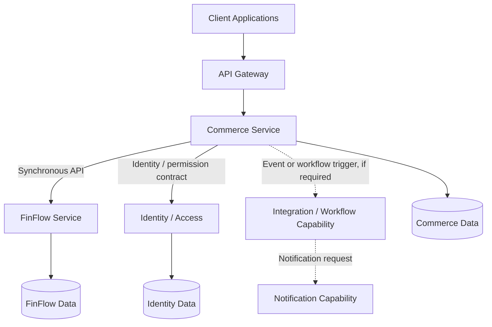
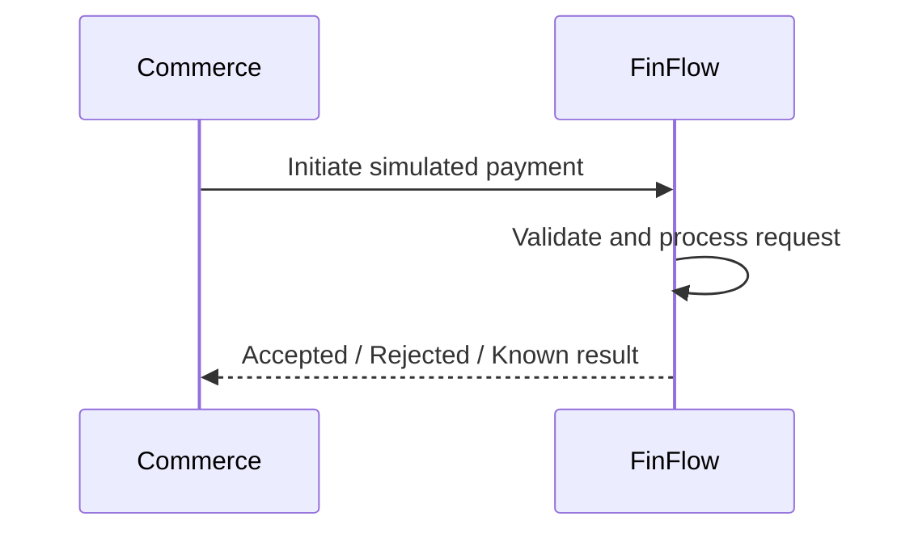
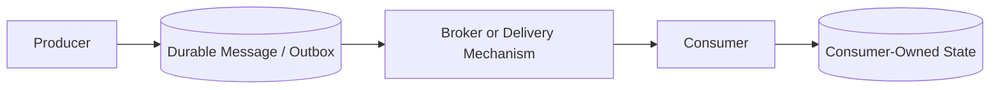
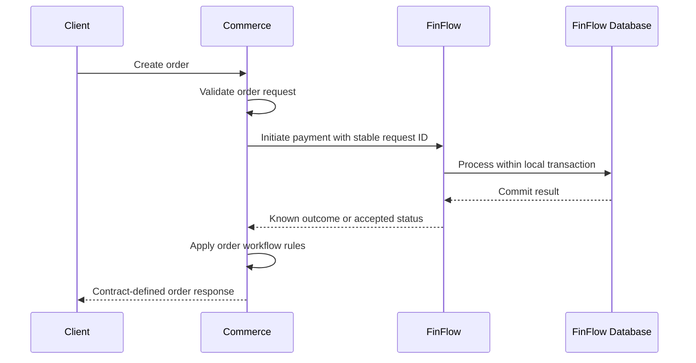
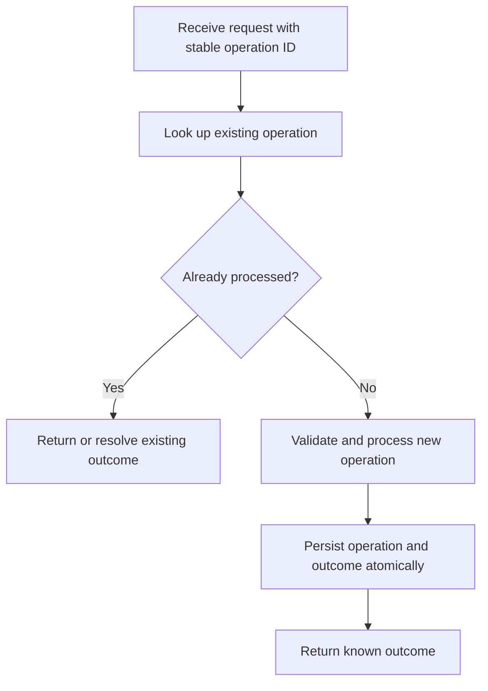
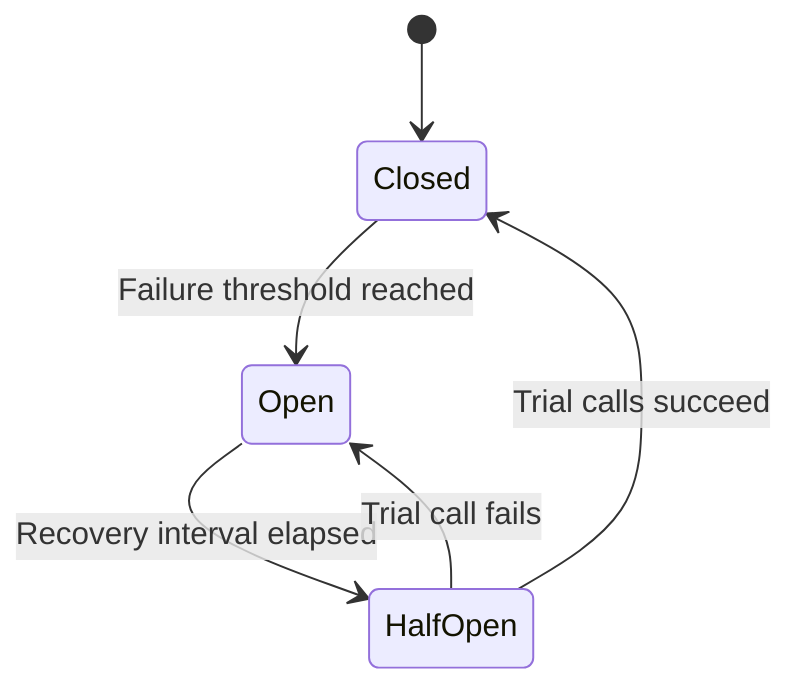
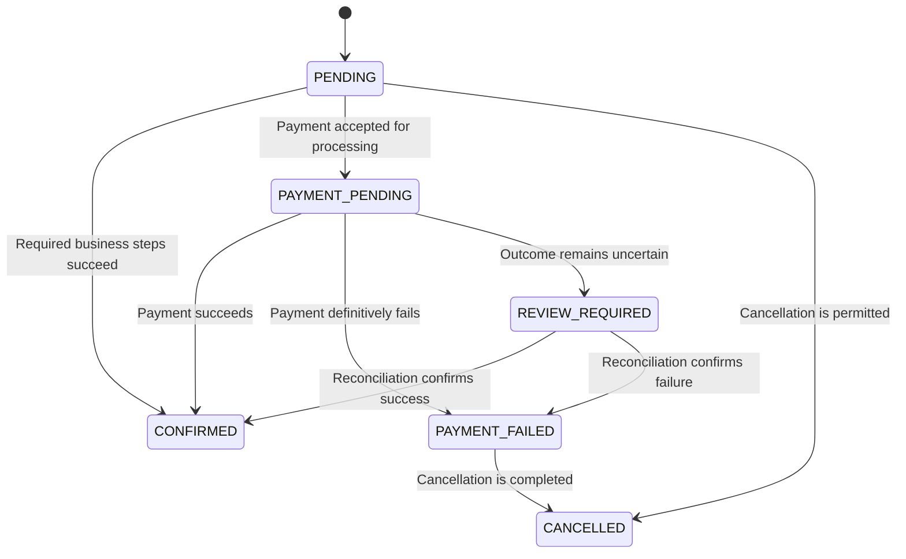
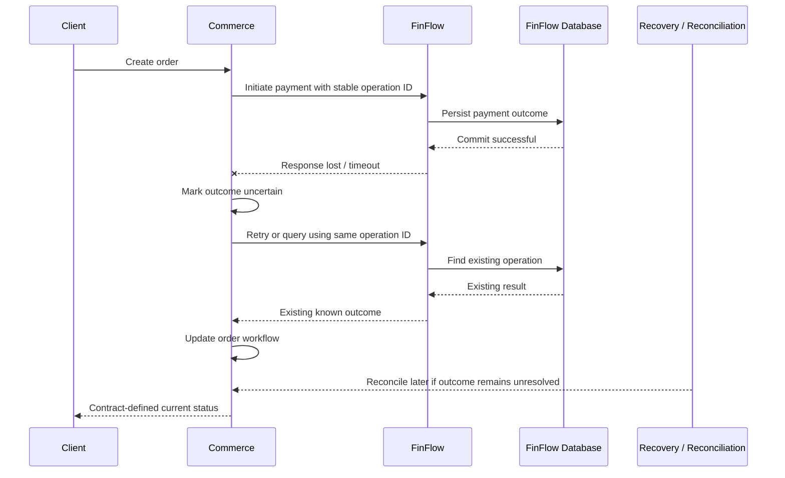

# Layer 6 — Service-to-Service Communication and Distributed Workflows

**Status:** Architecture design baseline — communication mechanisms remain subject to requirements and repository inspection.

**Objective:** Define how platform capabilities communicate without creating excessive coupling, uncontrolled retries, duplicate business operations, or workflows that become impossible to recover after partial failure.

> Core principle: A successful HTTP call is not the same as a successful end-to-end business workflow. Every cross-service interaction needs an explicit contract and a plan for failure.

---

## 6.1 Where Service Communication Fits

Layer 6 connects the backend domains defined in earlier layers.

Candidate capabilities include:

- Identity and access.
- Commerce.
- FinFlow.
- Notifications.
- Integration and workflows.
- Booking and subscriptions, if justified by future requirements.

Each capability owns its business rules and authoritative data. Communication allows capabilities to collaborate without directly manipulating each other's private state.



This is a logical communication model, not a mandate to deploy every box as an independent service immediately.

The current repository must be inspected before deciding which capabilities are already implemented, which should remain modules, and which need separate deployment.

---

## 6.2 Two Main Communication Styles

Most service-to-service interactions fall into two broad categories.

### Synchronous communication

The caller sends a request and waits for a response.

Examples:

- Commerce asks FinFlow to initiate a simulated payment.
- An application checks whether a resource exists.
- A service retrieves a result needed to respond to the current API request.



**Advantages**

- Straightforward request-response semantics.
- Immediate response when the operation completes quickly.
- Easy to understand for simple queries and commands.

**Risks**

- The caller depends on the callee's availability and latency.
- Timeouts can leave the outcome uncertain.
- Long call chains increase latency and failure probability.
- Retries can duplicate business operations if the API is not designed for them.

### Asynchronous communication

The sender records or publishes a message, and the receiver processes it independently.

Examples:

- An order-created event triggers a notification.
- A completed transfer produces an event consumed by a reporting projection.
- A webhook delivery workflow retries after a partner endpoint becomes unavailable.



The exact infrastructure is not decided. Asynchronous communication can use different mechanisms, and not every application needs a message broker.

**Advantages**

- Producer and consumer can progress independently.
- Temporary consumer outages can be handled through durable delivery and retries.
- Work can be processed in the background.
- One event may support multiple independent consumers.

**Risks**

- Delivery can be delayed or duplicated.
- Eventual consistency becomes visible to users.
- Event ordering and schema evolution require deliberate design.
- Debugging requires correlation across asynchronous steps.

### Quick comparison

| Question | Synchronous API | Asynchronous message/event |
|---|---|---|
| Does the caller wait? | Usually yes | Usually no |
| Does the caller receive an immediate result? | Often | Not necessarily |
| Can the consumer process later? | Not normally within the same request | Yes |
| Can delivery be duplicated? | Retries can duplicate requests | Yes, depending on delivery semantics |
| Is state immediately consistent across services? | Not guaranteed | Usually not |
| Best fit | Immediate bounded request-response | Background work and decoupled reactions |

Neither approach is universally better. Choose based on the business requirement.

---

## 6.3 Command, Query, Event, and Notification

These terms describe different communication intentions.

### Command

A command asks a particular owner to perform an operation.

Examples:

- `InitiateSimulatedPayment`
- `ReserveInventory`
- `CancelOrder`

A command can be rejected. Its result must be defined by the contract.

### Query

A query asks for information without requesting a business-state change.

Examples:

- `GetOrderStatus`
- `GetAccountSummary`
- `GetAvailableInventory`

A query should not unexpectedly trigger a business operation.

### Event

An event states that something happened.

Examples:

- `OrderCreated`
- `SimulatedPaymentSucceeded`
- `TransferRejected`

An event should describe an established fact rather than an instruction disguised as a fact.

### Notification

A notification is a delivery or communication action, such as sending an email or webhook.

A business event may trigger a notification, but the event and the notification are not the same thing.

For example:

```text
OrderCreated
    -> notification workflow
    -> email delivery attempt
    -> delivery result recorded
```

An email failure does not automatically mean the order creation failed.

---

## 6.4 Define the Contract Before Choosing the Transport

A service contract must explain more than the URL or event name.

For every interaction, define:

1. Producer and consumer.
2. Business purpose.
3. Request or event schema.
4. Response or acknowledgement semantics.
5. Authentication and authorisation requirements.
6. Timeout and retry policy.
7. Idempotency expectations.
8. Error classification.
9. Versioning and compatibility.
10. Correlation and operational visibility.

### Illustrative simulated-payment request

```json
{
  "paymentRequestId": "example-payment-request-id",
  "orderId": "example-order-id",
  "organisationId": "example-organisation-id",
  "amount": "45.00",
  "currency": "GBP"
}
```

This is illustrative only. The final contract must define the amount format, identifier semantics, organisation context, allowed currencies, and relationship between the payment request and order.

### Illustrative response

```json
{
  "paymentRequestId": "example-payment-request-id",
  "status": "PENDING",
  "correlationId": "example-correlation-id"
}
```

A `PENDING` response must not be interpreted as a completed payment.

The API contract should distinguish accepted work, a completed business outcome, a known rejection, and an uncertain outcome.

---

## 6.5 Synchronous Call Design

Suppose Commerce needs FinFlow to initiate a simulated payment.

A direct synchronous request may be suitable if:

- The operation normally completes quickly.
- The business needs an immediate result.
- FinFlow's availability and latency are acceptable dependencies.
- Timeout and retry semantics are explicitly defined.

### Request flow



This diagram is one possible flow. It does not imply that Commerce and FinFlow share a database transaction.

### Important limitation

If FinFlow commits the payment result but the response is lost, Commerce may not know whether the operation succeeded.

Commerce must not assume that a timeout means the payment failed.

A reliable design needs a way to determine the result, such as:

- Retrying with the same idempotency key under a defined contract.
- Querying the operation using a stable payment request identifier.
- Receiving an asynchronous status event.
- Running a reconciliation process for unresolved operations.

The appropriate choice depends on the business workflow.

---

## 6.6 Timeouts: Bound Every Remote Call

A timeout limits how long a caller waits for a response.

Without appropriate timeouts, a slow dependency can consume request threads, connections, and other resources.

### Types of timeouts

| Timeout | Purpose |
|---|---|
| Connection timeout | Limits time spent establishing a connection. |
| Response/read timeout | Limits how long the client waits for response data, according to the client implementation. |
| Overall operation deadline | Limits the total time allowed for a larger operation. |
| Database timeout | Limits particular database operations or transaction duration, depending on configuration. |

Exact settings depend on the HTTP client, database, and framework.

### Timeout does not mean cancellation

Suppose Commerce sends a request and waits for five seconds.

FinFlow may still be processing after Commerce times out. Even if the connection closes, the server may already have committed the operation.

```text
Commerce                  FinFlow
   |                         |
   |---- initiate payment -->|
   |                         | process operation
   | timeout                 | commit result
   |                         |
   |---- response unknown ---|
```

This is why the caller needs an explicit outcome-resolution strategy.

A timeout describes what the caller observed, not necessarily what the callee did.

---

## 6.7 Retry Policies

Retries can recover from transient failures, but they can also multiply load and duplicate operations.

### Retry only when justified

Potentially transient failures include:

- Temporary connection failures.
- Selected service-unavailable responses.
- Temporary rate limiting, respecting the service's retry guidance.
- Transient infrastructure errors.

Usually non-retryable without a changed request or business state:

- Invalid request data.
- Authentication or authorisation failures.
- A business rule rejection.
- A permanent resource-not-found result, depending on the contract.

Classify errors according to the API contract rather than blindly retrying every error.

### Exponential backoff

A common strategy increases the delay between attempts.

```text
Attempt 1: immediate
Attempt 2: short delay
Attempt 3: longer delay
Attempt 4: longer delay again
```

An illustrative formula is:

\[
d_n = \min(d_{\max}, d_0 \times 2^{n-1})
\]

Where:

- \(d_n\) is the delay before attempt \(n\).
- \(d_0\) is the initial delay.
- \(d_{\max}\) is the configured maximum delay.

Random jitter can reduce synchronized retries from many clients.

These are design concepts, not final timing values. Choose limits from the operation's deadline, dependency behaviour, and operational requirements.

### Retry checklist

- Is the failure likely to be transient?
- Is the operation safe to retry?
- Is there a stable idempotency key or operation identifier?
- Is there a maximum attempt count?
- Is there an overall deadline?
- Is backoff bounded?
- Does the service provide a retry-after instruction?
- What happens after the retry budget is exhausted?
- How is the failure observed and recovered?

Never implement an unlimited immediate retry loop.

---

## 6.8 Idempotency Across Service Boundaries

An operation is idempotent when repeating the same logical request produces the intended effect only once, or otherwise returns a consistent result under the defined contract.

Consider a payment request:

```text
Commerce sends payment request.
FinFlow processes and commits it.
Response is lost.
Commerce retries.
```

If FinFlow treats the retry as a new payment, the business operation may occur twice.

### Recommended conceptual flow



The implementation must also handle two identical requests arriving concurrently.

A typical design uses a unique constraint over the appropriate operation key and scope, then handles duplicate-key conflicts deliberately.

### Idempotency requirements

Define:

- What uniquely identifies the business operation.
- Which caller or organisation owns the key.
- How long the key is retained.
- What happens if the same key is reused with a different request.
- How concurrent requests are handled.
- Whether an operation can remain pending.
- How callers retrieve a final result.

A stable operation ID is often more useful than generating a new idempotency key for each retry.

---

## 6.9 Circuit Breakers and Bulkheads

These patterns address different failure risks.

### Circuit breaker

A circuit breaker temporarily stops calls to a dependency when failures indicate that continuing to call it is unlikely to help.

Conceptual states:



- **Closed:** Calls are permitted normally.
- **Open:** Calls fail fast or follow a configured fallback.
- **Half-open:** A limited number of trial calls test recovery.

A circuit breaker is not a retry policy and does not prove that a business operation failed. It is a mechanism for controlling calls to an unhealthy dependency.

Use a circuit breaker when failure patterns, latency, and the consequences of repeated calls justify it.

### Bulkhead

A bulkhead isolates resource consumption so that one dependency or workload cannot exhaust every resource.

Examples:

- Separate concurrency limits for slow external calls.
- Bounded worker pools for background tasks.
- Separate connection or execution limits where supported.

A bulkhead reduces the risk that one unhealthy dependency makes unrelated operations unavailable.

Do not add circuit breakers and bulkheads indiscriminately. Their thresholds and isolation boundaries should follow measured risks.

---

## 6.10 Partial Failure and Distributed Workflows

A multi-service business operation can partially succeed.

Example:

1. Commerce creates an order.
2. FinFlow accepts a simulated payment request.
3. Commerce receives a timeout.
4. The client retries.
5. The original payment request later completes.

The system must not create duplicate orders or duplicate payments because the outcome was temporarily unknown.

### Model business state explicitly

A possible order lifecycle:



This is an illustrative state machine. The final states and transitions must match the product requirements.

Do not use a single `FAILED` status to represent every situation. A definitive business rejection differs from a network timeout whose outcome is unknown.

### Why `REVIEW_REQUIRED` or an equivalent state may matter

An unresolved operation may require:

- A status query.
- A retry with the same operation identifier.
- An incoming status event.
- Reconciliation against the authoritative service.
- An operator workflow.

The exact recovery mechanism depends on the operation and service contract.

---

## 6.11 Saga Pattern and Compensating Actions

A saga coordinates a business workflow across multiple local transactions.

It is useful when several services must participate in a process but a single database transaction cannot cover them.

### Example workflow

```text
1. Commerce creates a pending order.
2. Commerce requests inventory reservation.
3. Commerce requests a simulated payment.
4. The workflow records each outcome.
5. Commerce confirms the order when the required steps succeed.
6. If a later step definitively fails, the workflow runs the appropriate recovery or compensation.
```

A saga does not make the entire process one atomic database transaction.

Each service commits its own local state. The workflow must handle failures between steps.

### Example compensation

If inventory was reserved but the payment definitively failed, the workflow may release the reservation.

Compensation is a new business operation, not a database rollback of a previously committed transaction.

For example:

```text
Reserve inventory
    -> committed successfully

Payment fails
    -> request inventory release
    -> record release outcome
```

The release request itself may fail or time out. It needs its own idempotency and recovery rules.

### Orchestration versus choreography

**Orchestration:** A workflow coordinator tracks the process and issues commands to participants.

**Choreography:** Services react to events and independently perform their responsibilities.

| Consideration | Orchestration | Choreography |
|---|---|---|
| Workflow visibility | Central workflow state is explicit | State may be spread across participants |
| Coordination | Coordinator manages steps | Events trigger local reactions |
| Coupling risk | Participants depend on workflow contracts | Participants depend on event contracts and semantics |
| Debugging | Often easier to see the overall process | Requires correlating events across services |
| Best fit | Complex, long-running business workflows | Simpler event-driven reactions |

Neither style is automatically superior.

For an important multi-step order/payment workflow, explicit orchestration may be easier to reason about. For independent actions such as sending a notification after an order is created, an event-driven reaction may be sufficient.

Start with the simplest design that meets the recovery and visibility requirements.

---

## 6.12 Outbox and Consumer Deduplication

When a database change must result in an event, the transactional outbox can help prevent the database/event dual-write problem.

The business record and outbox record are committed in the same local transaction. A separate publisher delivers the event.

However, publication can occur more than once.

### Consumer inbox or deduplication record

A consumer can record processed event identifiers.

Conceptually:

```text
processed_event
    consumer_name
    event_id
    processed_at
```

A unique constraint over the appropriate consumer and event identifiers can prevent the same event from being applied twice.

The consumer should persist its deduplication record and its business effect in the same local transaction where feasible.

Otherwise, this failure window remains:

```text
1. Apply business effect.
2. Crash before recording event as processed.
3. Receive event again.
4. Apply business effect again.
```

The precise design depends on the delivery mechanism and business operation.

**Important:** Deduplicating an event ID only works if retries preserve the same event ID. It does not automatically prevent two different events from representing the same business operation.

---

## 6.13 Event Design and Versioning

An event is a contract between its producer and consumers.

An illustrative event:

```json
{
  "eventId": "example-event-id",
  "eventType": "OrderCreated",
  "eventVersion": 1,
  "occurredAt": "2026-10-27T12:00:00Z",
  "correlationId": "example-correlation-id",
  "data": {
    "orderId": "example-order-id",
    "organisationId": "example-organisation-id",
    "currency": "GBP"
  }
}
```

This is an example schema, not a final contract.

### Event design principles

- Give each event a stable unique identifier.
- Include the event type and contract version.
- Include a timestamp with defined semantics.
- Include correlation information where useful.
- Publish only the data consumers are permitted to receive.
- Avoid exposing internal database entities as event payloads.
- Define whether the event describes an accepted command or a completed fact.
- Specify compatibility and deprecation rules.
- Avoid changing the meaning of an existing field silently.

### Event evolution

Adding an optional field may be compatible with consumers that ignore unknown fields, but this depends on serialization, validation, and consumer implementations.

Changing a field's meaning, removing a required field, or changing a type can break consumers.

Versioning should be based on an explicit compatibility policy, not just a version number in the payload.

---

## 6.14 Ordering and Eventual Consistency

Asynchronous events may be delayed, duplicated, or processed out of order.

For example:

```text
PaymentPending
PaymentSucceeded
```

If the consumer processes `PaymentSucceeded` first and then applies an older `PaymentPending`, it could incorrectly move the order backwards.

### Possible safeguards

- Define valid state transitions.
- Include a stable operation or aggregate identifier.
- Include a version or sequence when needed.
- Reject stale updates.
- Make consumer processing idempotent.
- Re-query the authoritative service when the contract requires confirmation.
- Design reconciliation for unresolved inconsistencies.

Do not assume global event ordering unless the selected mechanism and contract explicitly guarantee it.

### Eventual consistency

After a business event is committed, another service's local projection may not update immediately.

For example, a Commerce status page may temporarily display `PAYMENT_PENDING` while FinFlow has already committed a successful outcome.

The API and user experience should distinguish pending from confirmed states rather than implying that every domain changes simultaneously.

---

## 6.15 Correlation, Tracing and Observability

A workflow may cross an API gateway, Commerce, FinFlow, a publisher, a consumer, and a notification provider.

Without consistent correlation information, debugging becomes difficult.

### Recommended identifiers

| Identifier | Purpose |
|---|---|
| Request ID | Identifies a particular inbound request or processing attempt. |
| Correlation ID | Connects related work across a larger business workflow. |
| Trace ID | Connects distributed tracing spans when tracing is implemented. |
| Business operation ID | Identifies the logical order, transfer, payment request, or workflow. |
| Event ID | Identifies a particular published event. |
| Idempotency key | Identifies retries of the same logical API operation under the contract. |

These identifiers serve different purposes. Do not treat them as interchangeable.

### Example

```text
Client request
  correlationId = C-100

Commerce order
  orderId = O-200

FinFlow payment request
  paymentRequestId = P-300
  correlationId = C-100

Outbox event
  eventId = E-400
  correlationId = C-100

Notification workflow
  correlationId = C-100
  eventId = E-400
```

This makes it easier to follow the business workflow without relying on sensitive payloads in logs.

### Operational metrics

Depending on the system, monitor:

- Request latency and error rates.
- Timeout and retry counts.
- Circuit-breaker state.
- Pending workflow age.
- Outbox backlog and oldest unpublished event.
- Consumer processing failures.
- Dead-letter or exhausted-retry counts, if supported.
- Idempotency conflicts.
- Reconciliation discrepancies.

Monitoring should answer both “Is the service healthy?” and “Are business operations getting stuck?”

---

## 6.16 Authentication and Authorisation Between Services

Internal communication is not automatically trusted.

Depending on the deployment and threat model, service-to-service calls may require authenticated service identities, transport security, scoped credentials, and explicit authorisation.

### Questions to resolve

- Which service is calling?
- Is the caller allowed to invoke this operation?
- Which organisation or business context applies?
- Is the request acting on behalf of a user?
- What information may be propagated from the original request?
- How are credentials rotated and protected?
- How are internal endpoints prevented from becoming unintentionally public?

Do not forward a user's access token indiscriminately to every downstream service.

Define whether the downstream operation uses a service identity, delegated user identity, or another explicit authorisation model.

Validate tenant context and permissions at the appropriate boundary.

---

## 6.17 Failure Handling Matrix

Every remote interaction should have a defined response to its important failure modes.

| Failure | What it means | Possible handling |
|---|---|---|
| Connection cannot be established | The target may be unavailable or unreachable. | Bounded retry if safe; otherwise fail or defer the operation. |
| Request times out | Outcome may be unknown. | Resolve using the stable operation ID or query the authoritative service. |
| Target returns a validation error | Request is invalid under the contract. | Correct the request; do not blindly retry. |
| Target returns a business rejection | The requested operation is not permitted or cannot proceed. | Apply defined business workflow rules. |
| Target returns a transient service error | Temporary processing failure may be possible. | Retry within a bounded budget if the operation is safe. |
| Event is delivered twice | The same event may be processed more than once. | Deduplicate and make the business effect idempotent. |
| Consumer is unavailable | Event processing may be delayed. | Use durable delivery and retry mechanisms where required. |
| Compensation fails | The workflow remains partially completed. | Record the state, retry safely, and expose operational recovery. |
| Event arrives out of order | A stale state may overwrite a newer state. | Validate transitions and sequence/version information. |
| Workflow remains pending | A step may be stuck or its outcome uncertain. | Alert, query authoritative state, and reconcile. |

The exact behaviour must be documented for each critical business operation.

---

## 6.18 A Practical Decision Guide

Use these questions before choosing a communication mechanism.

### Use a synchronous API when:

- The caller needs a direct response.
- The operation is expected to complete within a bounded deadline.
- The dependency's availability is acceptable for the user-facing operation.
- Timeout and retry behaviour can be handled correctly.
- The number of synchronous dependencies remains manageable.

### Use asynchronous communication when:

- Work can complete after the original request.
- Consumers should recover independently from temporary outages.
- Multiple capabilities need to react to a business fact.
- Durable delivery and replay/recovery are requirements.
- The user experience can represent a pending state.

### Consider a workflow coordinator when:

- A process spans several local transactions.
- The order of steps matters.
- Compensating actions are needed.
- Operators need to inspect and recover stuck operations.
- The workflow has meaningful long-running state.

### Avoid choosing infrastructure first

Do not introduce a broker, saga framework, workflow engine, circuit-breaker library, or distributed transaction mechanism solely because it is common in microservices.

First establish the business failure modes and reliability requirements. Then choose the smallest design that addresses them.

---

## 6.19 End-to-End Example: Simulated Payment with an Uncertain Outcome

Assume a customer submits an order and Commerce requests a simulated payment from FinFlow.

### Initial flow

1. Commerce validates the order request.
2. Commerce creates the required pending order state.
3. Commerce sends a payment request using a stable operation identifier.
4. FinFlow validates and processes the request within its own transaction.
5. FinFlow commits the payment result.
6. The response is lost before Commerce receives it.

At this point, FinFlow may have completed the operation even though Commerce has not observed the result.

### Incorrect response

Commerce generates a new payment request with a new identifier and treats it as an entirely new operation.

This may create duplicate business effects.

### Safer response

1. Commerce records that the outcome is uncertain.
2. It retries with the same logical operation identifier or queries the existing operation.
3. FinFlow returns the existing result if the request was already processed.
4. Commerce records the confirmed outcome.
5. If the result remains unavailable, the workflow stays pending or enters an explicit review state.
6. A reconciliation process or operator workflow resolves the remaining uncertainty.

### Sequence diagram



This is a conceptual workflow. The final persistence and state-transition rules must prevent contradictory updates and handle concurrent retries.

---

## 6.20 Implementation and Testing Checklist

Before implementing a cross-service workflow, verify:

- [ ] Each service's authoritative data and responsibilities are documented.
- [ ] The API or event contract is defined.
- [ ] Request and event schemas are validated.
- [ ] Authentication and authorisation are explicit.
- [ ] Timeouts and overall deadlines are bounded.
- [ ] Retry rules distinguish transient failures from business rejection.
- [ ] Non-idempotent operations have an appropriate duplicate-prevention strategy.
- [ ] Uncertain outcomes have a resolution mechanism.
- [ ] Multi-step workflows have explicit states and allowed transitions.
- [ ] Compensations, if required, are idempotent and recoverable.
- [ ] Event delivery and consumer deduplication are defined if events are used.
- [ ] Correlation and business-operation identifiers are propagated appropriately.
- [ ] Stuck workflows and exhausted retries are observable.
- [ ] Tests cover duplicate requests, timeouts, partial failures, and recovery.
- [ ] The chosen infrastructure is justified by requirements.

### Minimum failure tests for a simulated payment workflow

1. FinFlow rejects the request because its input is invalid.
2. FinFlow is unavailable before processing begins.
3. FinFlow commits but the response is lost.
4. Commerce retries the same operation.
5. Two identical requests arrive concurrently.
6. The payment result arrives after the order enters another state.
7. A status event is delivered twice.
8. A consumer is unavailable temporarily.
9. A compensation request fails.
10. A pending operation remains unresolved and must be reconciled.

A workflow is not complete merely because the happy path succeeds. Its important failure paths must be defined, testable, and recoverable.

---

## 6.21 Interview Questions

### Fundamentals

1. What is the difference between synchronous and asynchronous communication?
2. What is the difference between a command, query, and event?
3. Why should services use explicit API or event contracts?
4. What is eventual consistency?
5. Why is a timeout not proof that an operation failed?

### Reliability

6. How do you design a safe retry policy?
7. What is exponential backoff, and why might jitter help?
8. What is idempotency, and how can it be enforced under concurrent requests?
9. What problem does the transactional outbox solve?
10. Why can a consumer receive the same event more than once?
11. What is the difference between a circuit breaker and a retry policy?
12. What problem does a bulkhead solve?

### Distributed workflows

13. Why can a local database transaction not automatically roll back another service's committed transaction?
14. What is a saga?
15. What is the difference between orchestration and choreography?
16. What is a compensating action?
17. How would you resolve an uncertain payment outcome?
18. How would you prevent an older event from overwriting a newer state?
19. How would you investigate a workflow that remains pending for a long time?
20. How would you design an operator-assisted recovery process?

### Senior-level follow-ups

- What if a retry arrives while the original request is still processing?
- What if two requests use the same idempotency key but different payloads?
- What if a compensation is executed twice?
- What if an event is published successfully but marking the outbox row fails?
- What if an order is confirmed but the notification fails?
- How do you distinguish a technical failure from a business rejection?
- How would you test the failure window between a database commit and event publication?
- Under what circumstances would you deliberately keep a workflow synchronous?

A strong answer should explain the business invariant, failure mode, chosen communication contract, recovery strategy, and testing approach.

---

## 6.22 Section Summary

Remember these principles:

1. **Contracts first:** Define the interaction before choosing the transport.
2. **Bound dependencies:** Use appropriate timeouts and overall deadlines.
3. **Retry carefully:** Retry only when justified, within a bounded budget.
4. **Protect business operations:** Use stable operation identifiers and idempotency where needed.
5. **Represent uncertainty:** A timeout is not necessarily a failure of the underlying operation.
6. **Model workflows explicitly:** Pending, rejected, completed, and unresolved are different states.
7. **Recover partial success:** Use compensations or reconciliation when the business process requires them.
8. **Design for duplicate delivery:** Events and requests may be repeated.
9. **Observe the whole workflow:** Correlation identifiers, metrics, and recoverable state matter.
10. **Keep the architecture proportionate:** Introduce infrastructure and patterns only when justified.

### Next section

**Layer 7 — Security, Identity, Authorisation, and Multi-Tenancy**

We will connect authentication, roles and permissions, organisation membership, service identities, tenant isolation, API security, secret handling, audit requirements, and security testing into one consistent security model.
