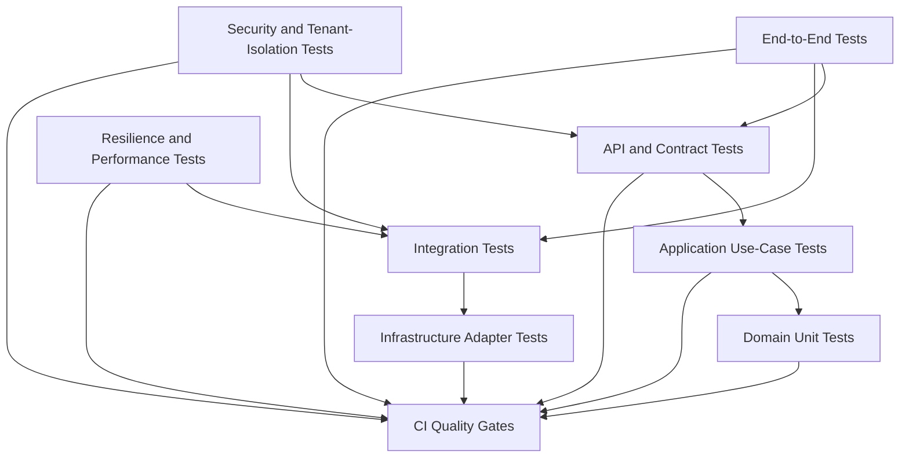
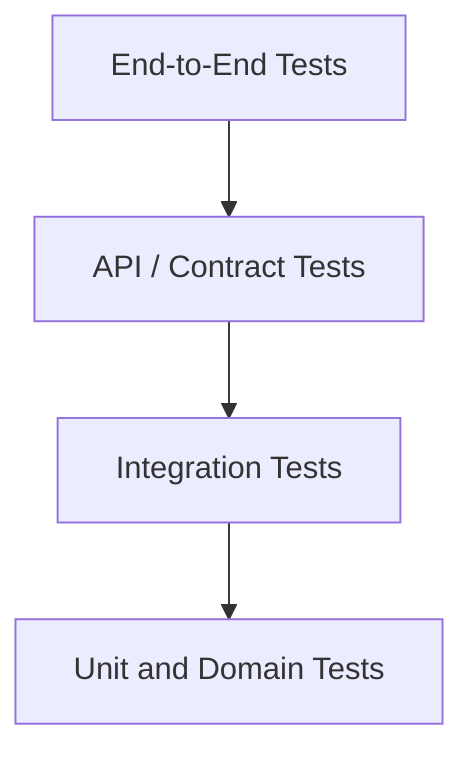
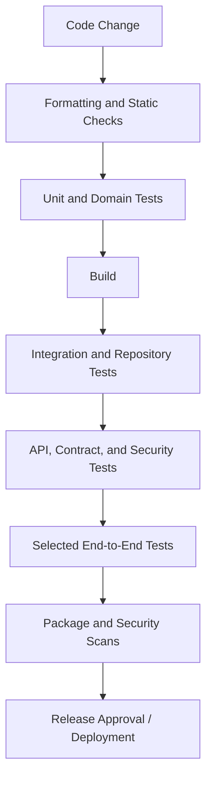

# Layer 9 — Testing Architecture and Quality Strategy

## 9.1 Purpose of This Layer

Testing is an architectural capability, not merely a final development activity.

Our Composable Business Platform includes:

- Client applications.
- API Gateway and backend APIs.
- Application services and domain logic.
- Databases and persistence adapters.
- Commerce and FinFlow services.
- Synchronous service communication.
- Potential asynchronous workflows.
- Authentication, authorisation, and tenant isolation.
- Audit and observability capabilities.

A defect in any one of these areas can affect other parts of the system.

For example, a Commerce API might return HTTP 200 successfully while creating an order with an incorrect state. A repository query might return data successfully while exposing another tenant's records. A simulated transfer might work in isolation but be duplicated when a network timeout causes a retry.

Therefore, our testing strategy must verify both individual components and complete business outcomes.

The objectives are to:

1. Test business rules independently of infrastructure.
2. Verify application use cases and transaction boundaries.
3. Verify API contracts and validation.
4. Test database queries, mappings, and constraints.
5. Verify communication between services.
6. Prevent cross-tenant access and privilege escalation.
7. Test retries, timeouts, duplicate requests, and partial failures.
8. Verify audit events and operational signals.
9. Automate quality checks in CI/CD.
10. Keep tests fast, reliable, maintainable, and useful during refactoring.

### Core principle

**Test business rules at the lowest practical level, test infrastructure at its integration boundary, and reserve end-to-end tests for the critical workflows that must work together.**

---

## 9.2 Testing Architecture Overview



This is a logical view of the test strategy, not a strict execution order. Different test suites may run at different stages of the pipeline.

The important distinction is that each test level has a clear purpose.

---

## 9.3 The Test Pyramid

The test pyramid describes a practical balance between test speed, isolation, and coverage.



Conceptually:

- Unit tests should generally be numerous and fast.
- Integration tests verify interactions with real infrastructure or framework components.
- API and contract tests verify externally visible behaviour and service boundaries.
- End-to-end tests verify a smaller number of critical business journeys.

The pyramid is a guideline, not a rule requiring exact test counts.

A system with many complex database interactions may need a substantial integration-test suite. The goal is not to minimise integration tests artificially; it is to avoid testing every small business rule through the slowest possible test path.

### Why not use only end-to-end tests?

Suppose an order-creation test fails because the final order is missing.

The cause might be:

- Invalid request mapping.
- Failed domain validation.
- Incorrect transaction handling.
- Repository mapping errors.
- Database constraints.
- FinFlow timeout handling.
- Incorrect workflow state transitions.

A single end-to-end failure may not reveal which component is responsible.

Smaller tests make failures easier to diagnose.

### Why not use only unit tests?

A domain unit test can prove that an order rejects an invalid state transition.

It cannot prove that:

- Spring maps the endpoint correctly.
- The database schema matches the entity mapping.
- A transaction commits as intended.
- A security filter rejects an invalid token.
- A downstream service receives the correct request.
- Tenant-scoped queries execute correctly.

Different test levels verify different properties.

---

## 9.4 Unit Tests — Test Business Rules in Isolation

Unit tests verify small units of behaviour without depending on external infrastructure.

For this platform, useful targets include:

- Order domain behaviour.
- Transfer validation rules.
- State transitions.
- Permission-policy decisions.
- Monetary calculations.
- Idempotency decision logic.
- Retry-policy decisions.
- Mapping and validation helpers where meaningful.

### Example: Order state transitions

Assume an order has these simplified states:

```text
CREATED
   |
   v
PAYMENT_PENDING
   |
   +----> CONFIRMED
   |
   +----> PAYMENT_FAILED
```

The domain should reject invalid transitions according to the actual business state machine.

Illustrative Java:

```java
public enum OrderStatus {
    CREATED,
    PAYMENT_PENDING,
    CONFIRMED,
    PAYMENT_FAILED
}
```

```java
public final class Order {

    private final String id;
    private OrderStatus status;

    public Order(String id) {
        this.id = id;
        this.status = OrderStatus.CREATED;
    }

    public void markPaymentPending() {
        if (status != OrderStatus.CREATED) {
            throw new IllegalStateException(
                "Order must be CREATED before payment processing"
            );
        }

        status = OrderStatus.PAYMENT_PENDING;
    }

    public void confirm() {
        if (status != OrderStatus.PAYMENT_PENDING) {
            throw new IllegalStateException(
                "Only a payment-pending order can be confirmed"
            );
        }

        status = OrderStatus.CONFIRMED;
    }

    public OrderStatus getStatus() {
        return status;
    }
}
```

This is a simplified teaching example. A production domain model may use specific domain exceptions and additional invariants.

### Example unit test

```java
import static org.junit.jupiter.api.Assertions.assertEquals;
import static org.junit.jupiter.api.Assertions.assertThrows;

import org.junit.jupiter.api.Test;

class OrderTest {

    @Test
    void shouldConfirmOrderAfterPaymentIsPending() {
        Order order = new Order("order-101");

        order.markPaymentPending();
        order.confirm();

        assertEquals(
            OrderStatus.CONFIRMED,
            order.getStatus()
        );
    }

    @Test
    void shouldRejectConfirmationBeforePaymentIsPending() {
        Order order = new Order("order-101");

        assertThrows(
            IllegalStateException.class,
            order::confirm
        );
    }
}
```

### What makes this a good unit test?

- It tests business behaviour directly.
- It does not start a Spring application.
- It does not need a database.
- It does not call FinFlow.
- It runs quickly.
- It identifies the violated business rule clearly.

### Unit-testing rules

- Test observable behaviour rather than private implementation details.
- Cover valid operations and invalid transitions.
- Test boundary values.
- Use descriptive test names.
- Avoid unnecessary mocking of simple domain objects.
- Keep each test focused on a meaningful behaviour.

Do not create tests that merely repeat the implementation line by line without verifying a useful outcome.

---

## 9.5 Application-Service Tests — Test Use Cases and Orchestration

Application services coordinate business operations and infrastructure ports.

For example, an order-creation use case might:

1. Validate the caller's permission.
2. Validate organisation context.
3. Create an order.
4. Persist the order.
5. Request payment simulation.
6. Record the resulting state.
7. Publish or schedule further processing according to the workflow design.

An application-service test verifies this orchestration.

### Example scenario

Given:

- A valid request.
- An authorised user.
- An order belonging to the active organisation.
- A successful simulated-payment response.

When the use case executes, verify that:

- The order is created.
- The correct tenant context is used.
- The expected downstream operation is requested.
- The correct business state is persisted.
- The returned result reflects the defined workflow contract.

### Mock external boundaries, not every object

For a unit-level application test, it can be appropriate to mock:

- Repository interfaces.
- External service clients.
- Message-publishing ports.
- Clock or identifier-generation abstractions where deterministic behaviour is required.

Prefer real domain objects and meaningful application behaviour.

Avoid mocking every method call of every internal class. Excessive mocking couples tests to implementation details and can allow incorrect business behaviour to pass.

### Failure scenarios

Test what happens when:

- Persistence fails.
- FinFlow rejects the simulation.
- FinFlow times out.
- Authorisation fails.
- Tenant context is missing.
- A duplicate request is received.
- A downstream response is malformed or unavailable.

The expected result depends on the documented workflow and transaction boundaries.

For example, a timeout must not automatically be treated as proof that the downstream operation failed.

---

## 9.6 Repository and Database Integration Tests

Repository tests verify the behaviour of persistence adapters against a real database engine or a suitably representative database environment.

These tests are important because mocked repositories cannot verify actual SQL, mappings, constraints, indexes, or transaction behaviour.

### What to test

- Entity-to-table mappings.
- Repository query methods.
- Tenant-scoped reads and writes.
- Unique constraints.
- Foreign-key constraints.
- Nullability and column constraints.
- Pagination and sorting.
- Transaction behaviour.
- Locking and concurrency where required.
- Migration scripts.
- Database-specific query behaviour.

### Example tenant-scoped query

Suppose the repository exposes:

```java
Optional<Order> findByIdAndTenantId(
    String orderId,
    String tenantId
);
```

The integration test should create:

```text
org-A -> order-101
org-B -> order-202
```

Then verify:

```text
findByIdAndTenantId("order-101", "org-A")
    -> returns order-101

findByIdAndTenantId("order-202", "org-A")
    -> returns no accessible order

findByIdAndTenantId("order-202", "org-B")
    -> returns order-202
```

This verifies that the actual persistence implementation respects the tenant boundary.

### Database choice for tests

Prefer a database engine compatible with the production database when behaviour depends on database-specific features.

An in-memory database can be useful for simple tests, but it may behave differently from the production database in areas such as:

- SQL dialect.
- Locking.
- Constraint enforcement.
- Isolation levels.
- JSON support.
- Index behaviour.
- Migration compatibility.

A containerised database can be useful when the team needs realistic integration testing and the CI environment supports it.

Choose the simplest setup that provides sufficient fidelity.

### Important distinction

A mocked repository can verify that a service called a repository method.

It cannot prove that the SQL behind that method correctly filters by tenant.

---

## 9.7 API Tests — Verify the External Contract

API tests verify the behaviour visible to clients.

For the Commerce order-creation endpoint:

```http
POST /api/v1/orders
Content-Type: application/json
Authorization: Bearer <access-token>
Idempotency-Key: order-request-123
```

The test suite should verify:

- Correct HTTP method and route.
- Request-body validation.
- Authentication requirements.
- Authorisation rules.
- Tenant context.
- HTTP status codes.
- Response-body structure.
- Error-response structure.
- Required headers.
- Idempotency behaviour.
- Sensitive-field filtering.
- API version compatibility.

### Example test matrix

| Scenario | Expected behaviour |
|---|---|
| Valid request and authorised user | Return the documented success response. |
| Malformed JSON | Reject the request. |
| Missing required field | Return a validation error. |
| Missing authentication | Reject the protected operation. |
| Insufficient permission | Deny the operation. |
| Invalid organisation context | Reject access. |
| Invalid business state | Return the documented business error. |
| Repeated idempotent request | Follow the documented idempotency contract. |
| Downstream timeout | Follow the documented workflow and error contract. |
| Internal exception | Return a safe error response without stack-trace disclosure. |

Use the status codes defined by the API contract rather than assuming every application uses exactly the same mapping.

### Contract-first principle

Clients should depend on a stable API contract, not on internal Java classes or database entities.

API tests should verify the published request and response structure.

Avoid returning persistence entities directly. DTOs allow the API to evolve without exposing internal storage details.

---

## 9.8 Contract Tests — Protect Service Boundaries

Contract tests verify that two components agree on the shape and meaning of their communication.

For example:

- Commerce expects FinFlow to accept a payment-simulation request.
- FinFlow expects a particular request structure and authentication context.
- Commerce expects a documented response or error contract.

A contract test helps detect incompatible changes before they reach an integrated environment.

### Example contract

```json
{
  "request": {
    "orderId": "order-101",
    "organisationId": "org-A",
    "amount": 100.00,
    "currency": "GBP"
  },
  "response": {
    "simulationId": "simulation-501",
    "status": "APPROVED"
  }
}
```

This is an illustrative contract, not a final API schema.

The actual contract should define:

- Required and optional fields.
- Data types and formats.
- Validation rules.
- Authentication expectations.
- Success responses.
- Error responses.
- Timeout expectations.
- Versioning and compatibility rules.
- Idempotency requirements, if applicable.

### Consumer-driven contracts

In a consumer-driven approach, a consumer documents the interactions it relies on, and the provider verifies that its implementation satisfies those expectations.

This can be useful when services evolve independently.

### Contract tests do not replace integration tests

A contract test can prove that the response matches an expected schema.

It does not necessarily prove that:

- The database transaction is correct.
- The downstream business rule is correct.
- The whole workflow succeeds.
- The production deployment is configured properly.

Use contract tests alongside the other test levels.

---

## 9.9 Security and Tenant-Isolation Tests

Security testing must include negative cases.

A test suite that proves authorised users can access their own resources is incomplete if it never checks unauthorised access.

### Essential scenarios

1. Missing access token.
2. Invalid or expired token.
3. Wrong token audience.
4. Missing permission.
5. User from one tenant accessing another tenant's record.
6. User modifying a resource belonging to another tenant.
7. User supplying a forged organisation identifier.
8. Service identity calling a forbidden operation.
9. Sensitive fields appearing in API responses.
10. Secrets appearing in logs.
11. Missing tenant context.
12. Privileged operation performed by an unprivileged user.

### Cross-tenant mutation example

Create:

```text
org-A -> order-101
org-B -> order-202
```

Authenticate a user who is authorised only for `org-A`.

Attempt:

```http
DELETE /api/v1/orders/order-202
```

The test must verify that:

- The protected order is not deleted.
- No unauthorised state change occurs.
- The response follows the documented disclosure policy.
- The attempt is logged or audited when required.
- The failure does not reveal sensitive information about `org-B`.

Repeat the test for reads, updates, cancellation, exports, and bulk operations.

### Why integration-level security tests matter

Unit tests can verify policy decisions, but integration tests can verify that the real authentication configuration, application flow, and repository queries work together.

---

## 9.10 Resilience Tests — Timeouts, Retries, and Partial Failures

Distributed systems fail in ways that are difficult to reproduce with happy-path tests alone.

The platform should test important failure modes deliberately.

### Scenario A — FinFlow responds successfully

Expected:

- Commerce receives the response.
- The workflow follows its success path.
- The resulting business state is correct.
- Relevant telemetry is emitted.

### Scenario B — FinFlow rejects the request

Expected:

- The documented business or technical rejection is handled correctly.
- The workflow enters the appropriate state.
- No invalid state transition occurs.
- The failure is observable.

### Scenario C — FinFlow times out

Expected:

- The configured timeout is applied.
- The application does not wait indefinitely.
- The workflow follows its defined timeout policy.
- The system does not blindly assume that no downstream state change occurred.
- Safe retry or reconciliation behaviour is followed.

### Scenario D — FinFlow succeeds but Commerce loses the response

Expected:

- A retry does not create an unintended duplicate operation.
- The system uses the documented idempotency or recovery contract.
- The final business state can be established.

### Scenario E — Database becomes unavailable

Expected:

- Errors are handled safely.
- Transactions do not produce unintended partial state.
- Connections and resources are released appropriately.
- Monitoring detects the failure.
- Recovery does not require uncontrolled manual data changes.

### Scenario F — Event is delivered more than once

If asynchronous messaging is used, verify that duplicate delivery does not cause unintended repeated business effects.

### Testing approaches

Depending on the infrastructure, use:

- Controlled fake downstream responses.
- Mock servers at service boundaries.
- Containerised integration environments.
- Test-specific network fault injection.
- Database failure simulation.
- Load and soak tests.
- Controlled duplicate-message delivery.

Do not introduce a complex chaos-testing platform before the project needs it.

---

## 9.11 End-to-End Tests — Verify Critical Business Journeys

End-to-end tests verify that the major components work together.

For this platform, useful journeys include:

### Commerce journey

```text
Create order
    |
    v
Validate request and identity
    |
    v
Check organisation access
    |
    v
Persist order/workflow state
    |
    v
Request payment simulation
    |
    v
Apply result
    |
    v
Retrieve order
```

The precise sequence depends on whether the selected workflow is synchronous, asynchronous, or a combination.

### FinFlow journey

```text
Create simulated account
    |
    v
Verify account access
    |
    v
Initiate simulated transfer
    |
    v
Validate business rules
    |
    v
Record the resulting state
    |
    v
Retrieve transaction history
```

### Tenant-isolation journey

```text
Create data for org-A
    |
    v
Create data for org-B
    |
    v
Authenticate user from org-A
    |
    v
Attempt to access org-B data
    |
    v
Verify access is denied
    |
    v
Verify org-B data remains unchanged
```

### End-to-end testing guidelines

- Cover a small set of critical journeys.
- Use isolated test data.
- Avoid dependence on production data.
- Verify externally visible outcomes.
- Clean up test resources where appropriate.
- Make tests deterministic where possible.
- Use bounded waits rather than arbitrary long sleeps.
- Avoid coupling tests to internal implementation details.
- Capture correlation IDs and diagnostic information on failure.

A failing end-to-end test should provide enough context to investigate the problem efficiently.

---

## 9.12 Test Data and Environment Strategy

Test quality depends on reliable test data.

### Test data principles

- Each test should know which data it owns.
- Tests should not depend on another test running first.
- Tenant identifiers and resource identifiers should be controlled.
- Sensitive production data should not be copied into ordinary test environments without an approved protection strategy.
- Tests should create the minimum data required.
- Data cleanup should be reliable.
- Concurrent tests should not accidentally modify the same records.

### Example

Instead of relying on a shared order created manually by an engineer, a test should create its own order and record its identifier.

This makes the test repeatable and easier to run locally or in CI.

### Test environment categories

| Environment | Main purpose |
|---|---|
| Local development | Fast feedback during implementation |
| Automated test environment | Repeatable unit, API, and integration testing |
| Shared integration environment | Validate interactions among deployed services |
| Staging or pre-production | Validate release configuration and critical workflows |
| Production | Real operation with controlled smoke checks and monitoring |

The exact environment structure depends on the deployment model and team size.

### Avoid environment drift

Configuration, migrations, authentication settings, and service contracts should be managed consistently.

A test that passes only because a developer's machine has an undocumented configuration is not reliable evidence.

---

## 9.13 CI/CD Quality Gates

Tests become much more useful when they run consistently as part of delivery.

A possible pipeline is:



The exact ordering may vary. For example, source and dependency security scans can run earlier or in parallel.

### Suggested quality gates

**Code quality**

- Compilation succeeds.
- Formatting and static checks pass.
- No prohibited dependency or architecture violations are introduced.

**Unit tests**

- Domain and application tests pass.
- Important business-rule regressions are covered.

**Integration tests**

- Repository and transaction behaviour is verified.
- Required migrations execute successfully.

**API and contract tests**

- Request and response contracts remain compatible.
- Error handling and security rules are verified.

**Security checks**

- Dependency and code scans run according to policy.
- Secrets are not committed.
- Critical tenant-isolation tests pass.

**Release readiness**

- Required end-to-end tests pass.
- Configuration and migration checks succeed.
- Deployment and rollback procedures are defined.
- Observability and recovery expectations are satisfied.

### Test failures must be meaningful

Do not automatically retry a failing test indefinitely until it passes.

Investigate flaky tests, unstable environments, and nondeterministic dependencies. A retry can help diagnose a transient issue, but it should not hide an unreliable quality gate.

### Coverage metrics

Code coverage can help identify untested areas, but it is not proof of correctness.

A test suite can achieve high line coverage while failing to verify critical business outcomes.

Prioritise meaningful behavioural assertions and risk-based coverage over a single percentage.

---

## 9.14 Performance and Capacity Testing

Functional correctness does not prove that a service can handle expected traffic.

Performance tests should reflect realistic workload patterns.

### Important measurements

- Throughput.
- p50, p95, and p99 latency.
- Error ratio.
- CPU and memory use.
- Database connection utilisation.
- Database query latency.
- Downstream request latency.
- Queue processing rate, where applicable.
- Resource usage over extended runs.

### Types of performance tests

**Load testing**

Checks behaviour under an expected workload.

**Stress testing**

Explores behaviour beyond expected capacity and helps identify limits.

**Spike testing**

Checks how the system responds to sudden changes in traffic.

**Soak testing**

Checks for issues that emerge over a longer period, such as memory leaks or resource exhaustion.

### Important principle

Performance targets must be defined from expected user behaviour, deployment capacity, and business requirements.

Do not invent a throughput target merely to make a dashboard or test report look complete.

---

## 9.15 Test Architecture and Maintainability

Tests are software and must be maintained deliberately.

### Recommended practices

- Use descriptive test names.
- Keep test fixtures readable.
- Separate test configuration from production configuration.
- Prefer deterministic clocks and identifiers where time or randomness affects behaviour.
- Keep test data builders simple.
- Avoid broad shared mutable state.
- Keep tests independent.
- Use mocks at genuine external boundaries.
- Verify outcomes rather than private implementation details.
- Reuse a small number of clear test helpers.

### Example naming

```java
@Test
void shouldRejectOrderAccessWhenTenantDoesNotMatch() {
    // Arrange
    // Act
    // Assert
}
```

The name states the business condition and expected behaviour.

Avoid names such as:

```java
@Test
void test1() {
}
```

### Avoid overengineering the test framework

A shared test utility is useful when it removes meaningful duplication.

A large test framework with many layers of custom builders, generic factories, and hidden setup can make simple tests difficult to understand.

Start with readable tests and extract helpers when repetition becomes a real maintenance problem.

---

## 9.16 Testing Decision Guide

| Requirement | Primary test level |
|---|---|
| Order state transition | Domain unit test |
| Transfer amount validation | Domain unit test |
| Application use-case orchestration | Application-service test |
| Permission decision | Unit test plus relevant security integration test |
| Repository tenant predicate | Database integration test |
| Entity mapping | Database integration test |
| HTTP request validation | API test |
| Authentication filter | Security integration/API test |
| Commerce-to-FinFlow compatibility | Contract test |
| Timeout and retry behaviour | Application or service integration test |
| Duplicate message processing | Consumer integration test, if messaging is used |
| Full order journey | Selected end-to-end test |
| Cross-tenant access prevention | Security and database integration tests |
| Request latency under load | Performance test |
| Alert and recovery behaviour | Operational test |

A requirement can legitimately need more than one test level. The table identifies the most direct starting point, not an exclusive rule.

---

## 9.17 Common Testing Mistakes to Avoid

1. Testing only the happy path.
2. Mocking the database in every test.
3. Relying exclusively on slow end-to-end tests.
4. Using only unit tests and never verifying infrastructure behaviour.
5. Testing that a method was called without checking the business outcome.
6. Allowing tests to depend on execution order.
7. Using production data without an approved protection strategy.
8. Ignoring tenant-isolation regressions.
9. Assuming a timeout means a downstream operation did not complete.
10. Testing retries without checking for duplicate business effects.
11. Ignoring database migrations.
12. Treating code coverage as proof of quality.
13. Retrying flaky tests until the pipeline passes.
14. Making assertions against internal implementation details.
15. Writing brittle tests that fail whenever harmless refactoring occurs.
16. Ignoring audit and telemetry behaviour.
17. Running performance tests with unrealistic data or workloads.
18. Introducing complicated test infrastructure before it provides clear value.
19. Omitting tests for background jobs and asynchronous consumers.
20. Treating passing tests as a substitute for operational monitoring.

---

## 9.18 Interview Questions and Follow-Ups

### Q1. What is the test pyramid?

**Answer:** It is a guideline for balancing many fast, focused tests with fewer broader integration and end-to-end tests.

**Follow-up:** Must every project have an exact pyramid shape?

No. The principle is to use each test level where it provides the most useful evidence at a reasonable cost.

### Q2. What is the difference between a unit test and an integration test?

**Answer:** A unit test verifies a small unit of behaviour in isolation. An integration test verifies that components work together, such as an application service and a real database.

### Q3. Why are mocked repository tests insufficient?

**Answer:** They can verify interactions but cannot prove that actual SQL, mappings, constraints, or tenant predicates work correctly.

### Q4. What is a contract test?

**Answer:** A contract test verifies that communicating components agree on their request, response, and compatibility expectations.

**Follow-up:** Does a passing contract test prove the entire workflow is correct?

No. It does not replace domain, integration, resilience, or end-to-end testing.

### Q5. How would you test tenant isolation?

**Answer:** Create records for multiple tenants, authenticate users with different memberships, and attempt cross-tenant reads and writes. Verify that protected data is not returned or modified.

### Q6. How would you test a downstream timeout?

**Answer:** Simulate the timeout, verify the configured timeout and documented workflow behaviour, and confirm that recovery does not create duplicate or inconsistent operations.

### Q7. What is the difference between code coverage and test quality?

**Answer:** Coverage measures which code was exercised. Test quality depends on whether meaningful behaviours, outcomes, and failure conditions are correctly verified.

### Q8. How would you test idempotency?

**Answer:** Submit the same operation repeatedly using the documented idempotency key, then verify the expected response and that no unintended duplicate business effect occurs.

Also test relevant differences in tenant, operation, and request payload according to the idempotency contract.

### Q9. Why test database migrations?

**Answer:** Application code can be correct while a migration fails, creates an incompatible schema, or breaks existing data. Migration tests verify that the schema evolves as expected.

### Q10. How should tests be organised in CI/CD?

**Answer:** Run fast feedback checks early, followed by the required integration, contract, security, and selected end-to-end tests. Apply release gates according to risk and investigate flaky tests rather than hiding them.

### Q11. What should be tested when an event is delivered twice?

**Answer:** Verify duplicate handling and ensure the consumer does not repeat unintended business effects. Also verify that failures and retries are observable.

### Q12. How would you choose which end-to-end tests to keep?

**Answer:** Prioritise the critical business journeys, high-risk integration points, and scenarios whose correctness depends on several components working together.

---

## 9.19 Final Architecture Summary

Layer 9 defines a repeatable strategy for proving that the platform behaves correctly.

The platform should have:

- Fast domain and application unit tests.
- Repository and database integration tests.
- API and contract tests.
- Authentication, authorisation, and tenant-isolation tests.
- Resilience tests for timeouts, retries, and partial failures.
- Selected end-to-end business workflow tests.
- Controlled test data and reproducible environments.
- CI/CD quality gates.
- Performance tests aligned with defined requirements.
- Tests for audit, logging, and operational behaviour.

The central principle is:

**Test each risk at the lowest practical level, then use integration and end-to-end tests to verify the boundaries and workflows that unit tests cannot prove.**

The objective is not to maximise the number of tests. It is to establish trustworthy evidence that the system is correct, secure, resilient, and maintainable.

---

## Next Section — Layer 10: Deployment Architecture, CI/CD, Configuration, and Release Strategy

Layer 10 will cover:

- Build artefacts and deployment units.
- Environment separation.
- Configuration and secret injection.
- Containerisation where appropriate.
- CI/CD pipeline stages.
- Database migration and release ordering.
- Health checks and rollout verification.
- Backward-compatible changes.
- Rollback and recovery planning.
- Environment-specific configuration.
- Deployment security and operational readiness.
