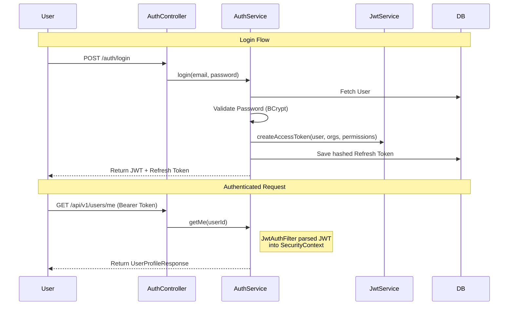

# FinFlow Identity Service Overview

The Identity Service is a core Spring Boot 3 microservice in the FinFlow ecosystem responsible for managing user identities, authentication, and organizational multi-tenancy.

## Architecture

The service follows a stateless architecture where identity is verified via JWTs. It acts as the "who you are" authority, while other services rely on the embedded claims in the JWT for authorization.

- **Stack**: Java 21, Spring Boot 3, Spring Security, JPA (Hibernate), MySQL, JJWT.
- **Stateless Auth**: Every request carries an access JWT. Server-side sessions are disabled.
- **RBAC**: Multi-tenancy is handled via `Membership` (User ↔ Org) with roles mapped to permissions.

## Authentication & Authorization Flow

## Security & RBAC

### Permissions (Roles)
Permissions are derived from `OrgRole` and embedded into the JWT claims.

| Role | Permissions |
| :--- | :--- |
| **ORG_ADMIN** | `org:manage`, `members:manage`, `wallets:read`, `wallets:write`, `transfers:create` |
| **FINANCE_OPERATOR** | `wallets:read`, `wallets:write`, `transfers:create` |
| **MEMBER** | `wallets:read` |

### Security Safeguards
- **Anti-Enumeration**: Authentication endpoints return identical error messages for invalid emails/passwords.
- **Soft-Guard**: Organizations cannot demote/remove the last `ORG_ADMIN`.
- **Token Security**: Raw refresh/reset tokens are never persisted; only SHA-256 hashes are stored.

## Error Handling
The service uses a global `ApiException` and `GlobalExceptionHandler` to maintain consistent JSON error responses across the entire API:
- `ApiException`: Captures business failures (conflict, unauthorized, forbidden, not found).
- `GlobalExceptionHandler`: Centralizes translation of exceptions into stable JSON bodies: `{ "code", "message", "details" }`.

## API Documentation

### Auth Endpoints
- `POST /api/v1/auth/register`: Create user account.
- `POST /api/v1/auth/login`: Issue access/refresh tokens.
- `POST /api/v1/auth/refresh`: Rotate refresh token and issue new access JWT.
- `POST /api/v1/auth/logout`: Invalidate refresh token.

### Organization Endpoints
- `POST /api/v1/orgs`: Create new organization (caller becomes Admin).
- `GET /api/v1/orgs`: List user's active organizations.
- `GET /api/v1/orgs/{orgId}`: Retrieve specific organization details.
- `POST /api/v1/orgs/{orgId}/members`: Invite/Add member (Admin role required).
- `PUT /api/v1/orgs/{orgId}/members/{userId}/role`: Update member role (Admin role required).
- `DELETE /api/v1/orgs/{orgId}/members/{userId}`: Remove member (Admin role required).
