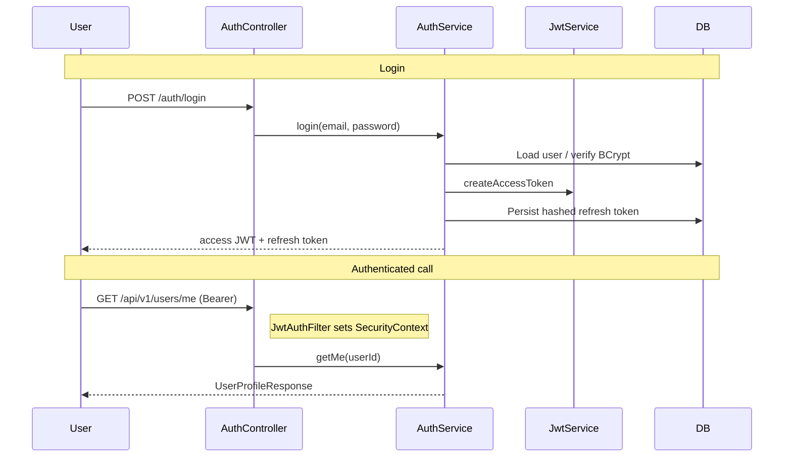

# Identity service

Single service doc for FinFlow identity (API review, security behaviour, signing-key setup). Stack: Java 21, Spring Boot 3.5.6, Security, JPA/MySQL, Redis rate limits, JJWT RS256. Auth is JWT-based (no server sessions); organisation permissions come from `Membership` roles embedded in access-token claims.



| Role | Permissions in JWT (union across active memberships) |
|---|---|
| ORG_ADMIN | `org:manage`, `members:manage`, `wallets:read`, `wallets:write`, `transfers:create`, `commerce:read`, `commerce:write` |
| FINANCE_OPERATOR | `wallets:read`, `wallets:write`, `transfers:create`, `commerce:read`, `commerce:write` |
| MEMBER | `wallets:read`, `wallets:write`, `commerce:read`, `commerce:write` |

Reviewed 2026-11-07 starting at HEAD d878dd7 plus the existing working tree; final Git HEAD is d499559 after an external gateway commit. The API inventory is a source-based review; the first security-response improvement below is now implemented. This does not establish production readiness. Gateway work is preserved. No endpoints have been removed or renamed.

## Security folder: where to find each responsibility

The classes remain separate and are grouped by purpose:

```text
security/
  SecurityConfig.java                 Public/protected paths and filter-chain wiring
  authentication/
    AuthenticatedUser.java            Identity of the current caller
    JwtAuthFilter.java                Read/validate bearer JWT and set the caller
  jwt/
    JwtService.java                   Issue/verify access JWTs and publish JWKS
    SigningKeyStore.java              Load the persistent signing key
  ratelimit/
    RateLimitFilter.java              Apply limits to selected auth endpoints
    RateLimitService.java             Check the Redis request counter
  token/
    TokenCrypto.java                  Generate/hash opaque refresh/reset/verify/invite tokens
```

Read SecurityConfig first, then follow the responsibility you need. For login, AuthService uses jwt/JwtService and token/TokenCrypto. For an authenticated request, authentication/JwtAuthFilter uses JwtService and builds AuthenticatedUser. Rate-limit filter/service stay together; SigningKeyStore stays package-private beside JwtService. Tests mirror the grouping: security/jwt/JwtServiceTest covers key/token behavior; security/SecurityHttpTest covers the complete security/MVC flow. Package moves changed imports only, without changing endpoint or security behavior.

## What the service does

Identity owns accounts, email verification, passwords, access/refresh tokens, organisations, memberships and identity audit records. Three controllers expose **20 application operations**, excluding Actuator. These are distinct flows, not 20 duplicate login APIs.

Account flow: register -> verify email -> login -> use access JWT -> refresh when needed -> logout revokes the supplied refresh token. Forgot/reset password is for a user who cannot log in; change password requires a logged-in user and the current password. Those flows should not be merged into one loosely validated operation.

Organisation flow: create org -> creator becomes ORG_ADMIN -> login/refresh loads membership permissions -> invite an existing account -> that account accepts -> login/refresh obtains updated claims. Wallet and commerce depend on these permissions. A new account with no memberships currently receives no wallet/commerce permissions. Removing organisation onboarding requires a separately designed permission/onboarding replacement.

## Endpoint inventory and recommendation

Paths below have `/api/v1` prefix unless shown otherwise. Successful status is from controller declarations/default behavior; it is not newly executed HTTP evidence.

| Method and path | Current purpose / successful status | Recommendation |
|---|---|---|
| POST /auth/register | Create account and verification token; 201 | Keep for self-service signup |
| POST /auth/verify-email | Consume verification token; 204 | Keep while verified email is required for login |
| POST /auth/resend-verification | Recover lost/expired verification link; 200 | Keep; do not strand unverified accounts |
| POST /auth/login | Issue access JWT + refresh token; 200 | Keep |
| POST /auth/refresh | Revoke supplied refresh token, issue replacement tokens; 200 | Keep with current short-lived access-token design |
| POST /auth/logout | Revoke supplied refresh token; 204 | Keep; does not immediately revoke access JWTs |
| POST /auth/forgot-password | Start recovery; generic message plus local dev token; 200 | Keep for password accounts; harden delivery/response |
| POST /auth/reset-password | Consume reset token, change password, revoke refresh tokens; 204 | Keep separately from authenticated password change |
| POST /auth/change-password | Check current password, change it, revoke refresh tokens; 204 | Keep |
| GET /users/me | Read database-backed profile/memberships; 200 | Keep; move to a UserController without changing path if readability warrants it |
| GET /.well-known/jwks.json (no /api/v1 prefix) | Publish public signing keys; 200 | Keep exact path: gateway and other services consume it |
| POST /orgs | Create organisation and admin membership; 201 | Keep for current onboarding/permissions |
| GET /orgs | List caller's active organisations; 200 | Keep for current organisation selection |
| GET /orgs/{orgId} | Read one accessible organisation; 200 | Useful detail operation; no demonstrated need to delete |
| POST /orgs/{orgId}/invites | Invite an existing account; 201 | Keep if multi-user organisations remain in scope |
| POST /orgs/invites/accept | Accept email-matched invitation; 200 | Keep together with invite creation |
| GET /orgs/{orgId}/members | List active/invited members; 200 | Keep for membership management |
| PUT /orgs/{orgId}/members/{userId}/role | Replace member role with last-admin guard; 200 | Keep for membership management; valid role-subresource convention |
| DELETE /orgs/{orgId}/members/{userId} | Remove membership with last-admin guard; 204 | Keep so access can be withdrawn |
| GET /orgs/{orgId}/audit | Admin-only organisation audit read; 200 | Optional client API; candidate to defer/remove after confirming no client need. Preserve internal audit recording |

Mandatory is a product decision. This review found no proven duplicate API. Absence of a server-side caller does not prove an endpoint has no external client. For an initial learning path, show account onboarding and org creation first in Postman; put membership administration and audit in separate folders. That simplifies daily use without deleting capabilities.

## Cleanup and design concepts used in this service

The [interview question bank](../docs/Java%20Backend%20Interview%20Master%20Question%20Bank%20%E2%80%94%205%20YOE%20_%2025%E2%80%9330%2B%20LPA.md) is a study reference, not a requirement to add every technology it mentions. The cleanup uses the concepts that match the actual problem:

| Concept | Where it appears | Purpose |
|---|---|---|
| Single responsibility | Controllers, services, repositories, JWT/key store, mail stub | HTTP, workflows, persistence and cryptography can be understood separately. |
| Constructor injection / composition | AuthService and OrgService | Dependencies are explicit. Services compose existing collaborators instead of inheriting a generic base service. |
| Repository abstraction | Eight Spring Data interfaces | Query details stay separate from use cases; no actively used repository was dropped. |
| DTO records and a small mapper | OrgResponse and private toOrgResponse | Preserve the API contract without duplicating response construction or exposing entities. |
| Batch fetch + HashMap | OrgService.listMine/listMembers | Load related rows together, then match IDs with direct lookups instead of per-row repository calls. |
| List ordering | Membership list drives output | findAllById does not promise input order; active members remain before invited members. |
| Database count | countByOrgIdAndStatusAndRole | Count admins without materialising every member. The concurrent last-admin race still requires a separate fix. |
| Read-only transactions | Organisation read methods | Keep related reads inside an existing service transaction. This is not a guarantee of production concurrency correctness. |
| LinkedHashSet | JWT permission collection | Remove duplicates while retaining encounter order. Flat permissions remain a union across memberships. |
| Locale.ROOT | Account/invitation email normalization | Server locale must not change the interpretation of email identifiers. |
| Token-safe mail | MailService.send | SMTP when enabled; otherwise skip send. Never log token-bearing bodies. |

SOLID is guidance about responsibilities and dependencies, not a reason to create an interface, factory or strategy for every class. This pass adds no application class, generic manager, inheritance hierarchy, cache, parallel stream, messaging integration or new dependency. Token repositories/entities and login/register DTOs stay separate because their workflows and persistence contracts are distinct. API paths, response fields, schema and role permissions were preserved.

The batch lookups are an intended query-count improvement; live SQL counts/latency were not measured. Two membership queries remain deliberately separate in listMembers to preserve ACTIVE-before-INVITED grouping. Missing organisation/user references still produce existing not-found errors, and access is checked before loading other users.

**Verification for this cleanup:** main sources compile with Java21 `mvn -B -o '-Dmaven.test.skip=true' compile`. Tests were not executed or test-compiled because the user requires confirmation. New pending regression cases cover batch ordering, missing references, access checks, database count use, locale normalization and mail log privacy. Earlier test results are historical; this cleanup has not passed a test run yet.

Suggested test scope after confirmation: OrgServiceQueryTest, OrgServiceTest, AuthServiceTest and MailServiceTest. Real email delivery, atomic token consumption/last-admin protection, pagination, migrations and production deployment remain separate tasks.

## API conventions to apply

- Keep versioned `/api/v1` paths, lowercase names, plural resource collections and current JWKS path. `/orgs` is internally consistent; renaming it solely to expand the abbreviation adds contract churn.
- GET reads; POST executes account/token transitions or creates resources; PUT of `/role` replaces that role subresource; DELETE removes membership. Auth action names are understandable. A noun-only URL rewrite is not a prerequisite for production readiness.
- Keep explicit 201 for creation, 204 for success without a body, and 200 for returned representations. Add Location on creation where the API has a corresponding stable readable resource. Do not invent GET /users/{id} just to add Location to registration. HTTP semantics: [RFC 9110](https://www.rfc-editor.org/rfc/rfc9110.html).
- Standardise controller and security-filter error contracts: validation 400, missing/invalid credentials 401 with the appropriate Bearer challenge, permission denial 403, missing resource 404, conflicts 409 and throttling 429. Decide any existence-hiding policy explicitly. Current controller advice cannot handle exceptions that occur before the controller.
- Bound/page growing member/audit lists; design the response contract before replacing existing array responses. Keep login/recovery errors generic where needed to avoid account enumeration. Keep secrets out of logs, URLs and production responses.
- Preserve distinct request DTOs and validation for different credential flows. Do not replace them with one generic action/body endpoint or a new framework.

Security guidance: [OWASP Authentication](https://cheatsheetseries.owasp.org/cheatsheets/Authentication_Cheat_Sheet.html) and [OWASP REST Security](https://cheatsheetseries.owasp.org/cheatsheets/REST_Security_Cheat_Sheet.html). These support security controls; the endpoint keep/remove recommendations above are project judgments.

## Production gaps confirmed in source

1. **Restart persistence implemented:** JwtService loads a durable RSA private key via SigningKeyStore and derives a stable kid from its public key. See setup below. Rotation with overlapping keys, managed KMS/HSM storage and issuer/audience checks remain separate production work; consumer claim changes require agreement with gateway/wallet/commerce/notification.
2. Mail: default off (Postman gets tokens in JSON). For SMTP, copy `application-local.properties.example` → `application-local.properties`, fill host/user/password, start identity normally. Register → `token` is null → read mail (Ethereal mailbox or real inbox) → Verify Email. Never commit `application-local.properties`.
3. Logout/reset/change-password revoke refresh tokens, not existing access JWTs. Membership role/removal changes also leave previously issued claims usable until expiry. Define the required invalidation window rather than promise immediate revocation.
4. Permissions are unioned across active memberships; orgIds and permissions do not encode a separate role per organisation. Review tenant-specific authorization with consumers before claiming tenant isolation.
5. Rate limiting covers login/forgot/resend only; it trusts client X-Forwarded-For and uses separate Redis increment/expire commands with no explicit Redis-failure policy. Proxy trust, atomic expiry and broader abuse controls need a focused task.
6. **Addressed for filter-chain responses:** SecurityConfig now writes explicit JSON 401/403 and a Bearer challenge on protected unauthenticated requests, verified by SecurityHttpTest. JwtAuthFilter still clears invalid authentication and continues; optional invalid tokens do not block public endpoints. Controller/domain error codes remain unchanged. Broader expired-token, live infrastructure and gateway-to-identity cases still need verification.
7. Single-use refresh/reset/verification/invite consumption and last-admin protection need concurrency tests and atomicity review. Reinvites leave old token rows usable; acceptInvite accepts already-active memberships and reapplies the token's role.
8. Existing tests primarily call services. They do not prove controller validation, security filters, Redis behavior, live MySQL races or cross-service JWT operation. The review did not rerun packaging; the subsequent implementation verification reached packaging after all 37 tests passed, then failed with Windows reporting that the cloud file provider is not running. See PROJECT_STATUS.md.

## Implemented first improvement: direct-service security errors

SecurityConfig now uses the existing ObjectMapper to write a small shared `code`/`message` response for Spring Security failures. JwtAuthFilter, all 20 application endpoints, claims, schema and organisation behavior are unchanged. No new dependency was added.

A protected request without a usable JWT now returns HTTP 401, Content-Type application/json and `WWW-Authenticate: Bearer`:

```json
{"code":"UNAUTHORIZED","message":"Valid Bearer access token required"}
```

An authenticated request rejected by Spring Security returns HTTP 403 with `{"code":"FORBIDDEN","message":"Access denied"}` and no authentication challenge. Controller/domain errors keep their existing codes/messages; for example, an invalid verification token still returns INVALID_TOKEN and an inaccessible organisation still returns its existing FORBIDDEN response. This change does not override every possible error response or add token revocation.

SecurityHttpTest adds 24 MockMvc cases using the real Spring MVC/security/JWT components and H2-backed services. Only RateLimitService's external Redis quota decision is stubbed. A test-only controller throws AccessDeniedException to exercise the security handler, because current identity URL rules otherwise require authentication without a role-specific filter rule; an actual organisation non-member test separately covers domain authorization. The test-only route is not part of production code.

The Postman collection now has a **Security response checks** folder with two unauthenticated/malformed-token profile checks and a public JWKS check. Point `identityBaseUrl` directly at identity (default `http://localhost:18081`), restart identity with the new code and re-import the collection. A gateway may reject credentials before identity is reached. These checks need no user setup, but the Postman runner has not been executed for this change. Their scripts were syntax-checked.

Regenerate only identity, preserving all other collections and the shared environment:

```powershell
python postman/_gen_collections.py --identity-only
```


A subsequent controller-only readability pass could move /users/me into UserController without changing its route. Persistent keys are now implemented below; real mail and token concurrency remain separate security tasks. The optional audit-read removal requires a product/client decision first. Removing organisation functionality would be a larger cross-service redesign.

## Verification and next decision

This review traced the three controllers through AuthService/OrgService, JWT/role construction, mail, rate/security filters, advice, relevant DTOs, gateway routes and existing test declarations/Postman references. A static inventory check counted 20 controller mappings; documentation links/whitespace were checked. The original review executed no Maven/Postman/runtime tests. The subsequent implementation passed `mvn -B -o -DskipTests compile` and `mvn -B -o -Dtest=SecurityHttpTest test` under Java 21: 24 tests, zero failures/errors/skips. The initial sandboxed test attempt failed before test execution because Mockito could not initialize its temporary agent; the approved unsandboxed rerun passed. A subsequent `mvn -B -o verify` ran all 37 identity tests with zero failures/errors/skips, then failed in maven-jar-plugin with "The cloud file provider is not running". Packaging remains blocked; the test success is not a successful verify/build. Detailed results are recorded in PROJECT_STATUS.md. No live MySQL/Redis or cross-service HTTP verification is implied.

The approved first task retains multi-user organisations/memberships and existing paths. No removal was justified by duplicate behavior. Next recommended security task: real email delivery with production token secrecy. Planned signing-key rotation with overlap and issuer/audience trust validation remain separate production work. See [project status](../PROJECT_STATUS.md) and [service dependencies](../docs/SERVICE_DEPENDENCIES.md).

## Persistent signing keys (implemented 2026-11-07)

Previously a restart generated a new RSA key and kid, so previously issued access tokens stopped validating. Identity now loads the same private key on startup and derives its public key. The kid is base64url SHA-256 of the encoded public key (X.509 DER); it is a stable identifier, not a separate secret or a claim-format change. The public JWKS fields and RS256 claims remain compatible with existing consumers.

### Local development

No manual key-generation command is needed. Default properties are:

```properties
jwt.signing-key-path=${IDENTITY_SIGNING_KEY_PATH:.local/identity/signing-key.pk8}
jwt.generate-key-if-missing=${IDENTITY_GENERATE_KEY_IF_MISSING:true}
```

First startup creates a 2048-bit RSA key in binary, unencrypted PKCS#8 DER format; later startups load it. `.local` resolves against the process working directory. IDE launches from repository root and launches from identity-service therefore use different relative locations unless you set an absolute IDENTITY_SIGNING_KEY_PATH. Use one consistent path to preserve tokens. Keys are not stored under target, so a clean build does not intentionally remove them. Git ignores the local directory and .pk8 files; no actual runtime private key is committed.

**On this workstation, prefer an absolute path outside OneDrive/cloud-synced directories**, in a directory accessible only to your account. Set IDENTITY_SIGNING_KEY_PATH in the IDE run configuration, for example `C:/FinFlowSecrets/identity/signing-key.pk8`. This is an example path, not a file created by this change. Windows inherits the containing directory's ACL: configure it appropriately. On POSIX filesystems, newly generated key files start with mode 0600. Existing file permissions are not silently changed.

After setting the path, restart identity normally. Log in **once after this upgrade**: the previous process's in-memory private key cannot be recovered. Tokens issued using the persisted key will survive subsequent restarts until expiry. Deleting/replacing the key or changing its path still invalidates old signatures. Preserve a protected backup; never paste key bytes into logs, source or Postman.

### Production deployment

There is no separate application-prod.properties file. The base application.properties remains the single runtime configuration file. Local startup can still create a missing key once and reuse it afterward.

For a deployment that must require a provisioned key, explicitly set:

```text
IDENTITY_SIGNING_KEY_PATH=<absolute path to a protected signing-key.pk8>
IDENTITY_GENERATE_KEY_IF_MISSING=false
```

Activating a profile named prod alone no longer applies signing-key safeguards. Without the explicit override, the base configuration permits missing-key generation. Provision the key before startup and protect it with deployment secret/ACL controls. Binary PKCS#8 DER is supported; PEM text, encrypted PKCS#8, JKS and PKCS#12 containers are not accepted. Choose RSA >=2048 bits. Do not distribute development keys to production.

Existing key loading needs only read access and creates no lock or temporary files. All identity replicas in the same deployment must use the same provisioned key. This is file-backed signing, not a managed key service, automatic rotation or a proven HA deployment. Protecting and backing up the mounted secret remains an operational responsibility.

Local creation uses a bootstrap lock and atomically publishes a complete file in the same directory. Competing initialization may fail startup and require retry; unsupported atomic moves also fail startup. Invalid/unreadable/weak keys fail startup without overwriting them. There is no ephemeral-key fallback. Do not rely on this local bootstrap lock as a distributed key-management protocol or use cloud-synced storage for production secrets.

### Rotation and consumer impact

No new rotation endpoint or scheduler is introduced. JWKS currently publishes one key. For planned rotation, a future change must pre-publish the new public key, retain the retiring public key for the maximum token lifetime plus cache/clock margins, then switch signing and retire it safely. Replacing the single file today invalidates old tokens after verifiers refresh; cached verifiers may temporarily retain an old key. Coordinate compromise recovery separately. Issuer/audience policy and immediate session revocation are unchanged.

Gateway and the three business services still fetch the same public JWKS URL. Their code was inspected and preserved. Restart persistence and independent public-key verification are tested; live gateway/wallet/commerce/notification restart integration and distributed deployment are not claimed.

### Verification

JwtServiceTest covers persisted-byte/JWKS/kid stability, two independent JVMs issuing then verifying a token, RSA public JWKS verification, malformed/non-RSA/weak/missing keys, no silent replacement, existing read-only-load path, expiry, different-key rejection and bootstrap-lock contention. Explicit required-key configuration tests exercise missing-key failure and provisioned-key loading without a profile-specific file. Spring tests use isolated temporary key paths, never the developer's key file. Existing HTTP/auth/org suites are also rerun; final counts/build limits are in PROJECT_STATUS.md.

Implementation references: [Java PKCS#8 key specification](https://docs.oracle.com/en/java/javase/21/docs/api/java.base/java/security/spec/PKCS8EncodedKeySpec.html), [Java file-channel locking](https://docs.oracle.com/en/java/javase/21/docs/api/java.base/java/nio/channels/FileChannel.html). Atomic publication and key-file layout are project implementation choices.
